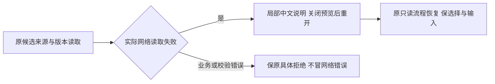

# T1305：恢复候选来源网络失败后的中文说明与原位重读

用户已授权恢复Codex功能和完整候选操作验收。Root依据独立R对UI_RULES及oil-ui-pro交互状态要求的判断，批准独立最小来源读取错误说明与原位恢复任务。不是新增审美标准或全局错误改写；T1304键盘归属独立审核/实现。Root判断复核，GPT-6.1 Sol高思考执行，不主动启用加速，无开关读回不称已核验。

## 真实问题与适用要求

T1303 production候选源码`8ced635520132688c6ef91449ad530d36d9ff1af`，A真实历史editor候选只读来源请求暂持后abort连接，modal可见alert只有英文“Failed to fetch”；关闭重开使用真实source请求恢复，0模型/0成稿保存，前后DTO不变。原source-failure-result、editor-source-loading/error/recovered图/DOM、UI_ACCEPTANCE.md和408文件SHA清单保留。loading/error/恢复的实际可见PASS不代表说明满足可理解与恢复发现性；该缺口由Root/R认定属于本次预览验收必须修正。

依据项目UI_RULES及oil-ui-pro `references/interaction-and-state.md`“加载或提交失败：在相应范围解释原因和恢复动作”，亦为T1303已采用状态要求。原English error来自useAssistedWorkReview直接把reject Error.message存入review.error，AssistedWorkSelection原样显示；work.creation成员也共用此hook与展示，应在同一读取失败边界验证。不能通过删alert或关闭预览来躲失败。

## 最小方案与不变边界

生产W仅`frontend/src/features/copilot/chat-work-editor-card.tsx`与`frontend/src/features/copilot/chat-work-creation-card.tsx`。共享useAssistedWorkReview仅处理**候选来源读取await**可确认的网络失败与其局部类型状态；机械失败类型须由该窄await产生并随共享promise的rejection/result传至所有subscriber，同次失败的两个读者都准确收到，不能只在首loader闭包setState而遗漏后续reader；类型/标记只在本文件内存，不进wire/storage，不新增外部接口。此次真实故障点为readWorkCandidateSource，不将指定base/exact版本网络、确认段校验或save失败泛化归为source网络。向用户给出准确局部说明及已真实可用的恢复动作，例如“候选来源暂时读取失败，请关闭预览后重新打开。”不新增按钮、自动重试、轮询或读取端点。editor沿原preview在来源error时review.retry；creation当前fresh读取失败后单纯关闭重开不会再读，允许仅在原Dialog用户明确从关闭转为重新打开、且当前局部错误确认为source load网络失败时调用既有review.retry。仍使用原scope/source端点，失败缓存按原规则清理，同卡不重复在途；creation新增资格必须绑定同一scope/source/candidate/output/base身份，确曾在打开的预览中显示该source网络错误，且用户随后明确关闭；消费资格只允许下一次用户重新打开触发一次原retry。首次打开、loading中先关闭后才晚到error、错误未实际打开可见、身份切换/卸载均不授资格；资格消费后即使尚在途又开关也不叠请求。成功后开关、身份/损坏/HTTP业务错误以及保存UNKNOWN均不能因此获得creation新增重试资格。editor保持原preview的error→retry行为，不借此修改原业务错误恢复语义。重开这一已有预览动作恢复可用性，不新增API或入口。

按实际来源读取阶段和异常结构判断，不匹配英文Failed/fetch关键词，不按文案/业务名猜语义。源码显示原fetch网络拒绝可原样抛TypeError；旧浏览器并未采constructor，前RED须以真实useCreationClient→createCreationWorkspace冻结transport→contract client→hook链验证底层fetchCreatorApi拒绝的异常保真，不能追认旧现场类型。HTTP业务拒绝由真实workspace冻结transport的既有HttpTransportError携status/code/details，AbortError及CreationScopeChangedError保原说明。仅在readWorkCandidateSource await的窄边界标识可确认的网络失败；原来源身份/候选全文不符、版本不符、记录损坏、字段/摘要校验与有status/code的业务错误仍保原具体原因。其它未知异常没有足够类型依据时保原说明，不把所有Error/TypeError全局翻译。实现必须核实际客户端消费者；若无法在此文件内安全区分，先报告准确缺口而不扩大transport/契约写集。

原请求/候选/版本/source/全文校验、权限与CAS不变；pending/confirmed及locked原语义、body/key/storage不变；没有成功回执不声称已保存、稿件未变或后台任务结束。中文提示只解释来源读失败和关闭重开，不把它写成模型失败或引导重新发模型。关闭重开保字段/事实选择与未发送输入；不会因显示文案清storage、改key或重置选择。

## 精确测试、先RED后产品

测试W为现存`frontend/src/features/copilot/chat-work-editor-card.test.tsx`、`frontend/src/features/copilot/chat-work-creation-card.test.tsx`及`frontend/src/features/copilot/work-candidate-adoption.ui.integration.test.tsx`（新增来源错误/关闭重开组合，不改原body/key/隔离断言）。creation仅对其原Dialog onOpenChange增加上述用户显式重开source失败重读接线，shared hook提供机械失败类型/状态；不移动hook或改变fresh默认。现存两卡test可在外fetch边界reject验证类型；关键组合必须经真实useCreationClient/createCreationWorkspace冻结scope/epoch/signal及contract client，不能旁路createHttpTransport，也不能mock workspace或scope。不新增测试文件；原组合挂真实workspace/Provider/owner/两卡/Radix，只有HTTP/native外部句柄边界替身，用真实workspace冻结transport的fetchCreatorApi拒绝核类型保真和原位恢复。只读参考原完整Provider/owner/card组合及原两卡恢复、网络transport、creation scope；不改Provider/owner、backend/worker/contract、全局transport/错误协议或共享Dialog。

产品编辑前，冻结两生产SHA、新测试字节/命令，并在原生产上实际运行两组**相互独立**目标RED（至少5例），不能中文第一条断言挡住恢复路径：

- 中文说明三族：editor article、creation article、creation graphic，各经真实来源请求fetch TypeError（任意不同英文消息）→打开预览，独立期望中文局部原因和关闭重开动作提示；原实现应未满足。保存底层到hook异常constructor/name保真事实，但不追签旧浏览器构造器。
- creation原位恢复两族：article/graphic各先让source真实失败、打开看见原错误→明确关闭→再打开→期望同身份原source恰有第二次读且ready恢复。此组不先assert新中文，可用真实role=alert/原错误存在继续动作，因此基线能实际走到“无第二读/仍error”的恢复失败，不能把中文缺失当恢复RED。

只能在外HTTP/fetch与native执行边界替身；不mock useAssistedWorkReview/错误展示/Provider/workspace，不直接给review.error塞目标文案。保原exit/DOM/失败断言；夹具、模块或类型错误单列。保存响应丢失另阶段，不被本任务翻译/重开retry改变；修后同组GREEN。

GREEN覆盖：editor lazy、creation fresh共享成员；source读取await与后续receipt/机械访问TypeError、指定base/exact错误的边界分别验证；先loading再error、两类卡用户关闭重开同scope/source真实读回、一次在途；已有选择/事实/输入保留，0成稿save/0模型/无额外自动重试；HTTP结构化业务错误及来源身份/文档不符仍具体显示，损坏本地请求原pending/锁定/恢复不洗；scope切换/卸载后无迟到回写；两卡相互隔离/有界缓存；双subscriber同次source失败均获局部类型和正确提示；source await之后机械访问TypeError不翻译。creation错误实际见到才可关闭后重开、首次open/关闭loading后晚到error/身份切换/卸载/消费资格后在途开关均不额外读，资格不跨对象复活。原body/key/confirmed/默认选择及原facts算法断言不弱化。

证据W为`docs/verification/t1305/runtime/**`、`IMPLEMENTATION_RESULT.md`；测试test/hook180000ms、retry0、workers1，执行/有限观察最短120000ms、外层覆盖串行/启动清理。运行受影响两卡与允许写入的原组合测试（其原业务断言保留）、frontend类型、boundary/semantic/timeout与LED-047适用路径。相同冻结字节的既有Gate按证明范围复用，不冒新runner已过门，不无理由全量suite或重复索引。

## 审核、DAG与真实候选验收

独立initial方案审核→真实claim/packet→目标RED先发生→两card最小修改→受控GREEN/独立实施复核。实施严格先T1304后T1305，T1305 implementation依赖已done T1303 implementation及T1304 implementation，acceptance只依自己的implementation；T1304实现已在8ab1b2bcd2158f351e2f27d9533a190dac3f2841冻结并经独立有限PASS，中间implementation实际done、acceptance仍pending；现在基于该真实新HEAD和wrapper/combo字节首次锁本任务initial独审，不能使用未来SHA或改写旧锁。T1304只改wrapper及其测试/原组合，T1305两card与T1304产品W无交叉，但组合test有交叉，须严格重新锁定；T1305派发绑定已冻结T1304实际新HEAD和本任务允许继续写入的原combo真实字节，原T1304初审/RED/实现报告不改；不能拿本任务修后combo回填T1304历史。若出现未审生产接口/语义变化先报独评，不把旧SHA冒新实施closure。T1303后续公共验收只需两修复implementation冻结即可用同一新不可变包/新owned run，分别在合法acceptance窗口引用原证据，不要求彼此acceptance先完成造成循环。T1304与本任务分别评审，不改变T1300round3/T1301原SPEC/审核/历史缺证。

两修复集中冻结后一次固定SKIP_INSTALL本地包，fresh DB/media，沿DEC-130003真实build_smoke签名/握手/归属；不碰正式App/用户库/Keychain，不重开旧根或重发旧UNKNOWN。新production公共候选实际暂持只读source请求显示loading→abort连接→可见中文原因与关闭重开提示→原关闭重开真实source读回；保选择/输入、原body/key及完整业务before/after，0额外模型/保存。editor与共用creation的适用族分列，不能以一个静态mock文案代全部。需要候选的最少模型与T1303/T1304原合法旅程共享，不能为证据重复付费。独立oil只评价实图和对应真实操作，原English失败永保。

真实适用Gate、pmem/reconcile、Root复核后再按taskctl完成；当前只是待审SPEC，不签任何修复/验收PASS。T1303当前业务局部PASS、真200%PASS、窄屏EscapeFAIL均保留；T1301历史组合前RED accepted-risk尚无用户真实回复，父矩阵不claim。现用原生壳/真实激活和父完整矩阵不由本任务签收。
