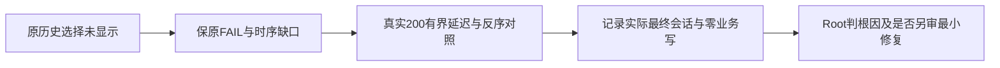

# T-1306 核对首次恢复期间历史会话选择未生效

用户已授权恢复Codex各功能并分模块真实验证，Root据T1305现场失败决定独立登记只读诊断；本任务目前📋待审，尚不授权产品实现，不改变T1300审核轮次、父矩阵依赖或T1301历史缺证裁决。执行继续GPT-6.1 Sol high；无service tier开关读回，不声称已核验加速状态。

## 真实问题与证据限度

T1305首轮creation文章case在用户选择joint1历史后，目标region观察120秒不存在，实际仍editor会话；来源匹配请求0。原轮自然exit1、1FAIL2PASS。article定向等待初始editor真实200/region后再选历史则抵达来源目标并通过，不能据此称竞争已修或原FAIL为夹具错误。

证据为`docs/verification/t1305/acceptance/runs/final-t1304-t1305/a/history-selection-observation.json`及同目录原result.json、playwright.log、creation-article-failure相关DOM/截图。原件只记录两messages.list发起顺序，没有完成顺序。代码线索在`frontend/src/features/copilot/ai-copilot-content.tsx:2008`的loadConversation引用守卫，以及2055附近默认hydrate、2139附近pickHistory共同调用：两个读取捕获同messages引用时，先完成的读取可能使后完成的显式选择返回而不更新。该推论未被原现场时序证明，不锁定为迟到默认覆盖或具体根因。

## 允许的诊断与边界

后续经Root分配合法packet/独占浏览器窗口，可在同一不可变候选和已owned两真实历史A/B上，UI选A后自然刷新；暂持服务器真实200的A/B消息读取，在B确已请求后先放A并核可见A，再放B，记录最终实际会话。另做先放B/后放A和初始hydrate完成后明确选B两个对照。只延迟真实响应，不伪响应正文、ID、来源、storage或保存回执；不得复制业务storage。准确保存发起/真实响应/释放时刻、状态码、会话ID和最终可见region，区分默认恢复与明确用户意图。

0新模型、0成稿save，保双方完整DTO、脚本metadata与全分页versions；不读取用户库、改产品、增加新请求协议、改超时或自动重发原任务。单次请求/结果观察至少120秒，保原更长预算，外层涵盖串行与清理。初始仅SPEC和BACKLOG登记，不新增执行module/claim，不运行此反例。

## 完成判据与写集

诊断报告逐项给原时序与可见结果，明确可复现、不可复现和仍缺证，Root据实判断；不预承诺修复、不签历史选择全族可靠。实现如获授权，须独立精确范围、真实行为RED先于产品编辑和适用独审，不能把等待hydrate完成当修复。本轮C仅登记本SPEC/BACKLOG；未来诊断证据路径`docs/verification/t1306/**`须在实际派发前明确合法写集和只读消费者。T1305三来源目标与T1303采纳恢复有限PASS原证据不被此诊断销改，29既有全局失败身份继续保留。

## 本次只读诊断执行授权（Root后续明确）

Root现授权B三对照公共UI诊断，不授权产品实现。该任务仅诊断/记录，不改设计/服务契约/UI源码，审核与前端实现回执按只读任务真实不适用设为—，不是已有产品修复PASS。新增diagnosis module/lease只写本任务public与run证据；0模型/save，原A/B历史来源只读。同一个不可变cfbaf包的既有owned65112，不重包/重启/复制storage。第一组A先放B后，反序B先放A后，及初始hydrate完成后选B三个对照均需原真实200状态和实际会话可见性；无法复现也如实报告，不先保证三组都出现问题。先按公共UI选A并自然刷新形成默认A，不改业务storage，不伪message或body。记录前后双方完整DTO及脚本metadata/allversions。

本次证据将由Root/独立R按诊断范围审查，产品修复如确认仍需后续精确SPEC独审；不以诊断done签功能已修或解除T1302正文阻断。原草案“尚不执行”描述的是登记时点，当前此追加为明确后续有限执行授权，历史原观察不改。
