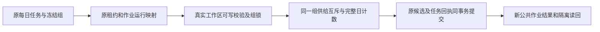

# T1309：恢复纯账号组每日选题的完成事务与供给锁

用户在T1300已授权恢复Codex各功能并分模块实测。父验收U05出现新的真实失败，Root于本轮明确授权独立最小修复；先SPEC独审、真实完整组合RED，尚未编辑产品。Root负责方向与复核，执行仍由GPT-6.1 Sol高思考代理承担，不主动开启加速；无开关读回不称已核验。维护期BUILD，沿原workspace/每日选题合同，不重置T1300三轮审核或借T1301历史accepted-risk覆盖本任务。

## 真实问题与证据边界

当前不可变候选源码`dc46cfa700ec9c9cbada47fb76237d0b50d10a67`，服务`65353`及owned根`/private/tmp/t1300-candidate-MhP4pW`。公共每日作业`job-bcda7005-1246`、run`run-bcda7005-1250`、AI任务`ai-task-bcda7005-1249`精确对应`exec_6923b675-96a2-4810-845c-12015a8cee3b`，真实组`grp-bcda7005-750`、accountId=null。原execution于05:22:02.628Z创建、约106秒后05:23:45.095Z failed，attempt2，最后码`MODEL_RESERVATION_REJECTED`；不是凭该泛码认定模型额度不足。作业已原公共入口停用，旧任务不重发、不恢复/续期。原jobRun仍running且finishedAt=null；本候选显式禁BACKGROUND_DRIVERS，因此失败态协调未完成是当前环境限制，不先另认调度缺陷或偷偷开启后台。

原件位于`docs/verification/t1300/acceptance/runs/final-dc46cfa/a-functional/`：`U05-original-terminal-readback.json`、`U05-daily-job.json`、`U05-daily-initial-runs.json`、`U05-daily-job-disabled.json`、`actions/U05-daily-topic/{submission,original-task,results,steps,action-result}.json`、`invocations/05-daily-single-run/`。原sidecar日志为1307 candidate当前run管理，活动日志只取安全前缀/行锚，不作为已冻结全文。现场未取得首个具体内部异常，不能认定原请求最先抛validateRun还是lockAccount；新增受控RED尚未发生。

源码确定的合法纯组失败路径：`daily-topic-completion.service.ts`模型完成及quota/未配置skip两族均调用真实`validateRun`、`lockAccount`。生产组合根`persistence-client.ts:6434`无条件调用`lockAccountForSupply`，其原合同要求真实accountId并在null时抛OwnershipError；随后调用`lockCandidateSupply`又仅传user/account、丢groupId。后者仅workspaceKey advisory lock，不等价真实可写归属校验。既有测试注入替身端口，不能证明该生产组合可用。

## 最小方案及安全边界

生产写集仅两现存文件：

- `backend/src/modules/ai/daily-topic-completion.service.ts`：使用下述局部外层同事务顺序落实真实user/group与active可写校验、原工作区锁及必要重验，不在settlement action中反向新取group锁，不用只有advisory锁冒权限。原`workspaceKey`以group优先；纯组、组加平台筛选均按同一创作组锁与额度，不把平台账号筛选当组供给互斥键。沿已有accountGroups/工作区锁原顺序，保持跨组/归档/迁移边界；不新增通用权限接口。
- `frontend/src/server/persistence-client.ts`：仅dailyTopicPorts.lockAccount既有内部组合接线，group路径不用通用平台账号锁作为必备前置，原legacy账号路径保真实平台账号锁；`lockCandidateSupply`传完整原user/group/account scope。业务校验归backend，前端文件只保既有组合根薄接线。不改通用`lockAccountForSupply`或`lockCandidateSupply`的定义/权限语义。

锁序必须可执行且局部：原`withLease(ref, settlement)`会先锁execution；不能在其action内再新增group锁，与admission的account→member→group→execution构成反向等待。daily完成服务先在局部外层`db.transaction`只读snapshot并分流：

1. 活动提交分支以该outer tx调用既有`assertExecutionTaskWorkspaceAdmission`，取得原account/member/group锁并核真实冻结版本；随后以**传入同一transaction**创建lease service并进入settlement，禁止用原root db开另一个连接。进入action后对比snapshot与实际task完整冻结user/group/account/groupVersion/membershipVersion/kind/owner及原attempt/fence，原业务/冻结run/call仍严格核；任何漂移拒绝，不追锁另一个workspace。顺序始终workspace→execution→原业务行/供给advisory，原skip与模型完成相同。
2. 初始已完成候选走单独的严格只读回执重放分支：仍通过原lease/fence及原result/task/call完整一致性检查，只能返回已有receipt，不能因当前组归档等剥夺合法历史读回。若重读不再满足已完成事实，拒绝而不是转活动提交；不获取新的workspace写权、不重建候选。
3. 不改通用lease、workspace membership或账号锁API。既有外层tx再传内部service的同事务/nested savepoint模式必须由当前PGlite/PG实际消费者验证，覆盖rollback与提交不自等待（T1276边界）；不能只写类型cast便宣称成立。记录真实使用的引擎/连接范围，PGlite结果不冒真实多连接PostgreSQL死锁压测。若实际不支持此同事务路径，停止并报精确独审delta，不回退原root-db另一连接、不临场新增通用锁hook。

不是简单`if(accountId)`跳过：组必须真实归属且未归档，事务内共享锁与原组级供给互斥保护必须实际成立。旧无group账号仍保原合法兼容，迁入新组的旧客户端不得借legacy读写；group+account不分割组额度。同一group带两账号只增加原已有membership校验，不将账号过滤变成组数据写权限或额度分片。完整候选计数按UTC日和workspace保原，不能仅数第一页；原偏好/排序/探索/模型内容不改，不增加确定性语义判断。

原lease/attempt/fence、deadline、未知call拒绝、最后settled provider回执、run/job/AI/execution冻结映射、取消、原幂等回执与回滚原子性全部保留。重复已完成回执不重建删除候选；并发纯组/同组不同账号不能超quota；一旦candidate/run/receipt写失败，事务全部回滚。禁止改模型保留/额度策略、worker通用错误/重试、continuous/maxAttempts、调度/background开关、contract/DTO/schema/API、普通平台账号锁、来源或旧任务状态。

## 测试写集与先后门

测试W仅下列准确路径，产品编辑前先实际记录生产组合RED：

1. `backend/src/modules/ai/daily-topic-completion.service.test.ts`（现存）
2. `backend/src/integration/daily-topic-completion.test.ts`（现存）
3. `frontend/src/server/__module_integration__/daily-topic-supply.persistence-client.test.ts`（允许新增，当前不存在）

新增组合必须走真实`compositeTransport`/生产组合根捕获的实际dailyTopicPorts、原每日作业/运行/AI task绑定、PGlite、真实租约/模型账本/完成service，不能用新的lockAccount/validateRun/finishRun替身掩盖接线。可用受控模型/provider结果，不调用付费模型；应明确真实worker/HTTP是否包含及替身边界，不冒真公共E2E。使用原现存组合测试的owned DB/media、停止后台与finally dispose方式；不碰当前活服务库或用户库。

在改任一生产字节前，独立目标RED至少击中合法纯组的模型完成和原quota/未配置skip生产端口组合；首错必须保原具体异常、原端口及受测源/完整测试快照，不用静态推断冒RED。旧兼容/负例按实际结果记基线或RED，不为凑数造红。之后同原组合绿，逐族覆盖：纯组/同组带两个账号共quota、legacy真实账号、跨user/group、归档/迁移、UTC跨日冻结、并发quota、complete幂等/回滚、cancel/fence/unknown与篡改run/task/call拒绝；活动提交与认领/组归档的锁顺序及竞争、snapshot换组拒绝、已完成后归档只读replay、终态分支不能升级新写、同一tx/savepoint实际支持与整体rollback。原后台失败协调只说明环境，不顺带修新根因。

只读回归既有`backend/src/integration/daily-candidate-supply.test.ts`、`backend/src/modules/scheduling/daily-topic-run.service.test.ts`；`daily-topic-automation.test.ts`原文件仅作只读参考，本任务不运行原旧suite，其全部业务断言必须由下述runtime等价回归覆盖；`daily-topic-worker.fork.test.ts`仅作为已存在legacy完整链参考，其beforeAll会build到本任务W外dist，不能原样运行。需要真实fork的新增生产组合测试绑定下述现有不可变worker，不省略主族覆盖；受影响frontend/backend类型、boundary/semantic/timeout及必要LED-047范围按实际消费者。正执行最短120s，test/hook至少180s、retry0、单worker，外层覆盖完整串行/启动/清理，保更长原预算。

## 新包公共验收与交付

受控实现与独评后，与其它已审修复一次集中新immutable包，沿SKIP_INSTALL/DEC-130003专用production sidecar driver与全新owned数据，现用App/用户业务库/Keychain不动，不安装/发布/推送。新纯组经原public创建topic.daily job→runNow→原AI/execution/call→完成候选池及run.finishedAt，完整候选、实际模型身份/原attempt/回执与组级隔离读回；无模型skip用合法公开配置/额度前置分别验证，不能通过伪旧ID/改库造成功。旧1246/1250/1249/6923失败全保，不重发。最终停止本轮新作业以免未来运行。

本任务acceptance只依本任务implementation，不反向依赖父验收。T1300 U05可引用此新候选原证据但原FAIL保持；父40功能/56键其它未完不代签，当前A已完成原件先冻结、父acceptance仍pending，不在本SPEC篡改父矩阵或旧审核。实际taskctl状态只按受支持命令；Gate/pmem/reconcile及全局既有欠账如实记录，Root复核后才最终taskcomplete。

冻结输入见`docs/verification/t1309/INPUT_LOCK.json`，精确模块见`docs/verification/t1309/MODULE_SCOPE.json`；此处列允许新增测试/脚手架，不虚构其已存在或已执行。

## 受控worker与派生输出锁定

若harness需要fork，优先只读绑定`docs/verification/t1309/WORKER_BINDING.json`已实核的dc46候选worker：`/private/tmp/t1300-artifact-bcz9nlt5/sidecar/frontend/runtime/execution-worker.cjs`，SHA`3851b4fb132035f1b03528d68b0fa1c5ab86bda8134d8b98795252295c5a6454`（5618216字节），执行前再核相等。不复制旧测试beforeAll build到ai-worker/dist，不编辑候选runtime/contract/vendor，不复用当前业务DB/session或真实模型认证。所有新日志/临时配置在本任务runtime或明确新owned临时目录；若必须产生额外派生文件，先报告准确路径和授权范围，不擅自执行。只绑定原worker产物不代实际受控协议链成功；具体替身和是否真实fork须报告。

## Round2：仅处理 REV-001 的旧自动化回归入口与预算

首轮原工具结论为CONCERNS[REV:d7ae5c446d0f]、REV-001 open；初审报告/原SPEC/原锁/原未执行事实保留，不新initial或重置轮次。此增量只澄清已授权runtime回归，不改变两生产/三原允许测试及业务修复边界。

`backend/src/integration/daily-topic-automation.test.ts`真实SHA为`4dc147ea912c0cdd654686b38f38bdcac17e79e053e27a22f6f25df87f497edd`，两it/原driver与父子完成、三来源预算全断言作为不可变输入。不能原样运行它：第一it执行build写ai-worker/dist，两个dispatcher指该dist，两it有局部30000ms。原文件不修改、不执行，不把其原suite写PASS，也不删除它要求的回归。

在已授权`docs/verification/t1309/runtime/**`内生成等价受控文件`automation-equivalent.test.ts`及单独`automation-equivalent.vitest.config.ts`、机械生成/校验脚本。只能做以下机械变换，并保存完整before/after/逐项diff与校验结果：

- 只移除原第一it中唯一`execFileSync(process.execPath,[resolve('../ai-worker/scripts/build.mjs')],{stdio:'pipe'})`构建语句，原import可保留为未使用；不拦截全局exec/不吞其它命令。
- 两处worker entryPath只改为WORKER_BINDING锁定且运行前重新SHA核验的现有不可变worker；不借当前dist、重建或写candidate。
- 两it局部30000ms均机械改900000ms，hook至少180000ms；原任务budget.deadlineMs120000/maxCalls/maxTokens等全部保持。每个请求/正执行/观察至少120000ms，保原更长值，外层至少3600秒覆盖两it串行及启动/清理；retry0/单worker。
- 仅为文件移动，将原相对import（包括动态import）机械解析为同一个backend源文件；裸包解析通过显式Vitest配置使用原backend依赖。不得改变任何业务构造、回执、断言、expected值或执行顺序。配置只选择该等价文件，不自动扫描/运行原旧suite。
- 允许前置只读worker hash/binding断言与owned临时DB/环境安全约束；每处额外非业务断言单列，不借之更改原两it。用完整文本反向归一/或等价机械映射核验：除上述允许差异外必须逐字相等，原expect表达式/数量/参数与两个it名称/业务语句都不变；不是只比通过数量。映射不成立即停止，不能跑其它断言凑绿。

报告必须分别列“旧suite未运行”和“runtime等价回归实际结果”，包括原driver创建窗口恢复→父blocked→原worker零模型skip→下tick父成功、三来源真实本地HTTP抽取3次/最终1次、原maxCalls13/调用账本8、后加来源不改冻结预算的全断言。HTTP只本轮owned loopback替身、0真实模型。不能拿新helper或subset代签。该机械副本属于测试执行脚手架，仍不编辑旧原测试/产品/通用guard、不扩大权限或修改生产预算。

本轮当前完整闭包使用`docs/verification/t1309/INPUT_LOCK_ROUND2.json`；旧`INPUT_LOCK.json`、ROUND1_SPEC/MODULE_SCOPE及首轮工具回执保持原字节，不能当改后闭包。
