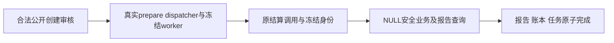

# T1311：恢复纯账号组脚本审核与作品审核的完成查询

## 事实、授权与范围

用户已授权恢复 Codex 全功能，Root 已明确授权两个现役审核完成服务独立窄修。当前静态事实：合法纯组 execution context.accountId=null，而两个完成服务使用 eq(accountId, context.accountId!)，Drizzle 等号绑定不等同 IS NULL。当前尚无本任务实际 RED；不得将旧 root 的缺记录/calls空归因为本问题。先独立初审，再真实完整组合 RED，最后实现与新包公共验证。

## 精确合同

1. 仅修 script.review、work.review 完成时对 business/report 的 userId/groupId/accountId 原冻结身份逐一空值安全匹配：null用IS NULL，非null精确等号；不可删除account条件、仅用会扩大范围的workspaceFilter，或允许同组错账号。task/context、business与work report原映射同时核验。work model.skillSnapshot.groupId 为 optional nullable，以缺省归一null与原task组比较；无契约字段新增。
2. work report由workspaceStamp写入，groupVersion/membershipVersion可能为null，不强制其等于execution冻结版本；不新增current group.version硬门，不改变来源、模型原回执、完整text/structured/partial、最后根call、operationKey、任务归属、fence/lease/deadline/取消和原子写入。
3. 保原settlement政策。归档事务只更新组status/version，未取消已有execution或换fence；原lease settlement不新增workspace admission。已发生合法同键settlement沿原ref可完成/严格replay，新动作/新claim仍经原归档准入拒绝；不能新增execution→group锁、通用权限或全新锁序。不新增aiTaskResults，不改变原报告读取语义。
4. 不改其他account查询、contract/schema/worker/dispatcher/模型/恢复权/continuous/超时，不批量改scope。

## 精确写集与只读消费者

生产仅：

- backend/src/modules/review/execution-review-report.service.ts
- backend/src/modules/review/execution-work-review.service.ts

测试仅：现存 backend/src/modules/review/execution-review-report.service.test.ts；允许新增 backend/src/modules/review/execution-work-review.service.test.ts、frontend/src/server/__module_integration__/group-review-completion.persistence-client.test.ts。自有runtime/结果/acceptance证据按MODULE_SCOPE。

只读原生产composition、review adapter/root、workspace/lease/归档/原worker/合同，路径与SHA见 INPUT_LOCK。frontend/src/server/chat-task-submission.integration.test.ts 仅参考：其build写ai-worker/dist及60000ms局部deadline不可原样执行，不冒旧suite本轮PASS。无需机械复制12case。

## 修改前后验证

修改产品前，两独立完整组合用例必须先实际失败：从公开 compositeTransport 创建合法纯组 script.review/work.review，真实 prepare/authority/dispatcher/immutable worker/SDK/host，真实ledger settled→commit捕获完成查询错误。外部API/Codex协议可用明确owned受控替身，禁止mock完成服务/dispatcher关键deps、直接种settled记录冒完整链；保实际被消费的模型schema及业务source，完整受测测试与产品SHA/原bundle/input先快照，exit/log/调用与报告原件当场保存。夹具失败与有效RED分开，测试函数不因第一族失败而跳过第二族。

修后同组合通过并读报告/AI/execution/call原回执；补legacy账号、组+账号、错user/group/account、错业务/报告映射、错call/text/partial、同key重复/错误receipt、取消/过期/fence、rollback、归档后已有settlement及严格终态replay、新动作拒绝。原测试已通过基线不得造RED，两个源查询互不代签。原worker绑定为WORKER_BINDING，不build dist，不访问current candidate或用户库，不真实模型。每正请求/观察>=120s且保更长原值，test/hook>=180000ms、single worker、retry0，外层86400s覆盖启动/串行/清理；原timeout-policy Gate必需五包Vitest可再生缓存按实际记录，不授权依赖源码。

后续含本修复的单一新不可变包、fresh-owned公开两族真实模型审核与保存读回另验；现有失败不重发UNKNOWN，不对外发布，不用mock组合签真模型。before/after原稿和另一平台/所有script versions隔离，正文/报告与实际source核，不追签当前缺证。最终pmem/reconcile/taskctl收尾须真实证据；仅实施done不等整任务完成。
