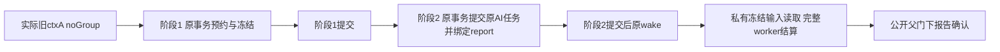

# T1313：恢复旧账号作品审核预约与冻结工作区一致性

## 已有失败与授权

用户已授权恢复全部功能；Root核定本任务最小三源方案。T1311公共六入口中legacy/work真实prepare失败（5PASS/1FAIL）：真实accounts.create后，无group旧入口ctxA预约report groupnull/accountA，AI经真实membership冻结legacyG/accountA，prepare以冻结group找不到原report。原件LEGACY_WORK_PREPARATION_FAILURE.json；原business/report queued、execution未绑定、0execution/ledger call/provider请求，错误在两完成服务之前。不放松T1311精确完成查询，不把本失败说成模型问题。

旧project/composition父行未当场保存。入口公开创建与源码可推导，但DB0128项目BEFORE INSERT trigger可把null组补真实G，work_compositions无同insert trigger；因此不称旧project实际null，也不将旧G查询失败当现场已证。新RED须直接保存两父实际行及report/task/request/冻结scope，按真正当前DB行为判断。已审T1311原失败与控制block保留，不补拍历史。

## 两个阶段与真实身份

保留原stage1 reserve与stage2 submit两个独立事务，wake仍事务后；禁止合并/暗示跨stage原子。仅合法noGroup且真实accountA分支，两stage最外先沿真实ctxA account→member→实际G原锁，再原workspace/父/报告锁。普通group及筛选B保持原G锁/报告与AI accountnull，不新增B成员/active硬门。

stage1：真实legacy冻结owner只为新report补实际group/account盖章，不新增report版本=current execution或current groupVersion硬门；原request身份/摘要/key沿原legacy ctxA，不因新增reportG改变requestKey或snapshot.scope。原receipt.reportId重入只读复用，绝不restamp旧report。公开组合父门与freezeReview所有校验保留，阶段1自己原子提交/回滚。

stage2：再次用实际此次ctxA(noGroup)锁/验原request/digest/attempt/report/snapshot与fresh freeze user/group/account一致，然后原withWorkspaceWrite(ctxA)及原父锁→report。rename版本推进不拒，转组/归档按原legacy guard拒；不能从pending.groupG构造提交ctx。submitTask必须传实际ctxA(noGroup)，使原AI createTask原fingerprint/父准入保持。普通group仍按原G/null提交，不从页面账号增加权限。两个事务都只用各自传入tx，不root连接自等待。

stage2幂等要区分：已明确report.taskId映射的重复，只能核原task/report/完整请求与原receipt映射后复用，不额外创建task/attempt/模型；尚未绑定report的同attempt查找不得直接绕过AI createTask原输入fingerprint校验，调用既有createTask幂等分支后再核task映射/私有owner。stage1已提交而stage2失败、stage2已提交但响应/wake边界中断等原key恢复都须测试：沿同body/key/attempt/task恢复原动作，无第二业务task、第二执行/模型或错误scope重绑；已完成重复不再wake新工作。是否需要继续原未唤醒任务以实际原wake幂等合同验证，不能把端口调用数等同执行次数。

旧混合pending（reportnull/AI legacyG）不暗stamp、不自动wake、不新attempt或重发；原公开可读/可取消路径保原，显式原key仍明确拒绝不一致，不用原receipt存在即猜已修。

## 私有冻结reader与公开父门

新增窄server-only owner端口复用现AiService.getTaskExecutionRuntime真实row owner（user/group/account及原版本字段），不增HTTP/DTO。AITaskResource本来没有accountId，不能补假required字段。adapter与root AiService Pick只加该已存在方法，persistence workAiFor已为全AiService，不改persistence/AI生产。

readFrozenTask在同一tx读取原readTask DTO+原真实owner；按exact user/group/account空值安全查report，并完整核taskType/attempt/taskId/project/input reportId/fingerprint、report映射、snapshot.scope.compositionId=report.compositionId、scopeKey=canonical(scope)、frozenContext.projectId=report.projectId及freezeReview重算snapshot/modelContext一致。snapshot没有projectId，单重算不等于项目已核。不能通过重读当前父重冻历史来源、用通用workspaceFilter扩大组内账号范围，或以当前group版本推进拒绝合法原候选。

仅私有准备reader沿持久冻结输入，不新增公开读权。公开get/list/status/request/confirm保原composition/project父准入与当前触点确认规则；project公开delete会同tx清report/composition/task，缺真实owner/task/report自然拒。不造不存在的composition-delete公开入口，不放宽跨组或已删父的用户访问。

## 精确W与只读输入

生产仅backend/src/modules/review/work-reviews.service.ts、backend/src/modules/review/work-review-task-adapter.ts、backend/src/application/generation/work-review-root.ts。

测试仅现存backend/src/modules/review/work-reviews.service.test.ts、backend/src/application/generation/work-review-root.test.ts，以及允许新增frontend/src/server/__module_integration__/legacy-work-review-preparation.persistence-client.test.ts。原测试aiFor是真实全AiService，只有root.ts显式Pick需扩；不制造额外假DTO/type测试。own runtime/IMPLEMENTATION_RESULT与后续acceptance路径按MODULE_SCOPE，不改contract/schema/AI/persistence/generic workspace/worker/迁组。

只读输入包括已修T1311完成服务、原composition/source/current reader、AI原fingerprint/idempotency/owner port、membership/workspace/DB0128、最终T1312 persistence与绑定immutable worker。旧worker suites有build/dist/短预算，只能参考，不原样运行或写本轮PASS；新专用测试独立config/include/cacheDir、原immutable worker hash/bytes逐次核，外部协议owned替身，无真实模型/当前候选HTTP/旧UNKNOWN/用户库。

## 实际前RED到实现验收

产品首字节修改前，新完整legacy公共create（真实账号/noGroup项目与composition）→两stage→prepare/真实dispatcher/immutable worker/SDK/host/ledger，预期完整审核成功，但基线在report/task冻结分歧前置真实失败。先保存完整源/测试/config/worker、两父实际行/request/report/task/冻结scope及原exit/首异常，不用mock prepare/完成或事后种settled代签。原T1311已成事实只作历史，不冒本任务前RED。若RED精确命中已审范围且源/完整测试事前冻结，可按packet自主最小实现→GREEN，不逐步再等Root；出现新范围/语义/意外根因停报，禁止扩大W。

修后六公开入口：纯组、group+account、legacy的script/work各自真实prepare→worker→settled→commit→原报告读回，work包含最终公开confirm/current status，script依原独立报告语义；不得把5/1改写成旧全绿。另测阶段间故障、原key/原attempt恢复、已映射重复/错误body fingerprint、错user/group/account/owner/task/report/attempt/snapshot/frozenContext、rename/归档/转组/取消/lease/fence/deadline、公开parent删除/拒绝、同tx trigger rollback/无孤儿报告任务、私有冻结读不重读当前父。普通group/filterB无新增B锁，legacy A两stage原锁序与实际ctx提交要捕获真实SQL/端口数据；PGlite不冒PG多连接死锁压测。

测试/请求保原长值，正执行/观察至少120000ms；新专用test 3600000/hook180000ms、retry0/singleworker、outer86400s覆盖启动串行与清理，原持久task期限不缩不续。固定timeout-policy原命令五包Vitest可再生缓存按真实footprint记录，不改守卫或依赖源码；独立scope内runtime缓存其余自有。后续最终不可变包fresh-owned真实模型公开review与父矩阵另验，原成功/FAIL/缺证均保留。

独立方案PASS、真实lease/packet后才执行；当前尚未开始本任务RED/实现。T1311阻断依赖在本任务真实受控/公共条件满足后再合法处理，T1311/T1313整任务及父全功能不提前complete；最终pmem/reconcile/taskctl保全局旧债与实际环境缺测。
