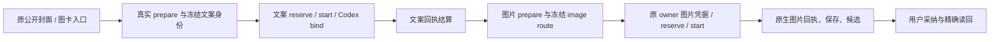

# T-1322：恢复封面与图卡文案阶段的冻结 Codex 身份读取

## 阶段、授权与目标

当前为待独立评审的最小修复 SPEC，规模 S、Not split；不是产品实施 START。Root 已明确授权本草案和两族完整链方向，并确认第二处图卡凭据门应在同任务闭合。当前作者只能写本文与 `docs/verification/t1322/ANALYSIS.md`；C 负责后续 DEC、source/input lock、module scope、正式独审收据、packet/lease。正式评审及 START 前，不改产品、不执行测试或模型。

用户原全功能恢复授权覆盖本任务：用户在现有封面生成、图卡生成入口提交合法内容后，应按原两阶段流程得到可采纳的图片候选。业务内容仍由已配置 Skill/模型决定；代码只核真实身份、归属、冻结路由、原调用及费用边界。不新增 UI/合同/能力或自动发布。

## 已发生事实与未证边界

固定生产包 source 为 `0e1dc6228f1fa3dc02f2b1c7a1cee77ab18d650a`。T1316 原封面 `ai-task-e80980cf-2613` / `exec_e026d68c-5a5e-4916-b9d3-4383a3e84db0`、原图卡 `ai-task-e80980cf-5713` / `exec_a337d6ab-f555-44d8-be3a-8a9b7488bfb8` 均 runtime unknown_result，公共 execution 为 blocked/MODEL_RESULT_UNKNOWN。safe 日志各首次记录 bindCodexCall / ConflictError / HOST_PORT_REJECTED（L217/L461），没有参数阶段、callId 或具体断言。不能追签旧首因；旧 UNKNOWN 不重发、不恢复、不改状态或原证据。

只读源码已核两个可达门，七个主要消费者文件与该固定包源逐字节相同，SHA 见 ANALYSIS：

1. `frozenNonChatModelBindingForCall` 在 cover.brief / graphic.card-brief 分支先无条件解析 `payload.coverImage.value`，再判断 call 是文案还是图片。实际 worker 先 prepareImage=pending，再文案 `/model/N` 原调用，文案真实结算后才 prepareImage 写图片准备证据。文案初次 onThread 的 bind 不能先要求未来图片证据；异常被 helper catch 为 null，随后 bind 可能拒绝“原call未冻结Codex执行权”。这条完整受控首错尚未执行，必须先真实 RED。
2. `persistence-client.ts` 把 cover.generate 和 graphic.card.generate 都交给 `createExecutionCoverService.resolveCredential`；该服务当前只接受 cover.generate。图卡到真实图片阶段会消费 resolveAssetCredential，因此文案首门修复后仍可能被“封面图片任务不存在”阻断。不能伪填 coverImage 或跳过账本来预证这一步；必须沿完整公开链自然到达。

## 产品流程与不变量

| ID | 现有入口 / 对象 | 必须保留的结果 |
|---|---|---|
| FR-01 | `ai.tasks.create` 的 cover.generate，owned project/output/口播稿 | 文案在图片准备前按原 structured:copy.generate 的冻结 Codex 身份绑定；图片另按原 image.generate/edit 路由，不因图片阶段未发生而拒绝合法文案 |
| FR-02 | `creativeResults.generate(kind=image_card)` 的真实 article section 及原版本 | 自然派生 graphic.card.generate，保持原 section/owner/baseVersion/快照与文案、图片两调用身份，原候选可由用户采纳 |
| FR-03 | execution、call、asset、creative result / artifact | 文案与图片均先真实 reserve/start/结算，再保存/生成候选；不改 task/account/group/project、父树、operationKey、digest、sourceDigest 或原 ID |
| FR-04 | 错路由/身份/归属与恢复 | 原守卫继续拒绝，UNKNOWN 不自动新发；已有图片准备/原 receipt 可读回重放，但不能新建或改写旧回合 |

UI 沿原封面/creative result 入口与状态，不增加控件。空/错/未知继续原产品合同；明确任务已失败、租约过期或预算耗尽不能因本修复续期。AI 只产候选，采纳仍由真实 backend service 写入。

## 最小实现边界

候选生产 W 仅两文件，正式范围以独审后的 module/packet 为准：

- `backend/src/modules/execution/execution-model-identity.service.ts`：将文案 `/model/N` 原根模型与 prepared image 原调用按真实冻结输入和 call 身份分路。文案只读取对应 structured:copy.generate route + 已 pin 的无秘密 modelIdentity + 原 scope/owner/operation 前缀；不解析尚不存在的图片准备。图片仍必须有完整 coverImage sourceDigest、prepared asset input、精确 operationKey/inputDigest 与 image.generate/edit 冻结身份，不能通过不解析准备来放开图片。普通 structured、asset、video、agentic、chat 及旧无 v2 route 合同不变；不泛化 catch/fallback。
- `backend/src/modules/execution/execution-cover.service.ts`：`resolveCredential` 识别真实 cover.generate↔cover.brief 与 graphic.card.generate↔graphic.card-brief 两种既有配对，重用本服务已有 `bindCoverExecution` / `readCoverImageBinding` 的完整 owned business/execution/原输入证据。不能只把字符串放进 allowlist 就返回凭据；公开 owner 的 AI/execution 映射、ctx user/workspace、原 skill/capability、业务 digest、prepared image operation/sourceDigest/media/capability 均须核。保持现有服务权限和当前 source 解析/route 凭据校验，不改 generic workspace utility，不造 ctx 或迁行。

`frontend/src/server/persistence-client.ts` 仅作为实际装配 read-set，不修改；不扩通用凭据服务、contract/schema/worker/Skill、状态/重试/期限/费用机制。不把图片凭据提前加载到文案阶段；不重解析用户当前设置来替换原冻结身份。若真实失败需要两源之外产品改动，停止该分支并报 Root/C，不临场扩 W。

建议测试 W：新增一个 `frontend/src/server/__module_integration__/cover-card-codex-identity.persistence-client.test.ts` 完整组合测试；既有 `backend/src/modules/execution/execution-model-identity.service.test.ts` 与 `backend/src/modules/execution/execution-cover-series.test.ts` 仅补精确保护断言；`docs/verification/t1322/runtime/**`、最终实施报告/索引为自有脚手架和证据。C 在评审前锁准确文件，不允许任意 tests glob。

## 必须先发生的完整 RED 顺序

所有测试和受测输入在每轮启动前冻结完整字节与 SHA，不事后补拍。每轮使用新的 owned PGlite/媒体根/应用 master key/空 CODEX_HOME/唯一输出目录，公共账号组/project/output/原稿或 article section 均真实创建；不复制用户 DB、凭据、Keychain 或旧业务库存。第一次 RED 前两生产源均保持锁定原字节。

1. 两个独立公开样本分别由原 cover.generate 和 creativeResults image_card 入口发起，经实际 compositeTransport、公有 prepare、模型 dispatcher、immutable worker、原 Skill/SDK、真实 reserve/start/ledger 到第一次文案 Codex bind。只以受控 Codex JSON-RPC 子进程替换外部供应商/可用性边界，参数和输出严格按真实冻结模板；不替换 prepare、host business、bind service、validate、ledger 或 completion，不直接插 settled 行。以透明 supervisor ports.invoke 捕获实际原异常并原样 throw，保首栈、真实 call、原输入/准备状态与协议阶段，断言预期成功自然失败。若前置不符，记录 fixture FAIL 并修受控输入，不能冒目标 RED。
2. 两族真实文案 RED 有效后，只修第一生产源。新轮按同一业务/协议完整运行：封面应继续到完整结果，图卡应自然走完文案真实 receipt/settlement→prepare image→reserveAssetCall→resolveAssetCredential，在第二生产源仍原 SHA 时捕获实际后门 RED。可以使用同合同的独立新 owned fixture；不能对第一轮已未知提交的原 thread 再发新 turn 或伪造恢复。
3. 两个源码门的具体首错均取得后，最小修第二源，再真实完整 GREEN。若第二处未自然复现，保实际成功/失败与源码假设边界，不能为造红损坏生产、手填 coverImage、假结算或绕权限。

每个新样本的 native CLI 边界要保 initialize / account/read / thread/start / turn/start / usage / completed 的真实协议方向与原回合身份；模板文案按实际 output schema 提供合法受控对象，图片阶段给明确标注为受控 fixture 的可解码图片字节。测试不访问真实 Codex 认证、不发真实模型/供应商网络。0 外部模型不代表 0 turn/call；不把合成 PNG 称真实模型图片或画质验收。

## GREEN 与保护验收

| AC | 必须实际发生的证据 |
|---|---|
| AC-01 | 两种公开入口分别完成完整两阶段 worker 链；文案 call 与 image call 分别真实结算、独立对应冻结 structured/image route，call status/usage/providerResult/native thread/turn 及原 operation/digest 可核；AI/execution succeeded 或原 awaiting_confirmation 合同、唯一业务候选 |
| AC-02 | 封面原候选通过原公开用户确认/采纳接口写入、刷新式公共读回；图卡 creative result 返回 awaiting_confirmation 的真实 asset/file，下载/解码/校验，再用原 owner/baseVersion CAS 采纳到精确 article section，sections/title 与其它目标保持原语义；不是只 helper 或凭据返回成功 |
| AC-03 | 文案 call 无 coverImage 时合法 Codex identity 可绑；文案不得借 image route/image credential 越权，图片不得借文案 root 权限绑定；改 engine、mode/capability、runtimeVersion/requestedModel、pin identity、scope/owner、operationKey/digest/sourceDigest/错误taskType、缺/坏准备等受控变更均准确拒绝，恢复原件后原合法链仍能完成 |
| AC-04 | image.generate 与带 owned immutable reference 的 image.edit 均核原冻结 route；至少完整公开带 reference 对照自然走既有准备和引用读取，不伪造 ref/图片准备。请求后设置变化不改本 task 冻结身份；缺合法 reference/配置按原合同拒绝，不 fallback 偷换来源 |
| AC-05 | 非封面/图卡普通 structured/asset 与已有旧 route 兼容断言保留；取消、过期、错误 attempt/fence、跨 user/group/account、原输出 CAS/非目标 task 拒绝沿真实端口验证，不能因为增配对而扩大 owner 或凭据权限 |
| AC-06 | 重复同键完成/确认不新增 call、图片、候选或费用；UNKNOWN 保原 ID、不自动重发，业务预算不续；历史已结算原 receipt 重放沿原服务，不直接种 settled 行 |

保护故障注入仅在自有完整真实样本中改变精确 owned 行/输入，明确标注 fixture 变更，逐例保存原件及恢复后相等证明；不能写用户数据、关闭生产 trigger 或改守卫。普通身份 helper 对照可作辅助，不代替 AC-01/02 组合主证。

## 执行预算、Gate 与交付

正执行/请求/探针保至少 120000ms 及更长原预算；本测试 test/it≥3600000ms、hook≥180000ms、外层≥86400 秒，explicit exact include、retry0、singleworker、owned cache。原 task 的 1800000ms 等真实 deadline 从消费者读取并保持；外层覆盖两阶段串行、启动与清理。恢复观察只消费原 absolute deadline 的剩余预算，以自有 timer 约束，截止不续窗/不重发。不 build ai-worker/dist、不安装依赖、不接当前候选 HTTP、不碰 C controller/旧 UNKNOWN/正式 App。

正式实施须执行受影响上述完整组合与精确保护、两类型、边界/semantic 和按当轮协调的 timeout-policy Gate；共享缓存命令若 C 统一独占，只引用准确 source/结果，不重复并发跑或声称尚未发生已通过。保所有历史 fixture FAIL/目标 RED/后门 RED、每轮 source/config/test/worker 快照、调用/业务行与原错误堆栈，敏感字段只 hash/白名单结构，不输出原凭据/body/握手。

最终报告分开写：新受控完整链实证、旧媒体现场仍缺具体断言、后续新不可变包真实 Codex/图片验收尚未发生。附所有源/测试 SHA、实际命令/退出/预算/计数、覆盖映射、资源精确 PID/自有根清理与索引。后台未知不取消、不重发；服务/controller 仅所有者处理。独立终审后明确 RELEASE，不能自行改 metadata/taskcomplete/commit。任何未发生结果只写 NOT_RUN/BLOCKED/FAIL/待验，不用修后 GREEN 反推旧首因。
