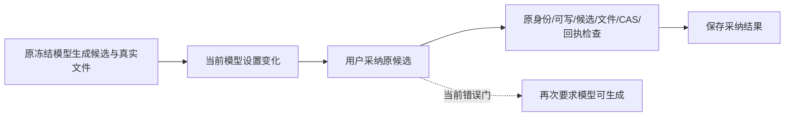

# T1325：恢复已生成创作候选在模型设置变化后的采纳

当前为独立最小问题SPEC草案，未START/未授产品测试写权。用户既有全功能恢复授权与Root本轮裁决覆盖；不插入T1322两源、不修改其原FAIL，不重发旧UNKNOWN或为了造恢复重跑已成功模型。正式输入/测试scope与独审另行锁定，当前只读分析与登记。

## 实际问题

T1322 protection-v6完整新owned公共受控图卡链已按原Codex冻结配置完成文案及图片、真实保存资产/文件、下载解码。之后当前设置切到未配置official，原候选creativeResults.adopt被MODEL_NOT_CONFIGURED拒绝；该run自然exit1/42.301s，3case为1PASS/2FAIL（card/edit），保原件，不把任务生成成功当采纳成功。原现场是受控完整生产root/worker/ledger及合成外部协议，不称真实供应商此轮故障。

用户采纳的是已经产生的合法结果，本动作不发模型请求；当前生成来源不可用不应阻断已有候选。重新生成/重试仍按原当前配置及冻结恢复合同，不能借本任务绕新模型准入。

## 已核职责与最小候选方向

creative-results.service.adopt先查scopedResult/原receipt，再assertWritableWorkspace、readResult、owner/status/editedValue/candidate存在/adapter存在，随后adapter.probe。这同一probe用于能力目录、generate与retry，其实际注入会再次resolveModelSpec(copy.generate/script.draft)或assertImageCapability(image.generate)，是当前生成readiness。文章/图文图片probe还限定owner/outputType/kind；publication cover还限定platform及video/image；text/script/publication各限定支持kind。因此**不能泛删所有probe、忽略它同时承载的静态交付类型边界**。

候选最小生产范围仅 `backend/src/modules/creative-results/creative-results.service.ts` 的adopt边界：将纯生成readiness从已生成候选采纳准入分离，复用既有 `rows → cells → cellFor(outputType, platform, kind)` 唯一静态映射，并严格核 `cell.owner === row.owner === adapter.owner`；未知adapter、无匹配cell或owner错配仍准确拒绝。保原已保存来源及真正业务可写/归属/状态/媒体文件/CAS/回执。不新增第二份kind/platform业务矩阵、不按MODEL_NOT_CONFIGURED等错误码catch放行、不给probe伪造supported。静态检查只在新采纳分支，原scopedResult→已存在adoptionReceipt同body/key重放顺序不改变。是否只需该一源须独审核定，不提前承诺靠盲删一行闭合；若必须改adapter接口或其它生产源，先准确scope delta，不临场扩写。生成/能力展示/retry的原probe保持实际调用与错误语义。

所有具体adapter.adopt仍走原owner服务，不把current配置替换成旧凭据、不加载原模型凭据、不伪造就绪状态，不放宽通用workspace/AI任务/资产过滤。候选身份、来源、输入、原version/sourceDigest、冻结路由/调用及原key不重写；重复同body/key沿原回执，冲突仍拒。

## 当场验证要求（正式审后执行）

1. 已有protection-v6完整失败准确引用，并在本任务新owned公共完整链当场前RED：真实入口生成候选→真实worker/ledger/文件→下载解码→切当前模型为未配置来源→原candidate/body/key采纳期望成功自然失败。所有实际源/test/config/native协议/worker运行前完整字节锁；不手插settled/candidate、mock adopt/probe返回成功或复制用户DB。
2. 最小修后同链GREEN：当前模型确未配置，原候选采纳/owner版本/真实媒体文件引用/刷新读回成功，0新增模型/turn/call/图片；原合法更换来源、取消当前来源与image.edit原reference均不改变已冻结候选。首次失败与后续原key恢复按原服务边界，不暗清pending/改原receipt。
3. 实际注册的文章text/sections与media、图文text/cardBriefs与media、output_script、publication text/cover逐族核静态kind/output/platform/owner门及原owner.adopt权限，保所有支持/不支持分支。完整主证至少复现实际article image_card生产组合；其余可准确原消费者组合补齐，不能用一个mocked adapter helper签全族。没有真实平台来源的publication公共样本缺测单列，不造账号/作品/metrics。
4. 真正安全门仍拒：跨user/group/account、归档/非可写、错owner/target/kind/platform/未知adapter、未ready/失败/取消candidate、非本task媒体/无文件/伪引用、原稿/section变化与CAS冲突、改body/key重放；正确旧回执重复返回且无额外版本/副作用。保持generate/retry在未配置时拒绝新请求，不把采纳恢复扩成新生成权。

精确测试W仅新增 `frontend/src/server/__module_integration__/creative-result-adoption-readiness.persistence-client.test.ts` 完整主链，现存 `backend/src/modules/creative-results/creative-results.integration.test.ts` 与 `backend/src/modules/creative-results/media-adoption.integration.test.ts` 精确静态/owner/回执保护；无tests glob。完整主链沿原controlled native边界及immutable worker，不mock最终adopt/probe/真实owner service；现存辅助组合不能冒完整worker主证。预算按原完整worker/图片串行继承：正执行/请求/观察>=120000ms保长值、test3600000ms/hook180000ms/outer86400s、retry0/singleworker/own cache。不安装、不build worker、不接旧live root/用户库/当前三packet，不改共享设置；设置变动只在新owned受控root。新包最终真实同候选设置变化采纳须独立证据，受控通过不代供应商。统一timeout Gate由C最终独占真实引用，原失败/实际SHA/命令/资源/局限完整保留。

## 实际并行与源冻结

T1319修改根persistence期间只准备稳定SPEC/adapter/test输入，不claim根RO、不把变化中的根签入正式完整锁。其freeze后才补实际根source/worker/SPEC/module最终锁并由独立reviewer核。R T1323 checkpoint链与本非chat媒体采纳链只有在完整harness证明不交叉消费各自W时才可并行；具体C cover/asset/durable非chat两阶段无readCheckpoint调用，仍须核真实harness/全部可达故障路径，不以未写源就推定无消费。发现交叉立即协调串行，不删实际RO；双controller监督始终C持有，测试outer异步轮询不挤掉服务监管。B T1321单真实root可能进入恢复，等1323源与恢复主链freeze；其工具允许集合若可达本generic adopt，也须等本源freeze。
