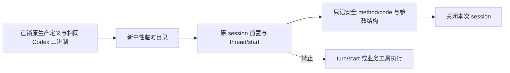

# T1326：定位自主任务 Codex 原生回合准入拒绝

本任务仅做一次有界协议诊断，无生产写集。Root 本轮要求先形成 SPEC、实际来源锁与独立评审；当前未 START，未运行探针。用户既有本轮新中性输入与官方 Codex 授权适用，不读取或复制用户认证、业务库，不安装、构建或发布。

## 已发生的事实

7790 不可变包、新 owned 58506 / IIbU73，真实 UI 将 text/vision/image 选为 Codex并刷新；提交时 revision 3。`agentic.collect` AI825 / execution `exec_58f6e2f8-ec85-4658-9d4e-b6dc5c1b7c5b` 准入后 runtime 为 unknown_result / CODEX_RPC_REJECTED，公开 durable 为 blocked，唯一 model call `call_4c3410e2-30ae-48bd-94be-0e474f9e5cb1` unknown；本轮 RSS server 0 HTTP 请求、0 item。独立 `agentic.material` 预演 AI848 / execution `exec_f8503c77-533d-4c4f-8978-578dc7cc429a` 同码 unknown_result、0 results。其 wrapper exit0仅表示观察返回，非功能通过。两原任务均不重发；第三个 research 没有盲发。

证据引用 `docs/verification/t1315/runs/resumed-7790/AGENTIC_OBSERVATION.json`、`collect-final.json`、`collect-diagnostic-read.json`、`agentic.material-final.json`。原公开投影不含冻结 route 的全部字段、native thread/turn、最初 rpcMethod/rpcCode，不能补写为已取得或据空工具结果推0模型。普通 thesis 和混合 Host220在同包真实成功，不能将这两个失败扩成全部 Codex 不可用。

`runCodexAgenticInWorker` 先完成 session/auth，然后 startCall，进入原 native turn，catch 将原 CodexHostError 的 method/code 压成 GenerationFailure.errorCode。因此 unknown model call 可结合源码限定到已 start 的 native 回合准入/读取阶段，不能确定 thread/start、MCP 检查、turn/start或末次回读中的哪一步。

## 两个待检验差异

- agentic 创建 session 时未传 taskTools=true，外部聊天成功路径显式传入 true；这改变原受控 functions 直接工具配置。
- agentic 动态工具直接使用 collect.plan / collect.run / material.search 等名字；外部聊天沿唯一 `chatToolProviderName` 编码并反向映射，且有碰撞守卫。

这只是源码可达差异，尚非现场首因。本任务不批准直接修这两处、丢弃 schema、缩工具范围或绕业务准入。

## 唯一允许的探针

使用当前字节已锁的 `createControlledCodexSession`、`codexThreadParameters`、`CodexRpcSession` 原实现及实际 `createAgenticCollectionTools` / `createAgenticMaterialTools` 的 definitions。两工厂参数只供构造定义；任何 forTask/search/stage 一旦被调用立即失败，不提供伪造成功。按真实生产 JSON Schema 转换结果构造，保存名字、version/effect、各 schema 与完整工具数组 SHA，不用人工缩小的玩具工具替代。

探针执行的是**源码原协议前置**，不是重新执行不可变 worker 或重放825/848。源码模块解析出的 Codex 0.159.3 binary 与不可变包实际 binary 已核同为 240351424 bytes / SHA `4d210f7c5a18fd0386434df23b5bdbb8c0e7257d3e8a2b30b0769c8bbe99a878`；运行前重新核真实路径/版本/字节。execution-worker/status-worker 和该源码也列来源锁，保持用途差别，不复制二进制到 Git。使用当场公开 engines 默认模型 gpt-6.1-sol；原任务 requestedModel 在公开 DTO 缺证，这个新前置值不能冒原冻结模型的原始证明。

每组工具最多四个预先固定对照，共最多八个新临时 session：原名+taskTools=false；编码名+false；原名+true；编码名+true。先 collect 原样一例；若其 session 前置或 thread/start 已取得明确拒绝，原样 material 和剩余固定对照只为区分两个差异，不能无限调参。编码只调用既有 chatToolProviderName，保持完整描述/schema/order/version/effect；编码前先验证无碰撞，不能临时发明名称规则。taskTools=true仅复用现有受控 functions namespace 配置，其余禁用项与 readonly/never/sandbox等原参数完整不变。

仅发原 session 所需 initialize、config/read、account/read(refreshToken=false) 与本探针 thread/start；成功后可沿原 verifyCodexThreadMcp 做 mcpServerStatus/list，再关闭。**请求包装器拒绝 turn/start、thread/read、turn/interrupt、模型消息、任何工具调用或业务端口**；不会创建 execution/AI root、候选、采集 run，不更改现用设置。若服务发出 item/tool/call则按原协议拒绝并立即保留诊断失败，绝不执行工具。不得读取/登录/注销/复制 auth.json、Keychain、token 或用户 config。已有合法官方宿主环境仅由原 Codex 进程继承。

透明观察只在探针装配层包装同一 rpc.request，原 method/params/timeout 原样透传、原结果返回、原异常 throw。不改生产日志，不打印原请求/响应、params/凭据/account对象/provider错误全文。固定白名单仅：运行标签、阶段、method、原 CodexHostError.code、ALLOWED 内 rpcMethod、32位整数 rpcCode、原工具名字/version/effect、结构类型/长度/schema摘要及 SHA、成功的新 thread ID/响应 model、安全配置摘要与资源PID/PGID。异常 message/stack 不记录。尚未取得 session 时，捕获原异常的这些安全字段；未知错误只记类别，不猜错误码。

探针自己允许方法比生产更窄；保存实际透传的方法序列，断言 `turn/start` 数=0、业务调用=0、每个已创建 session 均在 finally 原 rpc.close，临时 cwd 仅本次新目录清理。原825/848及其目录/状态/费用/期限完全不写；未知仍是未知。不用新 probe 成功覆盖原未知，也不将 thread/start 成功当模型功能通过。

## 文件、预算与验收

拟诊断 W 仅 `docs/verification/t1326/runtime/prefix-20261017/**` 和 `docs/verification/t1326/DIAGNOSIS_RESULT.md`；控制文件由 C 写 `docs/verification/t1326/control/**`。所有生产源 RO。正式来源锁在 `control/INPUT_LOCK.json`，实现好的唯一 test/config/runner还须运行前补锁并由独立 reviewer核对，不能以未创建的文件签 SHA。

单次正请求保持生产至少120000ms，不降低更长值；一份 test 包住最多八组前置，test=28800000ms / hook=180000ms / 外层32400s，singleworker/retry0/自有cache。原 session 自有RPC数量和close串行上界远低于总8h，但执行器实际控制必须核验；不把采样间隔当执行限额。任何模型提交、readiness伪造、源或 runtime 漂移、方法越界立即停止，不重试探针至成功。

输出八组实际结果或准确未执行原因、method/code、原参数结构与每组完整差异、真实退出及清理索引。只有确定性失败对照能定位哪个协议条件被拒；全部 thread/start 通过则报告未复现且停止，原 turn 阶段仍未知。任何生产修复或新的付费回合都必须有后续精确方案、独评和执行绑定；本任务不授权。统一timeout Gate由C收尾独占引用，pmem/reconcile保原32失败及新发现，不追签原TDD、供应商成功或原task终态。
