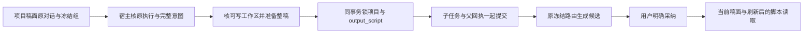

# T1327：恢复纯账号组整稿准备与提交的一致归属

当前为待独审 SPEC。用户本轮“允许继续”及 Root 2026-10-17 的最小修复裁决覆盖本问题；C 已登记 T1327 并仅授予本文写权。独审、START、精确实现 scope 与运行输入冻结之前，不修改生产代码、不运行新的业务请求。本文不追签 U10 原请求成功，不改父 40/56 矩阵。

## 真实问题与用户结果

新 7790 不可变包、纯账号组 group34、`accountId=null` 的项目稿面已真实生成并采纳三条开头；随后唯一整稿请求的父聊天执行结算成功，但正式工具回执明确为 `AccountRequiredError: ai.prepareScriptDraft requires a selected account (ctx.accountId missing)`、`taskId=null`，没有整稿子任务或候选采纳。原请求、原 attempt 和原目录保持此事实，不重发。输入事实及逐层核对见 `docs/verification/t1314/runs/resumed-7790/U10_GROUP_DRAFT_SCOPE_PROPOSAL.md`。

T1022 §2、§3.2、§4 已确认项目、稿子与组内素材归 `userId+groupId`；真实平台账号用于发布、浏览器和采集。用户在合法空组里创作整稿，应能得到候选，明确采纳后在当前稿面和刷新后的脚本来源看到新稿。不得要求补一个本地账号，不得把正文写进旧 `master_script` 来满足夹具的固定断言。

## 已核真实消费者与最小改法

矛盾门位于 `backend/src/modules/ai/script-draft-task-submission.ts` 的准备入口：复制 context/input 后直接 `requireAccountId(context.accountId,"ai.prepareScriptDraft")`。上游 `chat-script-draft-tool-host.ts` 已接受 account 或 group，且逐次恢复原宿主上下文、精确比较 user/group/account、工具定义、项目与选中版本，再冻结当前已确认稿的真实 snapshot。下游 `ai-task-commit.ts` 已用 `requireWorkspace`，核原父执行归属、继承原 executionRoute 并将原 execution/call/inputDigest 绑定到子任务，Codex 分支不引入新的模型 authority。

候选最小产品改动仅准备入口：用既有 `requireWorkspace(context)` 与 `await assertWritableWorkspace(deps.db,context)` 替代该局部强制账号门。保持 context/request 在第一个异步读取前 clone。工作区可写检查读取真实组，拒绝归档、非本人或不存在的组；纯组不要求 membership，不造平台账号。携带真实账号时，原事务中的 `lockWorkspaceMembership` 仍验证其真实成员关系与版本。准备检查不替代 commit 的当前归属重验。

准备阶段仍不创建稿件、版本、任务或父回执。原准备/commit 顺序、attempt 完整意图比较、历史任务删除后拒绝重建、运行配置冻结与原父事务全部保留：

- `script-draft-target.service.ts` 经项目 UPDATE 锁，校验 output 同项目且为 video，只复用同项目、同 output 范围的 `output_script`；没有才按原规则创建空初始版本。项目级目标为 `contentOutputId=null`，不复用其它平台作品稿。
- `ai.repository.ts` 按 user/workspace/taskType/attempt 查重，任务创建经组/成员及项目或作品父锁，真实冻结 group/account/version；完整意图差异仍拒绝。父回执提交失败时，目标、初始版本和子任务必须同事务回滚。
- `writing.ts` 与 script 业务适配器校验真实 artifact 的组、项目与类型，模型只产候选；`confirmTask` 经原后端采纳服务追加候选目标版本。output 级原 `baseVersionId`/CAS 不变；项目级旧路径没有统一 CAS，本文不声称新增该保证。

`requireWorkspace` 和 `assertWritableWorkspace` 只做确定性的归属/可写边界，不解释稿件含义，不引入语义算法。无需修改合同、schema、数据库迁移、全局 `requireAccountId`、worker/native 协议、调度、预算或采纳数据归属。

## 稿面可见性是完成条件

写入目标保留 `output_script`。当前 `chat-script-draft-card.tsx` 采纳调用 `confirmTask` 后发 `SCRIPT_WRITE` 局部信号并 `router.refresh()`；稿面 `resolveScriptArtifactIdFromDb` 优先读有正文的 `output_script`，兼容回退旧 `master_script`；服务端 `selectReadableProjectScriptArtifact` 优先读有正式版本的 `output_script`。这些是实际读取协议，不能由“库里存在新版本”替代验证。

完整主证必须构造有原正式母稿和另一平台稿的项目：采纳前原稿/旧版本/另一平台完整不变；候选目标为预期项目级 `output_script`；采纳后实际稿面读取目标 ID、版本和正文与该候选一致，局部显示与刷新读回都能看到新稿，脚本来源读取同目标。output 级另核只更新指定 video output，另一平台不变。测试应调用当前页面真实读取函数或实际页面，不能复制选择算法、强指定 artifact 绕过 selector。

准备前、新目标已有空初始版本但候选未采纳、采纳后三个时点，都实际调用稿面 UI 与服务端当前稿读取路径，并读取 article/graphic 的 `scriptContext` 核正文来源。特别保留“有正文旧 master + 新建空 output 初始版本”输入族：服务端仅看 `currentVersionId` 与 UI 优先有正文的差异必须实证核对；候选未采纳时不能因为空壳目标遮住原可读稿。原 master 行不变或保存 DTO 相等都不能替代这些消费者检查。

若实际页面 canonical 选择存在另外的问题，保现场、报告消费者与范围差异，先由 Root 独立判断并登记；不得在本任务顺手改变多稿选择、master/output 数据归属或原稿历史。

## 正式实施范围与 RED/GREEN

待独审后拟授予的唯一生产 W：`backend/src/modules/ai/script-draft-task-submission.ts`。精确测试 W：现有 `backend/src/modules/ai/script-draft-task-submission.integration.test.ts`，及新增 `frontend/src/server/__module_integration__/group-script-draft-preparation.persistence-client.test.ts`。测试配置、controller 和原始证据只放 `docs/verification/t1327/**`，由 C 正式绑定后使用。没有 tests glob；若需要修改其它生产文件、通用服务或前端行为，先停该扩写并提交实际 scope delta，不能借修准备门扩大权限。

1. **当场完整 RED**：新 owned 隔离库/root，真实公开建组/项目/原稿/另一平台稿，正式聊天入口及原 `script.draft` 宿主工具→准备→父/子事务→真实 worker/账本→正式候选→采纳→当前稿面消费者。合法纯组断言期望成功，修前自然在局部账号门失败；保存正式回执与无子任务、无目标/版本副作用，不以 helper throw 代公共 RED。完整 controlled native/模型协议必须独审，使用真实生产 runtime/worker/host/ledger；不能 stub `prepareDraft`、子任务成功、采纳或页面读取结果，不手插候选/settled。受控协议通过明确标为受控，不冒供应商通过。
2. **同链 GREEN**：只改获批局部门，沿同一测试意图/正式消费链重跑新 owned 隔离 fixture，原父任务冻结路由及 call/children/inputDigest 回执、子任务终态、候选结构、采纳与页面刷新全部核实。不能沿原真实 U10 ID/attempt 重发，不能给失败事务补实体或手改账本。
3. **新包实际验收**：受控通过与独立实现审后，由 C 绑定包含修复的不可变包与新 owned 项目，走新的真实纯组稿面→整稿→候选→采纳→刷新/脚本来源链，记录原父/子 ID、实际调用和版本。原 7790 U10 拒绝保留；新验证不能追签原包已通过，不增加无需要的重复模型收费。

## 安全、幂等与兼容验证

| 输入族 | 必须保留的结果 |
|---|---|
| 合法纯组；旧 legacy account；同组真实成员账号 | 允许准备与提交；冻结正确范围，旧账号路径行为不变；既无组又无账号仍拒绝 |
| 不存在/归档/非本人组、跨 user/group/account 的项目/artifact/output、非 video output、项目已删 | 准确拒绝；无目标、初始版本、任务或父回执孤儿 |
| 准备后组归档、真实成员转出/版本失效、父 execution/call/inputDigest 改变 | 原 commit 当前重验拒绝；不偷换当前页面组、账号或父调用；纯组不伪造 membership |
| 同组同 attempt 并发同意图；两组相同 attempt | 前者一个任务和一个正确目标；后者独立隔离，不能读回另一组任务 |
| 同 attempt 改 project/output/sourceSnapshots/instruction/mode/原文任何字节；retryOf；历史任务被删 | 完整意图冲突或明确拒绝，失败事务全回滚，不重建历史任务 |
| 准备时调用方改 context/input、运行配置或原文 snapshot | 已冻结副本不受外部修改；保真长度/hash 检查仍真实拒绝坏原文 |
| 项目级与两个 video output；原 master 和旧任务兼容 | 新任务只写对应 output_script；旧 master 不被写；另一平台完整不变；旧历史任务仍按原合同读取/采纳 |
| 父回执失败、重复提交/确认、output baseVersion 改变 | 事务回滚/既有幂等与 CAS 保持，不能额外追加版本或外部调用 |

上述边界沿实际 service/transaction/public 入口验证，不 mock ownership、membership、targets、receipt 或采纳返回成功。复用原正确用例并增加缺失组组合，不删除旧断言洗绿；旧账号缺账号测试仍保持“既无组又无账号拒绝”的真实含义。

## 预算、冻结、资源与 Gate

全部正式 source、test、config、协议 fixture、worker/binary 字节及命令事前冻结，独立 review 后才执行；不同阶段各自保原记录。正执行/请求/有限观察不少于 120000ms，保已有更长值；主链 test 8h、hook 180s、独立 outer 9h、retry0/single worker/独立 cache，外层覆盖启动、串行请求及精确清理余量。预算消耗沿原任务期限，未知不重发、不续期。controller 在执行前登记本 run PID/PGID/身份，正常及异常退出都清理本 run，保存实际资源残留；不停止 C 共享服务或旧未知任务。

不读取/复制认证内容、已有用户库或原未知 DB，不安装、不发布、不重建/替换锁中的 worker。受控公共链的协议响应必须真实消费者可解析，先独审和 collection-only 确认唯一测试可导入，不把 syntax/收集通过当执行通过。

要求实际运行并留原命令、exit、耗时、SHA：完整公共 RED/GREEN、上述 backend 组/账号/事务边界、稿面读取/采纳可见性、相关 contract 回归、boundary/orphan、LED-047 相关回归与统一 `node tools/timeout-policy/verify.mjs`。只修准备入口且无 UI 改动，不新增视觉方向或按钮。C 独占共享控制并按项目流程执行 pmem sync/reconcile/任务状态与审计；已登记全局既有失败如实保留，不批量洗绿。没有实际发生的 RED、真实模型或页面证据不得补拍。任务完成仍依赖独立实现审与新包实际验收，本文/受控 GREEN 均不代替。
