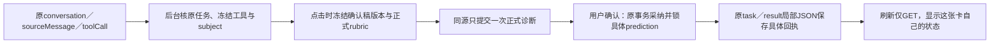

# T1328：盲预测原卡来源、正式诊断与锁定恢复

本稿仅供Root独立审查；任务保持📋待审，未START、无生产W。当前任务不是禁用一个按钮：需要让原卡锁定自己的正式诊断，并在刷新后只读找回具体预测。保T103a“用户点击后按正式rubric再诊断”的语义，不直接把聊天里的自由诊断变成正式预测。依赖T1331确认稿读协议，不另写脚本选择规则。

## 已发生与不能声称的事实

7790不可变包的新owned U08中，原conv1218/source1219冻结selection是output1211；页面VM仍没有outputId，原卡锁定又创建output1267→child1274→prediction1345。该预测确实locked；与原聊天不同，它只依据标题并说明缺稿。原项目有master1043/v1046，随后hook产生v1431，没有output_script。公开预测DTO没有原卡、child或稿件版本绑定，不能声称其实际消费1046/1431，也不能把1345反推成1211的预测。

原卡刷新后，原settled消息已恢复并实际等120.18秒，按钮仍enabled“锁定为盲预测”；原1345与列表逐字段不变。本轮0第二次锁点击/0新模型，未观察重复写入。原件在 `docs/verification/t1314/runs/resumed-7790/cases/U08/mapping-readonly/{DIAGNOSIS.md,PUBLIC_MAPPING.json}` 和 `restoration-canonical-readonly/`。旧结果、原ID及UNKNOWN保留，不重发来验证本修复。

## 实际消费者与复用边界

- `blind-predict-row.tsx` 已在打开聊天前创建挂点并传selection；`chat-result-cards.tsx`目前只看页面VM outputId，task/subject/attempt仅useRef，锁后从subject最新draft列表猜ID，恢复只有useState。
- `ai-copilot-content.tsx`现有 `workSourceLocation(message,toolCallId)` 可从正式消息metadata或同一liveSession已确认source映射取得原conversation/sourceMessage/toolCall。只复用身份传递，不把work.editor/creation专属来源op冒成诊断来源。
- `readChatTurnSnapshot`、`readChatHostContextPair`、冻结worker输入、`createAgenticToolBinding`及原external_tool回执可验证源消息→root→execution→原tool调用。新服务只针对calibration.diagnose成功已结算来源核验，不解析聊天自然语言来猜subject。
- 实际 `ai.confirmTask` 优先委托 `calibration-positioning-adoption.service.ts`，不是ai.service1594的legacy分支。该真实事务已有task锁、当前成员/归属、subject与冻结rubric检查，但丢弃createDraftPrediction返回ID。新回执必须落在这条实际链。
- `aiTasks.runtimeData`是后端私有JSON，`aiTaskResults.resultData`已有持久JSON；原attempt/fingerprint/唯一任务提交机制可复用。当前无需新表、列或迁移，不新增通用状态系统。

## T1331依赖：同一确认稿读协议

R已确认将提供 `backend/src/application/context/confirmed-project-script.ts`：`createConfirmedProjectScriptReader(ports)` 返回 `readConfirmedProjectScript(ctx,projectId): Promise<{projectId,artifactId,versionId,fullText,sha256}|null>`。它经scoped service确认父归属；已明确保存的空稿返回非null、fullText为空且hash为空串的真实SHA；无确认稿返回null，归属错误throws，不能吞成null。

T1331用私有显式自动预留初始versionId区分未采纳空target，真实保存/restore/采纳解除预留；旧未标记记录不反推。T1328只复用该正式导出，不能按非空/标题/时间/最近task另造选择，也不从backend导入frontend reader。接口字节与独审确认后才进入T1328 implementation，当前该依赖不是已完成的功能证据。

## 最小服务合同提案：两个typed op

拟新增 `contract/src/resources/prediction-lock.ts` 和两项AI操作；追溯现有 `FR-CALIB-PRED-LOCK`、`FR-AI-TASKS-CREATE`、`FR-AI-TASKS-CONFIRM`，本SPEC的来源/幂等/恢复验收锚为AC-1328-SOURCE、AC-1328-ONCE、AC-1328-RESTORE。由正式dispatch/client/transport到后台服务，不走私有UI直写：

| 操作 | 输入与真实结果 |
|---|---|
| GET `ai.predictionLocks.source`，`/ai/conversations/:conversationId/prediction-locks/source` | query仅sourceMessageId/toolCallId；返回version1的exact source、verified subject/project、当前或已绑定baseline摘要、具体diagnoseTaskId/resultId/predictionId及实际状态。无绑定的旧历史返回legacy_unknown，不猜项目最新预测。纯读，不ensure/create默认rubric、output、task、prediction或发模型。 |
| POST `ai.predictionLocks.start`，`/ai/conversations/:conversationId/prediction-locks/start` | body仅sourceMessageId/toolCallId/expectedBaselineDigest/policyVersion1；后台从原冻结来源恢复subject并重验当前基线，不能接受客户端自由subject/rubric/正文/taskId。首次提交一个正式calibration.diagnose，重试同源返回原task与原baseline。正文/subject/意图冲突拒绝，不换attempt。 |

采纳继续使用现有 `ai.tasks.confirm`。**仅新source-bound锁定任务**在其真实采纳事务内：复核来源和稿件基线→沿原Calibration服务createDraftPrediction→验证返回具体predictionId→同事务调用原lockPrediction→保存具体回执并将task置succeeded。保持现有普通standalone诊断confirm只创建draft的语义。这样不存在“draft已提交、ID丢失、再取最新draft”的窗口，无需第三个finish op或修改全局prediction锁规则。新bound分支的create、lock、result/parent回执、task成功任一步失败全部回滚。

## 来源、基线与局部持久事实

稳定source为 `{userId,workspace,conversationId,sourceMessageId,toolCallId}`；后台验证原用户消息绑定的copilot task、原execution owner、完整hostContext摘要、冻结工具名称/version/schema/effect和成功原call回执。回调重放沿既有账本解析规则，必须定位唯一原调用；foreign/损坏/歧义拒绝，不借活跃租约读历史。

为区分旧历史与新协议，在**新聊天根的私有hostContext**中由后台写入可选 `predictionLockPolicyVersion:1`；仅合法项目/单一content_output selection且声明原calibration工具时适用。没有该版本且没有已验证绑定的旧卡明确legacy_unknown，不能据“没找到映射”判未锁并自动创建。此标记不是权限：GET/POST仍独立核真实subject→project与原workspace，不信任浏览器VM或自由selection ID。

POST start按原workspace/member/project/source父锁顺序，锁原root任务，在其 `runtimeData.predictionLocks[toolCallId]`写版本化局部绑定：具体childTaskId、source proof digest、subject、baseline ref/hash与后台冻结正文、正式rubric版本/维度、stable attempt及完整意图摘要。child input只携带该绑定的不可自由更换来源键；任何generic createAITask伪造相同字段都必须因原root绑定不存在或child ID不同而拒绝，在模型调用前停止。旧正常无标记任务保原路径。

首次点击时的baseline来自subject实际项目及T1331端口，明确artifactId/versionId/hash；无已保存稿用具名none基线、诚实空正文，不能偷偷取新生成空target或伪造master版本。root局部JSON可冻结该版后台正文，adapter读取时经原root绑定、childID/owner/完整摘要验证；不信任client input里的正文。正式rubric在该用户动作中冻结，异步prepare不能改读后来版本或新配置。

`calibration-positioning-business-adapters.ts`只为新source-bound分支读取这个验证后的baseline/rubric，经原structured worker生成候选，仍保存并验证原 `__calibrationDiagnosis` 目标/维度冻结字段。普通诊断reader也复用T1331确认稿端口；publication及其它节点行为不变。模型不写绑定或预测。

确认前再次核root/source/child/result/原subject、冻结model facets与当前可读稿ref/hash。发生新保存/restore/删除/跨组/原稿变化时拒绝锁旧候选，保原task与候选，不自动再诊断。用户要为新稿预测，走新消息/新tool卡形成新source。已经locked的原卡只读自己的不可变回执，即使项目后来更新也不误称当前稿已锁。

采纳事务把 `{policyVersion,source,sourceDigest,baselineDigest,diagnoseTaskId,resultId,predictionId}`加到该候选resultData和原root局部绑定，保原diagnosis字段；不回写原聊天诊断为另一结果。root绑定存在但child/result被删，返回missing/unknown，不重新提交。当前task/result/Prediction实际状态是权威，不持久一个可漂移的前端locked布尔。并发同源start/confirm只产生一个child、一个具体locked预测；不同新source同项目可合法独立锁定。

## 独审补充：事务顺序、首次规则与并发保存

### A：同一事务与固定锁序

start和新source-bound confirm共用一个事务作用域服务：先验证workspace并取得原冻结成员锁，再按project → source root aiTask → diagnose child aiTask → result → prediction的固定顺序取得锁。来源hint只允许用来预读ID、定位锁对象，不在锁前判定权限或成功；锁后重新验证完整所有者、原source、工具调用和child/result映射。首次start尚无child时先锁project/root，再同事务插入child；重试与confirm均按同序读原child，不能先锁child再反向取root。

实际旧adoption当前先锁child，故新绑定任务必须在该锁之前分流到source-bound事务入口；入口依据仅是候选标记，不是授权，必须反查原root的已持久child ID和完整source证明。普通standalone仍走原先路径。不得先进入旧事务锁child再调用新事务，也不能在事务外先createDraft后补lock。新入口可复用原解析/冻结维度检查，但所有Calibration service ports由当前tx构造，createDraft、lock、回执写和task状态在一个commit内。

确认稿使用T1331同一reader工厂，由当前tx的scoped project/artifact ports实例化；不持锁后调用全局连接reader。project锁保护source绑定的串行性；对选中的artifact再取行锁并在锁后重新读current version/hash，与save/restore更新同一artifact行的锁相斥。若选择回退需要检查多个artifact，按确定ID顺序锁定再重新执行同一reader，防止选择期间目标改变。start的expectedBaselineDigest只在锁后再次算出并比较；confirm同样核当前确认稿引用/hash，禁止只信首次快照。并发保存跨越这两个动作时必须冲突或等待后重读，不允许取旧连接绕锁。真实公共并发测试应阻塞事务后插入save，验证无TOCTOU；发现现有保存端缺必要同行锁则先报精确scope delta，不能声称project父锁单独已阻止所有保存。

### B：GET不创建rubric，首次POST原子冻结

无绑定GET的expectedBaselineDigest仅覆盖policy/source/真实subject/project与确认稿ref/hash（含具名none），**不包含尚未存在的默认rubric**。GET不ensure任何规则。首次start在上述锁后验证该digest，再经当前tx的原正式Calibration端口ensure/读取默认或owned rubric版本，完整维度与ID冻结进同一source绑定和child意图后提交；失败全回滚，不留半绑定。规则不存在是允许首次用户动作创建默认规则的状态，不是GET伪造ready。

已绑定GET/start一律返回原baseline和原rubric身份，不因当前默认配置变化重新resolve或换意图。异步prepare/confirm使用原冻结版本并核它仍为同scope合法版本；默认指针改指向新版本本身不阻断原候选，原版本删除/所有权或维度正文与冻结摘要不符则拒绝且保原ID。未绑定GET之后、首次start之前规则配置变化，以首次start同tx读到的正式版本为准，UI文案不把GET尚未读到的规则称已冻结。已绑定后同源重试不因当前默认变化重发；当前稿变则保原候选并返回基线冲突。

### C：识别标记与可信绑定分别校验

predictionLockPolicyVersion只由后台chat-turn submission在核真实hostContext pair、实际project/单一content_output selection及冻结calibration工具后加到后端私有上下文；任何generic任务create input或外部hostContext字段不能自行获此标记。实现须在公开generic create测试中伪造marker、root ID、child输入并验证0模型/0绑定。即便标记存在，服务仍核root taskType=copilot.assist、原sourceMessage的conversation与user角色、root input/source/hostContext digest、execution owner与原tool settled receipt；child还必须等于原root局部绑定的具体ID。不能仅校验某字段有值就授权。

旧无标记的**那个source**返回legacy_unknown，不自动关联/创建；同一旧conversation中的新用户消息会由新submission核验后形成自己的新协议source，可正常开始。新合法source不扫描或依赖旧卡绑定完整性，不能因项目曾有legacy_unknown拒绝新卡。

### D：runtimeData写入盘点与局部更新

实际全量生产搜索发现`ai.repository.updateTaskRuntimeData`当前整对象set，唯一三个caller在ai.service的putMultimodalProviderCheckpoint、putVideoDecisionsCheckpoint、putScriptDraftCheckpoint，均先读runtime再spread且没有taskType门；因此不能只对新predictionLocks做jsonb_set便声称安全。拟把这个私有repository方法改名为patchTaskRuntimeData，三个caller只传各自一个checkpoint字段；在SQL直接基于**当前数据库runtime_data**做顶层JSONB merge，禁止客户端patch predictionLocks等保留键。该repository没有其它生产caller，旧方法删除后由类型检查保证不残留。新source服务仅在锁定root后用jsonb_set更新predictionLocks内的确切toolCallId（对象path参数化，不能拼SQL），保留其它卡与runtime键；confirm更新同一路径，resultData也是在result行锁后保留原诊断并局部增加回执。两个checkpoint并发、checkpoint与source绑定并发均须验证无键丢失。

其它整runtime更新的实际边界如下，保持源码不改，受控测试/来源锁必须核这些门：

| writer | 原实际任务边界 |
|---|---|
| chat-turn-submission与repository createTask/createTaskIfAbsent | 初次insert；不覆写已有root runtime |
| submitted-task-preparation与submitted-task-budget-recovery | supportedTaskTypes不含copilot；后者更限script.draft，持child行锁 |
| execution-video / execution-video-visual-review / execution-script-checkpoint | 分别video.decisions、exec.video.render、script.draft，不能写copilot root |
| execution-scheduled-child / scheduled-flywheel-execution | scheduled.*正式类型及job/run父子绑定 |
| ai-media-probe-control | assertProbe强制exec.media.probe |
| asset-legacy-recovery | 所有原task行强制asset.generate |
| browser-task-authorization | 行锁后强制exec.agentic.research |

不新建通用runtime状态层、不改这些无关业务分支。新增writer或实际装配不符合上述限定时，先报告范围变化，禁止默默假定不会覆盖。新增回归对三个checkpoint caller传旧快照的行为取得RED，修后只写自己字段，原checkpoint值语义保持；也核不同卡并发更新、confirm回滚和结果旧字段不丢。

## 卡片行为与视觉约束

加载oil-ui-pro 0.10.0、existing-project/interaction-and-state及账号组UI_RULES；保现有卡、tokens、正文维度/按钮尺寸、字号与布局，无新视觉方向。实施前保原1366×900截图基线，同视口实际操作/看图核局部状态，不以截图保存冒看过。

原卡传 `workSourceLocation`的明确source；不再用当前page VM output自愈新建subject，不按subject列表第一条draft或项目最新prediction。挂载/刷新/历史重开只GET，单在途轮询、scope generation与卸载保护；不mount时start、confirm、lock或发模型。

| source实际状态 | 行为 |
|---|---|
| 新协议可首次锁定 | 原“锁定为盲预测”主动作；点击时POST start，按同task观察，当前这次用户动作可继续confirm完成锁定。 |
| 原task进行中 | 显示排队/诊断中及原task状态，重复点击不POST新任务。 |
| 刷新恢复到待确认 | 显示“继续锁定”，只有人点才confirm同task，恢复GET自己不写。 |
| 精确回执locked | “已锁定”，展示其稿版本归属，原卡重复/刷新不创建output/task。 |
| legacy_unknown或缺绑定 | 保原诊断，说明“历史锁定来源缺失，无法确认”，不猜已锁/未锁；用户可经当前稿面的正常新诊断产生新卡。 |
| 失败/未知/取消/基线变化 | 原位说明真实原因与原task/候选，有限观察不重发、不续期，不用error掩盖部分结果。 |

## 拟精确实现写集（待Root审，不是当前授权）

生产：`contract/src/resources/prediction-lock.ts`（新）、`contract/src/operations/ai.ts`、`contract/src/index.ts`；`backend/src/modules/ai/prediction-lock.service.ts`（新）、`ai.repository.ts`、`ai.service.ts`、`ai.transport.ts`、`index.ts`、`chat-host-context.ts`、`chat-turn-submission.service.ts`、`calibration-positioning-adoption.service.ts`（这些短名均位于backend/src/modules/ai/）；`backend/src/modules/ai-runtime/calibration-positioning-business-adapters.ts`；`backend/src/application/context/calibration-diagnose.ts`；`frontend/src/server/persistence-client.ts`仅组合新端口；`frontend/src/features/copilot/{ai-copilot-content.tsx,chat-result-cards.tsx}`。T1331确认稿端口是依赖，不在本任务复制/改第二份算法；discovery现已spread calibrationDiagnoseReaders，可沿类型推导传端口，无需先扩大该文件W。

测试：新 `contract/tests/prediction-lock.test.ts`、原 `contract/tests/modules/ai.test.ts`与必要精确endpoint inventory测试；新 `backend/src/modules/ai/prediction-lock.service.integration.test.ts`、新 `calibration-positioning-adoption.service.integration.test.ts`（同目录）、原 `backend/src/modules/ai-runtime/calibration-positioning-business-adapters.test.ts`、原 `frontend/src/features/copilot/chat-diagnosis-card.test.tsx`、新 `frontend/src/server/__module_integration__/prediction-lock-source.persistence-client.test.ts`，任务runner/锁/截图在 `docs/verification/t1328/runtime/**`。实施前由C把inventory实际文件和整个精确集合绑定packet，不能用tests glob放权。

不改数据库schema/迁移、AI worker/native、全局workspace/账号门、其它预测/评分算法、UI主题或既有工具定义。若现有JSON和唯一attempt无法实现上述原子性，先报Root具体证据和scope delta，不暗加表/索引或通用状态层。

## 必需RED/GREEN与新包

Root独评并START/claim后，先锁已发生原U08公共RED与源字节；新受控完整公共链在任何生产编辑前取得当场目标RED，不拿旧根因猜测代替。只替外部模型I/O，真实聊天来源、父/child/Host、正式rubric、候选、confirm/Calibration锁、JSON回执、dispatch与卡片恢复不能stub成功。依赖T1331实际确认稿合同；fixture必须含有正文master、未采纳空target、明确保存空稿三族，实际冻结版本与正文按同一reader。

组合覆盖原source单次锁定→具体prediction→刷新120秒0写/0新模型；同源并发start/confirm与丢回执重试；同项目两新卡/新稿独立锁；跨组/他人/伪造tool/call/版本/child/result拒绝；旧无版本/无协议历史unknown；generic createTask伪造源绑定0模型；源task被删不重建；准备后稿变、rubric默认指针变化保原冻结/原版本损坏拒绝、过期/取消/unknown保持原期限/ID；confirm任一步失败零半写，旧standalone draft-only确认及原评分锁定兼容。

单正请求/观察≥120秒保更长，主公共case8h/hook180s、外层9h覆盖完整串行及清理；retry0/single worker/自有DB、worker副本和cache，PID/PGID身份精确finally释放。装配先独审并collection-only；业务RED→最小产品→同链GREEN各保原字节/输出，不重发旧1218/1274/1345。新完整不可变包用全新中性稿与新source真实完成一次锁定、精确回执与刷新无写，另新稿新卡合法锁定；不只helper/unit或把受控模型冒真供应商。

新op合同/公共来源权限/事务并发/前端状态、LED-047、timeout、boundary/orphan及统一pmem/reconcile如实执行。全局旧32失败、原现场错subject/缺稿、原历史无版本皆保留；没有独评、当场RED或新包实测不得签PASS/complete，不安装或发布。
