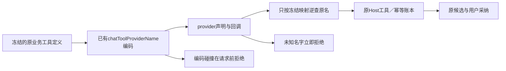

# T1329：自主任务Codex工具名适配与原账本映射

本任务恢复自主采集、素材与研究在原Codex协议中的合法工具声明与回调归属。Root已明确本轮最小方向：仅复用已有provider名字编码，回调恢复原业务名字；保持taskTools原值。当前仅SPEC待独立审查，未START、未写产品或执行RED。

## 原事实与目标

7790不可变包新owned运行中，collect825与material848为UNKNOWN/CODEX_RPC_REJECTED；持久安全字段缺具体rpcMethod/rpcCode，不能回写成已定位原现场首因，两原ID不重发、恢复或取消。T1326的受控新前置固定八组已真实完成：collect/material原完整definitions在raw名字下，taskTools=false/true均在thread/start被拒绝，rpcCode=-32600；仅复用chatToolProviderName编码后，两种taskTools均通过thread/start与MCP检查。0turn/业务调用、16RPCchildren全退，来源及限制见`docs/verification/t1326/DIAGNOSIS_RESULT.md`与runtime原结果。

这证明本轮前置存在名字准入差异，不证明functions曝光、模型工具选择、完整业务链已成功。因此本修复不能顺改namespace、MCP策略或原共享协议。新包仍须真实检验三个自主功能；若未出现真实工具调用或后续失败，准确停在实际层级，另提精确诊断，不继续调参盲发。

## 唯一产品变化

产品W仅`ai-worker/src/execution/codex-agentic-worker-run.ts`。

1. 直接引用`@creatoros/contract/execution-worker`已导出的chatToolProviderName（与external-chat-worker-run现用导入一致，不复制编码函数）。从冻结input.tools建立provider→原名字的映射；编码碰撞（含重复定义防御）在任何backend port、session或模型预约之前拒绝，使用明确GenerationFailure，不发业务/模型调用。
2. 传给runCodexNativeTurn的tools只替换name，保description、inputSchema完整内容及顺序；原input/context/reserveAgenticModel仍使用原业务名与真实原定义，不能把provider名写进持久canonical账本。
3. onTool收到provider名后先精确逆查冻结映射；不接受原点号名别名、模糊匹配、任意下划线逆解码或未声明名。未知名在recordCodexToolCall、reserve/start/executeAgenticTool之前拒绝，无工具业务副作用；仍保已开始模型的原unknown结算，不伪造成功。
4. 原toolCallId、args和callId保持。recordCodexToolCall写原业务名，其后runDurableAgenticTool、research.execute、dryRun、receipt与checkpoint均消费原名。保原版本/effect/权限/域名/预算、用户确认、幂等与调用归属，不直写数据库。
5. 已settled只回读原receipt，started/unknown仍只恢复原thread/turn，不将新映射用于重放工具。无新回合、换attempt或替代旧结果。保持createControlledCodexSession现有调用参数；不改taskTools、sandbox、approvals、auth、codex-native-turn或协议实现。

本转换属于协议标识符编码，非语义判断；复用已有函数的SEMANTIC_BOUNDARY_ALLOW，不新增关键词/业务分支。

## RED先于产品与完整公共回归

测试W：原`ai-worker/src/execution/codex-agentic-worker-run.test.ts`、新`frontend/src/server/__module_integration__/agentic-provider-names.persistence-client.test.ts`，及`docs/verification/t1329/runtime/**`受控runner/config/process fixture/输出。其它生产源全部RO。

先冻结当前原source、schema/工具定义、测试与runner、构建输入和实际worker字节，独立校验唯一collection/预算/资源。受控公共RED必须在产品修改之前当场执行并保存真实FAIL；不能把T1326前置或未来补拍作为该RED。公开链从真实compositeTransport/createExecutionTask→真实backend scheduler/dispatcher→本次构建worker→真实CodexRpcSession/native-turn/durable-tool→原Host端口/库/候选读回。仅外部Codex进程I/O换为明确synthetic fixture：thread/start按实际观察的provider合法名规则拒raw名，合法名返回确定协议事件；回调使用声明中的provider名并真实走原Host，不能直接调用helper或mock整个native-turn/业务Host为成功。新owned库/空认证目录、不付费、不读现用库，source/tools/归属均走正式入口。

最少collect/material/research三正常公共族：验证完整schema/顺序与provider名；至少一个真实工具回调穿过原Host并在账本保原名字、同call/args、settled receipt与canonical checkpoint；collect真实受控RSS输入经正常SSRF允许域名和测试I/O边界进库（不放宽产品SSRF），material/research仅本轮中性预演或只读工具，不编真实平台账号/评论。结果候选只有用户confirm才落正式目标；需要确认的正常链实际执行公开confirm/readback，不把预演成功当真实采集/研究成功。

同一受控公共链RED→唯一产品变化→GREEN，保存每轮source/runtime/退出/原断言，不覆盖旧文件。未知provider、编码碰撞、外thread/turn、原toolCallId/账本不一致、同key重复回执、失败/取消/usage越界、已结算回放与started/unknown恢复边界由原测试加窄用例覆盖；未知/碰撞的工具业务port调用数为0。旧账号/组权限与业务测试保留，不修改fixture期望洗掉原失败。

若公共fixture出现装配故障，先保原FAIL并仅修fixture，不能开始产品直到真目标RED已观察。test单例≥120s并保更长：公共it=8h、hook=180s、retry0、singleworker，独立outer=9h含完整启动/串行/清理；各生产RPC与持久deadline不减不续。拥有进程登记PID/PGID/出生身份，正常finally原close；超时仅本run准确身份清理，保真实退出/remaining。无全局kill，不触旧控制器。

## 新包真实验收与继承

Root计划与T1327窄修合为一次新不可变包，C冻结整套实际source/worker/manifest。新owned中性输入，正式UI保存刷新Codex选择，再真实collect/material/research各唯一新root，保原ID/期限、不试到成功。使用正常公开历史RSS标准样例或本轮合法中性素材，实际工具曝光、thread/turn、model/tool ledger、结果预览和用户采纳按公开支持字段核对；字段缺证明确UNKNOWN，不并发开在用PGlite补字段。若函数未曝光/无工具或链路失败，保真实结果另提最小问题；不顺改taskTools。

T1326/7790旧825/848和其它原证据不重写。图片、视频、普通聊天及其它能力只在精确消费者/装配差异核对后继承，不能按同能力名追签；父40/56矩阵保持。真实普通首字性能等所有模型工作结束后独占。统一timeout、受影响worker/backend/frontend tests、boundary/orphan、pmem sync/reconcile后如实记原32全局债与新失败；不以本任务覆盖整父验收，不安装或发布。

验收：新受控公共三族GREEN且原RED保留；provider声明符合协议、原Host/账本名字不变；碰撞/未知无工具副作用；所有原恢复/权限/预算边界保持；独立结果评审通过；统一新包真实三功能逐项报告。任何实际缺项保待验，不批量complete或伪造历史。
