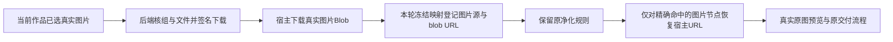

# T-1330：恢复图文原生预览中宿主注册图片显示

状态：SPEC 待 Root 独立评审。当前仅 spec 文档 lease，无产品 W、无 START。上游为 T1314 新7790完整包的真实 U14 公共显示失败；不改 T1321 历史诊断。

## 用户问题与期望

本轮自有图文作品已保存正文、三张图卡和一张真实图片。图片可以从正式接口下载，但“重新组织内容”生成的原候选预览只显示破图，用户不能按真实画面审阅。期望在原成稿和候选预览里看到自己实际选中的图片，正常翻页、关闭预览、采纳和刷新；图片引用、文字、版式与其他作品均保持各自归属。

## 已发生的公共 RED 与证据界限

原包 source `7790be04ca16b65a8161c06c5943ba607e8ecd4d`；sidecar SHA `275ef09211af5c06dabea13eeebca6ee75b0627896fb4d24be4ce80c307e394e`。owned group `grp-cbaff391-34`，project `project-cbaff391-1124`，graphic output `output-cbaff391-1153`，原 asset `asset-cbaff391-1951` / file `afile-cbaff391-1955`，人工源图 SHA `2a748e75ed4513a49fdf9072a549add1dcda06099286cb76be44975bc127b1df`。

| 现场 | 已读事实 |
|---|---|
| `docs/verification/t1314/runs/resumed-7790/cases/U14/image-readback.json` | 真实公开下载字节与本轮960×540原PNG SHA完全相等。 |
| `.../cases/U14/preview-readonly/settled.json`、`settled.png` | 原候选只读预览实际等120秒；open ShadowRoot，iframe=0；页面和候选两个img的src均为空，complete=true，naturalWidth/Height=0。 |
| 同 settled 请求记录 | assets.fileDownloadUrl两次200，group header/cookie都是grp34；签名blob GET两次200、content-type=image/png；签名值/private header未落盘。blob GET设计为credentials omit，无cookie不代表跨组。 |
| `.../cases/U14/preview-readonly/closed.json` | 普通关闭dialog后原卡可见、原采纳enabled；该observer没有点击采纳/模型请求。 |
| `.../cases/U14-adopt-ui/` | 修改前真实图片载入断言120s自然失败exit1，保原版本与原候选，不把helper断言代替公共RED。 |
| `.../cases/U14-persistence-pages/` | 正常逐页预览、关闭、采纳及同会话唯一校正/采纳/刷新均已完成；fullU14Pass=false，破图FAIL保留，原脚本/另一平台未变。 |

早期新fixture错误（外层`__creatorosOutcome`误入strict业务schema、模态背景role被aria隐藏、重复页码locator）是测试夹具问题，全部保留并独立标记，不能计为产品缺陷。公共破图是后续实际图像状态与下载请求已相互核对的产品显示失败。上述证据发生于本SPEC和任何产品修改之前，禁止补拍历史RED或重写原T1321 UNKNOWN。

## 机械消费者链与判断

1. `frontend/src/features/reference-editors/noterelay/projection.ts:4,6,72-80` 把明确已选asset/file投影为 `creatoros-asset:<id>:<file>`，按用户封面/卡片顺序构造Markdown，返回图片allowlist。
2. `.../noterelay-editor.tsx:34-44` 经真实 `getAssetFileDownloadUrl` 及下载获取image Blob，按当前generation/snapshot限制结果；把 `{source,blob}` 交原native load。
3. `reference-editors/noterelay/web/native.ts:41-68` 校验输入图片、建立本次 `frozenAssets`/`frozenUrls`；`resolveImageSrc`只从映射取本地ObjectURL，未知来源走原安全占位。
4. `reference-editors/noterelay/src/platforms/rednote/adapter.ts:28-38,159` 把解析后的src经宿主resolver替换，保留`data-noterelay-source`/image key，再经 `setSanitizedHtml` 输出。
5. `src/core/dom.ts:22` 调用 `web/obsidian.ts:2` 的DOMPurify默认净化。最终现场src为空，下载成功，符合blob协议被净化后丢失的局部消费者冲突。实现前用真实native bundle组合RED精确确认，不把源码推断替代现场。

## 最小实现方向与物理边界

只在 NoteRelay native 宿主图片映射的消费点恢复合法引用。优先在原 `adapters[next.platform].render(context)` 完成净化渲染之后、`preview.replaceChildren(root)` 之前，对该轮局部root进行同步操作，对真实 `img[data-noterelay-source]` 按本次冻结 `frozenUrls` Map做精确查找；仅命中当前load已下载/校验的source时设置相应img.src。若同名属性由原HTML伪造，也只能得到本次显式选图allowlist内的真实图片；不得获得其他作品/实例/轮次的Blob或任意URL权限。

`SEMANTIC_BOUNDARY_ALLOW:` source字符串与Map key精确相等只落实用户已选择的真实图片，不做内容判断、图片匹配、创作选择或风格决策。

保留DOMPurify原有全局URI/HTML规则。不得用全局ALLOW_UNKNOWN_PROTOCOLS、放开任意blob/javascript/customURI、信任原文的src、dataURL替换源图、测试注入或假图片补绿。不得改数据库、接口、模型、worker、采纳/来源/CAS、主题分页/版式语义或正文投影。URL生命周期仍由原load/operations/dispose负责，旧render被取消/换组/换作品/卸载后不能回写新DOM，不提前回收仍由原导出使用的URL。

采用后恢复的src必须是当前宿主Map中实际登记的ObjectURL，而非仅检查`blob:`前缀。映射未命中的节点保留原净化结果与当前错误/降级提示；合法正文与当前已选图引用保持，不能新增“一张图失败整单不可保存”的质量门。

本任务作用于reference-editor内核与对应消费测试，符合已有原生编辑器边界；无backend业务迁入frontend，无SDK新增，无AI直写。

## 冻结实施范围提案

正式 START 前由 C 更新 implementation scope/packet 并 supported claim；下列只是待审范围：

- Modify：`reference-editors/noterelay/web/native.ts`。
- Modify/Test：`frontend/src/features/reference-editors/noterelay/native-bundle.test.ts`，使用真实原native ESM、原Rednote adapter与原DOMPurify；不mock sanitizer替代实际消费。
- 必要的确定性生成W：`frontend/public/reference-editors/noterelay/native/native.js`、`frontend/public/reference-editors/noterelay/native/build-meta.json`、`reference-editors/manifest.json`、`frontend/public/reference-editors/sources/noterelay/source.zip`。已实际读取 `frontend/scripts/build-noterelay.mjs`：该脚本同步重建bundle、metafile、源码ZIP和manifest摘要，四项必须由C一起绑定，不能只锁前两项。manifest仅确定性更新noterelay项，其他编辑器项字节保持。
- 该确定性脚本还会写native.css、复制native及sources目录的LICENSE/THIRD_PARTY_NOTICES.md，并将共享noterelay-layout.ts复制到vendor/web/noterelay-layout.ts；旧legacy产物清理列表亦需事前记录存在性。C须为这些固定生成/复制目标绑定原脚本执行权限与前后字节锁；本任务不改对应CSS/许可/合同源，实际字节不变则不算产品delta。若任何非预期字节改变或旧legacy产物仍存在将被删除，先报告C/Root按实际集合裁决，不静默扩W或回写其他编辑器。
- 验证文档：另由 C 声明任务专用 `docs/verification/t1330/**`。原 T1314/T1321 历史证据均只读；本SPEC、BACKLOG/manifest/状态/控制记录由各自文档/控制lease管理。

若需修改obsidian全局shim、Rednote排版/HTML解析、宿主下载权限或原生跨实例状态，先报告独立复审，不在实现中默默扩大。旧master/script/图文候选内容不能为适配显示修复而改写。

## 验证与完成条件

修改前已存在公共RED，仍需在第一次产品编辑之前锁定该RED索引/原包及源码、实际native组合测试RED字节与命令。新测试必须确实检查原native渲染后的img src为当前注册ObjectURL；旧测试只检查图片key、样式、导出DataURL而遗漏真实预览src，不能当作已有显示GREEN。

受控组合回归覆盖：

- 当前owned注册图片在rednote原native渲染/翻页中src仍精确命中当前ObjectURL；真实wrapper与实际PNG解码/自然尺寸由公共浏览器验证，不用JSDOM decode stub冒图像成功。
- 同图封面/卡片复用、多个真实文件版本、空/坏图与无图正文、原图文及原公众号合法预览/交付；未知或未选source不会引入远程/任意Blob。
- 原文HTML或Markdown中的javascript、data:text/html脚本、带script/onload的data SVG、未知custom URI、未注册blob、伪造data-noterelay-source/image key均不得绕过净化；同时两实例/两次load不能互用旧URL。
- 取消/卸载/换owner/旧render晚到不写新DOM；旧导出占用时不提前回收，dispose与新load后的回收按原语义完成。正常文字/图卡结构、页序、版式和导出资源保真保留。
- 原生bundle/元数据由确定性脚本重建，类型、原有native组合、物理边界/相关合同及timeout/LED-047适用回归按实际修改运行并留下原结果，不把全局既有债务写成全绿。

公共GREEN由 C 绑定修复后的完整新候选包与自有运行根后进行；不用本地替换旧包静态文件冒原包修好。优先只读恢复原正式候选/已保存图文，正常UI重新打开成稿与候选预览；需要新owned根时沿公开API使用同PNG构造等价中性样本，逐项证明真实来源与包绑定，不能种假候选/回执。原模型root不重发，旧图片/旧RED不替换。

同目标视口1366×900对照实际原图，检查自然尺寸960×540、颜色/图形/数量与来源PNG一致；正文/各卡/翻页可用；正常关闭dialog焦点/可见性返回原卡，采纳前后及刷新后原文件/文档/脚本/其他平台保持真实归属。公开下载后校验SHA；导出若验证，以真实PNG/HTML/ZIP解码及图像内容为证，不以Blob存在代签。图像显示GREEN与持久采纳GREEN分别记录。

遵循项目 `oil-ui-pro 0.10.0` 与账号组UI_RULES：保现有tokens、组件、主题、比例、分页和界面任务；本修复属于现有图片恢复，不探索新视觉方向。实际查看修改前后截图和原操作证据，局部受影响区域核验；不把构建或截图保存当作已查看。Root已有独立公共RED看图，新包GREEN仍需实际独立结果复核。

## 历史、失败与授权

当前scope仅本SPEC。Root独立评审通过并由C更新正式implementation lease前，不改产品、不构建替换共享包。无安装、发布、外部消息、用户库迁移、凭据读取或新模型配置。原U14破图与T1321 UNKNOWN永久保留，修复后新包结果只证明新范围，不改写旧首因、旧任务或母矩阵未验事实。仍有图片失败时明确部分结果与安全可用保存路径，不洗绿、不无限重试。
