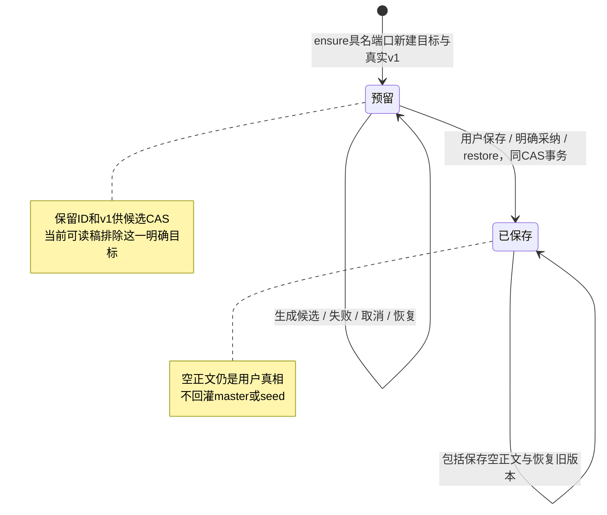

# T1331：区分整稿未采纳空目标与正式保存脚本

待独审 SPEC；当前仅本文写权，未 START、未授生产 W。承接用户本轮全功能恢复授权与 Root 2026-10-17 的明确裁决：保留正式保存空稿的权威，同时不得让整稿自动预留的未采纳空目标遮住原可读稿。T1327 仍保原完整公共链两项 soft FAIL，不因局部准备门修复或本 SPEC 而变绿。

## 真实事实与证据限度

T1327 唯一准备门窄修后，`runtime/run-green` 真实 exit1/28.497628792s：父 ai-task-91b26441-38、子 ai-task-91b26441-42，原 master artifact-91b26441-16，新项目级 output_script artifact-91b26441-40。真实宿主/账本/不可变 worker 产生四段候选，确认后新 version45 已被稿面、服务端选择器、article/graphic scriptContext 和刷新读回；旧 master 全对象/版本及另一平台 document 不变。该链外部供应商0、合成原生3turn，不冒供应商验收。

| 时点原件（均在 docs/verification/t1327/runtime/cases/green） | 稿面 UI / article / graphic | 服务端真实选择器 |
|---|---|---|
| consumers-before.json | 原 master16/version18/原文 | 同一 master16/原文 |
| consumers-before-candidate.json | 仍原 master/原文 | **新 target40 空初始版本** |
| consumers-awaiting-confirmation.json | 仍原 master/原文 | **仍 target40 空文** |
| consumers-after-adopt.json / consumers-after-refresh.json | target40/version45/新稿 | 同一 target40/version45/新稿 |

原件 RESULT 准确写 CHAIN_COMPLETED_WITH_PRE_ADOPTION_CONSUMER_FAILURE，Vitest0PASS/1FAIL。T1327 此轮实际调用了 UI selector/loadScriptEditorData、服务端 selector 及两个公开平台 source 读侧；**尚不能把直接 selector 观察称为 reviewSubject/getCurrentScriptRef/dailyReport 三条最终功能均已执行**。本任务必须补这三个真实消费者的公共读侧证据。

旧 `project-script-truth.ts` 明确合同是：正式 output_script 有保存版本后即为正文真相，即使用户主动保存空稿也不能回灌旧 master/seed。不能直接复制 UI 的“跳过空正文”逻辑。用户的“清空正文”和系统的“预留一个目标”是两种事实。

## 现有持久字段不能可靠反推

实际 `script-draft-target.service.ensure` 仅在没有同项目/同 output 的 output_script 时调用 artifacts.createArtifact，后者经 repository.create 自动造空 v1。已读 schema/repository：

| 字段 | 自动空目标 v1 | 用户公开新建空稿 v1 |
|---|---|---|
| artifact.origin / status | null / drafting | null / drafting |
| currentVersionId | 指向真实 v1 | 同样指向真实 v1 |
| versionNumber / contentText / contentData | 1 / 空串 / 空对象 | 可完全相同 |
| changeSummary / createdByType / aiTaskId | 初稿 / user / null | 可完全相同 |

随后 task.inputData.artifactId 只能证明任务使用该目标，不能证明目标是这次新建还是复用了用户已有空稿。创建时间、标题、版本数量或字符串匹配均不能补足明确事实。adoptionKey/adoptionSourceDigest 是采纳回执边界，不借用来冒充预留状态；origin 的 reconstructed 也不能挪作本问题状态。历史未标记记录不回填、不猜测。

output-scripts.service 的候选合同要求真实字符串 baseVersionId，并读取该版本校验 CAS，因此保留初始 v1 和 currentVersionId，不采用“全部目标暂不建 v1/设 null”方案。不为项目级和 output 级发明两套目标生命周期。

## 选定的最小可靠方案（待独审）

由 artifacts 属主保存一个**私有、nullable 的真实预留版本指针** `scriptDraftReservationVersionId`。只有 script-draft target 服务的具名内部创建端口，在同一原项目/工件事务新建空目标和 v1 时，才将此指针写成该工件的真实初始 versionId。复用目标绝不补标；普通公开 createArtifact 不可设置它。字段标识生产动作事实，不做正文质量或语义判断。

- 标记有效时必须属于本 artifact、指向原空初始版本且等于当前版本；不符合不静默猜测正文，返回明确读取错误/不可用。不能借 pending 放宽 user/workspace/project/output/版本归属。
- 正式 createVersion（用户保存或明确采纳）与 restore 的**原 CAS/归属事务**一起清除预留指针；包括用户明确清空、恢复初始空版本、重复确认、恢复旧版本。不得修改历史 version 字节或新增“伪采纳版本”。标记清除失败与版本/指针更新一并回滚。
- `artifacts.replaceStructuredContent` 只是导出的 TypeScript service/repository 方法；已核当前 contract operations、artifacts.transport 和全部非 test 调用，没有该公开 operation 或真实用户调用。原稿把它写成“公开同版本保存入口”是事实错误，现撤销该新增确认行为与验收要求。保内部结构化材料化不清 reservation，不新增 operation、确认语义或用户入口。
- 原采纳回执的幂等 early return 只读原回执，不再执行清 marker；新确认必须先持原 parent/artifact 锁、核当前版本/CAS与当次读到的预留指针，再同条件更新。旧、跨 target 或失效 CAS 的采纳不得清除另一版本/目标的标记。一个 artifact 的已解除预留不被后续 ensure 重新标记；并发测试同时核版本与指针，不能先无条件清标记再写版本。
- 任务失败、取消、模型设置变化和单纯候选生成都不等于用户确认，不清除预留状态；继续原任务或新合法任务复用此目标时保持原真实指针。采纳前从可读稿集合排除这一个明确预留目标，仍保留其 ID/v1 供原 worker 与 output CAS 使用。
- 新迁移默认 NULL；全部旧记录保留当前“正式保存空稿也 authoritative”的合同，不扫描旧 task 推断。新增列只迁隔离测试库；旧用户库升级由后续正式打包/迁移 Gate 管，不在诊断中操作用户库。

公开 artifact 读投影拟加只读可选 `currentVersionIsReserved` 布尔值，旧缺省按 false/已保存语义解释，值只由后端真实标记计算；不向公开 create/version/restore 请求增加设置该事实的权限。frontend 使用读投影，不读取数据库、不解释内部 task 或 adoption 回执。具体公开字段及迁移属于本 SPEC 的明确服务契约变化，须 Root 独审并由 C 记录 DEC 后才能实现。



## 一个后端确认稿读协议

拟新建 `backend/src/application/context/confirmed-project-script.ts`，导出 `createConfirmedProjectScriptReader(ports)`；返回的具名函数签名为：

```ts
readConfirmedProjectScript(ctx: RequestContext, projectId: string): Promise<{
  projectId: string;
  artifactId: string;
  versionId: string;
  fullText: string;
  sha256: string;
} | null>
```

ports 仅为现有 projects/artifacts scoped service，不跨模块 repository、不读前端、不引入 SDK、调度或另一份主稿实体。先核真实项目范围，按现有 output_script→master_script 的身份/列表优先级读取，仅排除明确预留状态；选中后精确读取 currentVersionId 对应不可变版本，不再“同类型再找第一项”或取最高版本代替当前指针。正文用既有 `extractArtifactText`/legacy 规范化事实读取，实际字节及 hash 一并返回，禁止按文本质量、标题或关键词另选。正式空稿返回非 null、fullText=''、空串真实 SHA256；没有确认稿返回 null；权限/损坏/读取失败不能混成 null 授予 seed 回退。

工厂 ports 必须可由调用者绑定**当前 transaction-scoped** projects/artifacts service；不能在持锁事务中偷偷使用全局 db 的 reader。T1328 start/confirm 按原 workspace/member→project→source root→child/result/prediction 稳定锁序，在同一 tx 构造此工厂并读取 ref/版本/正文/hash，避免另一个连接的 TOCTOU。一般读侧亦需单一一致快照或精确 current 复核；并发变化时明确冲突/有界重读，不混合新 artifact 指针和旧正文。共享的是选择/提取协议，不是共享全局有状态 reader 或第二个锁属主。

正文来源提取的 transcript/contentData.sections/contentText 兼容与旧语义须逐族对照，不能借统一端口改写正文、丢段或把 markdown/转录摘要混为相同 hash。旧 radar seed 只在**没有确认稿**的 null 分支沿原规则回退，不能对 fullText 空串或读取错误回退。

实际 `createCurrentArtifactReader` 还读取 `artifactsService.getScriptSections(ctx,versionId)` 的结构表；新端口必须把该 service 加入只读 ports，保留旧 JSON sections 的规范顺序、结构表章节顺序/正文、transcript 与纯文本族。应从已经选定的真实 artifactId/currentVersionId 复用其提取机制或拆出精确版本提取叶子，不能按 artifactType 再找一次目标。原 `context/current-artifact.ts` 因此纳入拟 scope 作为提取叶子/回归点，但任意 artifactType 历史读取接口不改成“自动挑另稿”。正式正文为空是当前不可变版本的结果，不能通过“没有结构段”就回退旧稿。

`project-script-source.ts` 当前 types 为 output_script、master_script、content_outline，另有“无主稿时项目大纲可用”兼容。核心确认稿端口只负责 output/master，不擅自让 review/校准开始消费 outline；project-script-source 在核心返回 null 时继续其原 content_outline 读取，保原 label/ref/current 版本与权限。若核心返回正式空稿对象，必须停止 outline/seed 回退。稿面规划大纲的独立 loadPlanningOutline 保原消费，不把大纲冒成用户已保存的口播稿。

### 机器写入可达性盘点

- `script-business-adapter`/structured worker 的生成 prepare/project 仅产生候选与业务任务结果，不在生成阶段调用 artifacts.createVersion；实际 `ai.service.confirmTask` 的 artifact_version 分支才通过注入 artifactsService 追加版本（createdByType='ai'）。因此不能以 createdByType='ai' 就判为后台未确认；该分支是明确用户采纳，应解除本目标预留。
- `output-scripts.service.adopt` 真实核候选/baseVersionId/CAS、先读原采纳回执，再 createVersion；它是明确采纳，正确解除当前预留，原回执 early return 不改变当前标记。`project-script-candidate.service` 的雷达稿采用同样属于用户 adopt，可能复用 output_script，应解除，不给后台生成增加自动采纳。
- `transcript-artifact.ts/.service.ts` 的后台转录，先按 imported project 与真实 awemeId 检查**已有逐字稿**；缺匹配时创建新的 output_script，再给这个新 ID 保存转录。它不把没有 awemeId 的整稿空预留目标当同一逐字稿；restoreMaster 只在没有 master 时创建独立 master 并写该新 ID，不触及 output 预留。原机器已保存的转录事实可读合同不改变，需真实覆盖“同项目另有预留目标”回归。
- `reconstruct-completion/reconstructed-artifact` 当前新建 research/trend_analysis 原稿，moments、article/graphic、thesis、positioning 等版本分别受原属主/工件类型约束，不是 script-draft output 预留目标；不为这些机器写入新增确认语义。实现前按实际最终可达调用清单与测试再次核，不以名称相似推断不可达。
- `replaceStructuredContent` 当前仅 service/repository 定义及内部材料化语义，没有生产用户入口，不在本任务引入确认动作。若发现新的真实后台写能复用预留 output 并直接改当前正文，应先留实际调用与 scope delta，不能泛把任意结构化写入都当用户确认。

具名端口供 T1328 冻结真实 subject→project 当前 artifact/version/hash/全文使用；其原卡/原 prediction 回执、盲预测锁和新版本 CAS 仍归 T1328，不在本任务重建或推断。C 已确认复用此端口，两个任务不并发写 persistence-client；先冻结共享端口与组合根，再实施调用者。

## 三个真实消费者与相邻读侧

| 已读源码的当前消费者 | 具体问题/原边界 | 本任务必须实证的改后读法 |
|---|---|---|
| backend/application/context/review-subject.ts 的 getScript，经 persistence-client 的 makeReviewSubjectReader 注入 | selector 选 current 指针后读 transcript/contentText，空串不回灌 seed | 原实例注入确认稿端口；明确预留阶段仍读 master；正式清空必须空串；归属不放宽 |
| persistence-client.ts 的 readCurrentScriptRefForReview → reviewGateService.script.getCurrentScriptRef | 当前 selector 后 listVersions 排序取最高版本号，可能与 restore 后 current 不同 | 同端口取精确 artifact/version，再从真实版本取得原 artifactVersion number；不能造版本号或换另一个稿 |
| persistence-client.ts 的 dailyReport.readScript → createDailyReportApplication | 当前 selector 选 type，再交 readCurrentArtifactTruth 找该类型首项，有多稿/恢复错位风险 | 同端口原 ref/正文；正式空稿不回灌seed；真实日报只有已发布记录才调用详情读，不伪造“已发布”事实来过测试 |

稿面 `resolveScriptArtifactIdFromDb/loadScriptEditorData` 和 `backend/application/project-script-source.read/readContext`（article/graphic 实际 scriptContext）按同一确认/预留读状态对齐，保原类型、项目、output 和准确 current 版本。稿面可显示用户正式清空后的真实空，不保留旧 master 正文；不做页面重构/视觉方向/假按钮。script.draft 宿主读取当前稿的注入亦复用确认稿端口，防预留目标在后续合法生成中被当已确认上下文；不改任意 artifactType 精确历史读取 API。

三条当前源码调用链和 T1327 selector 观察为已知事实；下游完整操作仍需新运行，不能把上述静态表当 PASS。日报如无真实发布样本，允许在隔离受控应用端口测试中明确使用合成 publication fixture，并标为受控，不能将它存入真实验收库或称真实发布/采集成功。

## 拟实施边界与当场验收

拟产品 W：`backend/src/schema/artifacts.ts`；C 已实际核无冲突并独占保留的新 `backend/drizzle/0138_script_target_reservation.sql`，主 `backend/drizzle/meta/_journal.json` 新 entry 为 idx111、version7、when1791043200011、tag0138_script_target_reservation、breakpoints=true（控制原件：fresh-20261017/control/T1331_MIGRATION_SLOT_RESERVATION.json）；`backend/src/migration-convergence.ts` 的精确新tail/catalog登记。后者当前硬核主 journal 恰111项，新版只认可共同旧111项原字节及这一第112项，entries/sourceSQL/expectedCatalog/缓存身份新增这一个锁定SQL hash与when/tag，要求原0137前置回执，正确区分升级前后catalog；SQL真实hash实施锁定时由实际字节计算，不虚填。`backend/src/migration-convergence-lineages.json`、installed-lineages与所有 drizzle/lineages 历史档保持原hash/字节，不在旧快照追加新版本、改旧hash或放开未知迁移。其它 W：`backend/src/modules/artifacts/artifacts.repository.ts`、`artifacts.service.ts`、`script-draft-target.service.ts`；`contract/src/resources/artifacts.ts`；新 `backend/src/application/context/confirmed-project-script.ts`；既有 `backend/src/application/context/current-artifact.ts`、`backend/src/application/context/review-subject.ts`、`backend/src/application/project-script-source.ts`；`frontend/src/server/project-script-truth.ts`、`frontend/src/server/persistence-client.ts`、`frontend/src/features/script/script-editor-data.ts`。不写 ai-worker、模型协议、全局 workspace/member 门或 T1328 采纳/预测服务。若实际迁移装配或消费者需要额外路径，先提交具体 scope delta/独审，不临场泛加 glob。

拟测试 W 限对应 artifacts 现有 integration/compatibility、project-script-source、project-script-truth 与 script-editor-data 测试，新确认稿 reader 测试及新 `frontend/src/server/__module_integration__/reserved-script-target-read.persistence-client.test.ts`；精确文件名由 C 注册实现包，不能用 tests glob。docs/verification/t1331/** 保存控制 fixture、source/test/config/worker 锁与全部原结果。T1327已冻结原件不改写，本任务新夹具从明确新副本装配。

1. **新公共 RED**：先锁完整 source/test/config/worker 字节和真实唯一收集；保持现源码无标记，非空 legacy master→正式 script.draft→自动空v1/候选未采纳。实际调 reviewSubject.getScript、getCurrentScriptRef、日报 readScript 的生产组合读入口及 UI/article/graphic 读侧，期望仍原 master，自然暴露目标问题；不只测 selector helper。完整父/子候选/采纳继续观察，失败保留。
2. **同链 GREEN**：目标初始 v1/CAS仍有效，未采纳三 server 消费者与 UI/平台均读 master；用户采纳后所有消费者读精确新 target/current ref/fullText/hash，刷新/重开读回，旧 master 与另一平台完整不变。实际完整生产宿主/worker/ledger/采纳，不 stub 最终 reader、reservation 或采纳成功。
3. **主动空稿族**：公开新建空稿无 reservation；用户将新预留目标显式保存空、从非空保存空、restore 空初版（包括当前已是该版本）均清 marker并 authoritative，三个 server/UI/article/graphic不能回灌 master/seed。旧未标记空 v1、旧已保存空版本和既有非空初版按原事实处理，不回填。
4. **目标生命周期/并发**：两个 output 与项目目标独立、preexisting空目标不补标、同 attempt/不同任务复用不造新marker、模型失败/取消不当确认、createVersion/restore/采纳 CAS失败整事务回滚、重复原回执无新增版本；保 output baseVersionId 真实且可采纳。
   另覆盖内部结构化材料化不解除 reservation；旧采纳重复或失败CAS不能清新预留指针、指针清除后不被ensure回挂。读后发生保存/恢复时，返回必须是单一一致的 artifact/current version/hash；若中途真值变化则冲突/重读，不能拼接两版本事实。
5. **安全与历史**：跨user/group/account/project/output、归档/成员失效、假公开标记、错 artifact/version/伪指针/损坏版本拒绝；原 ownership/当前版本/来源hash/用户确认保持。恢复到非最高版本的原 currentId 必须被三消费者精确读取。转录、sections/html/plain文本、无确认稿+seed与明确空稿各族分列，不靠空白字符串启发式通过。
6. 新迁移：隔离旧schema数据→新列NULL/原数量与ID与当前版本不变，可重复迁移，无历史猜测或真实用户库操作。最小产品 diff、契约 additive 兼容、完整公共链及独立实现审通过后，由 C 一次统一构建新不可变包，再真实 owned 项目验收；受控不代供应商/真实发布。

主链 test8h/hook180s/独立outer9h（正执行保至少120s及更长原预算，执行留完整清理余量）、retry0/singleworker/自有cache与worker输出。未知保原ID不重发、不续deadline；owned进程/资源在正常与异常退出均精确清理。先 independent fixture review 与 collection-only，不重演导入/nonce缺陷。

完成需实际公共 RED/GREEN、上述全部输入族、合同/迁移/前后端读侧回归、boundary/orphan/semantic、涉及读取/局部刷新处的 LED-047 与 timeout-policy Gate；C独占统一timeout/pmem sync/reconcile/taskctl。既有全局失败如实保留，不修改T1327原两FAIL或父40/56原矩阵。当前本文不是实施授权，也不声称三消费者新运行、新迁移或新包已通过。


## 2026-10-17 兼容补充：选择统一，正文投影保原消费者语义

原已审 SPEC c45bec7aef12c3176667c16265acbe7cce9af303a00be5bde9b8ba381a2c1ae8 与 REV:1af34a4130c7 原字节保存在 runtime/green-control/closing/spec-compat/BEFORE.md。原目标 RED、首轮公共 GREEN 和各次 Gate 原件保持，以下是基于实际受影响回归的补充，不能把旧证据改写为最终全绿。

首轮公共 GREEN 25.4711175s/exit0 完成预留/采纳/恢复/清空三消费者，但旧 T1034 在 artifacts-contract-v2 实际54PASS/1FAIL。旧 reviewSubject 还被素材导出 getScriptText 消费；将其返回值全部换成 canonical 使原 extractor 二次解释画面/字幕标记。真实 closing/export-observer-v2：用户局部改成纯文的第一段在导出丢失，只剩第二段。不能只更新断言或修补导出词法来掩盖回归。Root 已独审认可以下最小兼容设计；T1034 原断言一字不改。

### 两个只读投影，共用一个精确快照

原 `createConfirmedProjectScriptReader(ports)` 及五字段 `{projectId,artifactId,versionId,fullText,sha256}` canonical 接口完全不变，继续供 daily/平台/当前稿面/校准使用。新增同文件具名 `createConfirmedProjectReviewScriptReader(ports)`，返回 `readConfirmedProjectReviewScript(ctx,projectId): Promise<{projectId,artifactId,versionId,text}|null>`。

内部仅一个选择叶子：核项目/属主→按原身份优先级排除真实预留→精确 current 不可变版本→在该 snapshot 上执行投影→投影全部完成后再核 current/预留选择一致。不能先复核后异步读取结构表，不能第二次按 type 选择或取最高版本。两工厂同样支持 caller 当前 tx scoped ports，错误照旧明确拒绝，只有无确认稿才 null。

review 投影精确保留旧 getScript：若 `contentData.transcript` 是字符串，使用该字符串，**包括显式空字符串**；否则用原 contentText。原 `.trim()` 判空规则保留，非空原字节不改。不能直接套用跳过空 transcript 的 extractLegacyScriptText，也不使用 body/结构表把旧纯口播重新解释。该投影只供 reviewSubject.getScript；素材包继续复用原 review reader，不改 production/material-export 词法。显式空稿仍停止 master/seed 回退，选择/版本/归属门不降级。canonical 的结构表、JSON段落、全文/hash 与历史 readVersion 均不改写。

### 实际公共回归与范围

先在兼容修复前运行独立 `confirmed-script-export.persistence-client.test.ts`：同本轮 owned workspace 经正式 endpoint 创建项目/视频/output_script、保存分镜与公开段落修改、公开 restore 非最高版本；每族经 getOutputProduction→exportProductionMaterials→真实 blob GET→实际 ZIP 中口播稿.md读回。覆盖：分镜局部改纯文、口播文字本身含画面/字幕标签、restore 非最高版本。完整保存三族输出再 soft 断言使实际回归自然 RED；不执行模型/worker，不伪造导出字节，不为过门改 exporter。

实现仅恢复既有两后端源 `confirmed-project-script.ts`、`review-subject.ts` 的精确 W，persistence 两工厂的薄注入由当前 C owner 在其支持式范围执行。新增测试仅上述公开导出文件与现有 confirmed reader 对照；原 T1034 测试不改。相同公开导出 GREEN 后，原完整主链用新 green-v2 各按自己的投影断言：ref/version一致，review 保 legacy text，daily/canonical 保 canonical text，不再要求两个用途的字符串相等；原 run-green 保留。

旧 source.readVersion/legacy frozen snapshot 的结构表空历史欠账独立登记，不在本补充引入新历史协议或重算旧 digest，也不给该 workCreation 输入族签 PASS。完整收尾仍须受影响原测试、迁移、边界/孤儿/语义和统一 timeout Gate；本补充本身不是最终验收证据。


## 正式 script.review 的同稿消费者补充（本段待 Root 独立复核）

已核 c077 SPEC、289ae IMPLEMENTATION_RESULT、315项 FINAL_INDEX 与 RELEASE_HANDOFF 的原字节单独保存在 `docs/verification/t1331/review-consumer-supplement/before-review-consumer/`，原本地通过结论仍只覆盖已实际运行的消费者。该补充尚无目标RED、产品修改或正式新包验收，不把旧PASS扩大为正式审核成功。

### 当场源码事实与最小范围

新包U18准备只读发现：`persistence-client.ts` 的 `reviewScriptSource.getLatestScript` 仍自行选首个 output_script/master_script，并将 versions 按 versionNumber 倒序取最高。正式 `scriptReviews.trigger` 的 `readCurrentScriptRefForReview` 已按本任务确认稿reader冻结准确 current；`prepareScriptReviewContext` 又准确核任务 artifactId/artifactVersion。因此已保存v2、v3后恢复current=v2时，提交冻结v2而准备口读v3，会由原版本门拒绝；合法自动预留空output目标也会被该旧口优先读到。这是同一确认稿选择协议遗漏的实际消费者，不是版本门本身错误。当前是源码可达证据，尚未将其标成公共RED。

唯一拟生产差分在 `frontend/src/server/persistence-client.ts` 的这个薄组合端口：复用已审 `readConfirmedProjectScript`，按它返回的具体 artifactId/versionId 查找同工件不可变版本的 versionNumber，返回原端口形状 `{artifactId,version,text}`，text取同一确认快照的 canonical fullText。不得再按最高版本、最近任务、首个未确认output、非空正文自建选择规则；不得更改原 `prepareScriptReviewContext` 的版本/归属门。metadata查询只能精确匹配versionId且artifactId相同，缺行/损坏抛错；不能以最高版本代替或转seed。名称getLatestScript保留原内部接口，不新增公开op。

确认稿reader返回null时，保原 `readProjectRadarDraftSeed` 的无稿回退；明确保存的空稿返回非null空正文，仍由原“暂无可审脚本”门说明，不能回灌seed/master/outline。原reviewSubject/素材ZIP口播投影继续使用已审的独立legacy reader，本补充不改变它；当前canonical五字段/hash和旧workSource schema1历史快照/digest也不改。JSON sections、transcript、plain和结构表当前稿的文字提取由已有确认稿reader负责，不引入新的解析器、selector或表。

### 精确读取与写入边界

新增读取：`backend/src/modules/ai-runtime/script-review-context.ts`、`backend/src/application/generation/writing.ts`、`backend/src/modules/review/review-gate.service.ts`、`backend/src/application/chat/preparation-tasks.ts`，以及同目录已有script-review-context/prepare测试与旧 `group-review-completion.persistence-client.test.ts` 的实际链。迁移、worker、模型/权限/正式报告写入规则都不改。

R的新增公共受控fixture仅 `frontend/src/server/__module_integration__/script-review-confirmed-current.persistence-client.test.ts`，证据/runner/config/helper/锁在 `docs/verification/t1331/runtime/review-consumer/**`；产品仍由C单写persistence组合，不授R该生产文件。旧SPEC、旧测试/RED/GREEN/315项索引全部只读，新结果和新索引只追加至独立目录，不覆盖原报告。

### 必需当场证据与新包

1. 产品修改前取得真实公开 `scriptReviews.trigger → prepareScriptReviewContext → 原structured worker/正式报告服务` 目标RED。仅外部模型I/O可为受控替身，原冻结输入/准备/版本检查、账本和完成服务不得stub成功。覆盖restore非最高v2（v3仍存在）与合法自动流程新建的未采纳预留output目标+有正文master两族；预留事实必须来自原合法自动准备流程，不直接写私有marker。RED前置装配失败分列，不能当目标红。
2. 同一公开动作GREEN须核trigger冻结的准确artifact/version、prepare/worker实际正文为被选中的v2/master版本、真实settled模型call与正式报告引用版本，读回/刷新保持同一ref；不得用最大版本或仅父task succeeded代签。最高current原合法样例保原行为，当前空稿/损坏/外组与真实current在提交后变化仍按原明确门拒绝；旧版本检查测试完整保留。
3. 重跑这条新公共链、原script-review-context/准备版本回归、受影响类型检查与边界/超时门；已通过且实际消费者字节未改的ZIP/其它读侧证据可精确继承，不无差别重跑所有模型。
4. 最终完整包仍执行一次正常U18正式script.review：保存v2/v3→真实恢复v2→正常入口→实际冻结正文/版本2→报告刷新。受控GREEN不是新包/真实Codex证明；整体仍不提前taskcomplete。
