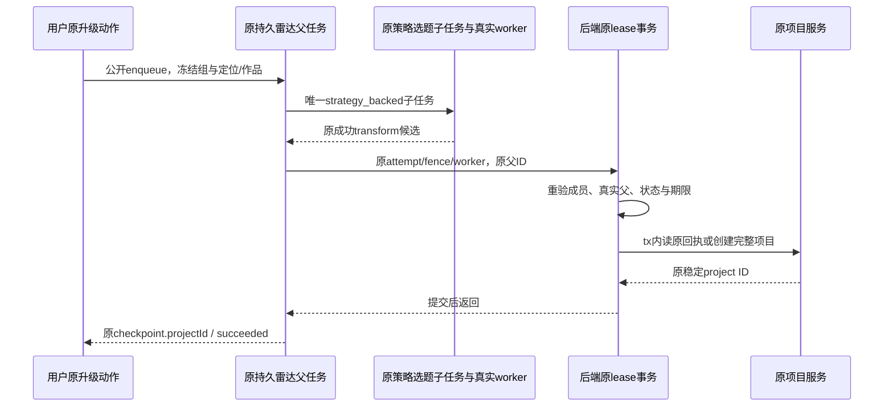

# T1332：恢复纯账号组雷达策略选题升级项目

待 Root 独立评审；当前仅 SPEC/控制文档权限，未 START、无生产写权。承接用户本轮通用修复授权、T1022「共享创作归组，平台事实/发布归真实账号」及 Root 2026-10-17 的明确裁决：U35 不补账号绕过，不先付费试失败；先审合法 workspace、真实父任务、成员与幂等兼容，再以完整受控公共链当场 RED/GREEN。本文不将源码判断记成已发生的 RED。

## 问题与现有事实

用户在内容雷达选择已有作品，点击现役「升级为项目」，应当在其原账号组内获得项目和 Brief 中的改编候选；没有绑定平台账号不影响这项组内创作。当前流程前段支持纯组，末端 `projects/radar-project.service.ts:16` 仍执行 `requireAccountId(ctx.accountId)`。纯组在策略任务完成后走到这里会被拒绝，可能白耗已完成的生成；本次尚未运行该公共失败链，不推断失败任务/收费已发生。

已读链路：

| 真实消费者 | 现状及边界 |
|---|---|
| `use-project-upgrade-queue.ts` → `intelligence.projects.enqueue` | 正常 UI「升级为项目」提交实际 itemIds、定位 statement ID 和幂等键；不是聊天 N 节点，也不是公开 `previewTopic` 的 rewrite_only 分支 |
| `radar-project-queue.service.enqueue` | 先用真实定位/作品服务逐项授权，再以同作品稳定键创建 `radar_project_upgrade` 父执行；重复点击返回原任务和冻结输入 |
| 原父 `tick` → `startTopicPreview(strategyBacked:true)` | 来源/真实手工稿可用后创建唯一原 `topic_preview` 子任务，checkpoint 保存 topicTaskId/transformId；等待该子任务，不另造模型根 |
| `intelligence-generation-bridge` → 原 generation worker | `structured:topic.generate`，依次执行原分解、策略、改编稿 Skill；最后一步正文是原 text 生成。原执行账本、冻结路由、模型身份及恢复策略继续生效 |
| 父读取已成功子任务及同 transform.outputSnapshot | 要求真实 adaptedDraft.contentText、adaptationStrategy、hook，再构造 contentRadarEvidence 候选 seed；不自动写正式主稿，不执行发布 |
| `createRadarProjectService.ensureRadarProject` | 当前单独要求账号；稳定种子为 `JSON.stringify([ctx.userId, accountId, queueTaskId])` 的 SHA256 前 32 位；现有命中早返、失败后补读均未绑定实际父任务租约 |
| 常规 `projectsService.createProject` → repository.insertProjectWithChildren | 已使用 requireWorkspace/workspaceStamp 与 withWorkspaceWrite；项目、七阶段、平台关系、activity 同事务落库。仅删上层账号门不足以补真实父执行/取消竞争 |

`persistence-client.ts` 直接把真实 radar service 注入队列，没有修正该账号门的适配器。现有 radar-project 测试只有 legacy 账号，且把不存在的 `queue-1` 当父 ID；它能测旧 ID 并发，却不能证明真实父关系、纯组、成员或租约边界。现有队列单测将最终 projects 口替成成功函数，不能作为本问题的公共 RED。

## 选定的最小后端方案（待审）

只改雷达专用末端及原调用方；常规项目、全局 requireAccountId、workspace/member 服务、模型配置和公开 DTO 不变。不开新页面，不恢复旧按钮，不新增模型或采纳入口，不迁数据、不增表。

1. 队列向内部 `ensureRadarProject` 传递本次原 claim 的执行凭证：`queueTaskId`、`attempt`、`fenceToken`、`workerId`，以及本次已经校验的来源身份 `itemId/topicTaskId/transformId`，与原 title/briefDetail 同次调用。不是公开请求字段，客户端不能提供此执行权；不接受缺 proof 的「兼容成功」路径。
2. 专用 service 复用现成 `createExecutionLeaseService.withLease({executionTaskId:queueTaskId,attempt,fenceToken}, 'admission', action)`。该服务先核冻结 workspace/member，再锁真实 execution 行，重核 running、有限 deadline/lease、attempt/fence 和冻结成员。action 内另核 leaseOwner 等于 proof.workerId、父 kind 为 radar_project_upgrade、ownerType 为 item、ownerId 与 payload.itemId 及本次 itemId 逐字相等；checkpoint 必须来自原 creating_project 阶段，非空 topicTaskId/transformId 与本次来源身份精确相等。传入 ctx 的 user/account/group 和冻结版本必须与锁定父逐字段一致；后续授权/创建只使用该锁定父派生 context，不能从当前页面重选 scope。
3. 真实 child/transform 的可信校验明确落在 **原 queue**，不让 projects 直接读取 intelligence repository。queue 在最终创建前通过 `tasks.get(ctx, checkpoint.topicTaskId)` 读取原子任务，核 id、kind=topic_preview、ownerType=transform、ownerId=原 itemId、原 `${parentId}:preview` 幂等键、user/account/group 与父相等，账号成员版本沿其真实冻结值核实，以及 status=succeeded 且未明确标记 runtimeStatus=partial/unknown_result；runtimeStatus 缺省、undefined 或历史内部 null 不算未知，规则见下节；通过 `intelligence.getItem(ctx,itemId)` 核 scoped item/detail，精确找到 checkpoint.transformId，核 transform.itemId、aiTaskId=原 topicTaskId、同幂等键/定位ID及其实际公开的 user/account/group、sourceSnapshotId 属于该真实 item 的已存快照。策略旧输出的 generationMode 合法可缺省（原 finishTopicPreview 参数就是可选）；按原策略分支接受缺省或 strategy_backed，明确拒绝 rewrite_only/未知值。**generationProgress 不是创建必需条件**：合法旧 snapshot 可完全没有该属性，仍凭真实已成功 child/精确 transform 与原 adaptedDraft.contentText、adaptationStrategy、hook 最小条件继续创建；不补阶段记录、不重跑模型。字段存在时只按其实际存储结构读取/核实已有阶段，见下节，不新增「必须三阶段齐全 completed」的质量门。transform 投影没有 groupVersion/membershipVersion，不伪造这些字段或要求与父相等；成员版本校验发生在真实 task/admission；groupVersion 只保存各任务当时事实，不要求父/child 数值相等：组改名递增 version 后，原组合法 child 仍可完成。既有 output 结构及 adaptedDraft/contentRadarEvidence 构造继续原路径；不要求旧冻结来源必须仍是最新快照，不换到新来源。当前 childReady 只有状态检查、transform 只有按 ID 找项，故上述缺失的身份校验明确纳入原 queue 文件的窄写集。完整受控链与错误 child/transform 负项都要实际经过这些检查；不拿传入 Brief 或字符串看起来像候选代替真实完成事实。
对于迁移前真正 legacy 父（groupId=null、真实 accountId 非空），原 scoped 服务允许的 child/transform groupId=null 或 `grp_legacy_${accountId}` 等价范围继续兼容；仅这一既有适配，不映射任意新组。child 当次成员资格仍由真实 admission 检验，旧父无 membershipVersion 不伪造数字补齐；已转入非 legacy 组仍准确拒绝。需增加真实旧父/新 child 兼容测试，不能用此分支放宽显式 group 父。
4. **查询既有回执和创建都在上述同一 admission action/事务内**。先取得真实项目 ID，再用该 tx 绑定 `createProjectRepository` 和 `createProjectsService`。创建仍走原 insertProjectWithChildren/withWorkspaceWrite，不手工插 project/stage/activity，也不在 transaction 返回后写入。锁顺序沿现有 membership/group → execution → 项目创建，不另造反序锁。
5. 原 queue 的 checkpoint、finish、等待/取消处理保持原协议。创建在持有有效父 lease 时原子提交；随后若父被取消，已合法提交的项目不被删除或改作未知。创建已提交而 checkpoint 未保存时，后续**同一父任务**合法恢复使用稳定 ID 找回同项目；不再调用生成、追加第二项目或覆盖原 Brief。completed 父的公开重复 enqueue 仍直接返回原任务，不重新走内部 admission；不为已完成/取消父新授执行权。

### 旧策略输出与可选阶段元数据兼容

Root 独审指出上一草案「三阶段 completed 必需」会给旧合法输出新增门，现撤销。只读证据与实际适用范围：

| 已读源 | 真实事实及本任务限制 |
|---|---|
| `intelligence.service.ts:133–149` hasTopicCandidate | 无 generationProgress 属性的旧非空 object 沿原候选投影；有该属性时按真实非空 adaptedDraft.contentText 投影，并不要求三阶段齐备。这里只是投影，不单独证明队列可创建项目 |
| `radar-project-queue.service.ts:126–130` | 原末端在真实 child 成功后仅要求 adaptedDraft.contentText、adaptationStrategy、hook；没有 generationProgress 必填。新身份/权限检查不可借机改变该旧候选内容合同 |
| `radar-project-queue.service.test.ts:13,42–53` | 既有成功 output 同时缺 generationMode、generationProgress，仍有 hook/strategy/adaptedDraft；该测试是机械 service fixture（最终 projects 为 mock），只证明原输出族/期望，不能冒完整公共 RED 或历史用户数据 |
| `intelligence.service.ts:4813–4935,4940–4978,5125–5129` | 当前逐阶段写入采用稀疏 map；decomposition/topic/draft 项完成时 status=completed、completedAt，失败时 status=failed、errorCode、failedAt。最终新策略 finish 写三项 completed；不能倒推旧成功 snapshot 也曾有这些记录 |
| `intelligence.service.ts:5293–5324` 与 `intelligence-confirm-topic-public.integration.test.ts:28,39` | 旧 strategy 采纳只在已有非数组 progress object 时检查其原 topic/draft，旧无 progress 的 strategy 仍有明确兼容 fixture；这个“采纳选题”消费者的门不移植成雷达项目创建门 |
| `contract/src/resources/intelligence.ts:380–390` | outputSnapshot 是开放 jsonObject/null，没有必填 generationProgress 或统一三阶段 closed schema；不新增或伪称已有这样的公开 schema |

实际 task 投影也区分缺省与明确未知：`persistent-task.service.ts:237–247` 的 toResource 仅对 retry_wait/waiting_user/unknown_result/partial 原状态增加 runtimeStatus；真正 succeeded **省略**该属性。`contract/src/resources/intelligence.ts` 的 V2 runtimeStatus 为可选四值枚举，当前公开 schema 不把 null 当合法枚举、真实当前 service 也不产生 null；不能声称其总是投影 succeeded 标记。队列读取成功 child 时接受 status=succeeded 且 runtimeStatus 缺省/undefined，历史内部兼容 null 同样只表示没有该额外标记；明确 partial（即便外层 status 被映射 succeeded）或 unknown_result、以及任何非 succeeded 的实际状态都不能进入创建。不要用 `!runtimeStatus` 判为未知，不要求 runtimeStatus 必须等于字符串 succeeded，不把 null/字段缺失补成 unknown_result。精确回归：相同合法已成功 child 的 absent/undefined/null 兼容三形状均可继续、无字段补写；真实 partial/unknown_result/失败/进行中均不创建。null 形状仅是隔离内部兼容 fixture，不伪称当前公开 DTO 返回了 null，不为此改 contract 或 task service。

字段完全缺失与字段存在分开记录。存在时，按原生产者结构检查实际已有的 known stage object/status 和实际附带的时间/错误字段，保留原字节及其它 JSON 字段；不把缺阶段/缺时间补成 completed、不猜历史调用。稀疏 map 是原 saveCheckpoint 的合法中间事实，不强制补成三项；阶段元数据不是本任务的执行授权，也不能覆盖真实 task 终态。元数据本身异常只保留并报告该观测差异，**不得仅凭可选阶段记录把原 child 已成功且原最小候选齐备的合法项目整单杀掉**。真实 child 未成功、来源/归属不符、候选最小条件不足仍沿原业务/本任务身份边界拒绝，不因“legacy”放开。

精确回归分两组，不混真实公共主链：新公共 RED/GREEN 仍用当前真实 worker 生成完整新三阶段，核其真实字段且不人为删写；另在隔离 backend 兼容夹具建立显式旧存储形状（复用现有旧 output 的来源，真实父/child/transform ID、scope 和 lease，不冒真实供应商调用），经原 queue → 真实 radar service → 项目事务执行。至少覆盖：①generationMode 与 generationProgress 均缺失、②显式 strategy_backed 而 progress 缺失、③存在合法完整三阶段、④存在合法稀疏阶段但原成功 child/候选齐备。前两族必须创建一次、重启/幂等仍同 ID/旧 Brief，前后旧 transform/output 逐字段不变且仍无 generationProgress own-property，0新 child/模型调用、0回填记录。第三族保原 metadata 精确不变；第四族只记录实际阶段，不补齐、不以缺阶段拒绝原合法结果。缺 hook/strategy/contentText、错误 child 或未成功的负项与这些旧族交叉，仍不创建项目。该兼容测试不把 hasTopicCandidate 的“任意非空 object”宽条件单独当项目授权，也不通过删新公共链字段伪造一条历史模型执行。

## 稳定 ID、既有回执和范围

不能只把 accountId 换 workspaceKey 后宣称隔离安全。ID 从锁定的真实父冻结范围计算，授权由父/成员/项目范围共同核实。

- 冻结 accountId 非 null 的原合法路径（包括已含 group 的既有任务）**逐字保留** `[userId, accountId, queueTaskId]`、同 SHA256/截取/`project-radar-` 前缀。七阶段及 activity 子 ID 的旧计数算法也保留；不迁移或重建已有项目，不因升级换 ID。
- 只有冻结 accountId 为 null 且合法 groupId 非空时，采用明确标签的新 tuple `[userId, 'group', groupId, queueTaskId]`，其余哈希/前缀规则不变。该标签只实现幂等，不判断内容。无组无账号拒绝；不生成假账号。group 中可选的页面账号不能改写原父冻结范围或让同一父生成新 ID。
- 既有命中必须经原父 admission 与 tx-scoped repo.get 真实范围读取；返回原全对象，不用新 title/brief 覆盖。checkpoint 如已含 projectId，必须与该父确定的稳定 ID 一致；不搜索用户最近项目/标题近似或跨 scope 猜回执。
- 原 catch 后无条件全局补读不能保留成权限绕过。并发同父由原 execution 行锁串行，项目主键仍裁决；若保留唯一冲突后的补读，必须重新取得**同父、同 proof 的合法 admission**并 scoped 读取，原错误不可泛吞。数据库/成员/取消等失败不得因为外部恰有同名 ID 而转成功。
- 同用户不同组、不同用户、legacy 不同账号与不同真实父不能借同请求 queueTaskId 读取/创建别人的项目；真实父 scope 不符先拒绝，不能以重新哈希掩盖越权。

组 active/owner 与账号 member.version 使用现有真实 admission 规则。纯组不伪造 membership；groupVersion 保留任务冻结事实及 ctx 一致性，不能擅自加「任何组名称更新都杀旧任务」规则。账号已转组/成员版本失效、组归档/不存在、原父取消/暂停/过期/换 fence 等必须在副作用前准确拒绝。

## 当场公共 RED/GREEN 方案

先冻结 source/test/config/Node/worker 字节及协议 fixture，独立装配审和 collection 通过后，**在改产品前**运行一条新的隔离受控公共链；当前没有这条 RED，不能补记。不得以旧 U35 rewrite_only 成功、源码 throw、直接 ensure 调用或 mock projects 成功代替。

拟新增 `frontend/src/server/__module_integration__/radar-project-upgrade-group.persistence-client.test.ts`，复用现有 persistence-client 集成装配：全新 owned file PGlite/media/workspace、内存随机测试 app key、真实 factory/compositeTransport/ENDPOINTS，纯组不带 account。公开创建组、合法定位 statement、RSS 来源；外来源网络 I/O 返回明确标记的中性受控 feed，经原 source runner 创建真实 item/snapshot；通过原 uploadManualTranscript 公开口保存同一段人工来源摘要，明确是测试人工摘要，非 ASR、全文采集或新近新闻。

使用原 `enqueueIntelligenceProjectUpgrades`，输入实际 item ID 和定位 ID；记录其原父。由真实公共宿主后台 driver 执行原 queue tick、原 topic child、production bridge/worker、call ledger、transform 保存及最终真实 radar service。只在外部供应商 HTTP（或经独审确认的等价最外层原生供应商协议）替换网络响应，按三个原 Skill 的实际 schema 给受控响应；不 mock generator/worker/queue/lease/project/repository/transport 成功，不预填 transform/output/项目回执，不调用 test-only 人工 tick/改状态捷径。现有官方 HTTP 受控替身有同消费者范式可复用，不新造执行器。

该受控链验证组末端，与真实 Codex 供应商验收分开：配置采用公开合法 self 路由指向本机受控供应商，只允许 loopback；不得伪造 Codex 登录/ready，不读取 auth。同时冻结路由/身份，策略 alias、facets 和 tool 分类来自原生产执行，不能把 text 请求冒 structured 三阶段。若现有 persistence 装配不能完整到该末端，先保真实失败并交独审，不为了 RED 改短链。

RED 必须实际观察：原策略 child succeeded、原 transform 含分解/策略/正文、原父末端 blocked/RADAR_PROJECT_BLOCKED，原因确来自账号门；本组项目列表前后无新增。若失败更早则如实记装配失败，不能计本问题 RED。GREEN 沿同一冻结夹具/断言（新隔离 run，不复发旧真实 root）要求：原父 succeeded、checkpoint.completed/projectId 真实、同组公开 get/list 项目可见、Brief 原来源/策略/候选正文逐字段一致、七阶段与一次 project_created activity，source/item/定位不变、无正式脚本/发布副作用。重建只读 client 后仍可见；同作品再 enqueue 返回原父/同 project/原 Brief，模型和版本不新增。

受控边界增加真实服务/事务测试，不能靠 mock ownership：

| 输入/竞争族 | 必须结果 |
|---|---|
| 纯组、legacy account、同组真实成员账号 | 完整成功；纯组 accountId=null；账号路径精确旧稳定 ID/子 ID，已有项目完整不变 |
| 同父重复/并发、服务重建、创建提交后原checkpoint暂未写入 | 一个完整项目/七阶段/一次activity；同父合法恢复找回，无重新生成或 Brief 覆盖 |
| 不存在/异用户/异组父、错误kind/owner/payload.item、错误checkpoint/错project回执 | 写前拒绝；无项目/孤儿子记录；不能仅换 workspaceKey 生成新项目 |
| 错attempt/fence/worker、租约到期、有限deadline耗尽、paused/cancel_requested/cancelled/终态父 | 不新增/修改项目，不把既有项目当执行权限；无人工续期或状态修改 |
| 同组只改名后生成/创建；组归档/错误owner；成员转出/版本变化、legacy已转新组 | 同组仅改名不误杀合法链；其余按当前 admission 准确拒绝，不偷换 frozen scope；纯组不伪造 member |
| 成员/组操作与创建两种先后顺序；取消/换lease与创建两种顺序 | 沿真实锁序：创建先持锁则有效原创建可提交；控制先提交则旧proof不产生副作用，无死锁或双项目 |
| 项目创建阶段中途失败、既有主键但 scoped不可见、数据库读失败 | 整笔回滚或准确失败；原 stages/activity/Brief 不变，不 catch-all 补读洗成功 |
| 原队列等待/失败/用户显式恢复、rewrite_only旧桥、原transcribe/source链 | 保既有行为及原任务冻结模型路由/预算；不自动重发未知、不扩大本次策略修复 |

controlled 场景可在独立 fixture 使用真实公开 command/成员管理口制造控制变化；不得修改旧库、原模型任务或生产用户资料。更低层故障注入仅为事务回滚负项，必须说明所替边界，不能取代主公共链。创建竞争必须验证真实持锁与提交顺序，不用事后 set 状态冒竞争。

## 拟实施写集、验收与资源

独审 PASS 后由 C 授具体 implementation lease；本段不是当前生产授权。拟产品仅两文件：`backend/src/modules/projects/radar-project.service.ts`、`backend/src/modules/intelligence/radar-project-queue.service.ts`（内部 proof 类型和原调用）。拟测试：上述两个服务的既有 `.test.ts`，以及新 `frontend/src/server/__module_integration__/radar-project-upgrade-group.persistence-client.test.ts`。旧 legacy 测试换成真正父任务/租约前置，保精确旧 ID、并发和七阶段断言，不删原语义。冻结 fixture/config/run 原件保存新 `docs/verification/t1332/**`，不得改 T1315/T1314 原报告、索引/失败或父矩阵。若需组合根、契约、worker、新表或公共字段，先给具体 scope/DEC 独审，不能隐含扩写。

阶段为现项目 BUILD 内独立窄修 SPEC；当前 Gate 是独立 SPEC 评审，非实现/发布许可。内部执行 proof 是安全边界收紧，公开 contract/IA/数据归属沿 T1022 不改；由 C 在正式登记时记录本次 Root 裁决/DEC 绑定。无页面/视觉改变，无新视觉方向。

实施要求实际命令/exit/耗时与文件 SHA：新完整公共 RED/GREEN、两 backend 服务完整回归、execution lease/member/workspace 受影响既有测试、相关 intelligence 原策略及 rewrite_only 回归、contract model-routing 与完整 final56 静态原测试按最终 sourcegraph 对照复用；typecheck、boundary/orphan、`node tools/timeout-policy/verify.mjs`。不得只跑新三条断言或为了此修复重复付费56次。

正执行/请求/有限观察至少120s，保现存更长；公共单 test8h、hook180s、单 worker/retry0，独立 outer9h并覆盖启动/串行I/O/清理。有限观察截止从唯一原 run 开始固定且显式拒绝 NaN，遇持久有限deadline再收紧，不续期；continuous保原无限任务语义但观察有界。所有资源为该 run 自有；finally 真实停止已创建的 host/worker、关闭本库/loopbackserver、记录PID与残留，未创建不能宣称已dispose。先冻结再运行，不在 C共享包构建时抢写dist。

受控 GREEN 和独立实现审后，C最终不可变新包/全新owned root执行一次原正常雷达升级入口，核实际策略 child/calls/transform→项目/Brief→刷新与幂等边界。只有真实供应商结果能计新包 U35 策略功能验收；旧 RSS rewrite/topic_preview/script_candidate/相似性链不重做，旧 UNKNOWN 不恢复重发。外部依赖/失败或未知如实保留，不凭 task succeeded 代模型账本/真实业务项目。C按支持流程维护任务状态、pmem/reconcile与既有全局失败，本 SPEC 和受控结果均不代最终收尾。
