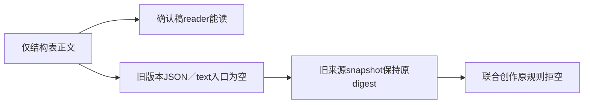

# T1333：结构表脚本历史来源读取兼容（待审）

这是本轮T1331验证发现的既有输入族缺口，仅登记事实，不START、不授产品W，不扩本轮修复或重算旧来源digest。

T1331确认稿reader可经getScriptSections读到只存在scriptSections表的正文；原 `backend/src/application/project-script-source.ts` readVersion仍经extractArtifactText读取原版本JSON/text，故同artifact10/version11的历史入口正文为空。实际原件：`docs/verification/t1331/runtime/regression/source-history-audit/OBSERVATION.json`。原 `workSource.read` schemaVersion1 legacy snapshot为空，digest `d057f343…`（完整值以原件为准）；restoreSnapshot原样深等，未改写历史。

真实旧消费者为 `backend/src/modules/work-compositions/work-source.service.ts`107-109/133及 `backend/src/application/generation/work-creation-root.ts`32/37。旧workCreation对这个空来源同样拒绝，目前无该输入族旧成功路径证据，因此不能把T1331修复标成引入回归，也不能把其三读侧GREEN代签这个历史来源族PASS。

未来独立SPEC需先定义新版本的来源读协议及旧冻结snapshot的兼容边界，再独立评审/真实RED-GREEN。不能静默回灌正文、升级旧schemaVersion、改旧digest或伪造旧成功。当前不提出未审技术实现，不要求用户接受新历史缺证。
