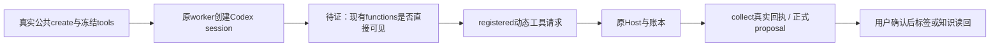

# T1334：恢复自主任务 Codex 现有动态工具可见性

状态：待独立评审。本轮只有SPEC/控制文档写权，生产0改、0新模型。所属任务T1334，与T1329工具名字编码范围分开；Root已允许依据本次真实失败提出窄修。任何生产授权仍等本SPEC独审、受支持START/精确lease与修改前公共RED。

## 问题与结果边界

用户让自主任务实际采集、整理素材或阅读资料入知识候选时，本次806a42新完整包确实调用了Codex，但三族均没有提出工具调用，最终没有完成业务。要恢复的是当前已注册、已冻结的业务工具进入原执行链的能力；没有新增工具、改变语义选择或扩大外部权限的需求。

| 本次真实新根 | 原执行ID | 实际事实 |
|---|---|---|
| collect `ai-task-c32b9e7a-174` | `exec_6edfc100-18e5-4263-8e78-a72b308fff45` | 1 settled model；proposedTools=[]；0 tool/reject；COLLECTION_INCOMPLETE/partial；source162无run/items，collections=[] |
| material `ai-task-c32b9e7a-204` | `exec_678d3188-2862-4884-95de-cce63469a4ab` | 1 settled model；proposedTools=[]；0 tool/reject；AGENT_NO_PROPOSALS，无候选/采纳 |
| research `ai-task-c32b9e7a-225` | `exec_88ce3e67-0c80-41e8-9f7f-c90ef34f94ef` | 1 settled model；proposedTools=[]；0 tool/reject；AGENT_NO_PROPOSALS，无读取/知识候选证明 |

三个原native thread/turn均公开，actualEngine=codex，model=gpt-6.1-sol，provider=openai。原结果全文、原spec、完整inspect/events分页、steps和清理见[本次报告](../verification/t1315/final-root/runtime/RESULT.md)及[三族公开原件](../verification/t1315/final-root/runtime/original-three-public-readback/PUBLIC_SUMMARIES.json)。冻结OUTPUT_INDEX SHA `2521b9ecb440e8e03d3043d26061740fd28a4356df84ca26e03c021fe7f3030b`，49项已自核0漂移。包source `806a42e67a8a75d74df14eaa917ec1cdbe30d657` / DMG `7d7d16e8e5f025ffe26f054e8ea81a95fe5ec15b4324ccb2c6f38ced7c6c63ff`；817files/13links执行锁与afterInputDrift=[]均保留。

这不证明模型真实视图里没有工具：public frozenTools只证明后端冻结输入；模型原回答没有公开。collect提交分支用固定错误覆盖summary，另两族diagnostic不保存summary；inspect对model.resultText固定null，events/steps本次为空。不得编造模型回答、补造工具回执或把“未发生Host调用”说成“Host丢回执”。

## 精确源码线索，非已证首因

- `ai-worker/src/execution/codex-agentic-worker-run.ts:51`调用`createControlledCodexSession(cwd,signal)`，taskTools取默认false。
- `ai-worker/src/execution/codex-app-server.ts:13–18`的directNamespaces仅在taskTools=true时加入`functions`，并由同文件的实际CLI构造、两次初始化/config/read及assertConfiguration共同执行；`code_mode.enabled`仍false。
- `ai-worker/src/execution/external-chat-worker-run.ts:115/117`的现役聊天路径明确传taskTools=true。该路径既有真实工具成功证据与本次agentic不同，但不能代签本次三族的模型视图。
- `codex-native-turn.ts`将编码dynamicTools放入thread/start，只有真实`item/tool/call`请求才进入原onTool；名字合法且thread/start成功不等于模型会调用工具。
- `backend/src/modules/ai/execution-agentic-candidate.service.ts`核原native身份和调用事实：collect结果空则partial，另外两族proposal空则failed。这些诚实终态保持，不能用放宽成功门修复可用性。

T1329只复用provider名字编码/逆映射，明确保taskTools值；它的受控CLI fixture无条件报告code_mode=false并不按实际argv反映functions暴露，且material仅search、research仅dryRun。其GREEN不得用于证明本任务的可见性或实际业务闭环。

## 最小拟改动与权限

若完整公共RED证实该接线缺口，唯一拟生产修改是自主Codex worker创建session时显式使用现有参数：`createControlledCodexSession(cwd,signal,undefined,false,true)`。不改变全局默认、其它caller、argv/helper实现或能力目录。

所有原冻结工具name/schema/description/顺序、T1329 provider编码及精确逆映射、原toolCallId/args、Host/ledger、预算、route/凭据和候选采纳保持。新配置只允许当前任务已冻结的动态函数直接进入现有callback；未知名字/namespace/跨thread/turn仍拒绝，不能变成任意函数执行。

不启用shell、unified_exec、code_mode执行、MCP、apps/plugins、浏览器交互或原生web_search；imageGeneration仍false；原thread approvalPolicy=never、sandbox=read-only不变；网络约束仍是agentic现役唯一支持的network=deny。研究的受控web.read仍经原批准端口和证据服务，不添加浏览器授权/toolGrants，不放开URL守卫。语义决策仍归模型，产品代码不按任务目标关键词选择调用或编候选。

这是现有工具暴露接线修正，不改服务契约、数据库/schema、IA、用户页面或发布标准。C沿本轮通用修复授权及Root技术裁决登记DEC；若实现需要超出上述边界，先回本SPEC独审，不隐含扩范围。

## 完整公共受控RED/GREEN

生产修改前先冻结新夹具、实际源/config/Node/SDK与独立worker字节，collection/类型后给Root实物装配审。复用旧`agentic-provider-names.persistence-client.test.ts`的真实公开transport/factory/worker骨架，新建独立测试和runtime；不改原T1329测试、旧证据或当前在用最终包。

### 外部I/O替身的准确边界

1. 新测试真实调用公共`execution.tasks.create`，由真实identity/new纯组、spec准备、原authority/dispatcher/worker、原`createControlledCodexSession`、`codexProcessArguments`、RPC协议及`runCodexNativeTurn`执行。session工厂或内部Host/commit不stub成功。宿主driver按正常start/dispose生命周期工作，不直接改lease/status/call/result，不以手动写库或最终complete冒队列通过。
2. 仅官方Codex子进程的version/stdin/stdout等外部I/O采用显式受控进程替身；真实付费供应商调用为0。记录实际CLI argv中的每个`-c`、两次config/read结果、thread/start完整dynamicTools和registered请求。替身从实际argv解析配置：taskTools=false时不发functions工具请求，只完成一个无工具回合；true时才发本次注册且被允许的动态工具请求。不得硬编码config/read永远返回functions=true或无条件发工具，否则不能作为本次RED/GREEN。
3. 受控工具请求是预置测试输入，不冒真实模型的语义决策或视图证明。它验证的是实际CLI/config→动态请求分发→原Host/账本接线。恢复、预算/取消、作用域和候选内容都仍由原服务核验；已知provider名字/原业务名字及完整输入回执逐字比对。
4. collect/RSS与research来源读取只在transport/I/O层提供明确合成HTTP/HTML/RSS。对外声明受控数据，非真实供应商/公网事实。fixture先证明生产URL守卫拒绝loopback/私有地址，不能为了本地HTTP服务器关守卫、改归属或把loopback伪称合法URL。可以在固定测试公共hostname的DNS/HTTP边界返回可核验响应，记录原requested/final URL、方法、signal、状态、content-type/响应SHA及本地承载地址；守卫、source/queue/adapter/Host/ledger真实运行，不能stub最终succeeded/complete。
5. research若需浏览器读取，限自有空profile、固定受控来源和HTTP I/O；不读用户浏览器/登录仓，不打开外部真实账号。原读取文本→持久evidenceRef/snapshotId→knowledge.write来源校验完整执行。若现有骨架不能安全承载该transport，先保装配失败补精确fixture方案，不绕过证据服务或用假evidence ID追绿。

### 三族业务断言（修改前后相同）

|族|必须实际经过的原链与断言|
|---|---|
|collect|公开新RSS source runInitial=false/monitor=false→唯一agentic根→registered collect.plan/run/status→真实source run/queue及RSS adapter→原Host canonical回执→实际items/snapshots和ok=true集合→正式result和succeeded。pending不算完成；合法即时完成族按真实合同不强加runId字段；没有status调用则单列覆盖，不能冒全工具覆盖。source/任务真实ID及稳定parent+target幂等绑定不变。|
|material|公开上传本轮中性素材→dryRun=false的唯一根→真实material.search返回该owned asset→material.organize→真实stage proposal及expectedVersion/原toolCallId/evidenceRefs→未采纳前asset与标签关系不变→公共confirm→真实taxonomy.entityTags.listForEntity和adoptionReceipts读回。不能用search0或dryRun计划替代此链。|
|research|唯一dryRun=false根→真实worker web.read受控来源→原证据服务保存/分窗读完→knowledge.write使用真实evidenceRefs，sourceNote逐字等于证据sourceUrl→正式stage proposal→确认前知识无变→公共confirm→knowledge.list/get/revisions和来源/回执精确读回。不能以URL假冒evidence、仅文字或synthetic dryRun计划判通过。|

RED应在原代码上：实际argv/config缺functions暴露、native回合完成却0动态请求/Host tool，三族业务断言分别失败；从原公共终态/结果验证，不能只用argv断言失败充当目标RED。比此更早的readiness、DNS、合同、worker/DB/路径失败只能记装配失败。当前806三族现场FAIL另列，不追签新夹具为历史RED。

GREEN应在最小修改后：同夹具、输入与断言，实际argv/config仅预期functions名单发生必要差异，registered动态请求实际进入原Host及账本；三族全部达到上表业务结果。保每个原model/tool的settled/rejected/错误回执、input/output及resultRef/proposal来源；允许原任务内合法纠错，但未知副作用/unknown_commit/未结算仍失败，不把已拒绝调用作为阳性证据。三个业务断言不可为过测而改为task succeeded或model completed。

### 保持既有输入族

复用并运行原worker既有族：settled回放；started/unknown只恢复原thread/turn、0新turn/start；缺native绑定不重发；原usage/budget；工具名字编码/碰撞/未知名和原点号provider拒绝；namespace/thread/turn边界。加本次局部caller参数精确断言，并核实际配置仍禁shell/code_mode执行/MCP/web_search等。其它caller的默认taskTools=false和已有external-chat显式true不变。

公共组合还保：foreign组的source/asset/evidence/候选拒绝且0跨组变更；同attempt/同intent幂等不新增原root/call，异意图不复用；确认前版本变化/CAS仍拒绝无半写；未授权浏览器和network=allowlist仍按现役合同拒绝；取消/unknown保原ID不重发。已有精确同消费者证据可以引用，新增source接线变化涉及的边界必须实际覆盖，不能堆无关重复测试。

## 预算、锁与清理

每个真实/受控agentic根维持timeoutSec1800、maxSteps20/maxTokens100000；从提交前登记原绝对期限，异步prepare→execution绑定不另开窗。finite deadline只取min，continuous null保原预算；错误NaN拒绝、剩余不足120秒不发正请求。RPC保900秒，单主要组合test保原8小时、hook至少180秒；三个根+setup/确认/读回显式受各段deadline约束，外层按实际串行上限、8小时major与清理余量共同计算，至少覆盖global/hook完整串行，不用默认一天掩盖欠覆盖。实物装配中列具体命令和总秒数再开跑。

worker只构建到T1334新owned输出并锁源/metafile/bytes/SHA，不能写共享ai-worker/dist或换在用806 sidecar。依赖只hash/链接核，不复制大binary。源锁前与C/R约短稳定窗，至该次实际cleanup释放；锁外其它文档工作不阻断。

透明supervisor保原参数/结果/异常；登记wrapper/worker/RPC/browser实际PID身份（不只parent PGID），finally无论断言/读回失败都await原dispose/close，核identity消失和files/links/absent零漂移。TERM不等于退出；有句柄且await成功才记disposed/closed，未创建如实NOT_CREATED。只清本轮owned资源，不停止C候选service、不碰旧DB/UNKNOWN/用户auth、不安装/发布。

## 拟后续写集与验收门

当前W只有本SPEC及`docs/verification/t1334/control/**`。独审通过、Root受控装配审及C正式implementation lease后，拟精确生产/测试W如下：

- 唯一生产：`ai-worker/src/execution/codex-agentic-worker-run.ts`。
- 原worker测试：`ai-worker/src/execution/codex-agentic-worker-run.test.ts`。
- 新公共测试：`frontend/src/server/__module_integration__/agentic-task-tool-visibility.persistence-client.test.ts`。
- 新控制/证据/独立worker/fixture：`docs/verification/t1334/control/**`、`docs/verification/t1334/runtime/**`。

`codex-app-server.ts`、`external-chat-worker-run.ts`、原T1329公共测试/fixture及旧所有原件都是R，不改全局helper或其它生产文件。若需要其它test/config精确路径，在装配时先列差分由C支持，不越权。无确定性生产生成产物，不自行重包；C统一构建最终新包。

验收：本次完整三族公共RED→同链GREEN；原worker相关tests与worker类型；新公共fixture collection/受影响frontend类型；contract（虽然无契约delta，保现役工具/worker schema）；timeout-policy；boundary/orphan，最后由C按适用规则pmem/reconcile，原全局债如实保留。fixture失败/缺环境不洗绿，不提前complete产品任务。

## 最终真实包闭合

受控GREEN只证明接线与业务服务组合，不宣称真实模型视图已证。本任务最终还需C统一新包、实际全新owned根/六槽配置与完整绑定后，独立新collect/material/research各唯一真实公共提交，按上述业务消费者/实际model runtime/ref/native metadata/候选与采纳关联验收。沿现有已审T1315四根driver意图与约束；新的正式新根必须经Root/C明确授权与新run登记，不改旧174/204/225或旧825/848。U35仍按自身T1332/母矩阵范围待依赖就绪后验证，不用本SPEC额外脚本生成/付费研究代签。

若最小参数接线在受控完整链或最终真实包未能解决，保新失败及原ID、停止该分支，回Root裁决；不得换话术/关闭诚实结果门或一轮轮新任务追成功。
