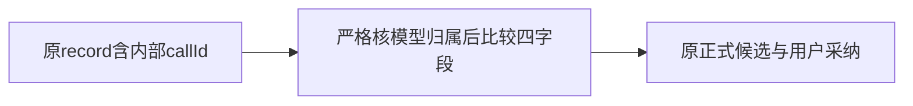

# T1335：修复自主研究知识候选的原生来源比较边界

状态：SPEC待独立评审，生产0W，未START。当前文档lease仅本文及 `docs/verification/t1335/control/**`；独评、Root核验与C正式授权前不改产品或执行新业务根。任务总授权与DEC-133501由C登记。本任务沿产品流程进入需求/SPEC审核，后续完整公共RED先于最小实现；无页面、视觉或架构方向变更。

## 问题、证据与源码链

合法Codex研究已读到证据并形成暂存知识提案，原模型/两工具均settled，但正式候选提交被拒绝。目标是恢复真实record→worker结算→来源校验→正式候选→用户confirm→知识/修订/来源读回；模型完成或stage成功不算交付。

T1334受控新AI `ai-task-23a350a5-7`／execution `exec_6fcdde10-f464-4baa-9aee-a7fa36ef36ea` 现场证明：final三帧写出、model settle/checkpoint成功、Chromium退出后，commitAgenticResult拒绝。trace共5次同ID自然恢复拒绝；Debugger只在当时时点取到前4次原中文错“知识候选与已结算原生工具来源不符”，原栈 `agentic-proposal-staging.service.ts:42:115` → `execution-agentic-candidate.service.ts:110:49`。第5次仅ConflictError/code null。观察器授权停止143/301.577秒，5PID gone/afterdrift0，原任务仍running、不取消不恢复。

权威原件为外盘0700根 `/Volumes/T7-MacData/CodexBuilds/t1334-tool-visibility-20261017-706cfbe7/diagnostic-research-v3/OUTPUT_INDEX.json`，SHA `7f5dd80d285e76ffe740f1b1646220b0db4ea2ca9bebd0fe8ef655fc9476af3f`（33项Root独核）。原T1334完整报告 `docs/verification/t1334/runtime/LOCAL_IMPLEMENTATION_RESULT.md` 保其它失败/清理/模型缺证限定；不重抄或追签旧806/UNKNOWN。

- `execution-codex-call.service.ts:33–39` 的真实recordCodexToolCall端口严格parse并保存完整incoming，含内部model callId/toolCallId/toolName/input。
- `codex-agentic-worker-run.ts:82` 显式构造type/toolCallId/toolName/input四字段canonical，settle原模型receipt。
- `agentic-proposal-staging.service.ts:37–42` 把完整binding spread进passthrough schema，settled后与四字段receipt全对象deepEqual；内部callId造成投影不等。
- `execution-agentic-candidate.service.ts:110` 最终提交再调用同一verifyExecutionKnowledgeSource，不能在调用方绕过。

原错误/收尾已现场证实；具体键差异由真实生产者与worker显式投影推导，未冒Debugger另读过完整binding/receipt值。新公共RED须用真实record端口和worker四字段receipt证明当前形状，不能以手写无callId旧测试替代。

## 最小方案与安全合同

只在verifyExecutionKnowledgeSource的native知识分支规范比较，不改变调用方、DTO、provider、全局schema或数据库迁移。

1. 沿原executionTask/model/binding读取、frozen knowledge.write唯一性、原thread/turn及根model检查。仍以 `tools[input.toolCallId]` 精确map key取值，且记录toolCallId必须逐字等于该key；不得通过Object.values扫描捡alias。原record中若**存在callId字段**，先验证它是非空字符串且逐字等于当前model.id；null/错误类型/foreign ID必须拒绝。缺省才属于受控兼容的旧无内部callId事实，不能把显式无效值当缺省。
2. 原binding与匹配的settled receipt工具事实都先经原checkpointToolCallSchema验证。canonical若带callId也必须与当前model.id一致；不能用规范投影隐藏冲突的已声明来源身份。
3. 明确构造双方 `{type,toolCallId,toolName,input}` 四字段，再严格比较，不能删除原持久callId、改worker事实、只比toolName或重新序列化input来掩盖参数变化。原record有callId并已验证归属后，它不参与这四字段相等判断。兼容原record没有callId的旧合法四字段事实，不伪造缺省callId或写回历史数据。
4. 保持canonical匹配恰1条、正确knowledge.write/toolCallId、唯一原生根模型、started/settled状态与requireCurrentModel规则；started准备可以形成原暂存提案，settled最终再核。非原生Pi分支保持原逻辑。
5. 保持knowledgeParameters全文严格相等、真实evidenceRef/阅读call已settled、证据先于knowledge工具账本顺序、同execution/task/组/成员/来源URL，sourceNote逐字等于已读sourceUrl等门。确认前后CAS/归属/唯一proposal/事务幂等仍由原服务执行；不调用模型来裁定来源身份。

`SEMANTIC_BOUNDARY_ALLOW:` 本次仅规范同一原模型工具事实的协议投影并校验真实callId归属，不选来源内容、不打分、不改知识语义。

不纳入范围：通用commit失败后的状态机/恢复策略、worker重试/心跳/租约、模型默认配置、shell/code_mode/MCP/网络权限、T1334工具可见性、旧任务修复/补候选、UI或发布安装。不能把“最终比较宽松”作为降级；合法投影恢复可用性，归属/真实证据错误继续拒绝。

## 公共RED与同链GREEN

独评/Root装配核/C授test-runtime scope后，先准备全新owned外盘fixture；生产仍0W。沿已实证T1334独立factory/public transport、自然host driver、真实worker/session/argv、Host账本与研究reader链，只跑research一族。原中性HTML、固定公开测试URL、原goal/tool参数及全部采纳断言复用；T1334可见性一行属于已审前置，必须在实际输入锁明确为工作树基线，不能冒806旧包原复现。

- 外部模型仅用明确合成CLI/RPC I/O替身，actual args/config派生functions可见性，实际registered `web.read`→reader/证据→`knowledge.write`→真实stage→原model settle/checkpoint→commit。不能stub工具成功、evidence、候选或最终complete。
- 合成HTTP只映射固定合法测试公共hostname到本轮owned loopback传输。生产URL/DNS/私网守卫先执行，loopback/10.x/169.254负例保留；不把loopback伪装成合法URL或关闭生产守卫。HTML单窗，只签本次单窗，不外推12000续读。原context-close取消与原剩余期限仍传递。
- worker/Node/实际源码闭包、两个精确jsdom/readability symlink与真实浏览器都当场绑定。依赖只锁字节/links，不复制SDK/完整源码/DB，不写shared dist、不安装依赖。新worker只能写本任务外盘owned根，不能碰在用/旧806服务或DB。
- 透明validate/invoke enter/return/throw、安全IPC/child exit、CLI三final发送、同Db只读状态投影复用；不落凭据/handshake/完整worker payload。IPC requestId含临时fence编码，新增观测须只存其hash与callSeq，不复制原始requestId入公开证据；原T1334受控0700原件保持不改。
- **RED结束条件**：原公共业务status终态/runtime终态，或原Host实际commitAgenticResult已返回拒绝。后者只结束测试观察循环，不改任务状态、不伪造终态、不发cancel/恢复；随后仍执行原 `business.status === awaiting_confirmation` 硬断言，故修改前必须在真实来源比较拒绝处FAIL。finally必须await正常host.stop/dispose及独立PID清理，保存原错误/源栈与实际账本。更早装配失败不冒目标RED。
- 修改最小生产后，同一冻结夹具/同断言在全新GREEN标签执行，不复用RED/旧UNKNOWN。模型/两工具真实settled，正式proposal与原tool/model/evidence绑定；采纳前get/list知识不变；confirm后知识标题/note/sourceNote、currentRevision正文、sourceMetadata.proposalId/evidenceRefs与正式proposal逐字一致。相同confirm/回执读回按既有幂等语义不新增知识/修订，原source/evidence/任务归属不变。
- 三final写出、task succeeded或仅stage成功都不代上述正式候选/采纳读回。受控GREEN仅证明实际接线与业务组合，真实模型视图及供应商业务仍需C最终新完整包独立实际三族验收。

## 局部边界回归

复用原 `agentic-proposal-staging.service.test.ts` 与 `execution-codex-agentic-candidate.test.ts` 原生组合装配；原 `execution-agentic-candidate.service.test.ts` 保只读Pi回归，优先让positive从真实recordCodexToolCall端口保存完整incoming，使用原worker四字段投影与真实staging/settlement/commit/confirm服务，不以手种结果或mock commit成功代组合。

| 输入族 | 必须断言 |
| --- | --- |
| 当前完整record含正确callId | started阶段真实stage；settled四字段receipt再校验、正式commit与confirm成功；原持久record不删callId。 |
| 旧record缺省callId | 原合法四字段族保持成功；不是迁移或补写历史。 |
| record/canonical显式foreign callId、null、非字符串 | 来源拒绝且0半写；不能被四字段投影忽略。 |
| wrong map key/alias、wrong或duplicate toolCallId、wrong toolName、input正文改动 | 严格来源比较拒绝，原暂存/最终候选/知识/修订不新增。 |
| foreign task/model/组或缺原thread/turn | 原归属/唯一性检查拒绝；原root/回执不复用为新根。 |
| foreign/未settled/时间在后evidence，sourceNote非来源URL | 原证据与顺序门继续拒绝，不加伪证据或改域名守卫。 |
| 同意图重读/同confirm、已有正式result | 同原ID回执/知识/修订数不增；异意图/版本或归属变化按原门拒绝。 |
| 非native原合法族 | 原Pi/provider来源比较保持，未新增callId必填。 |

非法持久形状若只能用同DB受控故障注入构造，须明确标为服务边界负例；不冒真实公共用户/模型已经产生该状态。已有同消费者负项可以按真实source/hash精确继承，不无意义重跑其它40U/56route，不把原手写无callId测试当当前record族已覆盖。

## 预算、隔离与清理

每新根timeoutSec1800/maxSteps20/maxTokens100000，提交前登记绝对deadline；异步prepare/执行绑定/自然恢复不续窗，NaN拒绝。正请求/探针至少120秒并继承原剩余期限。major test保8h/hook180秒；单research外层最低 `28800 + 2×180 + 2×1800哈希 + 1800启动/报告 + 600清理 = 35160秒`，可保原更长92760外窗但明列当前只1case；根仍1800秒。真实commit拒绝已到RED目标，不空等30分钟。

C核准新T1335外盘owned根后才创建worker/DB/cache/tmp/media/PID registry；先核parent realpath、目录不存在/非symlink及0700。仓库只小型test/helper/receipt/指针，不复制依赖/DB/完整源码或写shared dist。短协调实际源/deps稳定，运行wrapper完整before/after核files/links/absent；若冻结时引用前次after0，明确未重新全树hash、运行前仍完整实核。正常finally await原host/persistence/browser/http与环境清理，独立PID身份核验，TERM不等于退出；未实际await诚实NOT_OBSERVED。

所有旧RED/失败/原DB与索引保持只读，0task取消/改状态租约/旧UNKNOWN恢复/用户auth。原Debugger仅历史取证，不是新公共链前置或产品观测API。

## 拟后续精确写集与Gate

独审通过后由C另授，当前不是implementation授权：

- 唯一生产：`backend/src/modules/ai/agentic-proposal-staging.service.ts`。
- 两既有测试：`backend/src/modules/ai/agentic-proposal-staging.service.test.ts`、`backend/src/modules/ai/execution-codex-agentic-candidate.test.ts`。
- 新公共测试：`frontend/src/server/__module_integration__/agentic-knowledge-native-binding.persistence-client.test.ts`。
- 本任务控制、helper与小型结果：`docs/verification/t1335/control/**`、`docs/verification/t1335/runtime/**`。外盘只作明确owned运行数据，不把绝对路径塞repo write_set或改guard。

`execution-agentic-candidate.service.ts`、`execution-codex-call.service.ts`、worker/T1334两源、所有global schema与旧所有证据均R，不得借本SPEC隐含扩写。

Gate按一次有效输入/差分完成：真实公共RED→同断言GREEN、两服务边界/真实端口组合、受影响backend/frontend类型、现役执行/知识合同（已有精确同消费者可继承）、timeout-policy、boundary/orphan及diffcheck；无相关新改动不重复已通过整套。C最终pmem/reconcile与taskctl按流程处理，失败/全局债照实保留，未取得最终完整包真实三族/知识采纳不能提前签整任务或T1300全功能PASS。
