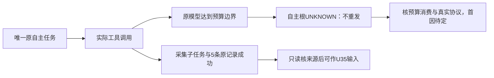

# T1337：诊断自主任务完成前预算耗尽

状态：待审的事实登记与零模型只读调查，不START，不授权生产修改。

本轮7f1d4ec9新包已经恢复实际工具调用，但采集和研究的原自主根在形成完整业务终态前进入`CODEX_TOKEN_BUDGET_EXHAUSTED / unknown_result`。工具副作用成功与自主根完整成功必须分列，不把预算码直接归因于累加、供应商或上下文，也不凭此否定T1334/T1335已实际通过的局部修复。

## 已证事实

- 实际来源提交`7f1d4ec9ec9f5dcb7f898e12408206ef41bac3c9`；DMG 847026757字节、SHA `0aee74b08c36defcd731a00bf6d72b1be1bc1239b992a7609431c958fce111dd`；新候选60616/独立ownedRoot `t1300-candidate-A5DZUu`。原六槽设置revision1未改变。
- 原采集AI `ai-task-7441aa97-72`、执行`exec_355bc7df-e517-44fa-bf13-236dd25f17c7`，当前公开状态AI running/runtime unknown_result、execution blocked/runtime unknown_result、errorCode `CODEX_TOKEN_BUDGET_EXHAUSTED`。Root/B已实际读取原账本：1个model unknown、原累计totalTokens110205超过原maxTokens100000，5个settled工具；原collector子任务93与run94成功，新增5条items及对应5个snapshots。完整安全回执由B原ID只读补证后独立封存，不能用当前公开DTO缺少budget字段捏造该数值来源。
- 原研究AI `ai-task-7441aa97-161`、执行`exec_d612d7e7-76ca-42b4-b9f4-c85f56872eef`也公开blocked/unknown_result及同budget码。最终token/tool/候选账本待B沿原ID补齐，不先假定与采集的内部首因相同。
- 原素材AI `ai-task-7441aa97-124`、执行`exec_5230d575-cec2-4c72-8f22-3815ffe0b14e`完整候选、用户confirm与标签域读回已通过，正式模型meta tokensUsed63015。该通过不代采集/研究完整通过。
- 原三根wrapper自然exit1/223.74092583399033秒、expired=false、error=null、afterInputDrift=[]、registered/remaining=[]；API DISPOSED/browser NOT_CREATED。没有第二次采集/研究提交、任务取消/恢复或预算改写。原UNKNOWN与副作用均保留。

## 当前调查范围

只读核：原AI/执行任务/全页inspect/results/events/工具回执与冻结预算，原官方tokenUsage通知的total/last/cached语义及本包实际消费路径，`codex-native-turn.ts`与`codex-agentic-worker-run.ts`预算观察、已安装且与本包绑定的Codex0.159.3 schema/配置接口。记录真实可见字段和未暴露字段，任何计费/上下文假设必须有协议和实际回执支持。

当前源码对原通知total进行赋值，不得未经证据登记“通知反复累加”的修复。只读调查不能调用turn/start、重新跑模型、重开旧DB、resume/cancel原任务、改变user设置、提高/绕过预算或修改生产。无需新增通用架构、供应商、账号或测试框架。

## 不在本次登记内的实现

没有拟定生产写集；未确认首因。若调查证实产品缺陷，必须另补准确最小方案、独立评审、DEC与当场完整公共RED/GREEN后才能授实现写权；保本登记与原新包失败。不能扩大T1334原caller或T1335知识比较任务的技术范围，也不能借T1331额外周期。

原合法采集run/items/snapshots可在Root逐来源核后作为U35输入，与原自主根UNKNOWN分开；新handoff必须明确`COLLECT_SIDE_EFFECT_SUCCEEDED_AGENTIC_FINAL_UNKNOWN`及`originalAgenticComplete:false`，不套旧整体PASS标签。U35尚未执行不能先写成功。

## 原件指针

- `docs/verification/t1315/final-root/runtime/run-final-7f1d4ec9/{OUTER_RESULT.json,CASE_RESULTS.json,collect/observation.json,research/observation.json,material/FINAL.json}`。
- `docs/verification/t1328/final-integration/runtime/final-candidate-7f1d4ec9/public-binding/SHARED_BINDING.json`与原实际来源、三个confirmed收据。
- 后续原ID安全inspect/来源补证与冻结索引由B追加，只读诊断不把模型自述或未暴露字段写为实测。

本项只登记待审调查；整包相关完整功能仍未通过，旧两个已验修复的局部结果保持。无新模型、生产改动或taskcomplete。

## 原ID最终账本追加（不改前述首因未知）

B已冻结同原ID公开全页inspect/results/events：研究原model unknown/113622tokens，三个settled工具（两次真实web.read分窗及knowledge.write）；仅一个staged知识草案，无正式agentic_proposals、未confirm。素材model settled/63015tokens、两个settled工具，正式采纳和标签读回完整通过。采集model unknown/110205tokens、五settled工具与原run94成功五条均保持。input/output/cache分量不在当前公开DTO投影，events全页实际空，不能把总量当prompt长度或准确费用，也不把events空推为无native通知。

原件：`docs/verification/t1315/final-root/runtime/final-7f1-result/RESULT.json`；68项冻结索引`OUTPUT_INDEX.json` SHA `d858ba908f4a4a9a385e6f12b6eced36dfef3da5e434aa5842eab643635ee23e`。现只读诊断不重发、不修改budget/生产；原首段“研究最终账待补”是此前登记时事实，以本追加已冻结字段补齐，不覆盖当时原件。

## 2026-10-17 最小实现提案：仅自主任务关闭自动Skill目录注入

本节是待独立评审的方案，不是已实施或已复现预算全部首因。上文原事实/失败/UNKNOWN与初始SHA原样保存在`docs/verification/t1337/control/FACT_SPEC_BEFORE_SKILL_CATALOG_DESIGN.md`。当前7f1候选及设置保持，先完成已批准最终性能样本；本方案未START/未授生产W。

### 新证据及能说明的范围

同一随包Codex0.159.3、全新隔离cwd的三次零模型RPC已实际完成：initialize、config/read、skills/list，1.355秒自然退出。config的instructions/developerInstructions/modelInstructions均null；skills共181（user176/system5），152enabled，description44839字符。MCP6全禁、未知0，16项扩展feature均false，0thread/turn/account/model、子PID消失。原件`runtime/readonly-v1/RESULT.json` SHA454ad28c226c850021dfb958dc2e856cb05ea3156e86ca5b53e19d917b824210与索引46707a9336ba364bece526729e36338e822ea4a7737fa0250fd8d3a62dd3a6a7。不把目录数量/字符数当旧turn实收prompt/token，也不把此RPC结果称模型根因实证。

B实际读取官方`rust-v0.159.3`对应commit`01fc69f4026735edfdf6789820549727a4867b11`源码；C另只读复核以下原官方文件：
- [skills_config.rs](https://raw.githubusercontent.com/openai/codex/01fc69f4026735edfdf6789820549727a4867b11/codex-rs/config/src/skills_config.rs)定义`skills.include_instructions`，作用是自动instructions block；它与逐name/path enabled不是同一设置。
- [world_state_catalogs.rs](https://raw.githubusercontent.com/openai/codex/01fc69f4026735edfdf6789820549727a4867b11/codex-rs/ext/skills/src/world_state_catalogs.rs)按include_instructions决定是否渲染自动目录；selected roots只限定executor来源，host用户目录独立。
- [fragments.rs](https://raw.githubusercontent.com/openai/codex/01fc69f4026735edfdf6789820549727a4867b11/codex-rs/ext/skills/src/fragments.rs)目录片段的角色为developer。B另读core/config默认true、host_roots与extension显式skill mention逻辑；完整路径/SHA由设计审计保留，不复制外部库源码进产品。

推论仅为：当前自主任务通过锁定的CreatorOS业务Skill/goal和Host完整动态工具提供能力，无需自动附带本机无关Skill目录；现有启动未显式关闭该自动目录。`include_instructions=false`能控制该默认目录，但不禁止显式Skill正文、project_doc、默认系统指令或其它上下文，不能称全环境/全部用户配置隔离。官方目录有上下文预算，44839字符更不能直接等于110205/113622总token。原预算耗尽的全部首因仍未证。

### 精确行为与范围

生产仅两源：
1. `ai-worker/src/execution/codex-app-server.ts`：增加具名、默认保持原行为的可选布尔参数（例如`omitAutomaticSkillInstructions=false`）。只在调用方明确true时，为MCP发现前/重新禁MCP后的两次startup argv均添加`-c skills.include_instructions=false`，并在最终config/read精确核`config.skills.include_instructions===false`。缺失、true、字符串或其它畸形值一律保现有`CODEX_CAPABILITY_UNVERIFIED`，不能把未核实当已隔离。不改变common调用默认，不因taskTools=true自动启用该新参数。
2. `ai-worker/src/execution/codex-agentic-worker-run.ts`：唯一该caller显式opt-in；保持原imageGeneration=false/taskTools=true及T1334动态工具命名/映射修复。

不改外部chat、structured、image、status/probe其它调用方；不改protocol/RPC白名单、完整tool/schema/result、base/developer角色、项目读取、HOME/CODEX_HOME/auth、MCP/扩展禁用、账号/所有权/幂等/候选采纳、原冻结业务Skill和goal字节、100000tokens/1800秒或持久deadline/UNKNOWN恢复。没有新CLI配置入口、全局默认或用户设置改写。没有按Skill名称/业务内容作代码语义选择。

既有测试仅三源W：`ai-worker/src/execution/{codex-app-server.test.ts,codex-account-precheck.test.ts,codex-agentic-worker-run.test.ts}`。验证显式true两startup一致、final false强核、返回缺失/true/malformed拒绝；默认/false不新增配置，taskTools=true的external-chat默认不受影响，image/既有disabled feature及两次MCP发现/凭据门保持。不得为了mock便捷漏掉第一或第二实际spawn。

独立完整公共受控测试拟新增精确`frontend/src/server/__module_integration__/agentic-skill-catalog-isolation.persistence-client.test.ts`，只测试/证据准备先另supported claim；runtime在`docs/verification/t1337/runtime/skill-catalog-isolation/**`，外盘新ownedroot须执行前具体授权。原T1334/T1335 fixture/红绿/旧UNKNOWN全部RO，采用透明副本及精确新label，不覆原件，不build共享dist。

### 红绿与验收

先交完整fixture/CLI shim真实argv-derived config、当前source/deps/worker锁给Root装配审，模型/HTTP仅外部I/O边界合成。RED须真实公开submit→现有worker两startup→实际config观察证明未关闭自动目录，主断言自然失败；不得人为合成爆量token或伪供应商预算码。实际目标RED与cleanup由Root核后才授两生产W。

GREEN使用相同公共动作与业务断言：collect原工具/collector/run/items；material真实proposal→confirm标签读回；research真实web.read/knowledge.write→Host账本/正式候选→confirm一知识一revision、重复confirm0新增。透明观测仅安全值/必要SHA，IPC requestId只hash，不落临时fence/凭据/raw配置；实际工具来源/父子/账本关联不弱化。受控成功只证明配置接线和完整业务链，不代真实模型usage下降。

必要门：上述三既有worker测试/worker完整type；frontend新增fixture type/collection；当前boundary、timeout、orphan及精确diff。123旧worker合同按未变具体消费者/协议证明复用，不重复整库门；新config形状触及的既有合同如确需另列精确实际文件，不把未收集路径当通过。test/hook>=180秒、retry0，单正请求/有限观察>=120秒并保原更长RPC/page预算；每原持久任务从第一次提交起取min原deadline，不续期/自动重发。三个串行case外层必须覆盖完整原观察/启动/清理，上线前装配核算，不用默认时长遮单根。

受控全部GREEN与Root结果独核后，唯一新commit/干净外盘固定SKIP_INSTALL包/独立ownedroot，再按原100000预算分别执行三个全新真实自主根；保真实meta/calls/tools/完整业务终态与usage、旧UNKNOWN不恢复。完整功能未过则如实FAIL/UNKNOWN，不以目录开关生效冒业务通过，不以一次总量变化断言全部预算根因。媒体/普通chat等未变消费者的806/7f1真实证据精确继承，最后新包性能仍需实际新身份绑定。

### 实际随包配置支持的生产前验收（Root独审补充要求）

性能独占窗口RELEASE后，先用同实际bundled Codex0.159.3与原三RPC观察器透明新副本，仅argv增`skills.include_instructions=false`，执行一次零模型initialize/config-read观察：实际config/read必须返回布尔false，随后正常关闭/实际PID消失/PGID空。可省skills/list，不列举/保存Skill名称，不读用户配置正文/认证，不thread/turn/account/model，不改本机或用户配置；保原readonly baseline与本次前后argv差分/安全布尔结果。单正RPC>=120秒、原startup/cleanup与外层完整覆盖，0重试。该实际支持证据必须在生产实现前完成；若返回缺失/true/malformed或拒绝该配置，停止本方案并如实待判，不先新增产品配置硬门反杀当前可执行任务。

完整公共受控RED的CLI/I/O业务回复不因flag改变：同原业务链可自然形成合法结果，在独立新增effective false断言上因旧配置未隔离自然失败。GREEN同业务断言逐字保留、配置断言通过；不得合成供应商错误/缺工具/爆量usage让旧代码“红”。实际config支持探针与合成公共接线是两类证据，均不能证明旧预算耗尽的全部因果。
