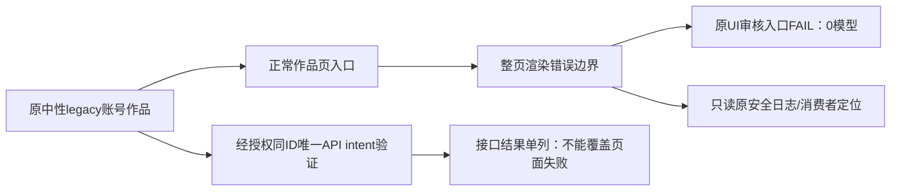
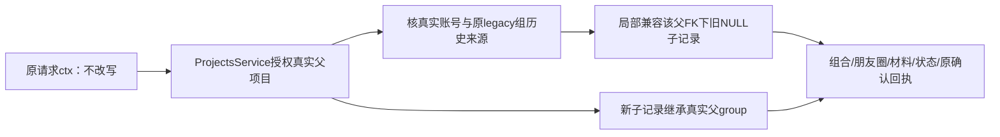

# T1338：诊断旧账号作品页的真实渲染错误

待审事实登记，当前不START、不授生产写集。

7f1d4ec9新包中，R按已审legacy account-only/no-group验收创建中性账号`acct-7441aa97-360`、项目`project-7441aa97-363`和composition383，通过真实页面进入正式作品审核。原UI没有产生模型根，页面实际为错误边界（digest `1542333634`），不是仅缺少定位器。Root/R已对同原ID只读DOM/图确认；首wrapper exit1/128.53087908303132秒、expired=false、afterInputDrift=[]、所有登记PID current=null、remainingOwnedGroup=[]。原120秒locator超时为实际错误页的表象，不能直接称模型不可用。

原账号无平台登录、externalAccountId=null、secretReference=null、followerBaseline=0；scope明确user-7441aa97-1/account360/groupId=null，不能换纯组来使该输入族消失。候选提交为`7f1d4ec9ec9f5dcb7f898e12408206ef41bac3c9`，DMG SHA `0aee74b08c36defcd731a00bf6d72b1be1bc1239b992a7609431c958fce111dd`。当前仅确认真实页面渲染错误，不猜数据归属、query解析或具体service根因。

当前允许的调查仅为原ID公开只读DOM/截图/安全错误栈与路由数据消费者核对。R已获Root单独授权用原ID及唯一原intent验证真实API入口，仍保原UI FAIL；API具体结果独立落盘后再追加，不预填成功。不得为调查自动重发原审核/新建替代作品、导入或种库、修改生产、绕开UI错误边界或放宽归属门。

若日志证实需要修产品，另写最小精确方案/DEC、独立评审及当场公共RED/GREEN后授实现，不能扩大T1313后端任务已验范围或把本项当现有T1331额外周期。当前无生产方案、根因结论或修复PASS。

原件根：`docs/verification/t1313/final-package-combined/runtime/runs/legacy-work-9e10f961-69cf-4906-a121-180dc2e1a284/`，含`UI_ORIGINAL_FAILURE.json`、`PRIMARY_FAILURE.json`、`EXECUTION_RESULT.json`、`LEGACY_PUBLIC_SCOPE.json`。同ID后续只读取证与日志由R独立追加/封存，不改首失败。

独立的校准经验case42.237秒通过和context当前实际测试不能替本legacy UI通过。本项是待诊断的新包可达性缺口，非新原生壳/供应商/模型故障定性。

## 已定位的实际读边界与最小实现提案（待独审）

R/Root已核同原user/account360/project363/work383的公开scope矩阵：account360且不带group时组合GET200；正常AccountSwitcher自动选真实legacy组后，session/page为group-only，projects.get仍200，而组合list空/get383返回「作品组合不存在」，moments391同组返回「朋友圈表达不存在」。原report589的group GET返回「作品组合不存在」发生于assertComposition，已过report行读门；不能推断report.group是NULL或为此改reportWhere。原API续验590实际0/19.356秒/真实模型正式报告与确认PASS保；UI仍独立FAIL，不能互签。

新增取证目录`docs/verification/t1313/final-package-combined/runtime/legacy-ui-readonly/`的READONLY_SCOPE_INDEX.json 848b3b77…保实际17件路径/SHA。旧子行NULL是源码stamp路径推断；没有打开7f1真实业务库证明物理列，不能把推断冒实测。后续受控新owned夹具须核实际NULL存储。当前首次独立完整方案，不改原T1313 SPEC/已PASS原件，不借T1331额外周期。

### 人能理解的行为

旧账号已合法建立的作品，不应因为正常页面选中了该账号原属的真实组而消失。先让现有项目服务核验真实父项目，再只对该作品子树兼容来自该账号和原组的旧记录。新记录继承真实父归属，不修改历史数据或审核任务冻结身份。

### 私有父授权能力

唯一helper为`backend/src/work-child-workspace.ts`（不是业务module目录，避免其它module反向跨域依赖）。内部具名`createWorkChildWorkspaceAuthority({readProject,readLegacyOrigin})`；不从backend/index导出全局能力、不新增HTTP/契约。`authorizeProject(ctx,projectId,tx,forUpdate)`先经现有`workProjectsFor(tx).getProject(ctx,id,forUpdate)`授权；不直接读project表顶替owner，不建替代ctx，不持有tx锁再访问全局连接。

返回内部最小WorkProjectAuthority：真实projectId/userId/groupId/accountId/status、经服务验证的legacyOrigin及newStamp。readLegacyOrigin在backend私有helper内仅经传入tx读取真实accountGroups/platformAccounts/memberships：同user真实G、同user真实A、A→该父原legacy G的真实历史membership（可已leftAt）。G必须精确为父原组；不能只凭`grp_legacy_*`后缀、账号名或JSON内ID授权，也不从UI传authority。

局部projectChildWhere/compositionChildWhere都必须含user与真实父FK：原workspaceFilter分支，或仅当前ctx是该已授权原legacy组、parent.group==ctx.group、leaf.group IS NULL且leaf.account==验证A时兼容旧行。显式foreign group拒绝；普通纯组NULL行不兼容；父已转新组时旧NULL不得自动跟随。账号迁组后旧数据仍依真实原组历史，不迁到新组；同user也不能据suffix伪造关系。account-only旧入口维持原workspaceFilter，无group无account仍拒。

新写先走原withWorkspaceWrite组/成员门，再同tx按project→composition→owner→request/confirmation顺序。newStamp.group取真实父group（含合法null），ctx有group时account=null；原account-only保实际A。原组归档写门保；权限/成员并发在原锁和同tx父事实复核下拒绝。不回填历史group/版本/JSON/metadata，不重签任何冻结任务owner，不做全库迁移。

### 精确生产写集（8文件）

| 路径 | 必要变更 |
|---|---|
| `backend/src/work-child-workspace.ts` | 私有父授权/真实旧来源证明/局部过滤与新stamp |
| `backend/src/modules/work-compositions/work-compositions.service.ts` | root/list/get/assert/lockMember；新组合/版本及成员预约继承父；原请求查找/幂等；只读内部readWorkspaceAuthority |
| `backend/src/modules/moments/moments.service.ts` | anchor/list/get/history/readVersion及原请求/保存回执同父授权；新anchor/request继承父 |
| `backend/src/modules/work-compositions/work-materials.service.ts` | 实际材料Panel/审核dependencies读取，以及关联/request/receipt/dependency局部旧来源和新stamp |
| `backend/src/modules/review/work-reviews.service.ts` | 仅requestRows/requestIdentity/reserve/request与confirmation读取/重放/新stamp；reportWhere完全不动 |
| `backend/src/modules/work-compositions/work-members.ts` | 原项目端口返回经ProjectsService实际授权的最小父事实，不新user全域读 |
| `backend/src/application/generation/work-review-root.ts` | 薄传已授权composition事实，原创建两stage/owner/submit/wake不变 |
| `frontend/src/server/persistence-client.ts` | moments项目port/materials组合port同tx薄注入既有service；不写业务算法 |

只这些物理路径；不改全局workspaceFilter/session/AccountSwitcher/page、contract/schema/migration/worker/index、workSource历史协议。work-moments-lineage/model-adoption等未触及生成分支不顺改或冒覆盖。精确port形状需返回父事实，旧测试`await getProject()`后return void的fixture仅允许在实际报错路径补`return真实getProject`，不加缺port自动fallback或伪造authority；额外类型fixture先独列scope delta。

### 原请求、状态与幂等

已知父写reserve：先父授权，同user+clientRequestId查原普通scope及该已验证legacy来源候选；逐候选再验真实parent/operation/digest/完整input，0条才reserve、1条沿原PK重放、多个Conflict，禁止挑最新/偏向非NULL。更新经已授权原PK；account/group入口同key并发仍走原真实组锁串行重读，原CAS/slot/nonce/digest/不同body拒绝不变。

仅requestId的公开GET不能先返回user域row：内部只用于定位同user精确requestId候选，存在compositionId就验组合；未materialize的create仅从持久原create input.projectId定位，再先授权真实project、严格原createBody parse/operation/key/digest。moments create同理，save沿真实target，review沿compositionId并核project一致。JSON ID不是授权凭证；无父/未授权维持原同貌404；多个合法来源Conflict，不返回假空回执。

status先真实composition→moments→不可变current；report筛选原样，只有confirmation查找使用同composition/scopeKey的局部authority。currentFingerprint/review outcome/confirmed_current规则保持。confirm原父锁/current/fingerprint/history/report验证保；committed原request返回同authority的原confirmation、不插新行，首次确认的新request/confirmation才继承父。

**workReviews.create跨入口冻结owner不匹配仍必须拒绝。** 原account request的冻结{G,A}与新group-only{G,null}不能为幂等重放绕sameOwner/readFrozenTask/两stage；找到原receipt后按原门拒绝且0新task/model是正确结果，不承诺跨入口AI创建成功。允许的跨入口旧回执重放是无冻结AI归属的组合/moments/成员原创建保存，以及原同scope+fingerprint+完整body的confirm。原account/noGroup入口同key仍按原幂等成功。

### 精确测试与真实公共红绿

测试准备拟W：新`frontend/src/server/__module_integration__/legacy-work-parent-workspace.persistence-client.test.ts`；原`backend/src/modules/work-compositions/{work-compositions.service.test.ts,work-materials.integration.test.ts}`、`backend/src/modules/moments/moments.service.test.ts`、`backend/src/modules/review/work-reviews.service.test.ts`；必要helper真实authority负例可新`backend/src/work-child-workspace.test.ts`，不代公共主证。证据`docs/verification/t1338/runtime/**`，原T1311/13夹具/运行件只读。

1. RED新owned public case：正常account-only公开创建project→work→moments并保存正文，真实trigger→prepare→structured worker→report→model-confirm（只供应商I/O外部替身）。随后正常页面SSR/AccountSwitcher自动原legacy组，成功读取composition/moments/报告/status/confirmation及完整页面的断言自然失败；保原错误/DOM/cookies/公开响应，不能用「期待拒绝」当完整RED。仅该owned fixture只读物理快照核真实NULL，7f1原库不打开。
2. GREEN沿RED已完成业务同ownedDB/同IDs/keys，原任务全终态，原私密key从开始0600保存，0scheduler/0恢复模型。修后正常页面WorkReviewPanel/正文/confirmed_current可用；原history/current及confirm原回执重放，0新增report/task/model；版本/原owner/frozenpayload/已提交request全文全等。旧完整budget/清理原始证据不变。
3. 必要新写族：新account-only的root/moments/request继承真实父group；原account与正常legacy组均读。新纯组无account的project/work/moments/人工confirm/status/刷新；材料经原真实owned PNG关联/receipt组合验证，不调用图像模型。
4. 全部归属反例：同user别组/跨user、伪legacy无来源、父子account不同、显式foreign group、父转组后旧NULL不跟随、账号转组历史仍留原组、归档读与原写拒、缺父/无scope、原create/member/save/confirm回执同key同body/异body/多候选冲突、pending create真实project授权；原report owner/两stage/readFrozenTask保护原样回归，跨入口workReviews.create拒绝且0新增。

先supported测试准备/完整collection/type/实际输入锁与Root装配审，真实公共目标RED独核后才8生产W。每独立case test8h/global8h30/exec31800/outer32400另600清理，retry0；单正请求/有限观察>=120秒，保原RPC900秒/page300秒等更长值，持久任务仅收紧原deadline、不续期/自动重发。RED/GREEN两个case预算分别绑定，不拿短wrapper掐原任务；锁前与C/B协调实际源码/依赖稳定，0fixture漂移冒绿。

局部全部GREEN与独立实现复核后，精确新clean固定SKIP_INSTALL包，在新中性正常页面0模型实际截图/原确认操作回验该UI族；7f1原UI FAIL与API PASS仍分列。当前只是设计提案，尚无当场RED/GREEN、生产W或任务完成。
