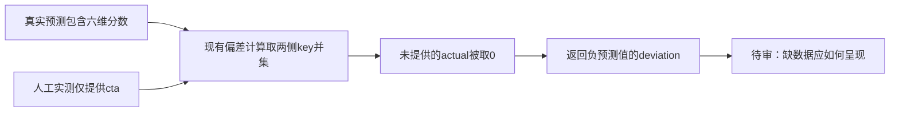
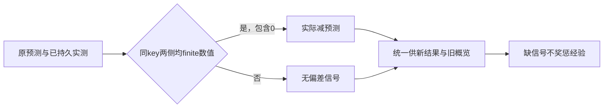

# T1339：核对缺失实测维度被计为负偏差的数据准确性

状态：待审事实观察；不START、不改生产、不重发模型或修改现有结果。与T1336自动调整经验置信度的既有no-op分开。

新7f1包的校准公共协议测试实际通过，但人工透明输入只提供`actualMetrics:{cta:4}`；原`calibres-7441aa97-482`仍返回缺失维度的负偏差：hook=-1、emotion=-1、social=-2、quotable=-2、product_path=-2。该输入是人工验收值，不是平台表现数据；协议操作成功不能证明缺失维度的数值解释正确。

已读源码：`backend/src/modules/calibration/calibration.service.ts`的computeDeviation（359–395）将预测维度摊平并合并keys，非有限或缺失actual取0后相减；overview（614–641）将缺失actual显示null，但继续取已存deviation，因而可能同时显示actual缺失与负偏差。当前只是准确定位该行为，不推定有真实平台亏损/模型质量下降，也不回写旧结果。

实际原件：`docs/verification/t1313/final-package-combined/runtime/runs/calibration-learning-111c3d50-5cd1-4f27-a3f6-e6ab89768a61/RESULT.json`的manualResult及businessState。AI诊断/锁定、manual ingestion关联、显式Learning→默认量表回流的协议PASS保持；Learning confidence40及自动confidence桥未实现另T1336，不混成同一根因。

后续仅允许先读原合同、调用者、旧缺值/明确零值测试与保存/概览消费者，提出能区分缺失和真实0的最小方案及历史兼容，独立评审后再考虑真实RED和实现。当前无生产写集、无新模型、无数据迁移/重算授权；不把pending调查当已修复或整包全绿。

## 最小数据准确性方案（待独立评审，生产未授权）

合同现已明确而非新增规则：`contract/src/resources/calibration.ts`的维度deviation在预测或实测任一缺失时为null。真实0是已提供值，不能当缺失。原7f1结果482/人工cta4的协议PASS、其它维度负偏差事实和T1336自动置信度no-op均保留。

唯一拟生产W为`backend/src/modules/calibration/calibration.service.ts`，不改contract、mapper、repository、数据库、UI、阈值、权限或T1336桥接。保持原dimensions摊平的key/优先级和四位小数规则；`computeDeviation`只对同key两侧真实finite number计算实际减预测。缺任一、null、字符串、非finite均不输出该key；明确actual=0或prediction=0仍计算。无可比key返回空map，绝不制造0偏差。

现役公开结果入口是`calibration.results.create`，没有results.get/list。原`recordResult`返回DTO需使用已经持久返回的`row.actualMetrics`和该原prediction投影覆盖DTO.deviation，不能用本次重放input算值：同prediction已有结果后传9999也必须返回原实际结果的相同投影，不回写原row/旧deviation，不新增入库字段。新结果落库的deviation是新规则；旧结果仅返回可比投影，历史DB原字节保。

`getOverview`须先按真实predById把每条结果与其原预测、row.actualMetrics配对，缺原prediction不猜。KPI mean/avgDeviationBand、latestFinding、reflowRows的每维deviation、整行deviationBand/reason都用同一可比投影，不能只修rowDims却让旧raw deviation继续计入KPI或原因。completedReflows仍是真实结果数量，即使没有可比指标也不能删掉事实；无数值信号的band为原none、finding为空，actual/predicted原值按合同显示null/真实0。旧存量中已持久的伪负偏差不得出现在这些概览消费者，读取不重算落库。

首次新结果若无可比pair，`deriveScoreDeviation`应返回可辨null或调用方先明确空map后跳过本次feedback，不能把空map当0而+5。完整pair仍沿原阈值/+5或-5、first-result-only、幂等与best-effort失败语义；不启用当前persistence的adjustConfidence no-op，不改经验confident来源、不伪装平台实测或自动Learning。判断只核真实数值存在性/机械相减，不做创作评价或新语义评分。

### 精确测试范围与当场证据

拟测试W仅既有`backend/src/modules/calibration/calibration.service.test.ts`、`backend/src/modules/calibration/calibration.acceptance.test.ts`、新`frontend/src/server/__module_integration__/calibration-missing-actual.persistence-client.test.ts`及`docs/verification/t1339/runtime/**`。原calibration.contract/repository/default-rubric测试只读保护，需要额外fixture类型闭包时逐路径列出，不授整个glob。

先独审方案，再测试准备：在未修service上通过真实公开dispatch建立中立组/输出/人工预测并lock，以公开results.create透明人工输入仅cta4，读取原结果DTO与overview，成功断言只包含真实可比cta偏差、其余维度null、KPI/band/reason不使用缺失维度自然RED。受控宿主用真实persistence/service/repository/transaction与归属，0真实模型；人工预测/指标明确测试输入，不冒平台表现。本次未修生产公共RED自然形成缺值坏deviation后，保完整终态ownedDB及原prediction/result/manual ingestion IDs；GREEN沿同DB原ID读取overview并重复results.create，派生投影修正同时SQL旧结果行逐字全等。当前不额外SQL种legacy结果；只有原公共口确实造不出的历史族才另单独申请明确fixture说明，不先扩范围。Root核真实目标RED后才授唯一生产W。

GREEN保原公开链与各成功断言逐字；同时覆盖：

1. 真实两侧finite pair、预测/实测明确0、正负/四位小数、dimensions与旧扁平形状；缺任一/null/字符串/NaN/Infinity在可触达层分别拒绝或不算，不弱化现有输入schema。
2. 仅单维actual时其它缺失dimension为null，旧raw负偏差不影响所有KPI/latest/行band与reason；没有可比指标保completedReflows事实而band none/finding空。
3. DTO幂等以row.actualMetrics为准，重放不同input不改变已存结果；逐行/版本快照证明读侧不回写旧actual/deviation、原prediction/rubric关系不变。
4. 空pair首次不调用feedback，真实0偏差完整pair仍走原阈值；重放不双发feedback；已配置bridge失败仍不回滚结果，T1336 no-op不改变。
5. 同用户别组/跨用户拒绝、foreign预测/结果不泄露、原锁与写保护、旧完整指标正常链原样通过。

执行用新owned外盘独立cache/tmp/DB，每正请求/有限观察最短120秒并保原更长预算，retry0；outer按实际case完整串行总预算+启动/hash/清理覆盖，持久task期限不续。先collection/type/输入锁/装配审，真实RED→唯一service→同链GREEN与必要现役合同、backend/frontend类型及diff/timeout/boundary/orphan，避免重跑不相干模型/供应商。最终新包以同公开透明人工指标0模型核DTO/概览实际展示，旧7f1事实不洗；未来若无合格新包实证则准确保待验。

### 已有授权与完成边界

此为现有合同数据准确性修复提案，沿用户本轮功能修复与透明人工验收授权，不扩自动confidence、不提高预测质量门、不把缺失当用户0。由Root独立审阅后START，生产仍先RED再授；全部旧失败/未知保。任务完成只按自身真实Gate/明确全局失败范围经supported流程收口，不以本方案文书或协议PASS当数值正确已修。
