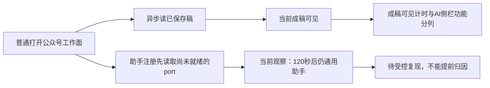
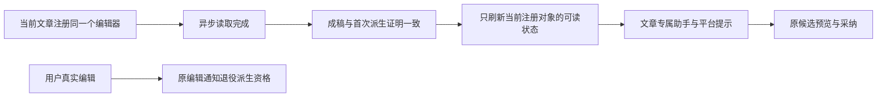

# T1340：核对公众号工作面初次加载后的专属助手注册

状态：待审事实与最小方向，不START、不改生产、不提交模型。不是性能夹具放宽，也不把成稿正文可见冒为专属AI侧栏可用。

7f1d4ec9候选60616、人工纯组grp-7441aa97-48/project-7441aa97-940已显示公众号成稿/重新组织内容，但正常打开文章页后等待现役专属textarea placeholder「告诉我这篇文章需要怎么调整」满120000毫秒仍未出现。原v4截图实际仍为通用助手占位/建议chips；v5该条件自然Timeout、blocked[]/pageerrors[]、0业务模型。原manual项目/稿件/三输出均为透明人工性能前置，不修改校准406已锁定项目。

Root已只读核源提出候选：article-workbench.tsx的load先更新stateRef/draftRef后setDraft(initial)，setDraft在无变化时未notifyEditorChanged，而registerEditor先于异步get完成且依赖outputId，可能使初次注册的preparation未更新。当前是需要真实受控组合RED证实的原因候选，不写成已证明根因或修复。

已知现役ai-copilot-content.tsx3661专属placeholder逐字为上述文案，不能改用通用输入框当专属注册通过；正常图文与其他工作面需作保护对照，不能通过放宽embedded owner、全局强制模式、删合法chips条件或伪造prepared上下文来消除断言。只读稳定DOM/图/原native预览状态待当前同project采尾追加。

原件：docs/verification/t1329/runtime/final-performance/preflight-final-7f1-v4/{DOM_article.json,article.png}与preflight-final-7f1-v5/FAILURE.json（原等待120秒）；同目录manual-fixture-final-7f1/FIXTURE_RECEIPT.json。后续预检状态与性能结果独立保存，普通聊天唯一root未因此重发。

拟后续先盘点实际ArticleWorkbench→DraftChat provider/注册port→专属AI消费者，最小只在文章实际状态变化后通知原port的可靠就绪点，保护scope/卸载、busy、保存竞态与原prepare/opaque ticket；不新增backend/worker/契约或新模型请求。准确生产/现存组合测试W、原公共RED/GREEN需独立完整方案后确定，目前没有实现写权。性能可以按真实「成稿内容可见+主操作可用」另列；不能称专属AI侧栏功能ready或整个页面全绿。

## 足额稳定尾证与最小修复风险追加

原同940的preflight-final-7f1-v6在文章main后实际等待120000毫秒：专属placeholder仍不出现，7个通用chips仍在；同时原native open shadow中真正可见的`.noterelay-wechat`两个p与人工原稿逐字相等，重新组织内容/复制按钮可用。图文对应专属placeholder正确、0通用chips，`.noterelay-rednote-card.is-active`两段原生可见正文逐字相等。实际页面/HTML/安全DOM在该独立目录保存，0模型/blocked[]/pageerrors[]/browserclose；不将早期loader截图追签就绪。

Root另只读提醒：不能简单在load末尾调用现有notifyEditorChanged；Provider在readState().dirty时可能retireDerived，而首次脚本承接与空current本来不同，可能反杀T1303首次派生采纳。候选设计必须区分「已加载状态可读刷新」与「真实编辑使派生资格失效」，保原注册token/prepare票/derived proof。需要实际异步load→嵌入助手→首次派生准备/采纳的组合前置RED，再定准确局部机制，不能重注册伪装首次或改全局embedded准入。当前仍仅事实/源码假设，没有生产W。

## 完整最小实施方案（待独立评审；生产未授权）

### 用户结果与当前阶段

本任务沿用户已确认的脚本唯一原稿、公众号/图文单一重组与AI交流方向，修复文章异步读取完成后侧栏仍显示通用助手的问题。页面保留既有布局、tokens、按钮与入口；用户可以直接看到平台改稿提示，并以现有对话/候选/采纳操作调整当前文章。当前处于BUILD上游的独立方案审核，先组合RED，Root核真实失败后才实施；原性能样本与旧页面失败保留，不追签全页功能PASS。

### 原因候选与精确边界

现有ArticleWorkbench的注册effect先于异步getArticle完成；初次readState没有preparation。load先写stateRef/draftRef再setDraft(initial)，内容比较相等便不会触发编辑通知。Provider消费者缺一次当前port可读状态刷新。这是由原页面与源码支持、仍须真实延迟get组合RED证实的原因候选。

Provider已有editorTick用于让消费方重新读取当前port。本次新增明确具名的内部 `notifyEditorReady(port: DraftEditorPort)`（名称在实现中保持该语义）：仅当 `editorRef.current?.port === port` 时触发原bumpEditor。方法不更改registration token、preparationEpoch、prepared集合、retiredDerived、nonce、目标、请求、准入或派生证明；不新增票据协议、不自动prepare、不重新注册。NOOP上下文提供对应空方法。旧notifyEditorChanged保持原真实编辑失效语义。

ArticleWorkbench保留原registerEditor登记的同一个wrapper port引用及其outputId；加载成功且serial仍当前、mounted、所读output与该登记一致时，在stateRef/draftRef及derivedRef/admittedRef全部一致后，用该登记的port调用纯readiness通知。不能在异步开始时捕获尚未登记的空port，也不能让旧output晚返回刷新新output。原scope/project/initialOutputId的key重挂、loadSerial及workspace capture保护保留；卸载cleanup只释放自身登记引用。失败、过期、切output、切scope、卸载晚回均不发送旧ready。readState、prepareForTurn、保存/采纳CAS与derived证明内容保持。

不能调用notifyEditorChanged来代替readiness：首次从脚本承接的draft相对空current本来dirty，通知真实编辑将把首次派生资格退役。也不能以重注册、清prepared、修改generation或放宽dirty/owner准入避开此问题。

### 既有UI方向与空态文字

沿项目oil-ui-pro 0.10.0和UI_RULES的现有丰富工作台方向，复用现有空态节点与样式，不新增按钮、控件、入口或新风格。基线是性能preflight-final-7f1-v6的文章/图文原图与安全DOM；文章仍7chips，图文专属placeholder正确且0chips。

AICopilotContent只按既有严格 `embeddedContentOwner` 条件切换空态文字，不改变该判据：

- 文章/图文空态标题：`告诉我这份成稿需要怎么调整`。
- 文章/图文空态说明：`可以调整表达、结构或重点，审阅候选后再采纳。`。
- 通用对话标题、原说明与原推荐chips保持原行为；没有合法当前preparation时不能强行显示平台模式。

文章placeholder仍为原 `告诉我这篇文章需要怎么调整`，图文placeholder仍为原 `告诉我这份图文需要怎么调整`；合法embedded模式0通用chips。候选归属与写回仍由原具体output/version/CAS控制，脚本和另平台不被采纳覆盖。

### 精确物理写集

唯一拟生产W（Root实际公共/组合RED核后才授）：

1. `frontend/src/features/draft-workbench/draft-chat-request.tsx`：上述当前port身份限制的纯readiness方法及现上下文/NOOP接线。
2. `frontend/src/features/article/article-workbench.tsx`：保存实际登记wrapper引用，当前异步load成功后的纯readiness通知与相应本地cleanup。
3. `frontend/src/features/copilot/ai-copilot-content.tsx`：仅现有空态两句按既有embeddedContentOwner切换。

测试准备W：`frontend/src/features/draft-workbench/draft-chat-request.test.tsx`、`frontend/src/features/article/article-workbench.test.tsx`、`frontend/src/features/copilot/ai-copilot-content.test.tsx`、`frontend/src/features/copilot/work-candidate-adoption.ui.integration.test.tsx`及`docs/verification/t1340/runtime/**`。原article-workbench-save-race、GraphicPostWorkbench和其它消费源只读保护回归；如实际type出现必要fixture闭包，逐文件报精确delta，不提前授glob。无backend/worker/contract/schema/迁移/全局scope/transport/模型设置变化。

### 当场RED、保护与验收

先保存被测源码/测试、实际输入锁、命令、原stdout/stderr/自然exit和清理。真实Consumer组合必须延迟getArticle resolve，让真实ArticleWorkbench、DraftChatRequestProvider与AICopilotContent依实际注册先经历未就绪状态；只替代合同dispatch/模型外I/O及原native宿主，不mock readiness/owner/Provider判据或直接喂prepared。现有integration的rail插槽mock不能冒真实助手消费，必须在精确测试内使用真实AICopilotContent（可复用其已有组件依赖fixture）或在其现役真实Provider测试中装配文章宿主。

目标成功断言自然RED：延迟文章get完成后，文章专属placeholder可见、通用chips为0、平台空态两句可见，native/现稿正文仍完整。图文对照使用真实合法preparation显示同平台空态且原专属placeholder不变；通用聊天继续原文/chips，不强制embedded。

GREEN同目标断言逐字保留，并补/保以下组合边界：

- 初次空current从脚本承接为dirty，原首次derived候选准备/审阅/采纳仍能完成真实保存与读回；脚本和另平台全文/版本不变。
- 用户真实编辑后原派生准入仍拒绝；readiness重复刷新不复活退役资格，不替代显式保存。
- 已准备ticket在同port纯ready刷新前后仍按原规则消费，generation、注册或基线真实变化仍失效；不新增ticket。
- 旧port/克隆port/卸载port的ready通知不刷新当前消费者；切output/scope与失败/晚resolve不得使旧正文或旧owner泄入新助手，不挂载轮询。
- 原保存在途、UNKNOWN恢复、选定来源版本、候选原key/请求/版本/CAS、两平台隔离与T1303首次derived/真实编辑保护原测试不改期望。

单次正执行/请求/有限观察最短120000ms，保更长既有预算；retry0，串行受影响组合，独立Vite cache/TMP在本轮新owned外盘，不写共享依赖。wrapper外层须覆盖所选择case完整串行预算、type/启动/输入hash与清理，按实际case数计算，不用一个8.5小时窗盖多个8小时case。新纯组件受控测试0真实模型，最终修后包以正常页面/真实原生正文和专属助手操作/截图验证，不能把JSDOM称真实像素。

必要门：受影响上述四文件与save-race保护；LED-047现精确八组（保原超时/断言）、完整frontend tsc --noEmit --incremental false；实际git diff --check、timeout-policy、boundary/orphan/semantic门按差分所涉规则执行。不为单个readiness新增通用架构、生产指标或默认供应商请求。

### 交付与非宣称边界

最终结果须并列旧7f1文章120秒功能FAIL、修前组合RED、修后组合/保护GREEN和新包正常页面证据。截图保存后需实际看图。性能原唯一chat与Tab结果保原包、原指标口径，不重跑计快。其它390适配、T1338legacy作品、T1337目录隔离、T1339缺失actual与T1336自动置信度分别归原任务，不由本任务冒PASS。完成仍需任务SPEC Gate、pmem/reconcile真实结果与supported taskctl；全局失败保其真实范围，不批量销账。
