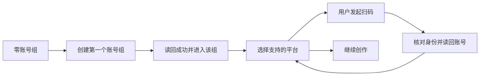

# T1345：精简账号绑定并引导首个账号组连续扫码

## 用户结果与已确认方向

2026-10-18 用户要求直接移除「手动登记平台账号」「共享资源」「整理历史资料」三整块；账号归档和转组保留真实能力，重复/嵌套框改为单层对象行，管理动作位于所属对象右侧。全新用户首先创建第一个账号组，创建读回成功后立即选择平台扫码，可继续绑定任意多个已支持平台。已有用户与旧内容不强制重新引导。沿项目原工作台、tokens、Button/Input/Dialog/DropdownMenu/PlatformIcon，不开A/B新风格。

## 现状与可行性

页面真实入口是 /accounts → AccountManagerView → AccountGroupManager。account-group-manager.tsx 同时渲染左组列表、名称卡、成员卡、嵌套AccountRow、能力表、三待删区块；AccountRow又重复展示同账号名/平台并自有隐藏确认。首组create目前create→getAccountGroup读回后只选中，仍需手动进入组后在长能力表找扫码按钮。AccountBindingPanel已有按group/platform持久runId、未知请求复用intent、单在途轮询、卸载/切组拒过期回写、成功getAccount读回和真实能力校验。用这些能力即可，无新增服务/存储/权限。

基线原件：docs/verification/t1345/baseline/user-1.png、user-2.png、user-3.png；另在隔离页面取得与最终同状态同视口基线。原件与实际截图需view_image看过才记视觉判断。

## 范围与契约

- 只移除三块UI入口及本页无消费者的状态/回调/import；不删除任何历史登记/共享/迁移数据、全局合法API及其它真实消费者。原migrationId参数不再打开已删区块。
- 组列表与当前选中组详情为两种不同导航职责，组名各可出现一次；平台成员只呈现一次身份、状态、查看数据与右侧更多管理，无第二账号卡和嵌套details。组名行右侧更多提供重命名、归档/恢复；平台账号行右侧更多提供转组、隐藏/恢复。操作均真实调用现API；隐藏沿现逐字确认与末号保护，归档保持版本/读回，转组保preview/digest/expectedMembershipVersion/活跃任务拒绝，历史原组归属不改。
- 零组经完整listAccountGroups读回确认后展示首组创建主操作与两步流程；加载/错误不伪装零组。createAccountGroup按同intent幂等key，getAccountGroup同ID读回成功后将新组设为当前工作区（writeCurrentGroupId/事件/router），立即在当前页展示「选择平台，扫码绑定」与支持平台按钮，页面加载/导航不自动发起外部扫码；只有明确平台按钮点击才启动。读回/创建失败留输入，未知不得显示创建成功或跳下一步。
- 已有组创建行为只选中新组，保原进入动作，不能把所有历史零平台组认作全新用户。新建首组完成后，通过当前组成员真实回读反馈已绑定数量，可反复点击同平台或另一支持平台，无只许一个的限制。无需扫码也可继续创作。
- 扫码按钮由getPlatformAccountCapabilities的bind.available=true且method=qr驱动，不按平台名称猜能力。选择平台本地打开同一个AccountBindingPanel弹窗；点击「扫码绑定XX」就是用户明确启动意图，本地打开弹窗即执行一次真实启动，不再要求第二个同名确认；用唯一click intent/ref消费和StrictMode微任务取消保护。既有run先读取，活跃run仅恢复，未知intent不自动新建；终态确认后显式新点击可新开扫码，支持同平台再绑多个。等待/成功/失败/取消/未知沿原runId恢复，不伪成功、不重发原UNKNOWN。成功反馈后「继续绑定其他账号」回平台选择；关闭/重开不丢真实run索引。
- 平台能力保留可读状态与失败重读，精简手动登记列；不将未读取标成不可用，不把已绑当登录有效。不支持平台有具体原因。

## 页面与流程

正式页面只突出当前主动作。零组时单一创建表单；已有组时左侧组导航，右侧一条组标题行、平台绑定选择与单层成员列表、次要平台能力详情。名称编辑放本地Dialog；管理用现DropdownMenu。每行最多一个直接动作，其余管理归更多。正文/控件14px、次文12px以上；1024×680与1366×900及200%可用，长名称可读，键盘Tab/Enter/Escape/焦点返回，单主滚动区。

## 拟写集

生产：frontend/src/features/platform-account/account-group-manager.tsx；account-manager-interactive-region.tsx 仅抽出可复用隐藏操作（保现AccountRow其它消费者），account-binding-panel.tsx 仅完成后继续绑定反馈需要时最小props；onboarding/onboarding-steps.ts（实际OnboardingCard直接消费；零groupId且零accountId首步应「创建第一个账号组」/去创建，保历史account身份抖音路径，已有group首步优先扫码；删指向已移除历史整理入口的引导句），及对应onboarding-steps.test.ts。onboarding-data.ts与对应tests：仅无group/account身份时用完整含归档组列表与真实旧账号列表确认首用户；完整0组且0旧账号才投影needsFirstGroup，loading/error不当零，已有账号恢复保原。onboarding-card.tsx仅首用户首屏专属两步提示与去创建链接，不要求页面加载自动跳转，不改持久引导记录。测试：对应现役tests及 frontend/tests/e2e/t1345-account-binding-guidance.spec.ts。证据 docs/verification/t1345/**。不改共享tokens、backend/contract/worker、真实用户数据。

## 验收与Gate

独立SPEC技术/交互审核PASS后taskctl start，生产前先在现役组合测试真实RED：三块仍存在/同成员重复卡；首组读回未进入/无连续扫码引导。保原RED，不补造历史。对授权删除入口的旧测试逐项变更合同并保原失败，不删归档/转组/未知/错组/能力保护。

GREEN：零组加载/错误/创建失败/未知同key重试、首组读回/选平台、已有用户不强制、同平台及多平台可继续；归档恢复版本读回、转组预览/活跃任务/取消焦点、隐藏确认/末号保护；扫码能力不可用/读取失败/等待/成功读回/取消/失败/卸载旧响应。支持平台组合用受控接口，不宣称真人平台授权成功。

真实浏览器在隔离库经公开操作创建/回读组、管理无真实用户对象；扫码前置能力与弹窗打开实际点击，若使用替身扫码必须单列为受控流程，不冒真人绑定。两视口、200%、长名与错误/空态取证并看图，交Root独立现有界面评审和任务走查。运行相关frontend测试/类型/LED047、boundary、orphan；改动超时则timeout-policy及实际公共链，正执行/观察至少120000ms并保更长原预算。最后pmem sync/reconcile，范围外旧失败如实登记。本任务不发布/安装/付费采集或模型。

### 首次首页与一次点击扫码合同

首页Dashboard顶部的OnboardingCard在问候上方首屏必须直接引导「先创建第一个账号组 → 选择平台扫码」，主按钮去/accounts同一创建流程。仅scope完全缺失且真实完整含归档组列表及用户旧账号列表都为空才显示；组读取失败只可重读，旧账号恢复/已有组选择不显示首用户创建。首次引导不阻断设置/激活/现有功能。精确加写onboarding-data.ts、onboarding-card.tsx及原tests，未触及DashboardPage/首页route共享写集。

扫码平台选择即用户明确外部启动授权，点击后弹窗自动启动一次；页面加载/返回/刷新/StrictMode不得自动重复。若存在活跃旧run则只恢复读取，未知旧intent保持核对请求入口；完成旧run经真实读取确认终态后本次明确新点击可再次扫码。同一新点击token被组件消费一次，不靠不稳定effect依赖隐含启动；保scope/epoch与成功getAccount读回。组合测试必须验证click→真实startAccountBinding调用恰1，而非仅测试弹窗存在。

### 外部管理动作的唯一刷新所有者

AccountSwitcher统一拥有scope变化后的transition refresh及真实RSC完成协议。manager.enter只writeCurrentGroupId(id,'account-management')和本地current，不再重复notify/router.refresh；首组create读回后写scope、当前组archive写null同样由Switcher接事件同步。mutate尾部若原scope已变不再发caller refresh，同scope rename/绑定读回仍保原刷新。初始化complete不以只有layout新scope就放行Suspense旧page；实际页面完成与scope一致后才ready。此是现有外部manager enter合同的精化，不新增方向/服务契约。覆盖三个scope变入口及同scope保存保护。
