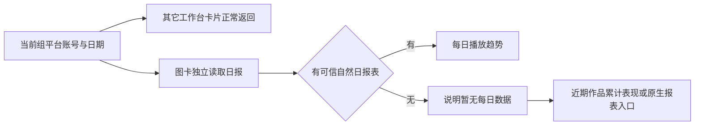

# T1347：首页真实每日趋势与诚实数据空态

## 用户结果与方向

2026-10-18用户反对首页按采集时间连线和大孤立点。保留已有工作台六卡与数据趋势目的；有真实自然日报表才画每日趋势，没有则同卡显示明确缺失原因及次级近期作品累计表现。原主题与ChartFrame/ViewsTrendChart/HorizontalBarsChart/ECharts tokens复用，不另造图表系统，不编日点/补零/均摊/插值。

## 已核事实

首页现实际链DashboardPage.DataOverviewCard→ChartFrame SVG，并非ViewsTrendChart当前消费者；SectionCard内再次包ChartFrame造成双层框。group-workspace→AnalyticsService→repository按北京时间采集日取每作品/来源/平台/definition/window/key最新累计快照，日历相邻/覆盖完整/无负修正才差分；不能称平台自然日新增。当前与74b ChartFrame源码SHA均e3012abd91b9bdb628a1c7cf1aa08ac9327d5bba6c8cb9c6157da9d240c22e16，受控Chromium当前小圆约6px，未复现用户Tauri椭圆，不冒称根因已证。

真实自然日报表来自现platformCollectionService.listNativeReports，已经有归属锁和100条分页：视频号daily字段「时间」「播放」有自然日计数；公众号readTrend字段「日期」「渠道」「阅读人数」单位people，不能把渠道求和或人数冒次数。现公众号没有经核实的可信总计字段/渠道值，禁止猜关键词白名单。本轮公众号如无法确定原生总计，就诚实无可比数据。

## 产品与数据合同

FR-1347-1：当前组/平台/账号/日期筛选保持，趋势仅显式账号或筛后唯一有效当前成员可用；多个平台或同平台多个账号时提示选具体账号，绝不跨平台/账号相加。历史/archived成员不绕过原native服务归属。

FR-1347-2：仅视频号自然日报表已知值按北京时间明确日期画「每日播放」，保null缺口、真实0、共同零轴、日期/次单位、可见摘要与来源时间。每统计日采用覆盖该日最新observedAt报告；最新明确null/缺行不回填更旧值，同刻冲突该日null。报表读取失败/未有日报不回退采集差分。

FR-1347-3：无真实日报时同卡显示「暂无每日数据，先看近期作品表现」，次级「近期作品累计播放」复用recentPublications最近5条真实累计值/HorizontalBarsChart，明确仅最近发布5条，不称全量Top5/同期曝光比较；未支持/混平台不画误导比较。null不当0，真实0可读；条形图无真实projectId就只展示，不假造逐条跳转；同卡提供一个真实「查看作品复盘」入口至/daily-report，日期/平台/账号参数先核既有页面确实解析才透传，若不支持则用现有效入口，不声称筛选已透传。公众号模糊旧views不改名阅读、不画该数字；显示「暂无可比较的每日阅读人数」并提供真实/accounts/works?accountId=…原生报表入口，原最近发布卡不动。

FR-1347-4：单卡层呈现，标题/说明/当前范围/摘要/图/更新时间顺序。真实逐日仅单个有效日时为小圆加准确提示（不能说只采集一次），稀疏保null缺口且不大点/不横向拉伸；图中不得用实现术语代替人话。空/失败/不支持保持账号恢复入口与其它合法卡片。

FR-1347-5：原生日报读取仅影响图卡。首页现getGroupOverview是其它卡片共同等待的唯一组合读取，不能在其中追加native分页，也不重复调用整份overview。首页其它卡按原overview返回；图卡独立读取当前已选组/平台/账号/日期，慢报表、失败与重试只呈现在图卡。切账号/日期/组后同步拒显旧scope结果；单在途请求、epoch与卸载AbortController保护，重复点击重试不并发，沿现fetch公共请求预算不新增短超时，不启动采集。

## 最小架构与写集

backend/src/application/queries/group-workspace.ts及test，新增同目录dashboard-native-trend.ts及test纯投影；现group query service新增getTrend窄只读方法，只执行groups.get/有效当前成员筛选/native read，不调用dashboard/projects/publishing/analytics组合读。getGroupOverview移除不可信旧差分的首页投影，完全不等待native读取。通过现组查询注入platformCollectionService.listNativeReports窄端口，注入点frontend/src/server/persistence-client.ts。不改原Analytics repository旧方法及其它消费者、不迁移/写库/采集。

contract/src/pages/group-workspace.ts及contract/tests/group-dashboard-native-trend.test.ts定义groupDashboardTrend响应：groupId、platform(string|null)、accountId(string|null)、startDate、endDate、trend(label/value nullable点数组)、performanceTrend(mode daily|unavailable、unit 次|人、valueLabel、reason nullable、accountId、observedAt、reportIds)。原additive可选workspace.performanceTrend同形元数据保兼容。contract/src/operations/pages.ts新增getGroupTrend：id pages.groupTrend.get、GET、path /groups/:groupId/trend、params groupId、query复用groupWorkspaceQuery、response groupDashboardTrend。backend/src/modules/query-services/query-services.transport.ts注册操作并dispatch至groupOverview.getTrend；公开transport目标测试放现group-workspace.test.ts。新端点沿现ctx/组归属/服务锁，不新造权限绕行。

新端点真实公共库存必须精确补单个ID：contract/src/workspace-operation-scope.ts登记group归属、contract/src/cli-policy.ts登记readOnly、contract/src/observability.ts及observability-registry.json登记operation enum/清单、contract/src/resources/assistant-system.ts现显式read endpoint清单机械加ID；frontend/src/server/__module_integration__/query-services.contract.test.ts的QUERY_SERVICES_OP_IDS数组加单个ID。contract/tests/endpoint-bootstrap.test.mjs只将实际穷尽计数434增为435；contract/tests/registry.test.ts的SPEC_13穷尽清单只加GET /groups/:groupId/trend。相关注册断言复用新contract/tests/group-dashboard-native-trend.test.ts及现modules/pages.test.ts、cli-policy.test.ts等库存保护，不批量重生成其它历史差异、不改变Agent行为/工具/权限。

frontend/src/app/(creator)/page.tsx将真实已解析筛选窗口传给DashboardPage；frontend/src/features/dashboard/dashboard-page.tsx及test把图卡交独立client岛，新增dashboard-trend-card.tsx及dashboard-trend-card.test.tsx，由其独占单层SectionCard并使用getGroupTrend契约。source包含groupId与query；key含group/platform/account/start/end，冻结scope与epoch，底层fetchCreatorApi沿现transport及AbortController，createClient解析响应。旧scope不能短暂显示在新筛选，失败局部重读/真实回退。原dataOverview.trend兼容结构对组overview填[]，不复用旧差分；无元数据legacy viewModel不画采集趋势，走真实比较或诚实空态。frontend/src/components/analytics/views-trend-chart.tsx及chart-coordinates.test.tsx仅必要文案/单点小圆，不影响其它消费者。必要时现HorizontalBarsChart最小扩展另向root报。证据docs/verification/t1347/**。T1345不写首页route/DashboardPage，首次入口只改现OnboardingCard及其数据/steps，写集互斥。

## 流程与验收

生产前独立SPEC审核PASS、taskctl START，再受控公共组query→真实服务port→DTO与首页组件目标RED，保旧FAIL/74b图形未复现事实。RED必须包括真实日报输入本来未显示、无日报旧差分被当每日趋势、混口径保护与双框，不能仅helper。

GREEN覆盖native完整逐日/单日/稀疏/null/0、latest缺失不复活旧值/同刻冲突/分页/权限错组、多平台/多账号、公众号no_total_channel不猜人数、查询失败保合法其它卡/作品比较null与0、legacy viewModel不复用旧趋势、筛选日期与北京时间一致。新增公开getGroupTrend端点目标RED先于生产连通，不能把ImportError当业务RED；受控慢native时overview先正常返回且native调用0、独立trend仍等待/可取消，证明不重复overview、不拖整页。client图卡真实请求晚回/ABA/卸载/单在途与scope归属组合回归。现Analytics差分接口及其它line消费者保护回归。受控fixture不冒真人供应商成功，真实集成读回不启动新采集/收费。

隔离真实组件浏览器1366×900、1024×680、暗色/200%，实际看图与hover、平台/账号/日期/切组；单层卡、字号/长名/零轴/单位/空态下一步可读，root独立视觉评审和任务走查。必要contract/frontend/backend定向+类型/LED047、boundary/orphan、timeout-policy与公共链（新增请求继承至少120秒及更长外层预算，保原分页取消）。唯一流程写者pmem sync/reconcile并准确关联范围外旧债，不签发布安装或真人Tauri椭圆根因。

## 决策

Root已明确选真实原生日报+同卡次级回退方案，否决只把采集差分改柱或用最近5条排名彻底顶掉趋势。现为正式独审输入，不冒实现或Gate已通过；重要方向授权沿DEC-134501，技术细节留报告不堆界面。
