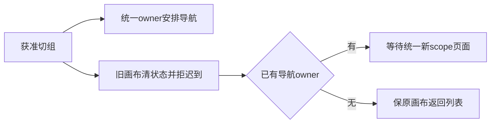

# T1350 画布详情切组统一导航归属

本稿待独立评审，未允许生产修改。用户已授权切组后工作区真实变化；本项落实T1346唯一导航/刷新owner的现有消费者合同，不改画布持久数据、保存、生成或后台任务。

## 实际前置失败

冻结d5253719f实际1280×800画布详情乙→甲：scope甲，旧画布input卸载，两个/canvases真实RSC均200且cookie甲，但地址仍乙canvas详情，页面停「正在打开工作区」。toHaveURL等待120秒失败；第二视口同路径原件在T1346 candidate-formal-attempt03，待本轮结束复制。截图、trace与真实请求留存，不把200冒页面完成。

只读代码显示CanvasEditor现useAccountsChanged回调在scope变化时无条件router.replace('/canvases')，与此同时T1346 AccountSwitcher已唯一负责replace+refresh及完成屏障。现AccountChangeDetail.routeRefreshScheduled已有明确合同，消费者不应重复发整页导航。

## 精确方案

FR1350-1：CanvasEditor接收现有事件detail；scope未变保持原行为。scope变化无论谁负责导航，都推进epoch、清accountRef/doc/旧成员资源与交互state，拒绝迟到旧canvas读回或task绑定，不保存新scope。

FR1350-2：detail.routeRefreshScheduled为true时不再router.replace，导航交AccountSwitcher现统一协议。false或legacy无标记账号变更保持原router.replace('/canvases')，不删除原账号切换功能。不改事件公共类型/helper。

精确写集：frontend/src/features/creative-canvas/canvas-editor.tsx（现一个回调条件），其既有canvas-editor.test.tsx（真实组件两事件族），docs/verification/t1350/**。T1346已声明E2E的canvas详情→对应列表公共段复用，不新增假页面/新抽象；唯一control_writer维护流程。

## 验证与边界

独立PASS+start后先新增组件RED：未标记事件仍router.replace；已标记事件清旧画布且0重复replace，迟到旧读取不重新展示/启旧任务。前置公共FAIL真实保。最小条件修后跑既有CanvasEditor/画布交互保护、Switcher+Provider/LED047，精确类型与lint（历史诊断单列）。冻结后实际两视口画布详情→切组→真实目标列表、旧input0、统一屏障消失、同组合法画布保存/读取不退化；沿T1346公共脚本继续验证项目详情与脚本，不绕权限、不作真实生成。

完成前独立看图/实际公共旅程与strictGate，pmem/reconcile留新旧失败。本项不签T1349项目列表标题布局、真实生图/模型或本机安装。
