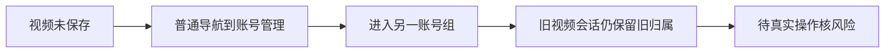

# T1351 账号管理进入组与驻留视频会话的保护边界登记

本项仅源码风险登记，尚未公共浏览器复现，不是已确证的数据丢失/越权缺陷，不允许据此先改产品。Root要求不混入T1350两文件范围。

只读消费者审计见 docs/verification/t1350/consumer-audit/REPORT.md：ProjectVideoSessionHost稳定放在WorkspaceBoundary外，主导航直接离开路由且保留宿主；host仅publish、registry仅显式requestVideoLeave才调guard，现生产调用点为AccountSwitcher。AccountGroupManager.enter仅foreground确认后writeCurrentGroupId，首组create/当前archive也写scope；video-reference-workbench未接foreground活动。代码链因此可达“视频dirty→普通主导航到/accounts→manager.enter另一组”，但旧视频session仍保留且冻结原scope，不能由此推断丢稿、串组写入或任务取消。

后续先用隔离真实原片/驻留视频会话验证实际可达用户行为、是否有未保存UI被卸载、原session/真实保存ID与scope是否保持、取消及返回路径。不得启动新模型/渲染或变更真实用户资料；没有公共失败证据前不扩写manager/videohost/保存策略。若风险确证，再独立SPEC/评审落实最小既有guard，保后台任务与恢复能力；若保留会话本已安全，应按实际证据关闭风险，而非凭缺函数调用认bug。

