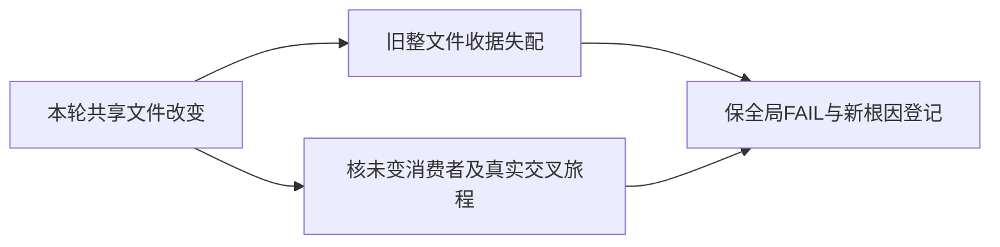

# T1353 本轮新字节触发旧全文件收据失配

843bf85冻结后的真实frontend receipt audit保存于docs/verification/t1345/control/FRONTEND_RECEIPT_AUDIT_FROZEN.txt。T1343/T1342/T1341/T1338/T1330/T1328/T1324的旧watched_paths收据因本轮onboarding-data、persistence-client、account-switcher新字节失配；这七项不是开工前旧债，也没有被历史accepted-risk自动覆盖。原收据及全局FAIL保持。T1298/T1296已有旧代码变化与T1294外来未提交设置测试属于另一来源，不能混写。

已保存实际diff与64项未变消费者SHA，见docs/verification/t1345/control/UNCHANGED_LEGACY_CONSUMERS.json及LEGACY_RECEIPT_IMPACT.md。persistence本轮只增加日报只读端口注入，旧视频/图片/图文路径未交叉；onboarding仅无scope首用户支路及引导词，有scope内容链未变。这些证明消费者字节未改，不等同原功能重新全程通过。共享切组的T1338账号作品与T1342最小脚本编导入口须本轮真实公共旅程补证，最终以同冻结候选实际结果记录。

本登记不许可机械重跑T1300整包、调用付费模型/渲染、改旧PASS或洗掉全局审计失败。后续按实际依赖与严格门判据决定收据维护范围；若只受整文件hash影响，明确保失配及未重新全程验收边界。当前五任务自己的合同仍须独立真实通过，不因本记录减免。最终reconcile如有其它新原因，另按当场输出补登记，不预称所有错误已解释。

