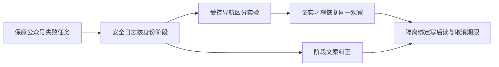

# T1354 公众号绑定身份阶段失败的有界修复

> 2026-10-19 用户补充事实：用户本轮补充原话：公众号是“扫码后已进入后台才报错”。这与身份读取阶段候选有关，但仍不能由受控导航恢复倒推原1726首因；原任务不重发、真人后台过程未补证。

## 用户结果、事实与未知

用户2026-10-19反馈公众号扫码显示“微信后台页面或原生下载暂未完成，请查看原任务”。公开原run已只读核实：`execution-task-0d742f83-1726`为wechatOfficial/failed/accountId=null，未写组成员；保持原任务，不重新扫码/重发/改业务库。原安全日志单次合法解码已取得readIdentity/BROWSER_OPERATION_FAILED/Error，时间15:12:48.750Z；原错误具体文本早已脱敏丢失，不能补出原1726首因。报告`docs/verification/t1354/{runtime-readonly,native-diagnostic-readonly}/REPORT.md`；原密文/私有解码现场不入仓。

已核安装tar/runtime的31个实际compiled evaluate回调无__name，不把打包闭包helper丢失猜测当根因。视频号新旧prepare/channelsDaily/REPORT_LINK_MISSING另保UNKNOWN，缺当前真实页面就不改selector；T1355本地完成流程与T1356首页指标不受本原深因未知拖住。

## 本次可交付范围

- **FR1354-1 绑定文案真实**：在扫码登录/身份读取阶段失败，不提示已进入原生报表下载。当前withProfile统一把未知Playwright异常变成“后台页面或原生下载”是源码可证的阶段文案问题；按实际stage给绑定/身份核对失败描述，仍保BROWSER_OPERATION_FAILED及安全stage/code，不写原始URL、token、异常正文或凭据。报告原任务时不称已成功或要求自动重发。
- **FR1354-2 候选故障先实证**：正常本人扫码会让官方页面导航；当前公众号setting入口observe的locator.evaluateAll，以及稳定字段page.evaluate若遇执行上下文销毁，会直接冒出observe终止整run。此为代码候选，不是原任务已证首因。仅在无用户数据的受控浏览器普通页面、受控官方origin路由中，用真实同页导航制造实际上下文切换，验证当前public login→identity路径是否会失败；不得用手抛同名Error或helper-only证明浏览器行为。先保真实RED，若无法复现，不做该恢复分支，交付已证文案与诊断边界，原首因继续UNKNOWN；仅改文案不满足公众号恢复结果，T1354不得据此完成。
- **FR1354-3 窄恢复合同**：仅独评通过且真实复现后，对身份观察中的已知导航context-destroyed瞬态继续同一观察；须同一当前profile owner/page、官方origin、仍有效原signal/deadline。只允许只读DOM观察，不重新启动浏览器/扫码/任务，不重置8分钟观察或续原总deadline。Page/target关闭、跨origin、明确退出/身份不符、语法/未知错误、网络失败/TimeoutError不按该分支吞掉；异常有真实可观察终态与资源收尾。
- **FR1354-4 不假认采集**：绑定成功仍须真实稳定身份→原commit→同账号/目标成员读回；不凭扫码窗口消失、worker finished或仅登录cookie成功。绑定不拉原生报表，不自动采集来证明成功。原profile staging/commit/rollback/取消与旧任务归属守卫保留。

## 有界验证与门

独立取证范围：最多两次受控区分性实验、总timebox120分钟；只写`docs/verification/t1354/**`或`orchestrator/probes/T-1354/**`，不登录真实平台、不触用户原profile/业务库/任务。实验1真实当前源码/安装编译回调在同源普通页导航中的身份观察结果；实验2仅在首实验能区分机制后确认read deadline/取消或排除替代原因。全部浏览器/私有目录正常teardown，实际正执行/观察预算最短120秒，原480000/原持久期限更长者保留，不为了复现缩到秒级失败。

拟生产写集仅`ai-worker/src/runtime/platform/wechat-browser-source.ts`及现`.test.ts`、`wechat-dom-witness.ts`及现`.test.ts`。新受控公共链回归放`ai-worker/src/runtime/platform/wechat-official-binding-navigation.integration.test.ts`；任务证据/驱动为`docs/verification/t1354/**`。不动backend采集、identity选择器、数据库/契约/真实登录入口，不用更换selector猜修。若需扩到历史error读投影，先以真实调用证据修订精确写集独评，不静默改旧error/完成记录。

| AC | 可观察后置条件 |
|---|---|
| AC1354-1 | 当前绑定/identity普通异常文案不再暗示报表下载，原安全错误code/stage与failed状态保留，原1726记录不被覆盖。 |
| AC1354-2 | 如真实context-loss RED成立，同一受控官方Page导航后原login可读回稳定ID/名称且只开一次profile；正常无导航仍成功、真实0副作用。不能复现则不冒该修复已证明原首因。 |
| AC1354-3 | 跨origin/target关闭/身份不符/未知Error仍失败；取消/原deadline耗尽停止且不重启不续期；同profile stop确认/迟到拒写原守卫保。 |
| AC1354-4 | 隔离真实public binding service与受控宿主保存/读回同ID成员，再由T1355本地Dialog正确显示核验/失败；这不是本人真实扫码/原任务重试或平台数据采集。 |

缺陷实现前须独立SPEC审核及相关真实RED；当场focused/公共链、timeout-policy/LED047相关路径与边界检查据实留证。当前原首因UNKNOWN不通过改文案洗成公众号真人绑定已恢复；若最终仍需要新本人扫码，先交可审的已证修复，再单独说明所需动作/理由，不擅自执行。

