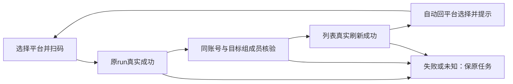

# T1355 绑定核验成功后自动回到平台选择

## 用户结果与授权

2026-10-19用户反馈：小红书已经绑定完成，本地弹窗仍须手动关闭；内外重复标题，成功后仍显示再次扫码与刷新。用户明确要求成功后无需手关。本任务沿原主题做局部任务流程修复：当前这次扫码真实保存并核对账号/成员、刷新列表完成后自动收起本地绑定Dialog，回到原平台选择并轻反馈，可直接继续任意平台。等待、失败、unknown及读回失败留在原位置，不自动重试、不凭worker终态关窗。现无生产改动，SPEC独评与组合RED后才实现。

本次排查不授权重新登录、采集、付费、覆盖用户原任务或直接写业务数据。只读真实原状态；隔离服务/受控宿主用于复现与修复验收，不能冒真人平台扫码。原3b产品及T1352安装完成记录保留；后续安装产物/页面差异须新证据查清，不反写旧收据。

## 已查现状与边界

- `/accounts`→`AccountManagerView`→`AccountGroupManager`，绑定Dialog在`frontend/src/features/platform-account/account-group-manager.tsx:142`，本地platform click intent驱动Panel唯一启动。
- `account-binding-panel.tsx:25..33`的`accept`验证group/platform，成功后getAccount→await onChanged→verifiedRunId；目前成功后仍渲染再次扫码、刷新、继续三个动作，manager仅onContinue关窗，onChanged不关窗。这是当前源码可证的流程缺口，组合RED尚待实际执行。
- manager `reload:57..90`既会吞读取异常，也在已有读在途时提前resolve。不能把当前`await reload()`视为完成列表核验。完成路径必须拿到真实成功/失败结果，等待最新有效读完成，而不是定时收起。
- 源码另一真实消费者为`native-report-panel.tsx:122`的重新绑定/登录Dialog，现onChanged会关闭并调用`startCollection`。普通历史成功run读回不能获得新动作授权；本任务应把普通数据刷新与当前本地绑定意图完成分清，保护此消费者的原已授权同步意图/key/期限/账号隔离。
- 全仓rg目前仅上述两个生产`AccountBindingPanel`消费者。另有旧`account-manager-interactive-region`抖音登录控件，属于不同loginDouyin合同，须只读核实际路由是否可达，不凭同名扩写；独立审计若证实额外实际扫码Dialog，先将精确入口与写集补入本SPEC。
- 两用户原图已实际view，基线副本在`docs/verification/t1355/baseline/`，权限0600、仅本地不提交。全窗3456×1988像素；小红书裁图viewport未知。图中重复内标题及缺少“继续绑定其他账号”与当前HEAD/3b Panel字节不一致（二者git blob同`87f8eceab8544483cca8c8cacd2de06921b5f14b`）。独立只读审计已核安装tar与runtime对应两个binding chunk字节SHA一致，均无内h3、均含“继续绑定其他账号”；证据`docs/verification/t1355/review/installed-binding-static-audit.json`（SHA256 `371c3092a98d532dafef9f65c6ebdfadeb55d87643709d5e362f19a0042fd32f`）。公众号原失败任务结束15:12Z，早于新安装15:47Z；截图加载进程/时点仍UNKNOWN，不宣称旧图、构建失配或当前tar仍有内标题。

## 功能与状态合同

- **FR1355-1 唯一完成门**：当前本地明确绑定意图对应的run为真实succeeded、accountId非空；getAccount按同ID读回且平台/用户与冻结目标相符，再以真实getGroup/完整列表核同group当前成员仍包含该账号、平台正确、归属有效。列表应用完成后才关闭。失败/不匹配/空账号/失去归属保持Dialog和原run，显示可恢复原因，绝不当成功或自动开新扫码。
- **FR1355-2 完成自动回位**：完成门一次通过后自动关当前Dialog、回原平台选择，焦点回发起平台按钮，外部可见区域以现有role=status轻反馈“已绑定XX账号，可继续添加”。成功窗口无“扫码绑定/刷新/继续”冗余按钮，不增加倒计时或二次确认。未获完成门时不先出现最终成功文案。
- **FR1355-3 当前意图与历史恢复**：新平台明确click/Panel本次显式start产生本地意图；恢复同意图活跃run可继续观察并在其核验完成时关当前Dialog。只为查历史终态而读回不得误关闭新click正在准备的Dialog、不得消费另一新意图、不得发新采集。相同run重读/StrictMode/多次响应最多完成一次；切scope、换平台、卸载后的晚回不得关闭另一Dialog或写新组状态。显式再次选择同平台可开新run，使用真实新组version；unknown重进不重发。
- **FR1355-4 单一表面与动作**：每个实际绑定Dialog只有一处平台动作标题。Panel只保必要组归属说明与当前状态；去掉重复平台标题及重复完成说明。等待保真实取消/状态重读，失败保原因和必要的显式恢复操作，unknown保原key/run索引；不把“刷新”当重新扫码，不遮盖原失败。
- **FR1355-5 另一消费者保护**：`NativeReportPanel`普通历史成功run回读仅更新已知绑定状态；不调用startCollection。只有该页面当前已明确请求的同步恢复意图、此次本人绑定完成且同accountId，才沿原clientRequestId/attempt/期限继续已获授权链（timeout仍须用户显式重新同步，不自动新key）。绑定成另一账号或切scope时不得继续旧目标采集。绑定完成与采集完成不混称；同步失败保原报表/任务，不能反过来把真实绑定标失败。
- **FR1355-6 外部窗口**：本任务自动关闭的是CreatorOS本地绑定Dialog。外部登录浏览器/profile的owner与关闭语义仍由绑定服务/宿主收尾，不由UI遍历/关闭浏览器。只读核其真实资源生命周期；未有实际证据不承诺平台外窗自动关闭，不把本地关Dialog描述为取消任务。

## 复用、操作与最小写集

沿`tokens.css`、现Button/Dialog/焦点回位及role=status，不新主题、依赖、操作、表或持久机制。已有API：`startAccountBinding/getAccountBinding/cancelAccountBinding/getAccount/getAccountGroup/listAccountGroups/listAccounts`；native原`startCollection/getCollection`只保护既有授权链。当前组与平台/runId/epoch/idempotencyKey为确定性边界，不做内容语义推断。

拟精确修改：
- `frontend/src/features/platform-account/account-binding-panel.tsx`及现`.test.tsx`：核验/意图归属/完成一次回调与成功动作收敛。
- `frontend/src/features/platform-account/account-group-manager.tsx`及现`.test.tsx`：可等待/可失败的列表完成路径、member核验、Dialog owner关闭与轻反馈、焦点；保原分页完整性/单在途合并读/组选择。
- `frontend/src/features/platform-account/native-report-panel.tsx`及现`.test.tsx`：明确完成owner与原同步意图保护，普通历史读回不得发起采集。
- 本任务正式隔离旅程与配置：`frontend/tests/e2e/t1355-binding-dialog-completion.spec.ts`、`frontend/playwright.t1355.config.ts`；`docs/verification/t1355/**`。

未证实的安装产物差异/公众号失败/采集投影修复属于T1354/T1356或独立来源问题，不能悄悄扩入本六生产/测试文件。工作流/合同文书仅control写。因共享消费者W/R依赖，生产写入串行；独评为shared只读。

## 前置RED与验收

现源码三文件基线实际73PASS/3FAIL；三FAIL均为`native-report-panel.test.tsx`替身缺少T1345已新增的真实`client.getAccountGroup`，日志`docs/verification/t1355/baseline/focused-existing-source.txt`。先在独评后使本任务测试替身与既有真实只读API合同一致，保全部原断言、0生产修改，建立可运行基线；这三FAIL不冒本次自动关窗行为RED。然后新增真实组合测试并记录原失败，不以缺import充RED：manager真实Dialog+Panel，受控start/getAccount/getGroup/完整list读；失败点应为核验成功后Dialog仍在/冗余动作、列表失败却错误完成或历史回读触发采集。写后通过真实public binding service+隔离持久数据读回同ID，并在真实浏览器从实际页面入口验证；受控平台宿主只能证明受控链，不冒真人平台登录。

| AC | 真实后置条件 |
|---|---|
| AC1355-1 | 同group一次平台click只start一次→真实run/account/member/list读回→Dialog自动关→新成员可见、焦点回按钮、轻反馈；无成功后扫码/刷新/重复标题。 |
| AC1355-2 | getAccount或列表失败/成员缺失/版本变化不提前关；用户仅重读原run可恢复，0额外start；inFlight列表必须等当前有效读完成。 |
| AC1355-3 | 同平台连续两次、跨平台连续绑定、StrictMode、unknown重开、原活跃run恢复、历史成功与新click交错/晚回均一次完成且不误关新表面。 |
| AC1355-4 | NativeReport真实组件：历史成功恢复0新采集；当前授权且同账号绑定后沿原key继续一次；错账号/切组/原deadline耗尽不新发，保已有报表。 |
| AC1355-5 | 1366×900/1024×680正常与暗色、200%、键盘Tab/Enter/Esc，等待/失败/unknown/长账号名不溢出，关闭焦点与平台下一步可用。 |

必需检查：本三文件定向测试、受控public服务与正式双视口旅程、相关类型/精确eslint、LED047、boundary/orphan；涉及真实请求/轮询等待执行timeout-policy及完整公共链。所有正执行/有限观察最短120秒，继承更长期限，禁止靠缩timeout/重发原任务获得成功。独立实图评审与主执行者功能走查分开记录；已有全局40ERROR、新宽路径收据失配仍分列，不改旧完成记录。
