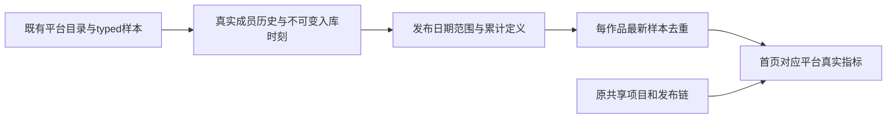

# T1356 首页读取已采集的平台作品累计指标

## 用户目标与已证问题

用户于2026-10-19反馈所有平台已绑定到同组，但只有抖音有数据。当前先闭合已证首页`pages.groupOverview.get`遗漏；其它具体缺数页面由用户澄清后按真实事实核对，不宣称所有界面问题已定位。新反馈不授权登录、采集、重发、取消、付费、覆盖用户原任务或直接改业务库。

公开只读报告`docs/verification/t1354/runtime-readonly/REPORT.md`：目标组4 active成员，无公众号；抖音46目录/5600作品指标、小红书112目录/1120作品指标、快手1目录/2账号指标+6作品指标，以上指标记录非指标值。小红书/快手目录verifiedComplete，不能称未采集。实际overview窗口2026-09-20至2026-10-19（北京时间闭区间）：小红书11作品在窗内/101早于，快手0窗内/1早于；因此小红书当前窗全—是确证遗漏，快手必须用包含其发布日期的合法窗口验读，不能仅凭存在指标判默认窗错误。实际指标样本均count/lifetime/int，不能冒30日增量。

视频号0作品/指标/原生报表，原EXPORT_FAILED及最新blocked父任务/running子execution分歧仍保留；公众号原failed/accountId=null另属T1354，首页加数不代签绑定或采集修复。沿既有首页合同、本次已证首页遗漏与原丰富工作台保留要求；本任务不造Publication/Project，不改变共享内容数、期间发布记录、待分发含义，不将112平台作品称112项目。

## 已查调用链

`group-workspace.ts:35`仅通过publishing读取发布记录，44仅通过analytics读取legacy snapshot，49..51从rawMetrics组合指标；这条链没有读`platform_collection`的既有catalog/typed metrics。`metricMode`原合同唯一`published_in_period_cumulative`，新来源不能静默冒原发布记录。组合根`frontend/src/server/persistence-client.ts:5666`已持有platformCollectionService，可注入窄只读端口。

`platform-collection.service.ts:listWorks:814/readMetrics:859`已有公共读口；readMetrics每页实际先全读账号快照再内存切片，不能首页逐作品/逐页N次重扫。采用该模块最小私有摘要读port，查询所需账号/日期及候选指标；无需新公开endpoint、表、索引、依赖、任务或采集器。

typed协议在`contract/src/resources/platform-capabilities.ts:110..164`：work play/view/read/like/comment/share/favorite与account follower分开，availability、unit、window、source、capturedAt/observedAt/ingestedAt均可辨。metric表无groupId，不能按当前成员拿全历史。现源`platform-collection.service.ts:754..783`仅insert新证据，同证据冲突拒绝，重放不更新原`ingestedAt`；group transfer保留旧membership.leftAt，插入新membership joinedAt（`account-group.service.ts:113..115`）。因此用**服务端不可变入库时刻**落在真实membership半开区间作为既有事实的确定归属，不用平台capturedAt、当前成员或可更新work.observedAt偷换原组。

## 功能合同

- **FR1356-1 来源与范围**：首页补充现publishing链未覆盖的platform catalog作品累计指标；按作品真实publishedAt过滤北京时间startDate 00:00含、endDate次日00:00不含。publishedAt未知不猜；非public/current有效目录不混入，返回真实覆盖说明。catalogWorkCount/eligible仅统计日期窗内且至少有一条归属该组的metric证据的作品（availability可为未知，但归属证据须有效），不冒全平台目录覆盖；无metric或无可归属metric证据的目录项只列不可归属覆盖，不计group-owned数量。只读既有事实，0新采集。原Publishing/Project实体、数量和导航不重写。
- **FR1356-2 真实冻结归属**：账号组服务新增owner校验后的私有只读membership-evidence端口：对目标组涉及账号读取该用户全部组的真实membership区间，以识别跨组重叠；只在backend内部使用，不公开额外组信息，不改变现get仅当前成员的UI合同。业务摘要仅返回目标组结果。集合由服务读取，不能接公开caller伪造区间。collection摘要只读同user/account事实，用immutable `ingestedAt ∈ [joinedAt,leftAt)`确定该组归属；未知/无区间/重叠/边界矛盾事实不猜归属，按不可归属覆盖记录留空。转组后原事实留原组，目标组只得新事实；未来再次转回仍按各独立membership区间，不把旧区间覆盖。work.ingestedAt在目录upsert时可变，禁止用它或当前member给无metric目录项造冻结归属。覆盖文案明确“有归属采集记录的作品范围”，缺少归属证据不冒全目录为空或已全覆盖。读取不得变成迁移或写回历史。
- **FR1356-3 累计与去重**：工作指标按accountId+platformWorkId+metricKey+规范window确定样本族，选择同归属下最新observedAt/capturedAt真实候选；同刻值或可用性冲突为未知，不以ID大小猜值。最新不可用/空值不退回旧available冒当前成功。仅累计lifetime+正确unit的同定义指标相加；interval/其它unit不混。真实0保留、未知不补0，返回known/eligible覆盖及来源时间。不做日差分/30日增量/稀疏补点。
- **FR1356-4 指标语义**：小红书view_count为“浏览（次）”，不得叫视频播放；play_count为播放、read_count保其真实阅读定义。不同指标语义不得只因unit=count跨平台加总。账号followers按account一次取最新有效follower_count，不乘作品数、不假装独立用户去重；缺失finish/转发等保持—。全平台总卡原视频播放仅加入语义确为播放的贡献，浏览与阅读独立，不能把小红书浏览塞videoViews。
- **FR1356-5 旧链保护与去重边界**：原publishing/analytics结果保持合法旧消费者语义。新贡献仅限有真实platform work、尚未被原出版链覆盖的工作项；用现有publicationId/legacyPublicationId等真实引用排重，不能按标题/字符串相似度拼接；存在已关联出版项时不重复相加。原项目数、发布数、待分发不引用平台目录数。metadata明确区分publicationCount与catalogWorkCount、样本覆盖、来源与累计口径；旧DTO缺新字段仍可读，新口径须typed声明并同步可见label/coverage。
- **FR1356-6 性能与错误隔离**：摘要服务仅查询当前合法组范围与所选平台/账号/日期，不遍历每作品公共读口、不重复全overview、不随首页启动全账号采集。一次窄只读摘要返回需要的候选投影/计数，不把所有原始历史快照传前端。错误局部保其它工作台卡与旧合法值，不伪全空或全成功；不能把缺summary误标平台没有采集。除FR1356-7的已知小红书累计比较文案外，T1347独立日报端口/client生命周期及六卡内容不改，native缺日报仍诚实，不把本累计摘要画日线。

- **FR1356-7 同屏语义一致**：真实小红书旧发布行的views已明确是浏览累计时，最近发布行与同卡次级作品比较均用“浏览”，不能在上方浏览卡、下方又称播放。只改已知小红书fallback标题、说明、辅助summary/aria和无日报空态措辞；保真实0/未知、原数值和排序，不改其它平台/自然日曲线/endpoint/请求或取消生命周期。此为Root本轮明确批准的指标文案校准，先真实当前组件RED，再独立delta复评后才生产修改。

## 最小实现边界与分工

后端writer拟写集（待独评通过才派发，单独持有这些路径；control不并写）：
- `backend/src/modules/platform-account/account-group.service.ts`与`account-group.integration.test.ts`：只读历史membership port/owner守卫。
- `backend/src/modules/platform-collection/platform-collection.service.ts`及`platform-collection.integration.test.ts`：只读bounded候选摘要port、原事实/重放/转组不变量；不改采集和原公共readMetrics合同。
- 新`backend/src/application/queries/dashboard-collected-metrics.ts`及其`.test.ts`：纯typed投影，不新增持久模型；当前`group-workspace.ts`及`.test.ts`组合端口、保旧链/数量。
- `contract/src/pages/group-workspace.ts`及新`contract/tests/group-dashboard-collected-metrics.test.ts`：仅必要的typed来源/累计口径/覆盖可选兼容字段；若新增导出才机械补`contract/src/index.ts`，不加新operation清单。
- `frontend/src/server/persistence-client.ts`：仅当前groupOverview装配只读port，保持其它持久路径字节/语义。
- 任务证据`docs/verification/t1356/**`。

前端主writer在T1355后按真实DTO差异处理同批UI（不让后端writer抢写）：首页当前renderer会显示MetricCard.label/value，若无需改就保持；若需要来源/覆盖文案才窄改`frontend/src/app/(creator)/page.tsx`、`frontend/src/features/dashboard/dashboard-page.tsx`及现`.test.tsx`，正式隔离UI `frontend/tests/e2e/t1356-collected-metrics.spec.ts`与`frontend/playwright.t1356.config.ts`。仅按FR1356-7窄改`frontend/src/features/dashboard/dashboard-trend-card.tsx`与现`.test.tsx`的已知小红书fallback文案/summary/aria，不改数值、自然日图、端点或生命周期；不写views-trend-chart，不造假发布行或每作品复盘链接，不把目录ID塞publication DTO。共享契约写入与T1357串行，persistence注入与UI的文件所有权明确交接。

## RED与验收

前置基线与公共RED均只用私有合成数据库，不触原用户/原任务：创建两组和真实账号，通过现collection service入目录/typed样本，再由公开groupOverview transport读同组/平台/窗口。当前应可复现“typed已有available非0，组页全—”，不是helper import失败；同时证明快手窗外—正确、合法包含窗口才应有数。

| AC | 必须可观察结果 |
|---|---|
| AC1356-1 | 小红书同窗口有效作品与typed lifetime多采样读回同ID数值，浏览不称视频播放；快手分别窗外空、包含实际发布日期窗口有数；0与未知区分。 |
| AC1356-2 | 最新/重复/同刻冲突/不可用/interval/其它单位/空publishedAt均确定；followers仅账号一次，finish无源—，覆盖与来源时间可读。 |
| AC1356-3 | A→B→A真实转组旧membership保留，immutable ingestedAt边界、历史成员/已归档/错用户/组/账号、重放不改原事实全部受测；读取0业务写，不能因当前成员把旧组指标移走。 |
| AC1356-4 | 真实关联出版项排重，旧抖音/旧analytics/共享项目数/发布/待分发不变；不造新Publication/Project，mixed语义不相加。 |
| AC1356-5 | 首页1366×900与1024×680、暗色/200%、真实平台/账号/日期筛选、返回刷新/切组晚回、summary错误其它卡保留，用户可见文本与数据同scope；原日报曲线不受累计摘要替代。 |

必需定向backend/contract/frontend、公共HTTP组合、类型/boundary/orphan、LED047及相关超时公共链/正式双视口Gate；失败先保原件，独立人审不代签实际功能。全局原40ERROR与新宽路径漂移分列，不将既有accepted-risk扩大。本SPEC正式独评后才生产修改，若不可变归属证明或bounded查询无法实现需先修订最小合同，不以当前member或原快照差分临时补数。

