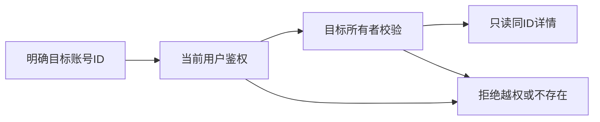

# T1357 目标账号详情读取的公开归属契约

## 当前事实与用户结果

本轮用户已授权绑定闭环与跨平台诊断修复。公开CLI对目标accountId即使显式--account/--group仍HTTP428；原记录见T1354 runtime-readonly。不能由此宣称普通UI也失败：`contract-client.ts`确实使用`createHttpTransport`→POST `/api/v1/dispatch`，但route仅CLI调用`cliInvocationService.begin`；canonical `WORKSPACE_OPERATION_SCOPES[accounts.get]`为platform-account，普通UI直接转service。`accounts.get`在route selectionIndependentRead清当前选择，http-transport亦按user-scoped清默认header，service.getAccount本身按ctx.userId+params.accountId查所有者。

需求是明确目标的只读详情不被旧默认账号或未选择账号阻断；不能为修复而放宽其它平台账号操作、泄露别用户对象，不能把current account当目标替代params。先在隔离数据经实际HTTP路径分别观测UI transport与带CLI身份dispatch；UI若200，T1355不依赖此任务，二者不人为串行；CLI428单独保留并修。现已完成隔离真实HTTP观测：UI三种默认选择均200/同目标ID，CLI三种均428；原行为RED日志为`docs/verification/t1357/http-observation-red-attempt01.txt`（1语义FAIL，11.59秒）。只新增实际loopback测试，canonical生产登记未改；待独评才start/修复。T1355不依赖本只影响CLI的修复。

## 合同与边界

FR1357-1：accounts.get沿当前用户认证、目标params.accountId的所有者守卫，返回同ID详情；未选/失效/另一当前默认账号不应改变读取目标。错用户或不存在目标仍统一拒绝，不泄露存在性。不修改accounts.update/archive/任何其它platform-account范围。

FR1357-2：UI实际createHttpTransport及CLI实际dispatch各自有完整Request/Response观测，覆盖无默认账号、旧默认账号、目标另平台、跨用户与无目标。明确哪些路径现FAIL、哪些既有PASS，禁止mock/source静态断言Panel必坏；只修已证不一致。

FR1357-3：优先统一canonical operation scope与已有selection-independent owner读语义，不复制客户端HTTP wrapper，不新op/字段/表/特权。公开CLI审计与只读policy保留；不改真实用户账户、不登录/采集/取消或重试原任务。

拟写集：`contract/src/workspace-operation-scope.ts`仅accounts.get精确登记及`contract/tests/workspace-operation-scope.test.ts`对应合同；`frontend/src/app/api/v1/dispatch/route.test.ts`复用现有真实loopback HTTP→POST handler→持久服务/CLI invocation组合，新增T1357定向用例，并通过实际createHttpTransport与DispatchClient分别调用；不另造HTTP实现或改共享helper。现`http-transport.test.ts`只作为既有运输守卫回归，不预设需要修改。是否需要route.ts/transport.ts生产改动由HTTP事实决定，若需扩入必须先修订精确SPEC独评，不默认改它们。backend实际getAccount/user ownership/service不放宽。

验收：真实HTTP UI/CLI均同ID200（原UI若已200保其回归）；目标属别用户/不存在保持拒绝；未选、失效旧选择、另平台默认号均不误读；其它platform-account op仍要求原scope，registry/CLI readOnly归属及审计回归；类型/边界与相关集成测试通过。正执行/观察最短120秒，0重发用户请求，不自动延续未知写。

执行顺序：当前生产/测试写窗口归T1356 backend，T1357不并改contract或route测试。后端已正式释放写窗，control已实际完成HTTP核验并提交独评；普通UI实际200，T1355不依赖本任务。
