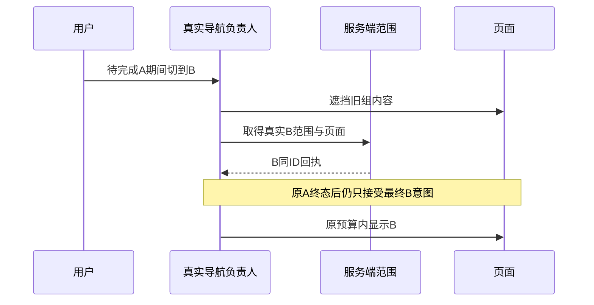

# T1361 待完成筛选与切组的真实刷新收尾

## 用户结果与当场事实

用户先前明确要求切账号组后界面跟随，本轮绑定与首页修复仍须保持该能力。Root于2026-10-19授权本窄修，不重新请求用户许可，不改变页面风格。当前T1356的首页数值/日期/归属前18个检查点通过，但切组终态未通过，不能据此签完本轮合同或安装交付。

c834ec7f7干净候选（产品字节同19d）formal03正常视口在原120秒pending全0等待失败（4个早于门的旧onboarding读未终态）；最小视口pending已归0，仍在实际B筛选区域不可见处120秒失败。两图都显示工作区打开超时；列表最后多次原HTTP200，未选择标签可由菜单error派生，不能据此宣称localStorage清空。原发送前延迟A记录Cookie为A、实际workspace为B，不能当作旧A成功payload晚到。

获准一次独立Response-stage实验在全新私有PG/真实服务seed上，仅执行A真实首页→首XHS原RSC收到200后暂停→真实侧栏切B→B原200完成→放行原A。A实际Flight workspace=primary，B实际workspace=transferB，A释放后真实Network.finished；最终原120秒仍未出现B界面，URL仍/、存储和Cookie均B、工作区超时。三个RSC未解析出initialScope，不据此证明layout未更新。Fetch body40773B/SHA e305…与BrowserResponse body42588B/SHA a152…不同，原命令未提供改写headers/body，但两读逐字同一性未证。原1726/平台任务与本问题无已证因果。

证据：docs/verification/t1356/candidate-attempt03/SAFE_SUMMARY.json、candidate-attempt03-live/RSC_AND_ONBOARDING_SAFE.json、FLIGHT_ACTUAL_SCOPE_SAFE.json、ONBOARDING_GROUP_LIST_SAFE.json；response-probe/attempt01/SAFE_SUMMARY.json及原图/trace；review/SWITCH_FAILURE_ANALYSIS.md。先查刷新负责人/导航队列/实际server scope收尾，首因仍待定位。不得以静态猜测预定修法。

## 正式合同

FR1361-1：用户发出合法B组切换意图后，旧组页面立即遮挡；原A筛选请求完成/取消后，实际B服务端范围及页面收尾，在原120秒预算内显示B真实数据。不能仅存储B或HTTP200即完成；不得展示A数据、冒取消为成功旧payload、强制complete或增加超时。

FR1361-2：同一次切组只有现有统一导航负责人协调。真实query/实体定位按原合同清理，保无统一owner时合法入口、无关筛选与同scope刷新保实例。原已提交筛选、未完成筛选、当前URL恰好等于清理目标、确需replace的日期/实体页、外部manager进入组均保。仅将实际因果证实的最窄导航/刷新完成路径修改，不预定删条件或全页reload。

FR1361-3：server scope与当前真实选择一致才开放页面。保时代/卸载拒旧、单在途/合法重试、错误可恢复、原脏稿离开确认/取消保稿与后台任务冻结归属；不因质量门阻断合法B，不放宽后端归属，不清用户任务。原A/B同ID、URL与真响应解析分证。

FR1361-4：诊断仅fresh合成库/浏览器。必要时只在隔离候选的account-switcher.tsx与workspace-initialization.tsx临时加入console白名单日志：Provider实际initialScope/liveScope/phase、Switcher refreshPending/refreshEpoch/是否replace与时间，不读取私有React结构、不读env/正文/凭据；只观察，不强制渲染/调度/complete，不新增产品API或改变执行行为。每次前后保两源原字节/SHA与精确patch，撤回逐字校验通过后再做正式生产回归；debug hook/日志不得提交。若需其它源诊断或扩大生产写集必须先独评delta。

## 写集与执行边界

最小候选生产写集：frontend/src/components/shell/account-switcher.tsx、workspace-initialization.tsx及各现test.tsx；只在根因确需时允许现有导航owner协作（具体文件先增量独评），不预设需要两源都改。只读layout/page/session/http-transport/onboarding与Next实际公共API；不改Next/React包，不新增产品调试接口、不移除隔离/超时门。

新增公共回归frontend/tests/e2e/t1361-pending-filter-workspace-refresh.spec.ts、frontend/playwright.t1361.config.ts，复用现有独立PG/seed，不跑18前置才测race；正常1366×900/最小1024×680，保真实RSC实体/时序与三个实际UI/存储点。原Response-stage新机制及bytes不等边界保留，不重写响应来拼装Flight；若机制限制妨碍判断，独立记录未知，不直接改生产掩盖。全局工作流与Gate白名单只由control精确登记。

既有组件fixture将router.refresh模拟为async Promise并自行latestRefresh拒旧提交，与真实Next同步void/导航队列不同；旧PASS只保其有限输入，不能单改mock就声称真实刷新已修。最终验收锚必须是真实Next公开回归，至少区分Provider实际prop scope是否提交与refreshPending是否收口。

先独立SPEC评审→正式收据/start/context→真实现组件/公共RED→最窄实现→定向GREEN与原相关保护；无前置RED不得先生产试改。T1356最终全部真实UI/独立图审+strict仍须通过；本窄任务不能以修复RSC为由跳过1356暗色/200%/真实SQL降级。T1355原自动完成与历史恢复、T1357owner读取合同不变。

验收包括A无筛选/已提交/待完成筛选三族、真实旧A终态与B最终排他；URL同/异清理目标、单向及快速反向、同scope刷新、旧离开保护/首次恢复例外、错误真实重读。按实际交叉运行现switcher/provider定向、LED047、timeout、boundary/orphan与类型。执行/请求/观察原最短120秒、原更长外层与cleanup保留，0副作用重发/模型/真实采集。全局41ERROR按旧32/此前7/本轮2分证，不洗旧PASS。

