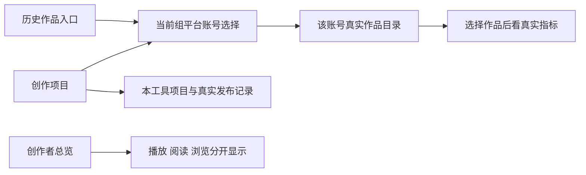

# T1362 让已采集作品与账号数据从真实入口可见

## 用户要得到什么

用户2026-10-19先说明非抖音“没有数据”同时在“首页和账号详情”，随后明确：“视频号采集失败，其他平台全部都采集成功了，但是没有作品。只有抖音是有数据的”。用户要求睡觉期间不要再提问，自主测试验证尝试。已采集的作品应能从常用入口找到；创作项目和真实发布记录仍保持原含义，不能造Project/Publication来填列表。

公众号另补充“扫码后已进入后台才报错”，归T1354事实/受控修复，原1726首因仍UNKNOWN。视频号prepare/channelsDaily/REPORT_LINK_MISSING另登记诊断，不用本展示修复签恢复；本任务不重新登录、扫码、采集、发布、付费、取消或重发用户原任务，不写用户业务库。

## 已证与还不能声称的事实

- 安装版只读：同组Project65（imported41/manual24）平台引用抖音52/空13，XHS/KS0；真实目录XHS112/KS1，默认账号详情只读粉丝，选择真实作品后样本指标可见。并未复现用户的完整点击轨迹，不能说113条数据全部丢失或所有详情指标均已验。
- `onboarding-steps.ts`“查看历史作品”指向`/projects`，引导信号只读Project source=imported。抖音旧导入链真实创建Project/Publication；其它catalog链不创建它们，最近发布/发布中心也只读Publication。
- `/accounts/works`没有日期query/概览聚合。无accountId且组已存在仍走ZeroAccountGuidance；有合法成员时目录可读，workId在当前目录页命中后才读作品指标。粉丝无记录与作品无数据不能混为一谈。
- `/overview`的GroupOverview没有消费可选browseViews/row.browses；sampleCount是legacy发布快照数，不能以它为0宣称typed目录尚未采集。
- 证据：`docs/verification/t1356/detail-scope-analysis/REPORT.md`、`docs/verification/t1362/installed-entry-readonly/REPORT.md`及本任务fresh私有PG的真实Next公共RED。RED未结束前不写PASS；原目录与累计值/默认日期语义不变。

## 结果合同

- **FR1362-1 入口真实**：组工作区的上手引导“查看历史作品”进入当前组的`/accounts/works`，文案明确平台已采集作品，不暗示所有平台作品已变成创作项目。项目列表附近提供清楚紧邻的“已采集作品”链接；项目列表、项目统计、最近发布和Publication实体含义不改。旧无组的合法账号引导路径按其原合同保留，不批量重做首页/项目页。组内该步骤“已查看，完成这一步”是用户明确自报确认，只在手动点击后保存completedSteps；不依赖hasImportedWorks/legacy Project才可点击，不自动把目录当Project或推断origin，不新增逐账号读取。旧account-only确认保护保留。纯typed且无legacy Project的组须完整走“已有内容→目录→返回→手动完成”且刷新读回。
- **FR1362-2 组内真实账号选择**：`/accounts/works`在已有有效组而没有accountId时，显示组名与真实active且leftAt=null成员的账号选择；不再提示“先创建账号组”。有选中账号时同一局部选择仍可用。只有owner/group真实成员可进入，不按名称猜账号，不自动落上一个组的账号。有效空组说明“当前账号组尚未绑定平台账号”并提供真实管理入口；无组/未登录继续原正确引导。旧合法account-only入口不被新组UI阻断。
- **FR1362-3 切换不串数据**：同组切账号生成仅目标accountId的新URL，清旧workId、cursor、metricCursor、accountMetricCursor。切组沿T1361唯一导航owner及现清理协议，旧组/账号作品立即遮挡，目标组只显示该组真实成员选择。显式越组/不存在/归档或已离组成员不回退到其它账号，不绕后端权限；给真实不可用状态及当前组选择入口。
- **FR1362-4 目录与详情不混淆**：真实目录行可点击到同账号当前页作品，显示真实typed数值、0、不可用与来源时间；顶部原仅follower_count区域标题明确“粉丝记录”，粉丝记录缺失只说粉丝暂无记录，未选作品说明先选择作品，不把它描述成目录无数据。保当前账号目录的既有历史/分页/权限合同，不重写历史归属，也不把账号目录全历史冒组累计摘要。本页没有日期筛选，不新增或伪验该功能。
- **FR1362-5 总览消费同语义数据**：在原总览摘要/表中最小补累计浏览及平台browses列，播放/阅读/浏览分开；optional旧DTO缺字段显示—，不补0或报错。真实0有证据。原sampleCount保数值并标清发布指标样本，不塞目录数；平台采集状态依据既有collected.metrics的platform/eligibleCount/knownCount而非truthy value或legacy sampleCount。存在归属采集证据但指标未知显示“部分指标暂缺”等；无当前窗口证据不能宣称平台从未采集，state=unavailable明确摘要暂不可读。原合法发布样本/旧DTO读法保留，不造新每平台目录数量或API。播放/阅读比较图数值/坐标不变，无需重做总览。
- **FR1362-6 不发新后台任务**：只导航/读已有真实服务事实，页面既有引导进度自动写单独精确记账；不提交采集、模型或外部操作。带组/账号参数须来自真实ID与所属范围。复用既有border/foreground/brand/rounded tokens、Link/SectionCard，无新主题或全局交互抽象。

## 精确实现边界（独评与真实RED后才生产）

- `frontend/src/features/onboarding/onboarding-steps.ts`与现`.test.ts`：仅组历史作品CTA/说明。
- `frontend/src/features/onboarding/onboarding-card.tsx`与现`.test.tsx`：仅组内“已查看”人工确认不被Project来源阻断，保save lock/真实scope/错误状态。
- `frontend/src/features/projects/projects-page.tsx`与现`.test.tsx`：紧邻现项目列表工具栏的真实已采集作品入口，不改列表过滤/数量。
- `frontend/src/app/(creator)/accounts/works/page.tsx`及新相邻`page.test.tsx`：真实组成员/账号选择、缺选择与无效选择状态；保原collection/native读取分支。局部新`frontend/src/features/platform-account/platform-work-account-navigation.tsx`只渲染真实成员Link，测试由真实route组合覆盖，不造镜像组件测试。若现有可复用导航已足够，不新建文件。
- `frontend/src/features/platform-account/platform-work-catalog.tsx`与现`.test.tsx`：仅粉丝区域标题更准确，不新造账号仪表盘或指标。
- `frontend/src/features/group-workspace/group-overview.tsx`与现`group-workspace.test.tsx`：既有DTO的浏览/覆盖与旧optional兼容，不改backend、contract、持久层或指标数值。
- `frontend/src/components/shell/account-switcher.tsx`与现`.test.tsx`（formal01真实URL残留增补）：仅`groupSwitchHref`对`/accounts/works`清理与旧账号绑定的`workId`、`cursor`、`metricCursor`、`accountMetricCursor`；其它路径同名参数保留。现`writeCurrentGroupId`已清accountId，保T1361两阶段唯一导航、原deadline/epoch/脏稿守卫，不改全局transport或后端。以实际路由声明为参数真相，定向RED/GREEN与T1361真实切组保护后再正式两窗。
- 新`frontend/tests/e2e/t1362-collected-work-entry.spec.ts`与`frontend/playwright.t1362.config.ts`：沿冻结T1355 helper/T1356 seed，fresh私有PG、禁scheduler/background、auth/me600s、正式操作120s/原更长预算、单Next。根真相/流程工件仅control写；独评方只写本任务review。

## 验收锚

1. 当前真实公开Next RED：从首页点击历史作品进入Project，合法13条XHS目录却不在该列表；已有组无account显示错误新建引导；/overview漏浏览123及纯typed0误标未采集。正控制：显式合法账号/作品能读同ID指标。不得用缺import、假DTO或手抛错误冒业务红。
2. 定向TDD保旧无组/已有组空成员/active/历史与越组、同组账号切换清旧query；旧DTOmissing browse、typed0/unknown/unavailable与legacy样本均真实组件验证。
3. 两窗口1366×900与1024×680真实入口链：首页历史→组成员选择→XHS目录/真实0与未知→KS目录/指标；项目附近入口、全局切组后正确选择与旧账号/作品排除、返回/刷新；纯typed无legacy Project组手动确认已有内容后看真实目录，再返回明确手动完成引导并刷新读回，不用primary合法旧Project掩盖。/overview同scope浏览123、纯typed0不误报、旧Project/Publication原数量不变。暗色/真实浏览器200%核主要入口与指标可达；不为历史固定顶栏视觉NB扩改。
4. 复用现服务seed，不扩新生产API；如需同组两个账号的合成事实，docs seed通过真实group/account/collection service建立，不直接写业务表、不把目录假导入项目。独立图审只签已见像素，真实浏览器/服务同ID与网络记录另验。
5. LED047、timeout-policy、前端类型、boundary/orphan及本批必要受影响消费者通过后，统一最新源reconcile分类保留旧失败，再真实strict完成。不能仅静态计数或样本直接GET完成任务，也不能凭这项展示修复签视频号已恢复。
