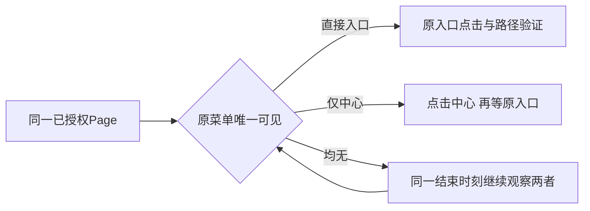

# T1363 视频号prepare报表入口失败的精确诊断边界

用户2026-10-19明确视频号采集失败，其它平台已采集但作品入口不可见。已查原安全日志：prepare/channelsDaily/REPORT_LINK_MISSING发生于等待“数据中心”或“视频数据”入口，尚未到日期/下载；先前identity已返回，后续登录状态仍未知。公开父任务execution-task-bd28c55d-1499与AI子任务最新均failed，errorCode=null不能推成timeout。

已有明确同Page扫码DOM会分类LOGIN_REQUIRED→needsAuth，不能用重复加登录检测泛修。旧无归属login tab不证明用户失效。只读边界证据docs/verification/t1362/video-collection-readonly/REPORT.md及installed-entry-readonly/REPORT.md保持，不把历史时间冒当前状态。

若可经现有公开能力、当前有效登录与严格owner/profile关联取得真实页面/menu证据，先制定一次有区分力、无外发或副作用的最小观察；没有证据不猜selector，不重发仅重复同码的新采集。用户已明确不用再问他，不能要求其补截图/扫码；仍不得重发未知回执原任务、发布或付费。受控fixture只能验证分类/guard，不能代签真实视频号恢复。

本轮展示与导航可独立交付，但包说明必须明确视频号尚未采集成功。生产仅在下述窄合同独评及真实RED后执行；真实平台新采集仍未放行，需安装后另核owner/期限/幂等及资源归属方案，不由本规格自动触发。

## 本轮窄修合同（独立策略调查后的拟实现）

独立报告`docs/verification/t1363/independent-strategy/REPORT.md`静态发现：初读“视频数据”计数0后，当前只等待“数据中心”；若原已合法直接入口随后唯一可见、中心仍0，仍会报LINK_MISSING。此输入与现立即直接入口合法路径不一致，尚不是当场RED，不能解释原1499首因。

- **FR1363-1 同一等待中的合法入口**：仅重用现精确可见selector，等待中心时也观察原直接入口；入口唯一可见优先沿现直接路径。只有入口0、中心唯一可见才点击中心，点击前再次核计数，防入口刚出现时反复切中心。不新增深链、词表猜测、first()兜底或全局observe恢复。隐藏模板不算。唯一性只约束实际需要点击的分支：entry>1保持原入口歧义错误；entry=1优先原直接路径，不因无关centre>1新增失败。只有entry=0且需要点击centre时才核centre唯一性，centre>1按原歧义失败；等待过程中entry变唯一时同样优先该直接路径。
- **FR1363-2 原权限与预算**：同一expectedIdentity/profile/Page/官方origin；等待、点击、路径验证继承同一原deadline与signal，不因条件变化续期。保取消/期限耗尽/wrong identity/明确登录提示与停止未确认优先级，禁止晚点击/下载/commit或租约假释放。旧合法channelsDaily/followers/works报告顺序、parser/真实保存链不变。
- **FR1363-3 安全子步骤诊断**：复用现onDiagnostic，只附固定entryPhase枚举（初检、等待中心或直接入口、点击中心、等待子入口、点击入口、等待目标路由）和循环中已经取得的可见计数/是否实际点中心；无需新观察或延长等待。组合根可附现有可信attemptId关联，禁止读取/输出DOM正文、identity、任意URL/query/href、Cookie、profile路径、私钥。日志失败不替换原错误或阻断close。旧事件缺字段继续UNKNOWN，不回填原首因。若新增字段须类型白名单/测试，不能把日志当成功依据。
- **FR1363-4 不重发用户任务**：本轮只受控隔离source/witness→collectNativeReports→backend collector/service port验收。保原1499/1502与已存目录/报表，既有tasks不改、不取消、不重发。真实owned新采集是后续独立动作，只有同源安装及明确执行策略后再授权一次，不向睡觉用户索要扫码、截图或回答。受控GREEN不能写成真实视频号已恢复。

## 精确写集

- `ai-worker/src/runtime/platform/wechat-dom-witness.ts`及现对应测试：上述入口观察与同deadline/歧义/取消保护，不改其它平台或全局observe。
- `ai-worker/src/runtime/platform/wechat-browser-source.ts`及现对应测试/既有integration测试：安全固定phase类型/透传；必要真实DOM公共collect链组合测试，不能mock prepare抛错误充RED。
- `frontend/src/server/persistence-client.ts`仅现WechatBrowserSource onDiagnostic装配段及对应现测试（若现接口可直接关联无需触碰则不改）：注入权威options.attemptId与安全枚举，不动其它持久/后台驱动，不新增API/存储。
- `docs/verification/t1363/**`受控probe、脱敏摘要、精确原始证据私有路径。工作流/DEC仅control，独立审阅者不写状态。

## 必需验收

1. 真实DOM初始entry/centre均无→随后仅原直接entry唯一可见：修前正式witness/source公共链LINK_MISSING且没有晚下载/commit，修后同输入真实click/path及合法报表集合下载parse逐份commit完成。独立工程实验与原用户首因严格分开。
2. 立即直接入口、中心晚到后点击才显子入口、两者初始存在、entry=1且centre>1、等待中entry变唯一且centre重复、followers原入口、works已在目标path的旧合法族；缺两者/隐藏/实际被点击分支重复（entry>1或entry=0且centre>1）/中心后仍缺入口/非官方/错误身份/明确扫码的负族；入口恰在点击前到达、等待/点击/路由阶段取消与原deadline、close未确认竞态族。保原码/无续期，全部实际回执。
3. 至少一次正式source→backend collector/service commit同ID完整成功，一次菜单失败安全failRun；公共链不以helper-only代签。LED047、timeout-policy、worker类型、受影响binding/native回归、boundary/orphan均按真实范围检查，不为纯worker无像素变化重跑无关绑定/作品UI。
4. 最终原1499首因UNKNOWN与视频号尚无本次真人采集成功如实保留。若安装后获准唯一新owned采集，另记新clientRequestId/attempt/终态与实际报表，只读跟踪原ID，无自动二次POST；该动作不改变本规格受控测试边界。
