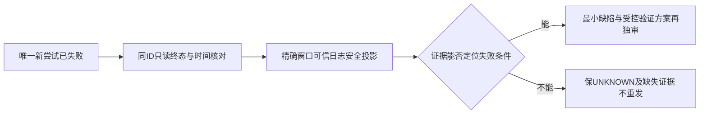

# T1364 核对新安装版一次视频号采集失败

## 用户目标与当场事实

用户明确视频号采集失败，其它平台已成功采集却看不到作品，并要求不再问他、由Agent自主测试验证。T1362已闭合真实作品入口；T1363只闭合“既有直接入口晚到”的受控缺陷和安全诊断，不能把其受控GREEN写成真实视频号恢复。Root 2026-10-19在e676同源安装核验后，另行放行唯一一次新owned采集。

Root交接的新真实attempt为`collection-92ecb053-281`：从UTC时刻`22:45:43.005Z`至`22:47:48.452Z`，125.447秒后`failed / EXPORT_FAILED`，`committedPages=0`、`generation=2`。完整UTC日期、对应account/group和来源文件由随后安全原件绑定，当前不补造。唯一POST使用预先保全的同一key；本任务不读取或复制该key，不重POST。generation不是执行次数，不能从gen2推出两次POST或两次实际采集。

新包源码`e6769b474fde3db583bf08b04104e4f3a57bd6c9`；其产品为eb19124ed、实际UI strict为721，六产品目录tree全等，见T1359 SOURCE_FREEZE。原视频号`execution-task-bd28c55d-1499`及AI1502、原公众号1726和所有旧失败完整保留。125.447秒不能单独证明120秒超时，EXPORT_FAILED不直接证明失败在下载或selector；0页只证明无已提交页，不推出尚未开窗或从未下载。

大白话：新版这一次仍没有采集成功。先把“这次真正走到哪一步、在哪个已证条件下失败”查清，再决定最小修法；不能再发一遍去碰运气。

## 诊断合同

- **FR1364-1 原尝试与归属冻结**：只关联本次真实attempt及其实际user/group/account/运行窗口；公开GET只跟踪同ID，不发retry/resume/cancel/new collect/login/bind。原1499/1502与所有旧状态、报表、profile/auth不改。若public读回或日志没有归属字段，记UNKNOWN，不靠时间接近或相同错误码拼成同一attempt。
- **FR1364-2 可信日志最小投影**：承接Root已授权且正在执行的精确attempt+窗口日志读取，仅保存stage/kind/code/entryObservation及必须的时间/可信attempt关联字段；entryObservation只沿生产已有固定phase/计数/是否点中心白名单。保原密文/原件的私有路径、SHA和采集方法，不复制密钥、整明文、DOM正文、URL/query/href、Cookie、profile内容或用户采集正文。已有事件没有字段就未知，不回填。
- **FR1364-3 因果与候选分开**：将公开终态、现有安全事件及e676实际source/witness/collector消费链逐项对照，区分入口观察、点击、目标路由、日期、下载、解析、提交、关闭/租约等实际能证范围。没有可信事件时不猜selector、登录状态、超时首因或T1363仍未生效；原任务与新attempt的不同来源不能互相代签。
- **FR1364-4 扩展先审与原任务不动**：R1只读日志授权及原件保留；本次R2拟新增的唯一导航诊断严格按下列FR6—12独审，不能借R1放行。禁止collect/retry/resume/login/bind/publish或改原期限，不自动继承已用完的采集POST额度；新诊断仅在独审、Root明确放行、受控公共验收后执行。用户已睡觉，不索要扫码、截图或回答。
- **FR1364-5 安装交付分证**：T1359真实构建、安装、连续稳定与清旧事实可按其证据结案；不得将本次新视频号failed改写为恢复。构建前false历史快照不回改；最终全局44ERROR分类、foreign9和T1255工作原行保护继续。

## 精确写集与只读输入

R1写集仅文书且未启动生产能力。R2拟写集以本文末尾精确清单为准，BACKLOG/DEC/阶段登记仍由control唯一writer维护；独审者只写分配的review子目录。不改已安装App、原collection业务状态/报表/作品、凭据或账号数据，不改schema/迁移。

只读：T1359 SOURCE_FREEZE/安装安全摘要及本次新attempt的Root安全投影；T1363原RED/GREEN/实现与诊断类型；`wechat-dom-witness.ts`、`wechat-browser-source.ts`、`wechat-native-collector.ts`及persistence现onDiagnostic装配消费者。需要源身份时以e676 Git对象/安装attestation核对，不把主树foreign字节当安装源码。私有原件只由当前已授权执行者按精确范围读取，本任务不派第二组重复decoder/日志扫描。

## 验收与停止条件

1. 新attempt同ID终态、UTC完整时间、可信归属与single-POST事实有原安全来源和SHA；未知字段明确保留，不补造父任务ID或业务计数。
2. 安全投影和当前消费链能区分“已证失败阶段/错误”与候选/UNKNOWN；保此前T1363受控成功、原1499失败和本次281失败三份独立证据。
3. 给出最小下一步：证据支持时精确受控验证/保护族；证据不足时写明缺少哪项观测及为何现有字段不足。不输出无依据修法，不以再次POST、模糊选择器或增timeout代替调查。
4. 独立SPEC审阅通过后方可进入本任务正式执行/收尾；待审登记不阻止Root已单独授权的在途只读投影。诊断无源码变化，不触发重复全局或无关UI测试；后续若扩实现，按实际消费者重新定门。

R1已独立通过并正式记录REV:756ccf30ea9c；当前R2范围扩展待独审与Root放行，尚未taskctl start或修改生产。原用户任务继续，不能因T1359安装成功结束问题处理。

## R2 已证事实与新增范围（2026-10-19）

T1359最终安全原件及副本`docs/verification/t1359/final/VIDEO_FAILURE_SAFE_EVENTS.json`补齐事实：attempt281对应2026-10-18T22:45:43.005Z—22:47:48.452Z，group=`grp_legacy_acct-ae1a8346-9`、account=`acct-0d742f83-1558`。22:47:48.382Z可信事件为prepare/channelsDaily/REPORT_LINK_MISSING，entryPhase=wait_entry_or_centre、entryVisibleCount=0、centreVisibleCount=0、centreClicked=false。仅证当次最后观察，不证明物理从未点击、当前登录状态、菜单改名或原1499根因。报表和目录全分页0→0，关闭/租约公开回执UNKNOWN。

Root选定：新增canonical CLI单次只读导航能力，不另建HTTP鉴权入口、不启动collector、不猜selector；hostLifecycle acquire只增加只读auditReceipt用于核对关闭/释放，旧算法和调用行为不变。此处“只读”指不修改平台内容/采集实体；授权准入标记、私有证据和现host资源租约确有本地写入，不能称零写。

### 新合同

- **FR1364-6 唯一canonical入口与默认关闭**：新operation固定`accounts.wechatNavigation.diagnose`，POST路径`/accounts/:accountId/wechat-navigation-diagnosis`，strict params仅accountId、strict body为空对象，不接query/URL/profile/selector/JS/路径/sink/expectedIdentity/预算。CLI policy为write、gateway幂等，workspace scope=group；仅正式本机CLI认证、可信invocation及受信服务器配置开启后可启动。配置默认off；本次authorizationId、允许的group/account和私有根均由服务器可信配置提供，请求不得覆盖。经原CLI→dispatch→canonical wrappers→backend service→worker，不新建通用浏览器框架、不加入助手默认工具清单。旧operation权限/调用/行为保持。
- **FR1364-7 同owner与冻结证明**：非空ctx.groupId，assertOwnedAccount确认当前user/active账号/wechatVideo及成员归属；group active/version、membership id/version与account平台/稳定身份/status/updatedAt组成冻结证明（账号没有数值version，不虚构）。authority authorizeBindingTarget及resolveProfile是唯一正式profile来源，不输出或复制profile。authority前、host排队拿租约后、采样及截图前后、证据发布前均经backend既有read ports复核；A→B→A必须由membership id/version识别。变化立即abort，阻止新导航/取证/发布；已暂写但未提交字节清除，先前原件隔离，不作为当前有效索引。跨用户/错组/无组/归档/错平台拒绝在launch之前。
- **FR1364-8 跨重启一次准入与重放**：受信authorizationId在0700私有根用原子wx标记绑定首个可信CLI invocationId，启动前消耗；不同invocation拒绝，同invocation只回读安全索引，不第二次launch，服务重启亦成立。gateway仍按原幂等input/key冲突及running/failed/unknown回执处理；新诊断用独立保全key，不能复用281采集key。成功缓存返回之前必须经同一个backend scope验证端口重核当前active/冻结证明；变化返回scope conflict，不返回旧有效证据、不再执行。私有准入或结果损坏记UNKNOWN/拒绝新启动，不能删标记换key重试。
- **FR1364-9 私有有限导航与结构**：worker内部observeNavigation复用withProfile、同Page/官方origin/固定首页及原identity witness，核对expected稳定身份；身份错/明确扫码时终止，未知字段保UNKNOWN，不索要扫码。身份核验后第一帧、原120000ms有限观察末尾第二帧，最多两张viewport PNG；不点未知菜单/深链、不调用prepare/date/download/parser/commit。最多32个串行样本、最多一个在途；上限不代替真实120秒末次观察。结构区分顶层、同源frame、跨域frame、open/closed Shadow、overlay：只存固定路由分类/层级/可见性/readyState/exact与visible菜单计数、tag/role/expanded/hidden/bbox/中心hit-test及截断标志。必要菜单名称只入私有导航容器候选，最多128项×80字符；无导航容器记UNKNOWN，不抓全body/全DOM，不输出URL/query/href/Cookie/正文。私有根当前OS owner、0700目录/0600文件、canonical无symlink/越根、大小有界、wx临时原子完成；截图失败记missing，不另开浏览器/预算重拍。私有manifest绑定run/冻结scope/source SHA/捕获时点/路由分类/SHA，公开只给opaque artifactId/hash/状态，不给路径/正文。
- **FR1364-10 信号与完整预算**：Transport兼容新增可选第四参RequestControls，只有新op由dispatch从真实req.signal和gateway可信invocationId构造；四包装仅此op转发，旧op仍原三参，不从body收controls。新run唯一startedAt/deadline不可续期，涵盖host排队120000、现STARTUP1120000、初goto120000、identity600000、有限观察120000、两截图240000、物理关闭120000、结算至少10000毫秒，合计至少2450000ms；实施核真实消费者若有新增有限执行预算必须加足总包络，不借观察/关闭余量。单正执行与有限观察至少120秒、保原更长预算，期限不足立即停。现CLI8100000ms请求/8280000ms无凭据观察应真实核身份，足够则不改默认；外层测试覆盖全部串行与清理，不能依赖SDK默认。必须真实HTTP断连→Next req.signal→service/source停止新动作/晚结果拒绝→实际close/lease回执；孤立controller取消不代签。若Next实际不传播断连，不执行真人诊断，不借旧采集cancel/新无审公共cancel补洞，报告并另独审最小契约。
- **FR1364-11 实停与租约证明**：hostLifecycle.acquire仅追加readonly auditReceipt{leaseId,hostOperationId}，取真实acquire/owner字段，旧恢复、互斥、排队、onStopped算法不变。guard实际context.close成功/真实close事件后才调用原onStopped，成功后才记physicalStopConfirmed/hostLeaseReleaseConfirmed及真实时刻，私有manifest绑定该真实auditReceipt，公开不输出profile/token。finally完整await，不能无条件onStopped冒实停。close/释放失败保stopPending和原占用，沿现shutdown retry，不手工DB解锁/TTL抢占/kill未知进程；未启动失败可释放未启动租约，不能写浏览器已关闭。真实run出现UNKNOWN继续保同invocation，不新key再开。
- **FR1364-12 实施与实际动作边界**：工程在新managed worktree从e676起，先list_artifacts再创建/复用，禁止重置已安装冻结候选/用户库。独审R2 PASS和Root实现放行后才taskctl start/修改；先受控公共RED→GREEN与保护、独立实现审，再由Root明确放行唯一真实诊断。实测只读导航不能签采集恢复或回填281原页面。原281/1499/1502/1726、global44/foreign9/T1255继续保护；本delta不授权第二collect/后台调度。现安装e676没有新op，不能旁启另一个共享用户库/正式profile的开发实例，也不能热改已验安装资源；受控门和独立实现审通过后须冻结候选，承接既有本机安装授权走独立交付登记/正式打包/安全替换，确认单一受管运行时同源后才执行真实诊断。若提出已有等价装配路径，须先由Root审其单运行时/正式authority/互斥/源码身份真实证据；不能用开发HTTP冒已安装能力。本任务不预签未来交付或提前开启构建。

### 精确拟写集

|边界|允许路径与窄用途|
|---|---|
|canonical协议|新增`contract/src/internal/wechat-navigation-diagnosis.ts`；`contract/src/operations/platform-accounts.ts`唯一op/DTO；`contract/src/transport.ts`可选controls；`contract/src/index.ts`必要导出；`contract/src/workspace-operation-scope.ts`唯一group归属；`contract/src/cli-policy.ts`唯一write/gateway；`contract/src/observability.ts`与`contract/src/observability-registry.json`仅新增此ID|
|backend业务|新增`backend/src/application/collection/wechat-navigation-diagnosis.ts`，冻结/准入/期限/私有索引和窄ports；`backend/src/modules/platform-account/platform-account.transport.ts`新op注册/注入；`backend/src/application/transport.ts`仅新op转发controls|
|资源|`backend/src/modules/execution/host-browser-profile-lifecycle.ts`仅auditReceipt返回，不改算法|
|worker|`ai-worker/src/runtime/platform/wechat-browser-source.ts`内部observeNavigation/复用withProfile和安全图片；新增`ai-worker/src/runtime/platform/wechat-navigation-observation.ts`固定有界投影；不改witness selector、collector/parser/guard算法|
|组合与HTTP|`frontend/src/server/persistence-client.ts`注入及仅新op的controls转发/getter；`frontend/src/app/api/v1/dispatch/route.ts`新op可信controls及缓存scope复核；`frontend/src/lib/page-read-cache.server.ts`仅新op转发controls|
|新增测试|`backend/src/application/collection/wechat-navigation-diagnosis.test.ts`、`ai-worker/src/runtime/platform/wechat-navigation-observation.test.ts`、`frontend/src/server/__module_integration__/wechat-navigation-diagnosis.persistence-client.test.ts`、`contract/tests/wechat-navigation-diagnosis.test.ts`|
|现测试|`ai-worker/src/runtime/platform/wechat-browser-source.test.ts`、`backend/src/modules/execution/host-browser-profile-lifecycle.test.ts`、`frontend/src/app/api/v1/dispatch/route.test.ts`、`frontend/src/lib/page-read-cache.test.ts`、`frontend/src/server/__module_integration__/platform-account.persistence-client.test.ts`（原7个OP_IDS精确库存+1，是本次直接消费者，不能归历史债）；`contract/tests/endpoint-bootstrap.test.mjs`和`contract/tests/registry.test.ts`仅新增单op的真实穷尽库存+1/route，不洗历史失败|
|文书|本SPEC、`docs/verification/t1364/**`；中央BACKLOG/DEC/events/context/modules仅control按正式工具维护|

不改schema/迁移、collection service/native collector/parser、原账号/原采集状态、UI、scheduler、CLI默认timeout、App安装资源、通用浏览器guard或任意其它endpoint；若实际公共导出/consumer需要清单外源变更，先明示有限增补再审，不能默扩。

### R2 当场RED、保护与验收

1. 真CLI SDK/gateway→本机HTTP正式dispatch/context→四canonical包装→真实合成owner/group/account→backend authority/lifecycle→真实Chromium合成官方origin→新source→私有图片/manifest→实停释放公共RED；旧版无新能力的真实失败仅证明诊断能力缺失，不冒真实平台根因。全私有DB/profile/图片根，所有外网由合成浏览器路由阻断；PNG真实解码/SHA核验，不仅mock screenshot。
2. 可区分族：顶层/同源iframe/open Shadow/closed Shadow/隐藏副本/遮挡/菜单不同/120秒后晚到/明确扫码/身份错/陌生origin/frame卸载，0/0相同仍有结构区分；0下载/prepare/parser/commit，原collection实体前后全等。
3. 真实owner排队后变化、截图中转组/ABA、缓存scope变化、跨重启准入/同key running/cached/failed/unknown/不同input冲突、真实HTTP断连、期限/晚context/样本/截图、路径symlink/owner/权限/大小、close或释放失败逐族保护；证明实停前不释放、实停后只释放一次、无晚发布/重发/续期。旧op仍三参、原持久取消和缓存行为不变。
4. 跑实际受影响contract库存/policy/scope/registry与types、backend业务/host生命周期、worker source/原T1363入口27例、真实组合/断连公共链、timeout-policy、boundary/orphan与确定性结构投影语义边界检查；不重跑无关UI/模型/实际采集。确定性结构投影只描述DOM机械事实，不做创作/平台语义选择，按SEMANTIC_BOUNDARY_ALLOW标注。
5. 提交前撤净临时诊断hook/只保正式窄op；独立实现审阅后，Root明确一次真实导航放行才可启动。最终报告分别列受控通过、真实当次观察、原281未恢复、原close UNKNOWN与本次实际close/lease结果，任何失败保同ID/原证据，不为了全绿新增运行。
