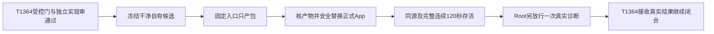

# T1365 视频号只读导航诊断的本机交付

## 授权与目标

用户此前明确要求安装新版、清旧版；本轮要求睡觉期间自主测试验证、不再提问。Root于2026-10-19承接既有本机授权，要求将T1364新增canonical只读导航能力经正式单一受管运行时承载，禁止在旧App旁启动共享用户库/profile的开发实例或热改已验安装资源。此任务只交付已受验候选，不改产品，不外部发布/push/tag/Release/放量。当前仅登记待审；没有开始构建、安装、真实enable或平台诊断。

大白话：先把经过受控测试的新诊断能力装进正式App，再允许它检查同一账号的后台。不能为了诊断开第二个占用账号档案的开发程序，也不能把“装好了”说成“采集好了”。

## 前置与依赖不成环

- 构建前必须收到T1364最终冻结源码清单/commit、受控公共CLI→HTTP→canonical→真实Chromium/DB租约门、真实断连取消及scope变化保护、独立实现审最终字节结论，并核实际适用types/contract/worker/backend/timeout/boundary等结果。任何当前范围必需门未过/源码漂移则不构建；旧失败与新失败分别如实分类。
- **不以T1364任务complete作为前置**：T1364还需要新安装后的真实诊断，形成“受控实现通过→本任务安装→Root单次真实导航→T1364最终结果”的顺序。本任务依赖的是已验工程证据，不是虚构的T1364完成状态。
- 新op默认off。受控工程通过不授权真实启用；本任务安装完成仍须Root另明确放行本次authorizationId/真实组账号/单次诊断。新collect、扫码、bind、发布、付费或修改原281/1499/1502/1726均不在本任务内。
- T1359既有e676构建、PID31464安装/120.399秒观察与清14项结果完整保留，不能拿来代签本任务的新候选。新候选SHA/最终路径当前待冻结，禁止提前填构建/安装PASS。旧App实际状态在安装前fresh核对，不把历史PID当仍存活事实。

## FR1365-1 冻结与固定产包

唯一交付执行者在Root明确构建放行后，使用已提交且干净的自有候选，核HEAD、相对范围、四版本一致、lock与源码树、secret差异安全预检；原始扫描失败/分类原件分别保，不能改工具或代码洗绿。执行packaging-creatoros-release规定四基本测试（package-local、desktop-release-workflow、notarize、tauri-signing-config），失败停止。

正式Next/Chromium测试及大型回归全部退出后串行构建。独立T7源码/真实本地依赖闭包，核workspace链接与shim/native依赖均指向本候选；不从含旧绝对路径Cargo target复用构建输出，使用新target。只运行受支持固定入口`CREATOROS_LOCAL_SKIP_INSTALL=1 pnpm -C frontend desktop:package-local`，先产包、后安装。构建期严禁改产品/测试/构建入口来消除失败；失败保原日志、停止发布动作，另走必要修复流程，不自动再构建碰运气。单次执行与观察至少120秒并保更长原预算，构建外层覆盖真实完整链与清理，不以120秒当构建/启动上限。

## FR1365-2 产物与正式替换

记录新源码精确ref、打包source tree、嵌入attestation、主程序/sidecar tar/server与DMG SHA256；codesign、hdiutil verify、只读DMG内树和版本同源实际核验。ad-hoc不得说Apple已公证；无Windows/公开Release事实不得补签。Downloads同名DMG覆盖前先保护现e676原包唯一字节及SHA，不动T1359历史结果或false快照。

产物通过后fresh只读检查正式App身份、公开活动任务及可支持的未保存状态接口；有真实活动、未保存风险或归属不明时停止替换，不能强退、点丢弃、暂停/取消/延长原任务。无dirty接口如实UNKNOWN，只沿已授权正常quit，不虚称“没有未保存”。旧任务自然终态与操作者行为分证，不将其当新包测试。

正常退出并核其真实进程子树停后，同卷暂存/备份/原子替换，唯一正式App正常启动；不对未知进程pkill，不旁启共享用户库/正式profile的第二实例，不热改已安装资源。新App同源可用核验通过前保旧App备份与原包可恢复字节。

## FR1365-3 同源与存活验收

确认新App正式路径/PID、实际加载runtime与新tar stamp及全量canonical文件/链接/类型零差异；隐藏文件名前导点按真实路径处理，不能沿旧核验helper误归一化。启动预算至少300秒并保既有更长预算，另实际连续观察至少120秒、记录每点同源/PID/Ready稳定，不用从open起算的总耗时冒完整连续观察。

公开只读核组ID、目标视频号同账号当前归属及原任务/报表/作品基线、现诊断默认关闭状态（仅用新契约已支持的实际证据，不为验收新增API）；不以“op注册存在”代签真实运行。新诊断执行须Root随后单独放行。原生像素只在实际能力支持时按精确新App窗口取证；不可用记未验，禁止浏览器镜像冒原App像素。关闭/租约的真执行结果由T1364实际诊断另收，不以安装存活代签。

## FR1365-4 清旧、数据与证据保护

清理只针对本次列明且经Root核准的旧缓存/旧App备份精确集合；不默认复用T1359已清14项，也不扫描扩大到其它项目。逐项核canonical路径/符号链接/当前引用/所有者和独有证据，必要trace先私有原字节/SHA/元数据归档校验后才删。新候选、当前包、唯一旧包、失败原件、用户Library数据/auth/profile/runtime、原任务和受信诊断准入标记均保护；不能通过删除一次授权标记制造新运行额度。

清后复核正式App/包/runtime身份、公开组/账号一致及保护清单；du是归属大小，df是并发快照，不冒精确释放量。未知保留，不为了“清旧成功”强删仍有引用对象。真实诊断是否失败、未能截图、stopPending等均保原ID，不再POST或改原收据。

## 写集、状态与结果

本任务无产品/测试/契约/schema/构建脚本写集。仅本SPEC与`docs/verification/t1365/**`安全文书、授权独立T7构建/产物和经核准的安装/精确清旧路径；中央BACKLOG/DEC/阶段/events/context由control唯一writer管理。SPEC与独审先行，taskctl start及唯一构建/安装执行者由Root实际放行后登记，不能因本文件存在开始操作。

运维验收列为—，以真实固定入口退出码、四基本测试、产物/安装同源/完整连续观察、公开只读一致性和精确清旧证据结案。中央pmem/taskctl按实际证据执行；后续文书HEAD与实际安装source分别记录。沿本轮适用全局对账及新增差异如实分类，原global44/foreign9/T1255保留，不为纯交付文书重跑旧UI/模型门，不将旧contract registry缺两条prediction-lock路由改成绿。新产品范围必需门失败不可归旧债跳过。

最终分别报告：本任务交付完成与否、T1364受控工程结果、尚待/实际单次导航结果、原281等失败未改、公众号未真人完成及真实采集恢复未证；本机安装完成不结束整个用户问题。
