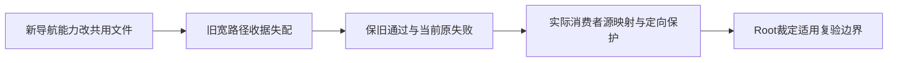

# T1366 导航诊断新增的旧宽路径收据失配

## 当场事实与目标

用户要求自主验证视频号失败；T1364新增受控只读导航能力已通过适用工程门和独立实现审，尚待新包和Root放行一次真实诊断，不得先完成。Root要求在精确候选`2d3826ef164241860437daa393d336d9b042f980`执行唯一一次完整reconcile并据实分类。该轮实际exit1、1300.595秒，56ERROR/0WARN，原完整stdout/stderr私有原件SHA及安全分类见`docs/verification/t1364/control/RECONCILE_2D_META.json`和`RECONCILE_SCOPE_CLASSIFICATION.json`。

原44个任务/LED失败身份均仍存在；5个消息类型变化不能冒同因：四旧宽收据现先被缺产物阻断，T1294由主树foreign dirty先阻断变为clean候选显示commit后watched漂移。新增12身份分为本次2新宽收据、8项缺旧本地产物、2项本次新LED fire。此任务仅登记本次真实收据影响，不把56都归旧债，不改旧PASS/原执行身份，也不宣布新能力或全局通过。

大白话：代码增加了一个受控诊断，两个旧验收把整个共用文件都锁住，因此原收据不再代表当前文件。要保留旧测试确实通过的历史，同时明确这轮改了哪里、哪些已有消费者只做过定向保护。

## 精确边界

- T1354新增漂移路径`ai-worker/src/runtime/platform/wechat-browser-source.ts`，本次只新增导航观察及诊断控制，原采集/绑定的真实原27与witness/source保护包含在worker168实际结果中；不能据此代签原公众号1726真人完成或旧任务所有族新一轮全程通过。
- T1356新增漂移路径`frontend/src/server/persistence-client.ts`，本次新诊断装配；既有features/components/creator routes/styles/backend queries/contract pages六目录Git tree对e676未变，旧frontend36/pagecache4与独立源码审原件仅证各自范围，不称全旧页面E2E重跑。
- T1294是旧失败身份，不计新增身份；当前后置watched差异含多个此前代码路径及本次persistence新增交叉。旧foreign dirty消息与本次commit后漂移并存，不以旧身份掩盖本次新字节。
- 主树旧验收报告9份和visible_copy根真实存在且ignored/untracked，clean候选没携带；它们形成12项缺产物消息（4替换旧失败原因、8新增身份）。这是验收产物可用性边界，不冒业务回归；不复制旧产物再跑一轮来洗原56。
- 本次新增LED057/061的原full子check stdout被stdio ignore，首因UNKNOWN。Root分别授权仅该门一次捕获详情；后验发现057构建前缺generated sidecar、061 worker缺Sharp0.32 native，不能倒填原full首因。余批及恢复状态沿实际终态另记，不能提前全绿。

## 只读核对与停止规则

1. 保原候选SHA、完整退出meta/rawSHA、旧44及新56原件，按任务/LED身份与机械消息差分分开计数。
2. 用Git实际diff/tree/逐源SHA说明新字节、未改消费者及真实定向保护；对未重新全程验收的历史族明确缺证，不以全文件hash机械触发模型/渲染/旧UI全重跑。
3. 若发现当前功能真实回归，先按实际消费者补独立SPEC/RED，不以“旧债”放过；当前仅登记本批收据根因，不改工具/旧收据/轮数或扩大用户accepted-risk。
4. Root根据实际新门详情决定交付，本任务登记不等于自动允许build，也不把T1364提前complete。不得新collect/登录/发布、改用户数据或改旧App。

写集仅本SPEC、`docs/verification/t1366/**`与control维护的BACKLOG/DEC/安全分类引用；无产品/测试/构建/用户数据写集。本任务待审，未start、未补造任何验收、未另跑完整reconcile。
