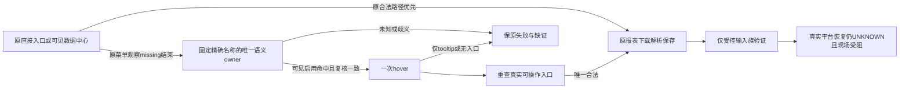

# T1367 恢复视频号折叠导航下的报表入口

## 用户目标、事实与当前交付边界

用户明确视频号采集失败，要求自主测试、验证、尝试，不再向其提问。Root选择最小A：为既有视频号报表prepare增加严格语义owner条件式hover，保全部旧合法入口；不增加诊断框架、公开contract/backend/UI或通用浏览器能力。当前先冻结本SPEC供独立评审，未start、未改生产。

大白话：后台已加载，但左栏只显示图标，原来的可见文字入口在原完整观察结束后仍没出现。只有图标本身能被现成按钮或菜单语义准确证明属于该入口，才允许悬停一次；还必须看到真正可操作的报表入口才能继续。猜坐标、强点隐藏字和只出现提示气泡都不能算成功。

### 已发生事实（不得扩大结论）

安装源`2d3826ef164241860437daa393d336d9b042f980`。T1364唯一真实只读诊断`cli-inv-3547e2dc-239`/`req-3547e2dc-238`实际127.919秒completed、identityMatched=true、26样本；Root实际看两图，末帧后台首页作品正常加载、左栏仅折叠图标。样本top readyState complete，固定叶文字entryExact=2/visible=0、centreExact=2/visible=0；navContainer unknown、menuCandidates空、overlay0。叶文字机械数量不等于prepare中Playwright locator数量；不能写成生产定位器确证两项。

两图SHA256为`876c3c4a5617f77188c756532d7dc2adec06c7554d9487509d27678ce14141bd`、`a8082367780bbacf7a67e3f998e1de2c717b08e2fe69a33c24b27ea5b1d1a17a`。物理close00:58:45.381Z、原lease callback释放.385Z、stopPending=false，随后默认off已恢复；完整实证见T1364 final/REPORT.md，诊断已如实结案，非采集恢复。

仍缺实际隐藏标签祖先role/tag/可访问名/bbox/命中信息，未证明实际站点owner结构或hover机制。因此受控fixture只能证明明确合法输入族兼容，不得称其为真实平台DOM复刻、原281首因或真实恢复。原`collection-92ecb053-281`仍125.447秒failed/EXPORT_FAILED、committedPages0/gen2；1499/1502/1726及全部旧失败不改。

CUA site-safety已明确拒绝目标页面观测，未触发Auto-review或用户prompt，且禁止同目的替代浏览器/CDP/间接执行。真实验收当前受阻；不得通过正式collect/诊断、另浏览器、CDP或其它手段绕过，不向已睡觉用户追问。可做离线受控实现与验证，但不能提前complete本任务或宣称视频号恢复。安全拒绝原文与边界见existing-session-inventory/REFUSAL_BOUNDARY_SAFE.json和TOOL_REFUSAL_SAFE.md。

## 行为合同

- **FR1367-1 旧路径完整优先，失败后才恢复**：只改现wechatVideo报表prepare。原整条可见直接入口/可见“数据中心”/直接入口晚到/点击中心前晚到/子入口等待路径先完整按旧行为运行，成功则原样接回后续；不得先插hover、增加owner门、改变原全Page晚到新节点选择或缩短其观察窗口。只包wechatVideo原initial `wait_entry_or_centre`这一次观察：其确实抛出`WechatBrowserSourceError`且code为固定`REPORT_LINK_MISSING`、centreClicked=false时，signal/原绝对deadline/官方origin仍有效才进入新增独立折叠恢复。已点击centre后等待子入口missing，以及route/frame/date/download等后续失败不进入恢复；其它错误、取消、到期、错源、歧义不捕获为恢复。原观察end已结束不重置、不续期；恢复后只用strict关联路径，不再重开原全Page等待，不承诺原窗口截止后才出现的无关联全页late；无需额外0/0持续条件挡住合法strict关联面板出现。原失败原件保留。已有合法直接入口不因无关centre或折叠owner重复被反杀。
- **FR1367-2 严格语义owner**：限同Page官方origin、固定当前报表精确名称及“数据中心”。候选只来自精确可访问名的button/menuitem/link（含对应原生button/a[href]语义），或通过明确aria-labelledby引用既有固定exact标签且形成相同精确可访问名的语义owner。不能仅凭普通div/宽祖先/textContent包含/title/cursor/tabindex/图标外观升级成owner；不取任意祖先或页面任意文本，不猜class/URL。原生与ARIA路径须服从真实可访问名语义，名称冲突或不精确不能降格接受。
- **FR1367-3 真实节点去重和行动前复核**：恢复阶段按真实DOM节点identity去重，不按名称、坐标或索引合并。两隐藏标签映射同一owner可归一，隐藏responsive副本不冒可见候选；多个真实可见候选不任选。owner须唯一、connected、真实可见、enabled且可命中；中心hit-test须是该节点或其后代，不能被遮挡。动作前重新解析并核原节点/语义/官方origin/signal/恢复阶段剩余期限；owner脱离/替换/身份改变后不得对陈旧节点操作或自动改点替代owner。未知/多候选可在本恢复阶段有界等待，不能倒改已经完整执行的旧路径。
- **FR1367-4 独立恢复阶段一次hover和关联入口**：仅在FR1规定的原菜单missing之后，当前report prepare最多一次hover，不click未知owner、不反复hover、不新goto/深链。hover后重新解析唯一真实actionable当前报表入口，仍守精确名称、真实可见enabled命中、同Page官方origin与分支唯一性。该入口必须是已复核owner自身/后代，或在该owner明确aria-controls指向且重新核实的同document关联面板内；按真实节点identity去重、关联内要求唯一，不用全Page同名actionable充当关联证明，不混入无关浮层计数。tooltip及其后代、孤立/无关同名可操作浮层均不点；owner或面板关联变化停止新分支动作。无结果/未知/多候选只在本阶段有界等待，结束保原missing或明确安全错误，不强点、不全Page回退。本阶段不承诺再放行窗口结束后无关联的新“旧入口”：旧原窗口已完整给足，该门不追设给旧direct/centre成功路径。关联内入口点击后接回原路由和完整报表链，hover成功不是采集成功。
- **FR1367-5 独立阶段预算与原持久期限**：沿原collector绝对期限、source withProfile同账号/组/authority/profile/Page及原hostlease，不重发失败、不延长原任务deadline。旧菜单observe原end完整结束不重置；新增恢复是其后独立有限执行，必须在原持久任务剩余期限内。至少显式增加串行owner观察120000ms、唯一hover动作120000ms、关联子入口观察120000ms三项；公共入口点击/目标路由等待仍按实际串行次数核算，原已计且仅执行一次的后续步骤不重复冒执行。source视频号每report聚合预算必要增加相应成本，并乘现三report真实串行消费者；若实现实际多一步有限执行，须加足而非借启动/清理余量。单次有限观察/动作保两分钟下限或原更长预算，实际动作由原绝对剩余期限裁剪；不足立即停止，不让出新任务期限。每个恢复观察的end只生成一次，允许witness局部将observe既有end传callback（旧无参回调继续正常），新动作timeout限本阶段end与原controls剩余量，动作后/成功返回前复核signal/origin/owner/关联/期限；不全局改变observe先读value的判定。取消/到期后无晚click/download/submit，physical close与lease释放继续分证，不改算法。折叠族先承受原约120秒菜单等待是兼容修复的明确代价，不称性能优化。
- **FR1367-6 受控公共RED及GREEN**：先在现channels真实Chromium集成测试构造明确合成的合法折叠语义owner/隐藏固定标签，一次hover后出现关联的真实actionable入口。旧witness须经真实source→collector→backend service/PGlite公共链在入口missing失败，保当场RED；新GREEN保实际旧菜单完整等待后才一次hover的时序证据，并走真实三报表download/parser/保存/公开同run读回及资源清理，不以helper或mock成功DTO代签。至少主公共族保真实旧120秒观察，辅助保护可用受控时钟但须分列，不能把加速族当真实墙钟。全部平台origin请求本地合成、其它请求abort且禁止真实DNS，仅私有合成DB/profile/身份/目录，不读真实用户库/正式profile或被site-safety拒绝的页面；不宣称合成页复刻实际站点owner结构。
- **FR1367-7 保护全部旧合法输入与新恢复负族**：原直接/中心/晚到direct/centre、原窗口内新增节点、中心点击前晚到优先、entry=1且centre重复、已到目标路由、三报告下载解析保存等旧合法族保，成功时hover0次；原centre已点击后子入口missing、route/frame/date/download失败、非missing错误/取消/到期/跨源均不能进入恢复。新增族覆盖未知或无语义owner、宽容器、相反名称、disabled/遮挡、两个owner、同owner重复标签、hidden响应式副本、一次hover仅tooltip、无关同名可操作浮层、关联内两个entry、关联内唯一且无关浮层存在、aria-controls变化、owner替换/脱离、各阶段取消/到期/原期限耗尽；恢复结束无迟到动作或提交。未知/多owner不能缩短旧观察或改变旧成功，恢复阶段只选严格关联入口。保登录/身份/冻结归属/实停原保护，不以新质量门反杀旧合法任务。
- **FR1367-8 结果诚实与安全边界**：输出仅固定phase/计数/错误码/必要合成run和哈希，不扩DOM收集或诊断API，不落真实页面正文、身份、scope、截图/URL、凭据、key/config/env/raw到Git。受控通过、真实现场受阻、真实恢复UNKNOWN分开。global56/T1366、foreign9/T1255及旧失败完整保留；本阶段不授权新collect/诊断/登录/打包安装。若实际需要超出严格语义owner的站点特例，先保缺证并重新审范围，不能在实现中偷偷加fallback。

## 精确写集与禁止扩展

|类型|精确路径与用途|
|---|---|
|必需生产|`ai-worker/src/runtime/platform/wechat-dom-witness.ts`：仅视频号prepare及局部语义owner机械定位/复核，SEMANTIC_BOUNDARY_ALLOW说明不做平台内容含义判断|
|必需公共测试|`ai-worker/src/runtime/platform/wechat-channels-entry.integration.test.ts`：现真实Chromium/source/collector/service/PGlite公共RED/GREEN及上述族|
|必要消费者保护|`ai-worker/src/runtime/platform/wechat-dom-witness.test.ts`：仅有意义的语义关系/旧路径保护；若该现文件不存在不得为镜像实现新建，保护留在真实集成测试|
|必需预算/测试|`ai-worker/src/runtime/platform/wechat-browser-source.ts`及`.test.ts`：补原missing后独立恢复的真实串行聚合成本和必要固定entryPhase类型/安全投影及测试；不能扩任意诊断字段或改变旧op|
|中央文书|本SPEC、`docs/verification/t1367/**`与BACKLOG/DEC/review/context/事件，由control唯一维护|

实现必须在独立managed worktree（计划name `t1367-collapsed-navigation`）进行：SPEC过审后由control统一创建并指定准确ref，基底产品树仍为2d；不使用默认分支、不复用或改动e676账号绑定候选及2d导航诊断两棵保留冻结树。依赖只按冻结manifest核对后复用/标准离线链接，不复制正式Library/profile。当前不创建worktree、不运行安装/编译。

不改contract/backend/frontend/UI、collector/parser、schema/迁移、scheduler、profileauthority/hostlifecycle、通用browser guard、既有导航诊断观察器、旧安装资源或CLI默认预算。本次非UI变更，不新增用户界面或启动oil视觉方向流程。没有extra探针、通用浏览器端口、任意Page回调、真实平台脚本或新公开API。清单外变更须先明示有限增补并独审。

## 验收与完成边界

1. SPEC独审和正式record通过、taskctl start及Root实施放行后才能写生产；初始事实SPEC与只读分析/安全拒绝原件保留，不借T1364旧审签新能力。
2. 实际完整公共RED原件→GREEN，以及FR7输入族/旧27与受影响source/witness/native/binding保护有真实退出码/source SHA；取消和deadline含公共实际消费者，不仅helper。
3. 必要worker类型、timeout-policy、boundary/semantic/orphan及独立实现审按真实写集执行；既有registry/56错误分证，不借旧44或上轮结果冒新源全绿，不为纯文书重复full。
4. 只有受控输入族通过时记录“受控实现与验证完成，实际站点owner/真实恢复UNKNOWN，site-safety受阻”。不得taskctl complete或将真实视频采集写成功；原失败不动，外部受阻状态由Root据事实决定。后续真实验收须在允许且不绕安全拒绝的条件下另明确范围，不能凭已授权自主测试绕过限制。
5. 如实际现场安全允许后再验证，必须真实新run/同ID终态、报表/目录与指标提交、资源释放各有证据才能宣称恢复；本SPEC不预授权这一动作，不用安装或导航成功替代。
