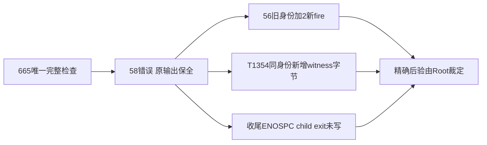
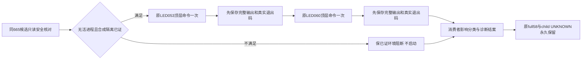

# T1368 核对折叠菜单修复的新增对账失败与宽收据交叉

## 当场事实

T1367受控四文件已精确整合为`665508e66ee4bf46a6ebe3267ce4887c92964e18`，独立实现审无open，真实平台site-safety受阻。Root授权最终稳定源唯一一轮完整reconcile，本轮原始输出真实58ERROR/0WARN/DRIFT；对旧2d的56个错误身份全保留，新增仅LED-053与LED-060两fire，不能泛称旧56同因或把两新fire直接归磁盘。

完整子进程已wait返回，随后Python wrapper构造meta时调用git status，遇index.lock写入Out of diskspace/exit128，wrapper最终exit1；child wait的rc未写出，故完整门实际childExitCode=UNKNOWN，不得由footer或wrapper1补造。原输出完整footer与私有SHA已保全到T7；没有重跑完整门。

同身份T1354的宽收据有本次新增交叉：旧2d仅`ai-worker/src/runtime/platform/wechat-browser-source.ts`漂移，本次665增加`ai-worker/src/runtime/platform/wechat-dom-witness.ts`，source仍在。T1356仍为persistence原漂移，当前未改该文件。这是消息头相同但本次新字节责任不同，不新增一个错误身份，也不能藏进旧债。

大白话：新代码的受控测试通过，但完整检查又亮了两盏新灯，还碰上磁盘不足使收尾回执没有写完。要分别保留真实输出和缺失项，查明新灯原因，不能把所有失败都说成以前就有。



## 初登记的诊断边界与停止条件

本节保留初登记时的事实与授权状态；下节是Root于2026-10-19明确授权的最窄增补，执行以增补合同为准，不倒改上述原始事实。

- 新LED053直接涉及本次预算消费者；虽有前版完整174PASS及最终静态0，不能拿它们洗本轮fire。LED060亦有本次实际fire。子检查stdout在原完整门被ignore，首因UNKNOWN；未经实际证据不能断言是磁盘、Sharp、产品预算或任何旧问题。当前交Root决定必要精确补证，不自行重验或扩大修复。
- 完整门原58、原2d的56、两轮source与本次wrapper异常独立保留；若后续单门有新结果，也不得倒填本轮子因、actual child exit或把本轮改成全绿。
- 只按真实watch路径和当前source SHA核对已有消费者影响；不重写旧PASS/收据、工具或统计来过门，不机械重演无关旧UI/模型/真人采集。
- 仅候选自有.lessons-stats新输出已先SHA保全后还原其原字节；T1073输入未变，候选只读status clean。主树foreign9/T1255不动。空间处置须仅精确生成缓存、先无活引用与原件保全，当前尚未授权/执行搬移或删除。
- T1367真实恢复仍UNKNOWN，site-safety拒绝不得绕行，不打包安装或新collect/诊断。最终任务外部受阻状态由Root依据本轮真实结果决定，不提前complete。

写集只本SPEC、BACKLOG对应待审行、DEC及`docs/verification/t1367/control/**`安全分类引用；无产品/测试/安装/依赖修复写集。待审未start。原件索引见`RECONCILE_665_META.json`和`RECONCILE_665_IDENTITY_DIFF.json`；私有原件不入Git。

## 本次授权的最窄后验合同

来源：Root于2026-10-19明确授权继续，只允许两条原门各执行一次和只读消费者核对，决定见`DEC-136801`。本SPEC冻结后先全新独立评审；正式record、taskctl start及Root执行放行前，不运行两门。

大白话：只把新亮的两盏灯各检查一次，先把真实退出结果保存好，再解释它停在哪一步。这能区分本次可复现的问题和已证环境阻断，不能补回上一次丢失的退出码，也不能证明真实视频号已经恢复。



### FR1368-1 同源、隔离与运行前证据

仅在既有受管候选`/Users/zyongzhu/.codex/worktrees/t1367-collapsed-navigation/Thirdspace-creator`执行，冻结产品源为`665508e66ee4bf46a6ebe3267ce4887c92964e18`。执行前只读核对HEAD、源码状态、当前环境、同树活动进程和磁盘；核对原测试使用合成身份、私有临时数据/目录及既有拦截，不读取真实用户库、正式profile或被拒站点。必须证明无外网访问、无用户home/配置修改与后台安装副作用；不能证明同树无冲突活进程或合成隔离时，保留具体证据并停止对应命令，不擅停进程或改环境。

当前LED-053存在已证安全前提缺口：`tools/timeout-policy/hyperframes.test.mjs:43`启动真实CLI；测试传入的`HYPERFRAMES_TELEMETRY=0`未被所安装CLI识别，CLI顶层有读写`~/.hyperframes/config.json`及更新/后台安装路径。Root据`/usr/bin/sandbox-exec`实际存在、系统SBPL示例及安装CLI只读代码审计，选定以下原生OS单命令隔离；不默认原环境执行。继承HOME且不修改，只为本次LED053子进程设置已被安装CLI实际消费的`HYPERFRAMES_NO_TELEMETRY=1`与`HYPERFRAMES_NO_AUTO_INSTALL=1`。SBPL为：

```scheme
(version 1)
(allow default)
(deny network*)
(deny file-write* (subpath "/Users/zyongzhu/.hyperframes"))
```

通过`/usr/bin/sandbox-exec -p <上述SBPL> node tools/timeout-policy/verify.mjs`包原命令一次；不允许loopback，避免本机代理转发外网。只读审计未发现原八组需要真实HTTP server，但运行兼容仍待实测；沙箱自身失败或某门被限制拒绝时原样记录stage和退出，按环境阻断分类且不补跑。不改HOME/测试/依赖/配置，不创建常驻框架。记录隔离和两个环境开关差异，不能称与原full同环境或据此证明原fire首因。LED060沿原命令和合成127.0.0.1/内存PGlite边界执行，不套禁止其合法本地HTTP的LED053沙箱。

### FR1368-2 原命令各一次，保内部语义与预算

先执行下列LED-053顶层原命令一次，完整保存结果后再执行LED-060顶层原命令一次；命令来自当前`orchestrator/process/reconcile.config.json`的`lessons[].check`，执行前只读核对逐字一致。

```bash
node tools/timeout-policy/verify.mjs
```

```bash
pnpm --dir ai-worker run build && pnpm --dir ai-worker exec vitest run src/runtime/pi-provider-json-compat.test.ts --retry=0 && pnpm --dir backend exec vitest run src/modules/execution/radar-model-result-unknown.repro.test.ts src/modules/execution/transcribe-postprocess.integration.test.ts --maxWorkers=1 --retry=0
```

LED-053保其原内部串行执行与失败聚合，不因某个内部检查失败提前截断；LED-060保原shell `&&`顺序和失败截断，不拆开后绕过失败阶段。两个顶层命令各至多一次，任何失败立即保原，不自行重试、补依赖或修环境；第一门失败不改其结论，第二门仍按本次独立授权和隔离前提执行。外层不新增任意短总timeout，不裁剪原内部预算；PTY每次观察不超过60秒，观察返回不当成执行终态。

### FR1368-3 先持久化真实退出，再生成元数据

每个顶层命令完整stdout/stderr写入本次专用证据目录，保原顺序与阶段标记。记录PID、起止时间、cwd、命令、相关source/config SHA与真实child退出码/信号；wait返回后先把该真实退出结果持久化，再运行git status、摘要或其它元数据步骤。日志及退出文件完成后记录字节数与SHA。若记录仍失败，如实保可得原件与UNKNOWN，不从输出footer、wrapper退出或另一次门结果猜补。私有原始输出不入Git；仅精确脱敏摘要、哈希与安全引用可以纳入中央工件。

### FR1368-4 只读核对T1354真实消费者交叉

只按已存在watched路径、当前源码实际调用方和hash核对`wechat-dom-witness.ts`与`wechat-browser-source.ts`：分别列旧2d的source漂移、本次665新增witness字节、未变或受影响的实际消费者及证明边界。T1356 persistence原漂移独立保留；同身份的新责任不冒新错误身份，也不藏进旧债。不重写旧PASS、扩大历史accepted-risk或机械重跑旧UI/模型/真人任务。

### FR1368-5 写集与停止边界

中央写集限本SPEC、BACKLOG的T1368行、DEC、后续适用review/context/events/PROJECT及`docs/verification/t1368/**`；另仅允许`orchestrator/process/modules.config.json`与`orchestrator/progress.json`登记T1368一个诊断step的task binding。该登记只满足现有`context-compile.mjs`读取的机械契约，不是新产品范围；不动其它任务、不改实际产品或验收命令，不虚构运行lease或completion。正式PASS和taskctl start后才按真实工具契约登记并编译。本次冻结只更新SPEC/DEC，尚未写绑定。T1367的REPORT/control仅可纠正陈旧“在途”等状态并引用本次结果。允许原构建自然生成候选树ignored `ai-worker/dist`和工具已有临时测试产物，不借此新增源码写集。完整原始日志在精确私有证据位置保全，不批量纳Git。

不改产品、测试、依赖、门禁或旧收据；不重新full、不删除或迁移缓存，不动三棵保留候选树与ignored历史证据、主树foreign9/T1255。无真实站点/用户库/profile/安装/打包/付费动作。暴露真实产品问题时保原并登记或补任务范围、先独审，当前不越界修复。重复问题若触发研究门，按真实问题族记录并停受影响动作，不把无现行研究阻断当成未来豁免。

### AC1368-1 可核对的两门结果

每条顶层原命令至多一次，有真实完整输出、退出码/信号与先落盘证据；或者有足以证明其未启动原因的具体环境/隔离阻断证据。分类写明实际执行到哪一步、失败stage或通过范围，不以静态词法扫描替代公共链，也不补签未执行的后续阶段。

### AC1368-2 消费者影响分类闭合

T1354 source旧漂移、本次witness新增交叉及实际消费者/hash分列；T1356无本次新增路径的边界保留，未知按未知记录。两门后验不倒填原full首因、原child exit或历史验收。

### AC1368-3 诊断结案与产品受阻分开

T1368的验收是两精确后验真实结果或已证环境阻断，以及消费者影响分类完成；不要求两门人为全绿。原665唯一full始终是58ERROR/0WARN，childExitCode=UNKNOWN、wrapperExitCode=1；任何新结果另列。T1367真实恢复仍UNKNOWN，须按真实site-safety受阻经taskctl block，不complete或声称视频号采集恢复。当前待审未start，本次仅冻结合同供独立评审。

本任务是纯诊断与既有门后验，没有UI写集或linked frontend journey contract。Root核对`taskctl.mjs:257-278`后授权将T1368验收类别纠正为`—`：`待验`会无条件触发frontend报告执行，`—`仅在无关联journey合同时合法。该类别不豁免FR/AC或任何适用产品门；只有本次全部诊断AC如实闭合、未分类新失败已处理且Root复核后，才可taskctl complete。T1367的`待验`保留，仍按真实受阻block。
