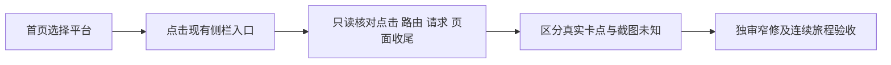

# T1369 修复首页平台筛选后的连续侧栏导航卡死

## 用户目标与初始事实

用户本轮明确反馈：首页切换平台筛选Tab后，再点击侧栏的“创作者总览”等入口，一直显示“正在打开”，要求修复真实连续导航。目标是筛选之后仍能进入所选页面，页面、筛选范围、账号组身份和加载状态最终一致。

Root已查看本轮四张用户截图。截图只能证明当时可见的界面与等待提示，不能证明请求未发出、服务器阻塞、路由提交失败、遮罩未清理或任何具体首因。当前尚无本任务当场公共RED、网络/路由回执或新测试；不把截图写成这些证据。

当前主树基准`10cab133f97821cface88f9d1c0f8426acad763a`；已安装源、实际进程和用户当时环境需要只读核实，不能从主树HEAD推断。T1361既有切组/筛选修复和T1358旧装配耗时只作关联线索，不预判本轮同因。

大白话：先选平台，再点侧栏，应该真正打开目标页面；不能只让“正在打开”消失，却仍停在旧页面或显示别的组的数据。

## 已核入口与正式行为合同

Root据只读诊断收敛为公共RED先行；初始用户截图与尚未发生的复现分证。已核实际路径为`frontend/src/features/group-workspace/group-workspace-filters.tsx`与`frontend/src/components/shell/use-primary-navigation.ts`，现保护测试分别在`group-workspace.test.tsx`与`use-primary-navigation.test.tsx`。前者当前自行transition/push筛选，后者管理侧栏导航及pending token；这只是源码事实，不预定两处transition就是首因。

本合同中A指同组旧首页平台筛选请求，B指后点击的侧栏目标`/overview`，C指其它侧栏目标；不是账号组A/B。账号组切换另用G1/G2表述。

- **FR1369-1 完整连续导航**：在首页改变平台后，无需先等旧筛选完整返回，即可点击现侧栏进入创作者总览等目标。最终URL、可见目标内容、账号组和筛选上下文一致，“正在打开”须随真实目标提交/可恢复失败收尾；不以隐藏提示或改spinner冒充修复。保正常页面/筛选路由，不把它们改成同页弹层。
- **FR1369-2 原源码公共RED**：在独立新worktree、基底`10cab133f97821cface88f9d1c0f8426acad763a`先只写新公共E2E与其配置。先按用户自然连续操作取得真实网络与UI证据；只有自然结果不足定位，才在真实首页平台RSC的response阶段暂停，随后立即通过现侧栏点击`/overview`。最多两次诊断，全部原FAIL保留，不靠反复重试找绿。记录旧A和新B真实生命周期，不能用fulfilled假DTO、手改store/DOM或孤立hook代替。未得可定位公共RED前不改产品；无复现或仅环境/夹具失败时保原并报告，不能宣称修复或猜首因继续写。
- **FR1369-3 完整响应结束与提交分证**：每个相关RSC均有started、finished或failed，绑定实际目标路径、当前scope/筛选与请求identity。仅在真实response finished/body完整后记录其scope及必要bytes/SHA；暂停期间不读取body、替换Cookie/header或伪造scope。新B完整finished后须观察实际UI提交，而旧A晚释放/结束不能夺回新导航；旧A真实取消亦按failed记录，不假称“晚到完成”。服务端page-read已有可取的真实结束事实与HTTP响应阶段、UI提交分别记录；HTTP200响应头不当作查询完成。
- **FR1369-4 区分慢读与导航竞争**：同样的A暂停/侧栏操作增加现`/settings`对照；区分`/overview`的groupOverview/page-read慢读和路由/transition提交竞争。仅引用现有可信可观测证据，不能为取证另加通用诊断框架、伪造计时或先扩backend写集。若缺真实page-read结束证据明确UNKNOWN，不用HTTP头代填。根因在backend、AccountSwitcher或Provider时，先保具体证据和最小delta独审，不能预加大写集。
- **FR1369-5 输入族与现保护**：平台、同平台账号、日期筛选后均能真实侧栏进入与返回/刷新；快速B→C→B服从最后意图，同目标在途防重、缓存命中与RSC失败后重进仍合法。切G1/G2保现dirty离开提示、遮旧组、最终scope、取消/过期回写与后台原任务；旧A结束/错误不能解锁或覆盖更新意图。不删历史、不重发任务、不改全局权限或原离开保护。
- **FR1369-6 原预算与隔离**：复用T1356现私有PG/seed/宿主harness和既有网络禁出机制，背景driver/scheduler关闭、合成身份/目录与独占端口；不碰用户库/profile或真实collect/登录/模型。正常1366×900与最小1024×680两视口。正执行/动作/单次有限观察至少120000ms或保现更长；Next readiness保600000ms，现harness自身更长预算不缩，测试外包络保7200000ms及必要清理余量，不用一层短总timeout裁掉内层。暂停/放行控制不靠短sleep造通过；finally只清理本次自有资源，原始deadline/取消语义保持。
- **FR1369-7 窄修与视觉方向**：只在公共RED证明首因且无需改变已确认行为时，在下列两生产文件及现测试内最小修复；按真实依赖保护LED-047与原切组/导航族。用户已撤销OilUI，沿旧tokens/组件和稳定页面，不造第二套主题，不运行其审美门。功能、权限、预算与真实旅程验收不因撤销技能而删除。
- **FR1369-8 证据诚实**：原RED/环境FAIL/既有收据与全局58原件全部保；GREEN须绑定实际新source SHA、命令退出与同源公共旅程，截图只证当时可见状态。真实用户截图和带身份/正文/URL的原始工件只私有保全，Git只安全投影/hash；本地合成E2E不冒已安装App真机或被拒channels站点恢复。

## 界面与完成边界

用户最新已撤销OilUI：停止其流程与审美门，沿原已稳定工作台、tokens和组件修复，不引入第二套风格或主题。保留`docs/features/t1022-account-group-workspace/UI_RULES.md`中的原布局/状态与功能原则；正式改动前须保同视口/状态基线，当前没有完成本任务视觉或操作验证。真实页面导航保留路由；同页弹层沿已有本地打开路径，禁止借本修复改变二者职责。若触及相关路径，后续必须按真实写集验证LED-047、原dirty离开保护、切组与过期回写边界；不缩执行预算或续原任务期限。

修复须覆盖“平台筛选→侧栏→目标页面→返回/刷新”的完整用户链。诊断、组件测试或HTTP200本身均不能结束本任务；没有真实公共RED/GREEN或仍然卡住时不得complete。

## 精确候选写集

|类别|路径与边界|
|---|---|
|先行公共测试|`frontend/tests/e2e/t1369-dashboard-filter-sidebar-navigation.spec.ts`：现真实入口、response阶段暂停/放行、完整响应及UI witness、输入族；不改生产先跑RED|
|先行配置|`frontend/playwright.t1369.config.ts`：复用`playwright.t1356.config.ts`现harness/seed/隔离及现更长预算，改本任务testMatch/输出/两视口，不复制另一套harness|
|有证后最小生产|`frontend/src/features/group-workspace/group-workspace-filters.tsx`、`frontend/src/components/shell/use-primary-navigation.ts`，仅已证明的连续导航首因，不增通用能力|
|现消费者测试|`frontend/src/features/group-workspace/group-workspace.test.tsx`、`frontend/src/components/shell/use-primary-navigation.test.tsx`，保护真实不变量，不写镜像helper单测|
|中央工件|本SPEC、`docs/verification/t1369/**`（含正式PAGE_SPEC/报告）、BACKLOG/DEC/review/context/events/PROJECT与必要本任务控制binding，由唯一中央执行者维护|

不改backend/contract、AccountSwitcher、Workspace Provider、共享导航架构、T1356原harness/seed/旧断言、全局spinner/timeout/质量门、依赖或安装资源。超出两生产边界先以公共证据提出delta并独审，不临场顺手扩写。后续新worktree由Root指定实际ref创建，不改或复用三棵保留冻结候选；当前只冻结SPEC供独审，未start、未创建树或执行测试。

## AC1369与完成门

- **AC1369-1**：先在原10cab产品下取得自然连续操作的真实网络/UI证据，不足定位才做response阶段暂停，诊断总计最多两次、原FAIL保留；公共RED须真实发生并记录失败阶段/完整原件/source。修复后同一主操作在两视口从平台筛选立即侧栏进入`/overview`，B真实结束后UI落地，旧A释放/取消后不倒退。无复现不能冒修复。
- **AC1369-2**：每RSC started/finished/failed、真实scope与page-read结束证据可追溯，`/settings`对照可区分慢读与导航竞争；未知项如实保留，不把响应头当完整成功或预定根因。
- **AC1369-3**：账号/日期、快速B/C/B、返回/刷新、RSC失败重进、同目标防重/缓存与G1/G2保护族通过；当前URL/可见目标/组/筛选及等待状态最终一致，原任务/dirty保护不被反杀。
- **AC1369-4**：正式PAGE_SPEC按上述FR/AC绑定当前真实入口和6个候选代码/测试路径，覆盖正常/最小窗口及加载/错误/返回/刷新/重复条件；真实公共链和受影响组件、LED-047及适用frontend/timeout/boundary等Gate按实际写集验证。只读/模拟不能冒用户实机。
- **AC1369-5**：最终独立实现审无阻断，Root复核完整用户链恢复后才taskctl complete；Root若发现范围外首因，先独审delta，不能以诊断完成替代修复。
- **AC1369-6**：用户原截图/原始证据私有，全部foreign/旧失败和全局58边界保留；没有新collect/登录/模型/付费/安装或站点绕行。

独审、正式record与taskctl start及Root执行放行前，不改生产或运行公共RED；SPEC通过不等于后续实证已发生。完整公共RED后才允许在已审窄边界修，原预算/隔离与所需同源验证不能省略。

## 本次中央写集与保护

当前只写本SPEC、BACKLOG的T1369待审行及`orchestrator/DECISION_LOG.md`登记；后续实施按上表在独立隔离工作树进行，须先独审并经taskctl start，不虚构运行lease或完成标记。

保真实业务数据、原任务和历史失败、主树foreign9/T1255；不新collect、登录、模型调用、打包安装或full。channels站点既有site-safety拒绝继续有效，不能绕行；它不扩大为禁止本机UI只读验证。用户截图原件只私有保全并以实际SHA引用，不把账号隐私图纳Git；本SPEC尚未取得原件路径/hash，不虚构。

## 补充受控诊断（DEC-136903，2026-10-19）

原两次合成预算已耗尽，原FR/AC及已发生审核/实验事实不倒改：natural01完整自然链PASS但未复现；response02首个带组首页document原120秒冷编译/装配失败，尚未到受控链，finally依赖执行上下文又阻塞并由已核owned runner SIGINT结束。原FAIL/interrupt/trace与未知首因保留。安装浏览器的四个read dispatch迅速403且finished，“pending”解读已撤回，不能作为卡死根因或补token/握手绕过准入。

Root另明确授权一次、仅normal1366×900、mode=response的补充受控运行，限overview和settings两个真实目标，不重跑自然族或minimum，不将其冒原两次预算续期。精确测试修订及判定以[DELTA_PROPOSAL](../verification/t1369/DELTA_PROPOSAL.md)为准，冻结SHA256 `0a9fe4ce971383788b78ad61c563dad174e652d9a6f4a469726e75486ae67059`。

先同真实私有身份/scope context，逐个GET真实首页带seed日期、/overview、/settings；每路由600秒绝对deadline涵盖完整body消费、不重试/不stub/不写客户端router cache，非200或未完整结束立即保原停止。主用户导航/观察120秒不变；失败catch/finally不evaluate、不补DOM现场，旧成功样本时间标明，未知不补图。owned context close120秒、必要owned browser fallback120秒、observer结算120秒独立有界，真实取消/UNKNOWN与原失败分别保留。test9360秒、wrapper10620秒覆盖原启动及完整预热/清理，不以延长用户动作刷绿。

本delta只改原公共e2e/config与docs/verification/t1369/**，复用原T1356/T1355隔离harness/seed、禁出网/后台及新root身份；产品仍无公共RED，不改两生产源或扩大写集。若再次前置/夹具失败即保原停止、不自动再跑；如真实公共RED定位首因再按原最窄生产合同处理。本补充仍不能代签全部FR/AC、两窗、dirty/ABA或用户完整修复。独立审核此新增段/提案通过并正式记录后才执行。

## 隔离production差异实验（DEC-136904，2026-10-19）

获批supplement03自然exit1/630.200567秒：第一真实首页GET完整body预热600000.56ms耗尽，尚未进入受控动作；context close54ms、observer完成、pending0及owned端口/Next收尾成立，不能把这些清理终态当服务端查询或用户导航结束。原自然GREEN、response02前置FAIL/interrupt、supplement03原件与安装403更正全保，不再刷同dev链。大白话：这次只把同一代码换成正式web构建运行，分清开发装配和页面导航，未证首因不修产品。

Root现授权一次同10cab产品源的普通web production差异实验，精确方案见[PRODUCTION_DELTA_PROPOSAL](../verification/t1369/PRODUCTION_DELTA_PROPOSAL.md)，冻结SHA256 `c74d22eb0366e98fe9a0cdebfaac3292ae46c5b057438c01dcfed727b3a66729`。标准完整pnpm frontend build（含原prebuild/worker本地bundle/课程/Next类型检查）→原seed&&start共同600秒绝对readiness→标准start。seed在build后、该readiness槽内；seed完成且有有效剩余时才落本轮公钥、调用正式createBuildSmokeVerdictToken签唯一token并立即spawn start，authready只用原槽剩余，不另开/续期。仅驱动新随机合成Ed25519 keypair与原helper build_smoke/端口绑定/最长5分钟启动TTL，seed不进server env/参数/日志/Git，公钥只落本树ignored产物；不读用户/安装签名凭据、不改helper/verdict guard、不关握手、不设desktop或打包安装。

只用本轮新0700私有PG/seed/auth/profile等root，显式最小env清除业务/模型/安装连接继承、禁后台/调度/遥测，整棵build/fixture/start/Chromium用仓库现SBPL禁外网/限localhost并拒读用户Application Support与Keychains；先一个原生sandbox本地正向探针，失败停止不降级。这个已知窄实验不证明T1373全部原检查的全局闭包，full仍未执行。

仅normal1366×900一次：三目标各600秒完整GET预热，不填client RouterCache；自然平台→overview成功后full document重进复位，再原A-held/B完整/UI提交/释放A不倒退及settings对照，任何阶段失败保原停止。A有真实requestfailed取消才可把无效interceptionId分列控制器事实，未证取消/释放失败仍FAIL/UNKNOWN；cleanup沿现context/browser/observer各120秒且失败不DOM采证。build独立7200秒、test保9360秒、core120秒不改，外层18300秒涵盖probe360+host300+build7200+seed/start共同600+test9360+结算240+余量240，不续期/不重试。

当前df约9.7GiB，production增量未测不保证。至少8GiB才启动，5秒只读采样低于3GiB有界停止owned进程并记RESOURCE_LIMIT，不靠删用户缓存续跑。唯一可条件回收路径是本新树`frontend/.next/dev`（923316KiB可再生，非symlink/UID/realpath/无lock与活进程须执行前再次核），原trace181754B及SHA `d47794c2f3a4942b24dafd389cb37a34ac099aee8d7a535107fdfe3672a2cf53`先与0700/0600私有副本逐字核同；保全部browser trace/原件，不清主树/依赖/旧树/用户cache，不把du当物理回收承诺。

本delta只新增`frontend/playwright.t1369.production.config.ts`、`docs/verification/t1369/production/**`驱动/策略/证据，窄改原e2e的production minimal模式与A取消分证；原config/历史源快照/harness、两产品源、依赖和许可门均不改。允许正常构建生成本树ignored.next/ai-worker dist/Next类型与tsbuildinfo；若意外改tracked产品/config/package即保diff失败停止。PASS后中央仅为现context消费把新production config加入T1369当前write_set并compile，不改任务步骤/verify/lease或完成flags。此新增段与方案独审正式记录后即可一次执行；不签完整FR/AC、Tauri真机或最终修复。

## production夹具边界修订（DEC-136907，2026-10-19）

前三次均为环境/夹具前置失败，未开始build/seed/sign/start/UI，不充产品RED：01长Unix socket119B而EINVAL、exit1/5.155582667秒；02同原SBPL短路径tsx CLI IPC探针EPERM、exit1/422.091ms；03标准Node loader探针实际0/1322.885ms，随后原宿主/bin/ps spawn EPERM，wrapper1/5.152955750秒最初留owned PG24400。03残留不隐去：外层另核root/UID/owner/私有pgdata/PID后原pg_ctl正常0/142.422ms清理，三端口再无listener。原件/源码快照/后置清理分证保。

Root明确授权精确[PRODUCTION_FIXTURE_BOUNDARY_DELTA](../verification/t1369/PRODUCTION_FIXTURE_BOUNDARY_DELTA.md)，最终SHA256 `f846415eb6ebdc4d96e42c15e5310adc4e3d56c13247fb82c239df875393f1de`。本段只修订上一production段的夹具隔离拓扑与外层清理预算；原冻结批准/实验历史不覆盖，未改产品/导航时序/准入门。大白话：原进程归属检查必须实际运行ps，因此合成夹具放外层，真正构建和页面运行仍留原沙箱；不能说成全栈禁网。

外层仅本次最小env、新0700 owned root的原T1355 host/PG及原T1356 seed，保标准node --import tsx入口和原ps/nonce/UID/root/PID/监听归属门；fixture本身不再有OS禁网。已源审原host未装真实collect/onBound/external adapters，seed仅对严格校验的127.0.0.1私有role/db写确定合成service事实，无外部模型/实际采集/发布；原host空binding drain仍存在，不虚称无循环。seed后host/state安全计数基线与结束前比较，runIds/stageDetails应空、AI/schedule零、允许原合成collection runs且不得新增任务。

build/Next/browser逐字使用原SBPL，不加UnixIPC或外网规则；原verdict/build_smoke/helper与用户凭据禁读不变。配置webServer=[]，禁止自动reuse；只许本轮实际spawn后代，端口前置全空，ready/owner新文件0600/非symlink/UID、nonce/root、postmaster tuple、真实ps和实际监听PID逐一核，auth/me user须同seed.userId，失败即停不能借任意既存host。

原本地探针360秒→外层host完整readiness300秒→沙箱标准完整build7200秒→外层原seed/沙箱Next start/authready共600秒绝对期限（seed完且剩余有效才唯一签token并立即start）→沙箱一次normal原自然后受控链test9360秒/core120秒。清理PW120+Next120+host480=720秒，保host原ps180+pgCommand240串行420秒的真实预算；不沿旧300秒误杀。唯一新production04独立外层18840秒覆盖360+300+7200+600+9360+720+120=18660秒，另余180秒；不续01–03或任何在途期限。入口8GiB/运行3GiB及原精确cache/trace保护不变。

本delta只在原production驱动/env/config与docs/verification/t1369/**内落实，不改原harness/seed、两产品源、依赖或许可guard；独审核本实际边界/预算字节后按Root既有明确授权唯一执行，不新增常规许可层。无真实导航RED仍不修产品，T1369保持进行中，不能代签完整FR/AC、Tauri恢复、full或完成。
