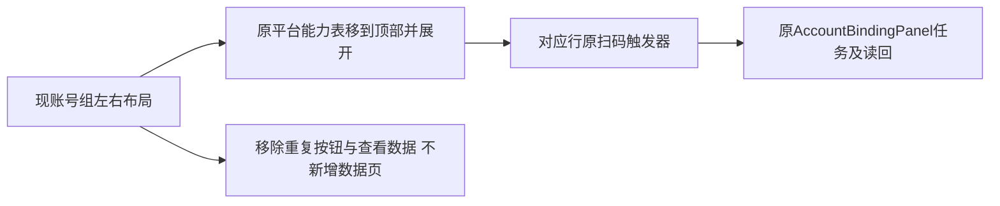

# T1370 将扫码入口合入平台能力表并移除冗余入口

## 已确认结果与当前事实

用户明确要求删除账号组页顶部五个扫码按钮及说明，把扫码直接放到原“平台能力”表对应平台行；组内每行“查看数据”和悬空“状态见账号数据”文案移除，不新建或删除既有数据页面，暂不支持的能力隐藏。该UI/IA选择已授权，无需A/B；最新要求已撤销OilUI，严格沿旧稳定页面、左右布局、tokens和标准组件，不造第二套主题。

Root已看四张用户截图，只证当时可见现象，不证绑定底层或根因；原件私有/SHA引用，不纳账号隐私图Git。只读已核实际入口在`frontend/src/features/platform-account/account-group-manager.tsx`，不是另一`platform-capability-overview.tsx`：顶部五按钮、成员“查看数据”、底部折叠能力表和原AccountBindingPanel真实存在。合同`available`表示已装配能力，不能拿当前登录/组选中状态冒平台不支持。当前未运行本任务RED或产品测试，初始版本历史保留。

大白话：平台在哪一行，就在那里扫码；去掉重复按钮和多余的数据入口，其它旧页面和真实绑定流程照常使用。

## FR1370

- **FR1370-1 同表归并**：把原底部平台能力表直接移到顶部冗余按钮区并展开，删原五按钮区、标题说明与底部重复表，不另造同义表或新版主题。
- **FR1370-2 原绑定消费**：扫码绑定单元格复用原Button触发器、每次fresh intent、原Dialog/AccountBindingPanel及focus返回；一次点击一个run，保原任务恢复/unknown/失败，不因重排重发。当前组/选中组、归档、busy等原guard保持；这些状态不等于平台不支持。
- **FR1370-3 能力真实展示**：按已返回合同动态派生行/列/项，无可用能力的列/项不显示，尤其publish/draft；某平台没有任何可用项时不展示空能力行。能力fetch未完成或失败必须保原loading/错误/重试，不能误作无能力；不硬编码平台能力或把登录状态当available。
- **FR1370-4 去冗余而保旧数据路径**：删除组内每行“查看数据”和“登录与采集状态见账号数据”等悬空指引，调整空态对真实行内入口的表述；不新造或删除原数据页面，不改业务数据/归属/已有合法管理动作。
- **FR1370-5 原完整闭环**：跨组切换、同平台多账号、一次点击一run及忙碌/失败/恢复、成功后真实账号与组成员公开readback/刷新再关窗保持；不只以mock回调、弹窗消失或按钮可点当绑定成功。
- **FR1370-6 隔离与视觉**：在Root指定独立worktree，复用T1355现合成PG/宿主/绑定harness与网络/后台禁出，两个视口1366×900和1024×680验证旧页面视觉、键盘/focus与真实扫码操作链。只有合成扫码/可信fixture，不真人新登录或collect。正执行/观察至少120秒或保更长，harness现启动/外层预算和清理余量不缩；保foreign/旧失败与channels拒绝边界。

## 精确写集与顺序

生产仅`frontend/src/features/platform-account/account-group-manager.tsx`；现组件测试仅`account-group-manager.test.tsx`；新增`frontend/tests/e2e/t1370-platform-capability-inline-binding.spec.ts`及`frontend/playwright.t1370.config.ts`复用现harness，不复制另一套。中央工件限本SPEC、`docs/verification/t1370/**`、BACKLOG/DEC/review/context/events/PROJECT与本任务机械binding。

先原组件与公共UI的实际RED，记录未归并/不支持项仍可见等原失败，再窄改至GREEN。没有当场RED不补造。原AccountBindingPanel、contract/backend/能力服务、其它capability组件/页面、T1345/T1362历史SPEC与旧harness不改；真实需要范围外变化时先具证delta独审。先正式独审/record/start及Root指定新树后才能实施，不写共享产品或三旧候选。

## AC1370

- **AC1370-1**：两视口原平台表已在顶部展开，对应行扫码可操作，顶部五按钮/说明、底部重复表、每行查看数据及悬空文案消失；已有左右结构、标准组件、内容身份和旧视觉保持，实际前后图与操作证据分列。
- **AC1370-2**：合成能力组合证明无available列/项隐藏，失败仍错误/重试、未读取仍loading，错误组/归档/busy guard不被当不支持；不含假按钮或硬编码能力。
- **AC1370-3**：公共扫码完整链证明每次fresh intent/一次run、同平台多账号与跨组隔离、原任务恢复与成功公开readback后关窗/刷新/focus；错误/unknown不伪成功，原失败保留。合成证据不冒安装旧版或真人绑定。
- **AC1370-4**：同源组件、真实双视口公共UI和适用frontend/LED047等Gate通过并独立实现审；完整用户结果闭合才taskctl complete。无Oil/explorer/评分流程，无新数据页/真实collect/登录/模型/安装/full；原全局58/childUNKNOWN与foreign9/T1255保留。
