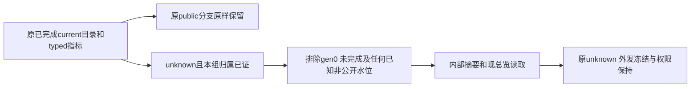

# T1371 恢复小红书已归属采集数据的内部总览摘要

## 用户目标与已核事实

用户明确小红书已绑定但创作者总览0/缺指标，要求查清原采集→保存→查询→筛选→显示并修确认缺陷。Root已看四截图，只证明可见现象；私有原件/SHA引用不纳账号隐私图Git。用户已撤销OilUI，显示层沿旧tokens/组件和稳定页面，不新建数据页或主题。

本轮同scope公开只读API已发现catalog112而groupOverview0；安装版只读诊断中11条窗内作品均有入组后available/count/lifetime真实样本，安全证据由诊断代理保全。源码已核`platform-collection.service.ts`的`readDashboardSummary/scopedWorks`要求public且两冻结字段null，将当前unknown排除。XHS parser明确未证明tab_status语义而保守产unknown，不能改成public。截图、真实只读数据、源码机制和未发生的公共RED分别记录，不从112推断全部都在指定日期或指标已归属。

旧T1356 FR1“非public不计”保为历史；本SPEC与DEC-137101明确本次最窄授权：自己已授权账号组内部摘要可计入已完成当前目录、无已知非公开历史证据、具有真实可归属typed metrics的unknown。它不代表公开发布资格，也不修改原visibility或外发隔离。

大白话：后台已经有本组的小红书数据，只因作品公开状态尚未确认就被总览全排除了。本次只让自己组的内部总览读取已核实的指标；不把“未知”改成“公开”，不放行私密、删除或外发。

## FR1371

- **FR1371-1 只改内部摘要准入**：原public且`outbound_frozen_at IS NULL`、`uncertain_visibility_at IS NULL`分支逐义保持。仅新增unknown分支：真实已完成当前catalog（实际schema `c.generation>0`、`c.completed_at IS NOT NULL`且作品generation等于当前目录），并无该user/account/platform/externalId身份的任何private/hidden/deleted tombstone，才可进入内部摘要候选。generation0/legacy_import/未完成目录不得顺带纳入；其它未知/不存在语义不扩大。
- **FR1371-2 已知非公开保护**：同一真实service链先private（优先级100）、后更新unknown（同优先级100）可能留下tombstone而当前行变unknown，不能裸ORunknown纳入。必须以该族及hidden/deleted/已知非公开水位证明仍排除；不假定commitPage总会保住旧visibility，也不修改isPrivate、commitPage/tombstone/uncertainty写入、存量visibility或外发冻结/导出发布门。
- **FR1371-3 原归属与指标口径**：保持user权限、真实组成员/历史入组退出时间、平台/账号/日期、current目录、归属唯一性/重叠拒绝、去重、同刻冲突与typed availability/unit/window及0/null语义。unknown只有真实已归属typed指标才计相应数值，不按目录数量补指标、不编假日点、不把缺失算0；原账号级指标链不受本分支扩大。
- **FR1371-4 公共RED→GREEN**：独立隔离候选先在现真实service→commitPage/保存→readDashboardSummary→groupWorkspace公开transport消费者构造完成current unknown/有归属typed指标，原产品应出现summary漏计RED；保真实退出/source与原FAIL，再只改内部准入至GREEN。不是重采集、不重POST原任务、不读写用户库；合成service调用与真实安装只读事实分证。
- **FR1371-5 显示闭环与隔离**：复用现T1356私有PG/seed/harness、合成身份及禁外网/后台，正常1366×900和最小1024×680从既有总览入口验证相同scope/筛选和真实读回值、返回刷新。不能只凭helper或mock假DTO签恢复。正执行/有限观察至少120秒或保现更长；readiness600秒、独立外层7200秒及既有更长/清理预算不缩。UI不换主题、不新增数据页。
- **FR1371-6 诚实边界**：全部旧失败与原宽receipt保留，不将旧T1356 SPEC/PASS重写；受控新行为、安装旧版只读观察和真实平台恢复分别说明。无新真人collect/登录/模型/付费/安装，channels旧site-safety边界不绕行且不扩大到本机UI只读验证；foreign9/T1255/旧树和原全局58/childUNKNOWN不动。

## 最小写集与执行顺序

生产仅`backend/src/modules/platform-collection/platform-collection.service.ts`中`readDashboardSummary`的scopedWorks准入；现真实消费者测试`backend/src/application/queries/dashboard-collected-metrics.test.ts`。新增`frontend/tests/e2e/t1371-xiaohongshu-unknown-dashboard.spec.ts`、`frontend/playwright.t1371.config.ts`及必要`docs/verification/t1371/harness/**`合成seed，复用现harness，不修改T1356旧seed/断言。中央工件本SPEC、`docs/verification/t1371/**`、BACKLOG/DEC/review/context/events/PROJECT与本任务binding。

不改parser、contract/schema/迁移、isPrivate/commitPage/外发路径、前端产品组件/页面、权限/成员算法或用户数据。范围外问题先具证delta独审；正式record/start和指定隔离树后先真实公共RED，再只在该边界修，不把诊断结案当完整恢复。

## AC1371

- **AC1371-1**：同完成current unknown+真实typed归属样本当场公共RED→GREEN，公开getGroupOverview有正确非零/真实0/缺失值，旧public分支结果原样；两个视口现总览同scope/筛选/返回刷新显示一致。
- **AC1371-2**：真实service先private后更新unknown同优先级、有任意该身份private/hidden/deleted tombstone仍排除；gen0/legacy_import/未完成目录、错误user/组、入组前/转组/重叠、窗外、无typed/不可用/冲突样本均保持原保护与口径。
- **AC1371-3**：新unknown分支不清冻结、不改visibility/tombstone/uncertainty、外发导出发布仍拒绝；同ID/source读回证明纯内部摘要变化，不把内部指标当公开资格。保护测试经真实service而非只验证SQL字符串或helper。
- **AC1371-4**：同源backend真实消费者、双视口公共UI及适用frontend/contract/boundary等Gate与独立实现审通过，Root核对完整用户结果后才complete；原fail/旧receipt与原58边界保，未运行真实采集或安装。当前冻结仅供独审，未start/测试/修产品。
