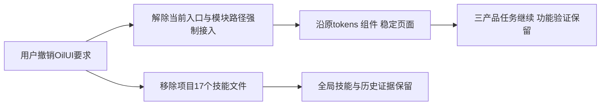

# T1372 删除项目OilUI技能与强制接入，回归既有页面风格

## 用户授权与范围

用户本轮明确纠正：“把OilUI删掉”“做页面参照我们之前的风格”“现在两套风格”。该最新授权优先覆盖AGENTS的旧Oil要求；立即停止该技能流程，不继续按其设计/审美门执行，无需再确认删除或选择A/B。

本任务仅删除本项目工具与流程配置，不改产品、安全或架构，不扩全站重设计。T1369连续导航、T1370扫码入口归并、T1371小红书数据链三个完整任务继续；页面严格沿项目已有已稳定风格，复用tokens与组件，不再引入第二套主题或视觉语言。

大白话：去掉项目里强制调用OilUI的工具和入口要求，页面照原有风格改。功能修复和真实操作验证照常执行，旧记录保留。



## 精确删除与修改清单

目录`/Users/zyongzhu/Workbase/Thirdspace-creator/.agents/skills/oil-ui-pro`已只读核实：17个Git跟踪文件，实际文件17个，无额外foreign/忽略文件，无目录内工作区改动。只删除该项目目录的以下17个文件，不触碰用户全局安装或其它技能：

```text
.agents/skills/oil-ui-pro/.gitignore
.agents/skills/oil-ui-pro/README.md
.agents/skills/oil-ui-pro/SKILL.md
.agents/skills/oil-ui-pro/assets/style-explorer.html
.agents/skills/oil-ui-pro/references/design-direction.md
.agents/skills/oil-ui-pro/references/existing-project.md
.agents/skills/oil-ui-pro/references/imagery.md
.agents/skills/oil-ui-pro/references/interaction-and-state.md
.agents/skills/oil-ui-pro/references/layout-and-viewport.md
.agents/skills/oil-ui-pro/references/media.md
.agents/skills/oil-ui-pro/references/motion.md
.agents/skills/oil-ui-pro/references/ornament.md
.agents/skills/oil-ui-pro/references/style-explorer.md
.agents/skills/oil-ui-pro/references/visual-language.md
.agents/skills/oil-ui-pro/references/visual-review.md
.agents/skills/oil-ui-pro/scripts/build_explorer.py
.agents/skills/oil-ui-pro/tests/test_build_explorer.py
```

当前入口只改：

- `AGENTS.md`旧Oil强制段：替换为用户10/19撤销OilUI、页面沿项目原有稳定风格，复用tokens/组件，禁止再引入第二套风格。保产品编排与全部适用功能规则。
- `docs/features/t1022-account-group-workspace/UI_RULES.md`前两节：删除Oil加载、其探索生成器/强制审美评分流程，保原tokens、组件、布局、状态和真实操作验收原则，以实际旧页面为基线。
- `orchestrator/process/modules.config.json`：仅机械去除所有以`.agents/skills/oil-ui-pro`为前缀的当前`read_set`、`step_read_set`、`write_set`（含对应步骤写集）引用，其它任务/路径/命令逐字语义保持；另加本任务一个配置步骤的最窄binding。
- `orchestrator/progress.json`：仅加T1372当前单配置步骤binding，以生成真实Task Packet，不伪造lease、e2e或完成标记。
- 本轮尚未冻结的新T1369/T1370/T1371 SPEC：明确用户最新撤销Oil约束，沿已有稳定页面风格；不是批改历史SPEC。历史SPEC/DEC/context/review事件的既有字节保持。
- 中央BACKLOG/本SPEC/新DEC/本任务context和事件、PROJECT及`docs/verification/t1372/**`只记实际过程与检查结果。

CLAUDE.md当前没有Oil引用，不为形式修改。若删除前出现新增foreign文件，则保留并报告，不批删。删除采用可逆Git工作区变更，当前不提交。

## FR1372与验收

- **FR1372-1 项目精确卸载**：只移除上述17个本项目文件，保全局与不相关技能、用户数据和历史证据。
- **FR1372-2 当前流程撤销**：当前AGENTS/UI_RULES不再强制加载Oil或运行其探索/评分门；其它模块当前对应前缀引用清零，保产品编排、服务契约、隔离与功能验收。Root确认T1372自身仅保留17个精确删除write_set是必要声明，不读/加载该技能、不恢复强制接入。
- **FR1372-3 既有风格为基线**：新页面工作参照原已稳定页面、现tokens/组件；不新增主题、不重设计全站。T1370原已授权入口重排继续，无需用户再次选方向。
- **AC1372-1**：目录删除与17路径清单一致、无foreign文件被删除；相关JSON可解析，精确diff/check通过。
- **AC1372-2**：当前入口与其它模块不存在Oil强制使用/前缀路径引用；T1372仅有17个精确删除write_set声明，无Oil读取路径。其它命令、任务与历史工件按声明范围保持。
- **AC1372-3**：foreign9/T1255、原业务数据/任务/三棵保留树及原全局58/childUNKNOWN等历史失败保留；报告区分本任务配置检查与未发生的产品视觉/功能验收。

纯工具/流程配置删除没有UI journey，不运行产品测试、full或新增审美门。Root已核`reviewctl.mjs:787`支持审核`—`，taskctl对无linked frontend journey的验收`—`合法，故本任务审核/验收均`—`；不借此豁免三个产品任务的适用评审与功能验证。先taskctl start、真实binding/packet后执行，完成JSON解析、精确diff/引用与保护检查，再按实际结果pmem sync/taskctl complete；不调用progress done/verify或手改flags，不安装/真实collect/登录/模型/付费，当前不commit。
