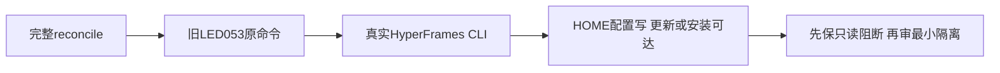

# T1373 完整对账真实CLI的执行副作用边界

## 当前事实与目标

T1370/T1371产品源码已在2d4f32e2f整合，前瞻验收控制HEAD10238309c。本次完整reconcile执行前只读核实：配置LED-053仍为`node tools/timeout-policy/verify.mjs`；reconcile在lessons循环直接`execSync(L.check)`继承环境，没有该CLI的原生隔离。hyperframes.test.mjs的真实公共CLI只传`HYPERFRAMES_TELEMETRY=0`，安装CLI识别的是`HYPERFRAMES_NO_TELEMETRY=1`，且仍有HOME/.hyperframes配置读写、顶层更新/skills查询和后台auto-install可达路径。

这是静态可达风险和当前执行授权缺口，不声称本轮已发生联网/配置写；本轮尚未启动完整reconcile，不伪造full退出或错误数量。T1368已授权单门OS隔离的174PASS只证明当时该隔离后验，不能把其包装成当前完整对账已安全隔离或洗掉665唯一full58/childUNKNOWN。

大白话：检查代码本身也可能动到用户环境；先把这种副作用封住，才能把“再检查一遍”作为安全动作执行。

## 当前范围

只登记SPEC/DEC/BACKLOG与docs/verification/t1373/**的安全预检来源、SHA和阻断事实；不start、不修改原验证器/依赖/配置/HOME，不执行真实CLI或full。不将全部完整门都假定安全或以已通过的两个产品定向链代替完整对账。

后续只有经Root核实且实际可行的最小环境边界才能执行；如需改变测试、门禁或实际执行契约，先收敛明确delta并独审，不临时关闭检查/替换receipt。当前不预定全门wrapper、放开外网/用户目录写或新框架。保原业务数据/profile、foreign9/T1255、旧树与ignored证据。

## 后续验收待冻结

按实际原命令列出用户目录、真实网络/平台、安装/模型/采集等副作用及必须本地HTTP需求，区分可复用原生关闭开关与需要OS隔离的路径。只读预检阻断或获批后的真实执行结果均保原stage/退出/完整输出；没有发生的full不补拍，原58只保原源，不签102新全局结果。具证后由Root决定最窄方案和任务适用验收类别，未审不改门或任务状态。
