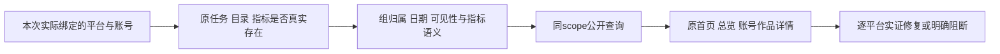

# T1374 查明并恢复所有已绑定媒体的既有数据展示

## 用户目标与事实边界

用户2026-10-19再次明确：不只是小红书，其它媒体也都缺数据，只有抖音正常。目标是逐平台查清并修复已证缺陷，让实际已绑定且已有采集事实的平台能沿原入口看到应有作品和指标；不能只做诊断就称全部恢复。平台全集以本次真实owner/组的公开绑定清单为准，不凭写死平台列表或能力表推断。抖音是同scope正对照，不预认其所有指标均正确。

已读T1356、T1362、T1371与PROJECT/PROJECT_CONTEXT：历史只读证据曾有小红书112目录、快手1目录，视频号原采集失败、公众号当时未绑；这些只约束当时事实，不能代本轮绑定/日期/任务状态。T1371已在确定源码修复完成current unknown内部摘要准入，真实后端47及双窗/strict均通过，但安装App仍2d旧源、未替换；保其完成事实，不以新反馈倒改旧PASS，也不从源码已修推断用户当前已恢复。截图/口述只能证明可见现象，不能证明首因。

大白话：先列清这次实际绑了哪些平台，分别查“有没有存下来、属于哪组哪天、页面读到了什么”，再修确定漏掉的一段；不能把没有采集成功、日期不含、未知指标和页面漏显统称成0。

## FR1374

- **FR1374-1 全部实际绑定平台**：通过现受支持公开只读口核owner/组/active账号及平台库存，逐平台逐账号列状态，抖音同scope对照。未绑定、已离组、归档、无权限与能力不支持单列，不能作为“所有平台已覆盖”的假空样本；不按名称猜身份，不读取凭据/profile。安装运行源、主树新源码及每次候选SHA分别记账。
- **FR1374-2 原数据链分层**：先按真实capability分catalog/typed与nativeReports两族，不能用一种存储形态衡量所有平台。catalog族核原采集任务真实终态/提交页/current完成目录、作品、账号级和作品级typed指标、immutable入库时间及原成员历史；微信两平台等仅原生报表能力族沿nativeReports核report kind、真实group+membershipVersion/selection、统计或发表日期、单位与accumulation，不要求或制造platform_works/typed。再核同scope平台/账号/日期查询与可见页面。只读必要投影/hash，不导出真实正文/截图/身份入Git。catalog数量不等于指标数量/值，不等于Project/Publication；原生报表无目录不是缺数证据，0、null/未知、无样本、查询错误、窗外分别表达。
- **FR1374-3 先具证后窄修**：只读诊断立即可做，不等产品修改gate；对每项实际漏失须有原始事实→服务查询→UI消费者的可复核差异，不凭模板把所有平台归成同一首因。产品修改前据因果证据补精确文件/消费者/真实RED与保护族并独审、正式record/start及隔离候选后才写；当前生产写集为空，不先扩parser/backend/frontend/contract或新建页。
- **FR1374-4 原合同保护**：复用T1356归属/日期/累计口径及T1362原作品入口、T1371已核内部unknown保护。保user权限、真实成员历史、入组半开区间、不可变ingestedAt及各来源原规则；原public分支仍保其双冻结null规则，不额外套用unknown的新限制；仅T1371新增unknown分支要求完成current/正generation并排除gen0与任意同身份tombstone。保存量visibility/冻结/外发门、最新不可用/冲突与0-null语义；不伪改unknown为public，不按目录数补数。播放/浏览/阅读/粉丝分定义，不混计；原抖音路径/项目/发布数量和日报曲线不被新增修复反杀。
- **FR1374-5 真实用户结果**：定位已证缺陷后，真实service与公开transport公共RED→GREEN先行，再用原现首页/总览/已采集作品/账号详情入口验证平台/账号/日期及返回刷新、切组保护；正常1366×900与最小1024×680同scope读回一致，沿旧tokens/组件，不造新数据页或第二主题。仅目录有数、单API成功、mock或孤立helper不能代完整恢复。只修真正受影响入口，不机械遍历无关页面。
- **FR1374-6 执行与安全边界**：无新真实collect/扫码/登录/模型/付费/安装、无重发原任务、无直接写用户业务库；channels旧site-safety拒绝保持，不经替代browser/CDP/间接口绕行。本机受支持只读服务核对不被扩大禁止。新合成验证沿现私有PG/seed/harness，背景/调度禁用，预算保正执行/观察至少120秒、原更长readiness及完整外层/清理包络；先核磁盘，Next与重门串行，不清旧证据/用户cache。T1369候选仍待用户newcycle，production04不执行；T1373 full安全预检阻断保持，本次不启动full。

## 当前精确写集与推进

中央仅本SPEC、BACKLOG T1374、DEC与后续本任务`docs/verification/t1374/**`安全证据/review/context/events/PROJECT及必要单任务binding；状态只由taskctl。只读诊断可读取现模块/公开只读口、沿来源声明的最小查询；用户数据/密钥/安装profile不复制。当前生产/测试写集待因果证据，不能借这份范围先改代码或运行未审新测试。相关基线SPEC和旧收据原字节保，不把原T1371任务重开或冒已安装。

读证据后由Root收敛真实最小delta，交独立Sol审核，再以工具真实receipt/start与隔离树执行；产品源若需改变服务契约/数据归属/安全/IA，先写DEC明确行为差异。只读诊断不以等待上述产品门为由停滞。

## AC1374

- **AC1374-1 覆盖可追溯**：本次实际owner/组的全部绑定平台/账号有逐项矩阵，含抖音对照、当前安装源与候选源、原任务/目录/指标、归属/日期、公开查询及实际入口；每项有证据或明确UNKNOWN，不能用旧快照冒当前全集。
- **AC1374-2 确认缺陷闭环**：每个确认应有而缺的指标/作品都有可定位原公共RED、最小修复、同source公共GREEN及受影响保护测试；对有相同机制的平台必须逐平台证明，不能以小红书单例外推全量。日期不含/确无指标/失败采集等真实空态或阻断须证实，不用编0补齐。
- **AC1374-3 页面与保护**：两个视口沿现实际入口平台/账号/日期/返回刷新读回正确，切组/越权/归属/0-null与原抖音正对照保护成立；原tombstone/visibility/冻结及外发隔离字段不变。未执行真实外发不得冒其E2E。
- **AC1374-4 完成边界**：独立实现审与实际写集的类型/契约/边界/受影响frontend等门齐备，Root核完整用户结果后才可complete。只完成诊断、部分平台GREEN或源码未交付不能声称全部恢复；若仍有受阻平台，任务保真实未完成/阻断及其原因，安装与真实采集缺口单列，不扩大本轮授权。全局门未执行/失败如实保并沿既有流程分类，不洗旧PASS。

本版为待独审的证据先行合同，任务尚未start；没有新产品修改或测试结果。

## 已证跨平台回归delta（DEC-137402，2026-10-19）

Root已收本轮公开fresh证据：XHS current gen10/112目录，默认窗11作品均unknown且550条5类available/count/lifetime样本入库晚于当前joined，机械最新view3379/like51/comment4/favorite81/share5；KS current gen10/1作品，在包含其真实发表日期的合法窗口仍summary0/null，30条play/like/comment样本均available/count/lifetime且入库晚于joined，最新3116/19/0、账号followers1。旧安装同scope总览仍漏，安装App两hash当场匹配2d来源。公开口不能穷尽历史tombstone/重叠membership时保UNKNOWN，不能把这些样本直接签全资格或安装恢复。video nativeReports0且原已知attempt fresh get为failed/0页/EXPORT_FAILED（非latest），独立受阻；无新采集/禁站绕行。

新源码T1371通用unknown准入已修且XHS已验，KS旧测试却是public，故本次只补跨平台实证，不制造新修复RED、不改变生产语义。复用干净`/Users/zyongzhu/.codex/worktrees/t1370-t1371-ui-data/Thirdspace-creator`的确定`10238309c46f557b0c92d9d008cb466f7974c594`与现依赖；不建新树或copy缓存。产品/契约/config/原T1355宿主/T1356 seed一律原字节，精确仅修改三个既有文件：

1. `backend/src/application/queries/dashboard-collected-metrics.test.ts`：按真实KS协议结构提交unknown→真实service/typed保存→公开groupOverview transport，覆盖合法日期/窗外、0/null、粉丝、known-tombstone及同ID可见性/冻结/源字段不变；保原XHS/public/Douyin与归属保护。不在backend引worker。
2. `docs/verification/t1371/harness/seed-unknown-dashboard.mts`：仅在新私有合成root补KS族，可import已有纯normalizer包导出，以明确合成响应走identity/page解析、两次一致完整扫描→真实service。两pass sourceSnapshotKey=null、scanPass1/2、pageIndex0、requestCursor/nextCursor=null、hasMore=false、reportedTotal为真实合成条数、原KS_WORK_SOURCE/terminal字段，确认complete/current正gen。测试装配按已核生产playCount/likeCount/commentCount/fansCnt协议映射到原typed定义；不提取/修改生产内联dict、不声称复用同一dict对象或真实采集器全程。使用如2026-09-01等明确合成合法窗外日，不复制用户作品日期/正文。
3. `frontend/tests/e2e/t1371-xiaohongshu-unknown-dashboard.spec.ts`：保原四XHS链，补现快手平台/账号/日期、原总览值/粉丝/作品入口/返回刷新、两视口，公开DTO与DOM同scope读回。本轮新增抖音原事实控制：只暴露原T1356 seed已有transferA/B scenarios，同scope DTO+DOM读回5/200及原去重/冻结归属断言；不改T1356 seed，不声称旧T1371 UI已验抖音。保0/null和权限/切组不变量，不换主题/造页。

中央仅必要SPEC/BACKLOG/DEC/review/events、本任务单step binding/packet与`docs/verification/t1374/**`安全证据。所有新运行输出独立T1374，保T1371旧收据/JSON/图/私有root：实际Playwright1.60的PLAYWRIGHT_JSON_OUTPUT_FILE优先于config outputFile，执行时须设置该绝对新results路径并同时CLI --output指定绝对新artifacts；不能只换outputDir或OUTPUT_NAME。原config不改，fresh root保持原nonce/UID/PID/loopback守卫、无真实身份/外网业务/后台。

正式delta独评/record后继续本任务已真实start的只读/回归执行，不伪第二次start或lease。固定三文件后串行：`pnpm --dir backend exec vitest run src/application/queries/dashboard-collected-metrics.test.ts src/modules/platform-collection/platform-collection.integration.test.ts --testTimeout=120000 --hookTimeout=120000 --retry=0`；现叶子`pnpm --dir ai-worker exec vitest run src/runtime/platform/kuaishou-creator-normalizer.test.ts --testTimeout=120000 --hookTimeout=120000 --retry=0`；两者释放窗后原`pnpm --dir frontend exec playwright test --config=playwright.t1371.config.ts --workers=1 --retries=0 --output=<T1374绝对新artifacts>`配上述report env。重门/Next独占，不新加短外层总timeout；动作120s、原host300s/authready600s/test每project7200s及cleanup原更长预算保，外层须覆盖两个project完整串行与启动清理。PTY观察每次≤60s，真实stdout/exit先落盘，不自动重试/修环境或洗首FAIL。

验收仅签本次确切源KS/XHS及原控制公共回归，actual当前源若无产品RED就只记新覆盖GREEN，不冒新修复RED。意外真实失败保原立即回Root，产品仍零写集，先具证delta独审；video已证无报表/采集失败仍另列受阻。此三文件回归不签所有媒体已恢复、安装恢复或T1374完成，仍须按AC1374完整用户结果判断；T1369/04待授权与T1373 full阻断不变。
