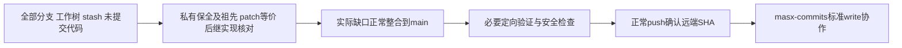

# T1375 全部现有代码整合到main、正常推送与私有仓库协作

用户明确要求“把当前所有的代码。没有合并的，全部合并，然后提交到主分支，然后给这个用户添加协作的权限，私有仓库用户名masx-commits”。本任务是既有代码维护整合，不改变既有产品方向、服务契约或验收口径，不以合并把未完成产品任务签完成。审核/验收—仅指本任务没有新增UI journey；每项实际合入代码仍需来源审计和相应验证。

大白话：先保住所有在途代码，再找出哪些真正缺在main、哪些早已用相同或更新实现合入；只补缺口，不把用户已删除的旧行为带回来。

- **FR1375-1 完整盘点/保全**：本地heads/remotes、所有worktrees（含detached）、stash与未提交代码先快照，fetch最新远程；不删除分支/旧树/原stash，不drop/pop或覆盖尚未保全工作。实际ancestor、patch等价、已被批准后继替代与真正未合代码逐类留可复核结论，不能只is-ancestor或机械apply旧备份。
- **FR1375-2 精确整合**：现repo为private的zzyong24/Thirdspace-creator，default=main。正常merge/必要精确patch整合保历史，不force/reset；冲突按当前已确认合同与后继实现解决，特别保护OilUI已删除、T1371通用unknown/T1374跨平台保护等。原foreign9/T1255中代码本次明确可纳入，但运行产物/控制缓存/raw证据不是代码，不一并stage。
- **FR1375-3 安全与验证**：不纳密钥、实际用户数据/凭据、构建产物、原始取证；私有保全只能留本机0700/0600，Git仅安全统计/哈希。按真实变更运行必要类型、针对性tests/diff/boundary；full因T1373既有危险安全预检保持不跑，不冒全绿。失败与范围外欠债如实分证。
- **FR1375-4 推送与协作**：用户已授权main提交/正常push，无需重复确认；保护规则拒绝则不绕，改正常审查PR并报告。确认远端main接收真实SHA后，交指定Sol使用正常GitHub权限API向masx-commits加标准write/push协作；已有权限/邀请先核，不额外给admin，不泄露token。
- **FR1375-5 原任务保真**：T1374⏸️、T1371已完成但未安装、T1369仍未修复等状态不因代码汇合洗成完成。用户对T1369测试夹具单次新cycle的真实授权另记DEC，本任务整合期间不启动其production04或其它争用重门；无安装/真实collect/login/模型/发布或site-safety绕行。

## 完成证据

每个分支/stash/在途集合都有合入、等价或已由后继替代/不属代码的证据，真正代码缺口已整合，原件仍在；必要验证真实退出/安全检查与远端main实际SHA可复核；协作权限或待接受邀请状态真实读回。独立只读审计实际核对，不靠改状态或空merge掩盖代码遗失。仅用taskctl迁移本任务状态，原未解决产品任务保持真相。

本任务允许唯一MAIN执行者写既有实际缺口、必要冲突解决及本SPEC/BACKLOG/DEC/events/PROJECT与docs/verification/t1375/**安全报告；GitHub协作由Root指定nav Sol串行在push后执行。先盘点再写最窄缺口，不从本任务推导新增产品功能或无限重试。
