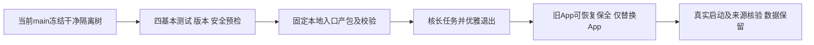

# T1376 当前main本机产包与保留数据重新安装

用户明确要求：“好的，你修复之后的，你把当前的卸载掉，重新安装一下。”本任务沿维护/本地packaging路由，将已提交main `0b823f65442701d7b4d5731cd221513a9bc7e84d` 生成本机官方包并安全替换 `/Applications/CreatorOS.app`。只替换应用，不卸载账号、激活、媒体、Application Support或Keychain数据；不等同正式双平台发布。

大白话：先把新安装包做好并验过，再短暂退出旧App、保留可恢复副本并换新。原导航及真实视频号问题没有完成的部分仍照实保留。

## 需求与边界

- **FR1376-1 冻结来源**：只纳上述已授权提交；使用`/Volumes/T7-MacData`（APFS）本次独占干净隔离冻结worktree，不将主树原12在途文件、旧raw/缓存或未提交代码带入包，不丢原件。读取旧T1365/T1359安装SPEC核既有入口/保护经验；技能3.29.0与项目版本一致，按维护BUILD/packaging及实际架构边界准备。
- **FR1376-2 固定入口与基本门**：遵循项目`packaging-creatoros-release`，核frontend/package.json、tauri.conf.json、Cargo.toml/Cargo.lock均为当前1.2.0，不自改版本；运行技能四基本测试与干净树/diff/精确HEAD/相对origin-main安全预检。只调用`CREATOROS_LOCAL_SKIP_INSTALL=1 pnpm -C frontend desktop:package-local`先产包，禁止默认自动安装器的pkill/rm。新树内`frontend/src-tauri/target/release-fast`是本次全新target，既有固定入口按此读产物；不复用旧target，不把CARGO_TARGET_DIR指到入口不消费的位置。构建子env不带Apple公证/Developer ID、Release与channel/package override输入，走原本地ad-hoc/default BUILD_ONLY=1；被默认跳过的额外smoke/TLS/硬化不冒已验。具体外层预算执行前按原链只读核定，不猜参数或缩短内部预算。
- **FR1376-3 冻结期不修代码**：产品、测试、打包脚本、workflow及生产配置原字节不改；任何真实失败原样落盘并停止该步骤，不借改断言/补门/造资源/重复重跑洗绿。单步至少120秒且保原更长预算，独立外层覆盖启动/串行/清理；不重跑T1373已知危险full。
- **FR1376-4 先产包后替换**：固定入口会写Downloads同名DMG，构建前先将现有同名旧包原字节/SHA保全至本次owned路径，不能先覆盖再备份。产物精确路径/SHA256、hdiutil verify与包内App来源/架构/签名边界核实通过后才替换安装；本地ad-hoc包不冒Apple已公证，不tag/Release/Windows构建/公开分发或生产放量。
- **FR1376-5 保留数据和旧App**：只读核当前App与归属进程/长任务，包验过后fresh核公开活动集合及既有running intelligence原ID；有真实在途、未保存风险或归属不明则不替换，不取消/延长原任务，优先等自然终态。无公开dirty接口如实UNKNOWN，只沿已授权正常quit，不点丢弃、不pkill或kill无关/后台进程。旧App以可恢复方式保全；不删除用户库、profile、激活/凭据/媒体或Keychain，不做清库卸载。备份/替换/回滚按已验证旧安装路径和实际权限核实，操作范围先落证据。
- **FR1376-6 真实验收**：核新App版本/buildSHA、实际sidecar tar/stamp及canonical文件集与本次冻结来源一致（不能仅同为1.2.0判新包）；启动预算至少300秒且沿更长原预算，Ready后连续观察至少120秒，真实启动与每点PID/Ready/同源可复核；不执行新collect/login/模型/真实外发，不绕视频号旧site-safety。T1369未修复及T1374剩余视频号阻断不因安装签完成，仅纠正安装来源实际事实。

## 验收

- **AC1376-1**：冻结树干净、HEAD精确、四处版本一致与安全预检有真实证据；主树原12文件逐hash保留。
- **AC1376-2**：四项基本测试真实命令/退出/日志留存；固定入口产包真实退出，失败不冒PASS。
- **AC1376-3**：规范安装产物SHA256/DMG校验/包内App来源检查通过，本地签名与未公证边界诚实。
- **AC1376-4**：旧App可恢复保全、无未安全处理的长任务被强杀；仅App替换，用户数据/激活/账号/媒体/Keychain保留。
- **AC1376-5**：新App真实启动/就绪及安装buildSHA核对完成；原未解决产品任务状态保持，不冒全局全绿。

写集仅本SPEC、BACKLOG/DEC/events/PROJECT等本任务必要控制与`docs/verification/t1376/**`安全证据；构建/安装产物在独占owned路径，不进Git。当前仅方案待正式独评，尚未start/构建/退出旧App或替换安装。无新产品代码或正式发布授权。
