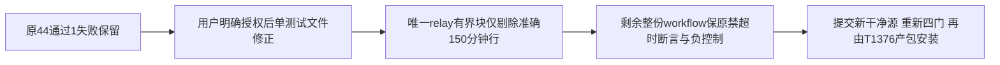

# T1377 精确收窄旧出包超时断言的单文件修正

T1376四基本门在干净0b823源实际44PASS/1FAIL：`desktop-release-workflow.test.mjs:12`对整个workflow禁止timeout-minutes，误覆盖已获批的独立`t247-private-asset-relay` job级150分钟预算。原FAIL保留，打包/安装未开始。用户现已明确答复“允许修正并继续安装”（DEC-137701），授权先退出包装冻结流程完成本单文件修正，再恢复T1376。

大白话：只让已批准的独立中转任务保留那一行150分钟，其余所有任务和步骤仍受原禁超时断言保护。

- **FR1377-1**：唯一行为写集`frontend/scripts/desktop/desktop-release-workflow.test.mjs`；不改workflow、Python原7200秒预算/CI150分钟、产品、打包入口、版本或生产配置。
- **FR1377-2**：定位jobs下唯一、精确命名且有界的`t247-private-asset-relay` block，确认唯一4空格job级`timeout-minutes: 150`；只从测试输入剔除这一行，再对整个剩余workflow执行原`not.toMatch(/^\s+timeout-minutes:/m)`。不得删除原断言或整块排除relay，缺失/重复/其它数值不静默放宽。
- **FR1377-3**：有限内存变异负控制：原5个非relay job各自注入job级timeout、build/relay子step注入timeout、relay之后新增job带timeout均拒绝；relay150声明缺失/变更/重复/移位至其它job亦拒绝。当前真实workflow为正例。同文件小定位helper与当前断言输入调整，不新增依赖/fixture，原it其它断言原样保留。原150分钟对7200秒的已审预算不变，不借测试修改其运行语义。
- **FR1377-4**：用户明确授权后才实际改文件/定向回归并独评；通过并提交后T1376使用新干净已提交源重新四基本门，原44+1FAIL永不覆盖，不跳门/重复旧结果签PASS。

**AC1377-1**：只有该测试文件与本任务必要控制文书变化，产品/workflow/入口字节未改，原12在途文件仍保全。

**AC1377-2**：实际定向测试及上述正/负控制通过，原失败及命令/退出/source/hash分别保留；不执行远端workflow/中转/产包或安装来证明测试。

**AC1377-3**：独立复核确认只准那一条已批准声明、其它job/step禁超时保护不减；形成新提交供T1376恢复。用户授权已实际确认；本SPEC不预签测试GREEN或安装结果。
