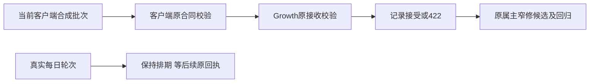

# T-1378 日轮次HTTP422与观测固定清单兼容诊断

2026-10-20定时只读复验原T-1255，安装版实际返回`OBSERVABILITY_HTTP_422`，requestId=`req-3ff833eb-8954`。原成功回执、日轮次、用途及待发1563原值见`docs/verification/t1255/desktop-agent-live/heartbeat/2026-10-20.json`。错误统一用于config/batch/log，原请求和拒绝响应正文未读取，首因未知。

操作者是本聊天已授权Agent，已有公开状态及两仓源码；结果交给Growth原接收模块属主的T-248，目标是证明并修复有证据的固定清单不兼容，而非重发客户日志。保持完整原失败、最近成功回执与数据归属。

只读取证显示客户端固定清单426个request operation，Growth424个；仅差`accounts.wechatNavigation.diagnose`与`pages.groupTrend.get`。客户端`recordOutcome`按当前本地清单保留这两项原ID，Growth`validate_batch`拒绝不在其原固定清单中的ID。本轮最多两次区分性隔离实验，使用合成UUID、固定时间及内存/临时数据，不调用生产上报接口、不读真实数据库/加密日志/凭据、不制造真实上传轮次。验证客户端原合同可接受且Growth原校验拒绝同一输入；用既有操作正控制和未知操作负控制区分机械库存缺口与放宽校验。

本任务只登记现场/实验/交接证据；不改Creator产品代码、安装包、用途、排期、模型或用户任务。Growth若实现，只在其T-248独立评审范围内更新两项受控注册清单与绑定SHA、增加准确回归；保留全部原ID、计数/时间/未知维度拒绝与幂等规则。生产发布与真实owner核验分列，不能用本地合成实验证明真实422已解决或完整诊断闭环已完成。

验收：原状态和失败完整保存；同一批次跨两端实际接受/拒绝对照；修复后本地清单相等且合法两新ID、旧ID通过，任意未知ID仍拒绝；明确原现场证据仍缺与生产未验证范围。无UI，不设页面门；不触发有用户目录/联网副作用的完整reconcile。
