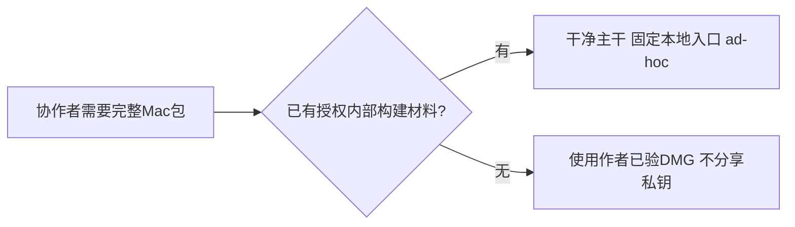

# T1379 协作者Mac本地打包条件核对与操作说明

本轮为只读咨询：核当前55841cea主干的既有本地完整包入口，纠正把Apple证书、updater签名与内部运行时签名混为一谈的说明。只登记本说明与任务事件；不构建、安装、生成/读取/分享私钥、传送文件或改产品/脚本/签名制度。T1378等在途内容保持。技能及项目均3.29.0，无升级。

大白话：本地完整包不用Apple开发者证书，也可不产自动更新包；但当前代码仍要求项目内部签名材料。只有仓库协作权限不足以在另一台Mac独立重打完整包。



## 核定事实及源码

- 本地入口`frontend/scripts/desktop/package-local.mjs:20-35,62-69`默认BUILD_ONLY=1/ad-hoc=1，但必须读取verdict双钥（环境变量或`~/.creatoros/verdict-signing.key`及`verdict-public.key`）。`package.mjs:396`仍校验双钥格式/配对。
- Apple Developer ID/p12不是本地ad-hoc必需：`tauri-signing-config.mjs:10-16`缺identity时使用`-`；未配公证凭据会跳过，见`notarize.mjs:28-57,108-113`。
- `package.mjs:452-460`缺TAURI_SIGNING_PRIVATE_KEY会关闭updater制品继续App/DMG；不应混用`desktop:release`的完整更新发布门。激活码不能替代任何构建签名材料。
- 真正的项目限制：`package.mjs:388-391,418-421`仍要求sidecar root签名；`sign-sidecar.mjs:13-27`固定已批准公根，只接受匹配私钥。默认路径`~/.config/creatoros-release/keys/creatoros-update-root-20260805.pem`或CREATOROS_UPDATE_ROOT_PRIVATE_KEY_PATH；不能临时生成替换根或unset来绕过。已签capsule入口仅Windows（package.mjs:389），不是现成Mac免私钥方案。
- `package-local.mjs:163-181`默认安装会quit/pkill并删除旧App且无备份，故先设置CREATOROS_LOCAL_SKIP_INSTALL=1（:231）只产包，验过再正常退出/备份安装。对方App是否已被删本轮未远程核验，不能推定用户库也被删。
- main实际包含T1377修正（8062921为55841cea祖先）；T1376在dedc源真实四门58PASS、完整产包exit0并成功安装122.526秒Ready。本轮没有重跑这些检查。

## 可转发步骤（具备授权内部材料时才适用）

1. 使用干净完整仓库主干，不覆盖工作区；拉取main后确认含8062921。需macOS13.5+、对应本机架构、Node25、pnpm10.32.1、Rust/Cargo stable和Xcode命令行工具/SDK；足够的新target空间及依赖下载网络。不拷作者node_modules/target/.next或用户数据。根package.json与macos-runtime-compat.mjs:22-25为Node/系统依据。
2. 在仓库根运行`pnpm install --frozen-lockfile`，包含dev依赖并保仓库onlyBuiltDependencies（pnpm-workspace.yaml）；不要用production-only安装或忽略原生依赖构建。确认内部root/verdict已有授权材料；没有则停止，使用现成包，不向作者索取私钥/密码，也不修改验证器。
3. 按packaging技能先运行四项基本测试；任何失败原样停止，不改断言/脚本洗绿：

```sh
pnpm -C frontend exec vitest run \
  scripts/desktop/package-local.test.mjs \
  scripts/desktop/desktop-release-workflow.test.mjs \
  scripts/desktop/notarize.test.mjs \
  scripts/desktop/tauri-signing-config.test.mjs
```

4. 若shell继承正式Apple公证/DeveloperID、updater或渠道覆盖，清除相应输入后调用固定入口。不存在通用“关闭签名即可绕内部根”的合法选项；保留内部材料校验。

```sh
(
  unset APPLE_SIGNING_IDENTITY APPLE_CERTIFICATE_P12_B64 APPLE_CERTIFICATE_PASSWORD
  unset APPLE_NOTARY_KEYCHAIN_PROFILE APPLE_NOTARY_KEYCHAIN_PATH APPLE_ID APPLE_TEAM_ID APPLE_APP_PASSWORD
  unset TAURI_SIGNING_PRIVATE_KEY TAURI_SIGNING_PRIVATE_KEY_PASSWORD CREATOROS_RELEASE
  unset CREATOROS_TAURI_PACKAGE_CONFIG CREATOROS_PACKAGE_IDENTITY_PATH CREATOROS_SIGNED_SIDECAR_CAPSULE_PATH
  CREATOROS_LOCAL_SKIP_INSTALL=1 CREATOROS_LOCAL_ADHOC_SIGN=1 CREATOROS_PACKAGE_BUILD_ONLY=1 \
    pnpm -C frontend desktop:package-local
)
```

这仍是生产构建的App/DMG，不是desktop:dev；BUILD_ONLY略过额外smoke/TLS/硬化，不等于所有产品行为已验。规范产物`~/Downloads/CreatorOS-1.2.0.dmg`，覆盖旧同名包前先备份；核SHA256/hdiutil verify和App签名/真实启动后再安装，不清Application Support/Keychain。

## 无内部材料时的立即可用选项

使用作者已验`CreatorOS-1.2.0.dmg`，SHA256 `7a0aa554bbfdfc43cf1afe2bee375ff4f22f755a9250c3bc44393e3c62a8e88b`。这份为Apple Silicon/aarch64、macOS13.5+本地ad-hoc包，不能当作已公证包或Intel包；传递前由用户确认机型/传递方式。本轮只提供说明，不执行传送。

验收：实际源码行已核、T1377祖先已核、可选Apple/updater与必需内部根/verdict已分开；对方环境与App存在性仍未知，不承诺其独立构建必成。生产、构建脚本、安装、业务任务、full reconcile均未执行。
