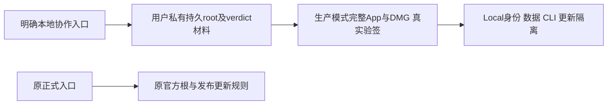

# T1380 协作者独立本地Mac完整构建

用户在T1379说明后问“这个限制能不能解除呢？”，Root明确承接为行动授权：新增独立本地协作构建模式，使用协作者自己的密钥，正式发布签名与现有更新链不变。授权记DEC-138001。基底`55841ceaf80d97f33847e8913b75c00bfa2e17d8`；技能/项目3.29.0、maintenance/4-build，先正式独审再record/start/实现。当前产品和构建代码未改。

大白话：协作者用一条命令做出“CreatorOS Local”完整App和DMG；它只信任本地自己的构建根，数据、命令和更新不串现用正式App。它仍须正常激活，不获得免费许可或官方发布权。

## 已核消费者

JS `sign-sidecar.mjs`固定根/签名域；Rust `build.rs::write_release_integrity`固化root/digest，当前只校SPKI形状；运行`lib.rs::verify_release_signature`另读固定rootID，三者须一致。verdict独立配对并按T656将seed mask/XOR编入壳，sidecar只带对应公钥。现PackageIdentity可覆盖displayName/appIdentifier/keychainService/packageRef而不改canonical ProductManifest。

真实隔离还包括：Rust appData派生DB/auth/log/runtime/workbench；backend DB优先DATABASE_URL/PGLITE_DATA_DIR，媒体默认HOME/CreatorOS/media，browserPool可被环境覆写；CLI目录只按creatoros且launcher全局，macOS license defaults域也固定。更新有前端公开manifest/download、Rust license_latest_version及Tauri插件/制品三条消费者，不能只关updater tar。

## 需求

- **FR1380-1 单一完整入口**：新增`pnpm -C frontend desktop:package-collaborator`，仅本机macOS、production Next+release-fast原完整包装链、ad-hoc；不调用desktop:dev，不因官方缺钥自动降级。默认只产独立本地产物，不quit/安装任何App、不覆盖现有Downloads/CreatorOS-1.2.0.dmg。输出名含CreatorOS Local，落本树target下独立交付目录并报告SHA。
- **FR1380-2 自有密钥与复用**：使用Node原生crypto在用户Git之外的`~/.config/creatoros-local-build/keys-v1`生成一次并持久复用root与verdict配对材料，目录0700、文件0600、核真实owner/普通文件/无symlink；原子发布整组并排斥并发，已有不完整/损坏/不匹配材料立即拒绝，不能静默轮换。root私钥不入Cargo/OUT_DIR/sidecar/包/日志/Git；verdict seed只沿既有壳mask/XOR受控编译和必要短时验证输入，不进sidecar或日志。入口不读取作者官方HOME密钥、Apple/updater凭据，收窄继承的构建/渠道/capsule/override输入；正式命令不能因继承local输入误转local。
- **FR1380-3 三段信任一致**：本地公开构建上下文只含模式/身份/public root/指纹及固定短rootID `creatoros-local-build-v1`，不含私钥；JS签名域、Rust编译验签/固化root/digest/rootID、运行解包前与后台验签均同一根。保104B envelope、BLAKE3、原128B消息限长与篡改拒绝，不改协议或关门。官方JS pin保原，Rust官方分支补精确原SPKI pin负控制；正式release/channel/local-official入口遇local上下文或开发钥拒绝，不能打成官方身份/更新。
- **FR1380-4 身份与数据隔离**：复用PackageIdentity：displayName `CreatorOS Local`、binaryName `CreatorOS`、appIdentifier `cloud.aitongban.creatoros.local`、keychainService `com.creatoros.desktop.local`、packageRef `creatoros-local`；expectedChannelRef沿原official，canonical productRef/projectKey=creatoros及license/AM/Growth验签业务规则保持。Tauri实际identifier必须匹配；仅local编译分支将DB及MEDIA_ROOT/browserPool强制落自身appData，去掉高优先DATABASE_URL/PGLITE_DATA_DIR等串库输入，不能复活通用env_clear。local license防回拨/重置defaults域独立，官方旧域保持。CLI连接/默认context不碰官方creatoros目录，使用独立local连接目录和`creatoros-local`launcher，descriptor真实产品/包校验不关；不覆盖现用creatoros命令。
- **FR1380-5 更新隔离**：local不生成/接受官方updater制品、不注册可安装官方更新的local插件；编译packageRef与公开链接为local，官方manifest/download默认不能回流。前端更新薄封装和Rust license_latest_version在本地模式返回真实“本地包请重建”说明/不可用结果，不发官方更新网络请求；复用现状态，不重构UI。正式路径保原mock更新成功负对照。
- **FR1380-6 隔离实现与真实验收**：独占T7/APFS新worktree、新target及私有HOME，从无作者root/verdict/Apple/updater密钥文件/环境的实际公开入口完成完整App/DMG；依赖仅按锁文件合法复用/准备。最终App直接在独占路径启动，不复制到/Applications；独立空数据和本地Keychain服务，允许真实停在需激活/新安装界面。不得绕license、导入正式激活/业务库、启动真实collect/login/模型或外发。编译/实际runtime信任、身份及隔离须有真实证据，不能仅helper绿。
- **FR1380-7 保护和失败事实**：保护正式App/PID及其数据/CLI，T1378/T1255、原12与T1379在途字节不纳覆盖；不动旧worktree/失败工件/官方信任根文件。预期RED与实现验证失败保原，同一已授权范围内停止该次执行后修正，不为每次失败造新授权；最终冻结后沿包装技能产包。T1373危险full保持不跑，不代签旧导航/真实平台恢复或全局全绿。

## 验收

- **AC1380-1 真实RED/GREEN**：先公共入口/真实消费者RED，后定向GREEN；覆盖无作者钥生成/复用、权限/owner/链接/部分缺失/错配/并发拒绝且原材料不变。官方+本地选路矩阵明确，不打印私钥。
- **AC1380-2 信任负控**：真实JS/Rust协议覆盖local根正确/错根/换rootID/摘要或tar/签名篡改及旁置公钥不能改已编根；官方拒local根/身份/上下文，原官方pin不弱化；local rootID完整消息不超128。原verdict配对、生产真token正确/错钥/错port/过期及production不被dev flag绕过的现受影响回归通过。
- **AC1380-3 实际隔离**：同一包装公开链断言Tauri/PackageIdentity一致、编译local标志不可被运行时env改根；注入父DB/media/pool指向官方的合成负控制仍选本地数据；Keychain/defaults/CLI命名空间与官方不同。local更新消费者无网络/无官方download，官方更新现mock对照保持。不读取正式凭据来证明隔离。
- **AC1380-4 完整产包**：候选提交/干净冻结、四处版本一致、四包装门及适用Node/Rust/前端类型/边界/diff实际通过；无作者密钥环境公开入口真实exit0，完整App/DMG hdiutil/codesign/身份/编译与runtime源一致；root私钥及明文verdict seed不入包/日志/Git。记录本地ad-hoc未公证、BUILD_ONLY略过项，不冒正式发布。
- **AC1380-5 真启动**：新local App独立PID/路径/身份启动，>=300秒启动包络保原更长，Ready后连续>=120秒；若license拦在正确激活/新安装界面，记录实际停点与sidecar/握手/资源信任完成事实，不伪造激活后业务Ready。可用原生像素才签原生视觉，无像素则未验，不用浏览器冒原生。正式App/CLI现用文件与归属前后不变；只结束本轮owned local，不杀正式/无关进程。
- **AC1380-6 收尾**：独立实现与真实证据审、pmem/实际taskctl状态、精确合入main/普通push，密钥和构建产物不入Git；明确full未运行及未验产品问题，提供协作者一条可复用命令和本地材料/输出说明。

## 精确候选写集

新建：`frontend/scripts/desktop/package-collaborator.mjs`、`package-collaborator.test.mjs`、`local-build-context.mjs`、`local-build-context.node.test.mjs`。此小模块只承载本任务私有材料/公开上下文的机械验证，禁止扩展通用配置框架。

最小修改：`frontend/package.json`；`frontend/scripts/desktop/{package.mjs,package-local.mjs,release.mjs,build-sidecar.mjs,sign-sidecar.mjs,sign-sidecar.node.test.mjs,package-local.test.mjs,startup-safety-contract.test.mjs}`；`frontend/src-tauri/{build.rs,src/lib.rs,src/license.rs,src/activation_reset.rs,src/cli_access.rs,src/release_integrity.rs}`（后者只增加真实协议负控测试，不改算法/缓冲）；`frontend/src/lib/{package-brand.ts,package-brand.test.ts,desktop-updater.ts,desktop-updater.test.ts}`。仅上述local路径/选路/编译隔离与测试，禁止业务、许可决策、通用环境硬化、Windows/CI/正式根文件/依赖锁更改。

控制：本SPEC、BACKLOG/DEC/review/events/必要PROJECT及`docs/verification/t1380/**`安全证据，`orchestrator/SYSTEM_ARCHITECTURE.md`最小追加local构建信任与资源隔离说明；现THREAT-REL-001官方root保护保持，负控对应AC1380-2/3。不生成无需要的自治step/新审美流程。

## 原执行预算

所有单次正测试/构建/探针/观察>=120秒且保更长；focused测试独立外层至少7200秒，Rust/完整构建沿实际原链最长并用86400秒外层/900秒owned清理。启动独立>=900秒，之后连续120秒观察及owned清理余量；TTL/轮询间隔不是执行总上限。实现验证与最终包装均串行，不并发第二Next/重构建；每次真实rc/stdout/stderr先保再元数据。任何需要扩大产品/许可/隔离范围的发现先具体登记，不自行越界。
